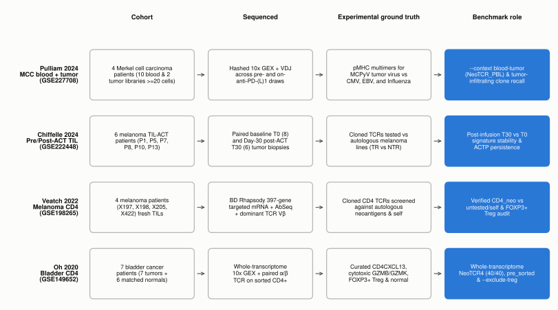
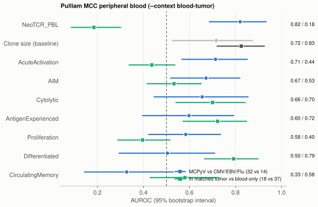
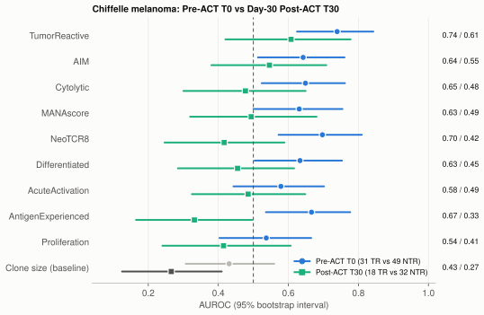
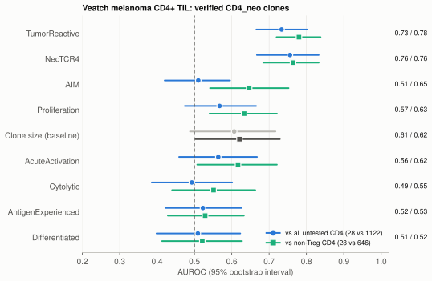
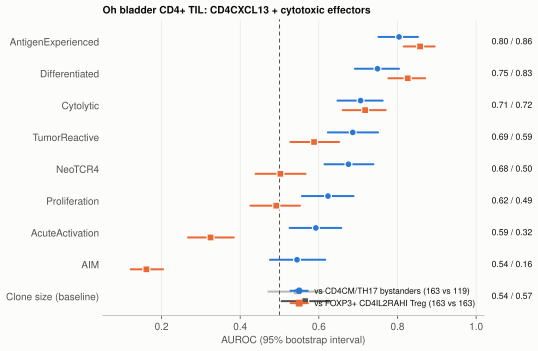
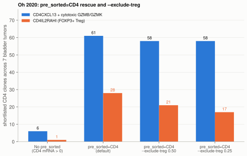
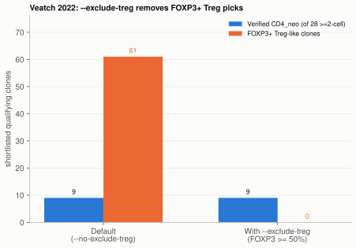

# Benchmark on paired blood-tumor, post-ACT, and CD4+ TILs

This page evaluates three settings not covered by the [solid-tumor CD8 TIL
benchmark](benchmarks.md) or the [infectious-disease blood
benchmark](benchmarks-infectious.md) (for cross-cohort and baseline comparisons,
see the [Benchmark overview](benchmarks-overview.md)):

1. **Circulating antitumor CD8+ T cells in cancer-patient blood** (`tcrsift
   prioritize --context blood-tumor`, `NeoTCR_PBL`, and blood-to-tumor clonal
   overlap).
2. **Longitudinal melanoma TIL biopsies before (`T0`) vs 30 days after (`T30`)
   adoptive cell therapy (ACT)** (`tcrsift prioritize --context solid-tumor`).
3. **Human CD4+ TIL prioritization** (`tcrsift prioritize --context solid-tumor
   --tcell-type cd4`, `NeoTCR4`, FACS `pre_sorted: CD4` coreceptor-dropout
   rescue, and `FOXP3+` regulatory T-cell exclusion via `--exclude-treg`).

## Summary

- **`NeoTCR_PBL` separates circulating polyomavirus tumor-specific CD8+ T cells
  from common antiviral memory T cells in cancer-patient blood.** Across 46
  multimer-verified peripheral-blood CD8+ clonotypes in Merkel cell carcinoma
  patients (Pulliam et al. 2024; 32 `MCPyV` antitumor vs 14 `CMV`/`EBV`/`Flu`
  control viral clones), `NeoTCR_PBL` reaches an AUROC of 0.82 (95% CI
  0.69 to 0.93; 0.83 on expanded ≥2-cell clones), ahead of general
  activation panels (`AcuteActivation` 0.71, `AIM` 0.67, `Cytolytic`
  0.66) and `CirculatingMemory` (0.33, which enriches for
  resting `CMV`/`EBV`/`Flu` memory). Against unlabeled expanded blood clones
  (21 vs 63), `NeoTCR_PBL` drops to 0.62 (0.46 to 0.77). Within the two
  patients who have sequenced matched tumor hashtag libraries (`Z1249` and
  `Z1308`; 18 tumor-shared α/β blood clones vs 37 blood-only clones),
  clones shared with the tumor biopsy are enriched for clonal
  expansion and differentiated cytolytic effector state (`clone_size` 0.83,
  `Differentiated` 0.79, `AntigenExperienced` 0.72, `Cytolytic` 0.70)
  rather than `NeoTCR_PBL` (0.18), reflecting vascular and bystander effector
  infiltration alongside antitumor clones.
- **Pre-infusion (`T0`) melanoma biopsies outperform Day-30 post-ACT (`T30`)
  biopsies for identifying tumor-reactive clones.** Across six melanoma patients
  with paired `T0` and `T30` biopsies (Chiffelle/Barras et al. 2024),
  `TumorReactive` and `NeoTCR8` separate autologous tumor-reactive (`TR`) from
  non-reactive (`NTR`) clones at `T0` (0.74 and 0.70 across 31 `TR` vs
  49 `NTR`; shortlist tested precision 62.5%, 10 `TR` of 16), and drop
  30 days after lymphodepletion, ex vivo TIL expansion, and high-dose
  IL-2 (`T30` AUROC 0.61 and 0.42 across 18 `TR` vs 32 `NTR`;
  shortlist tested precision 28.6%, 2 `TR` of 7), as systemic ACT
  shifts infused non-reactive bystander clones toward similar effector and exhausted
  states.
- **`NeoTCR4` and `TumorReactive` enrich for verified neoantigen-specific human
  CD4+ TILs, and co-select intratumoral `FOXP3+` Tregs unless `--exclude-treg` is
  enabled.** Across 28 experimentally verified neoantigen-specific CD4+ TIL
  clones in four melanoma patients (Veatch et al. 2022; 1,163 expanded Vβ
  clones on a 397-gene panel covering 9 of 40 `NeoTCR4` and 8 of 9 `TumorReactive`
  genes), `NeoTCR4` reaches 0.76 (0.67 to 0.83) and `TumorReactive` reaches
  0.73 (0.78 vs non-Treg clones). Without Treg filtering, `FOXP3+`
  regulatory clones (≥50% `FOXP3+` cells) make up 38.1% (61 of 160) of the
  shortlist; enabling `--exclude-treg` removes 100% (61 to 0) of `FOXP3+`
  Treg picks while retaining 100% (9 of 9 `CD4_neo` and 5 of 5 `CD4_self`) of
  shortlisted tumor-antigen clones. Within Patient `X205`, `CD4_neo` and
  melanoma self-antigen `CD4_self` clones (12 vs 13) share the same chronic
  activation state (`TumorReactive` 0.48, `NeoTCR4` 0.62).
- **Whole-transcriptome FACS-sorted human CD4+ 10x libraries require
  `pre_sorted: CD4` to prevent *CD4* mRNA-dropout loss and benefit from
  cytolytic and Treg-aware filtering.** Across seven bladder tumors (Oh et al.
  2020; whole-transcriptome 40 of 40 `NeoTCR4` genes), 88.5% of `CD3`-gated
  FACS-sorted CD4+ T cells have zero `CD4` UMIs (708 vs 6,144 cells
  retained); setting `pre_sorted: CD4` on the sample sheet increases shortlisted
  `CD4CXCL13` and cytotoxic (`CD4GZMB`/`CD4GZMK`) clones 10-fold (6 to 61).
  `NeoTCR4` (0.80) and `TumorReactive` (0.78) rank `CD4CXCL13`
  clones above `CD4CM`/`CD4TH17` (47 vs 119), while `AntigenExperienced`
  (0.86), `Differentiated` (0.83), and `Cytolytic` (0.72)
  separate combined `CD4CXCL13` and cytotoxic effectors from `FOXP3+`
  `CD4IL2RAHI` Tregs (where `AIM` is inverted at 0.16).

All results are from TCRsift 3.37.1 and VDJdb `2026-11-06`, generated by
`benchmarks/public_blood_cd4/` ([how to reproduce](#reproducing); full
ground-truth file and assay provenance in
`benchmarks/public_blood_cd4/PROVENANCE.md`). None of TCRsift's gene signatures
was trained on any cohort on this page.

---

## Source studies and ground-truth provenance



*Summary schematic of the four open-access human cancer cohorts evaluated on this page.*

| Study | Setting | Raw GEX & VDJ Deposit | Ground-Truth Label Source | Positives | Negatives / Contrasts | How TCRsift ran |
| --- | --- | --- | --- | --- | --- | --- |
| Pulliam et al. 2024 | Paired peripheral blood + Merkel cell carcinoma (`MCPyV`) | [GSE227708](https://www.ncbi.nlm.nih.gov/geo/query/acc.cgi?acc=GSE227708) (5 hashed 10x runs across 4 patients: 10 blood & 2 tumor libraries with ≥20 cells; 1,014 retained blood CD8 cells, 548 clones) | Table S4 (`mmc5.xlsx` multimer calls) + matched autologous tumor VDJ | `MCPyV` multimer+ blood clones (32 total, 21 ≥2 cells) and tumor-infiltrating α/β blood clones (18 total / 12 ≥2 cells in `Z1249`+`Z1308`) | `CMV`/`EBV`/`Flu` multimer+ viral control clones (14 total, 5 ≥2 cells) and unlabeled (63 ≥2 cells) or blood-only (37 in `Z1249`+`Z1308`) clones | Default `prioritize --context blood-tumor` and `--context blood` |
| Chiffelle / Barras et al. 2024 | Melanoma before (`T0`) and 30 days after (`T30`) TIL-ACT | [GSE222448](https://www.ncbi.nlm.nih.gov/geo/query/acc.cgi?acc=GSE222448) (6 patients `P1, P5, P7, P8, P10, P13`: 8 `T0` biopsies, 4,933 cells / 3,032 clones; 6 `T30` biopsies, 5,595 cells / 2,004 clones) | Table S3 (`mmc3.xlsx`, autologous melanoma reactivity `yes` vs `no` and `ACTP` expansion) | Autologous tumor-reactive `TR` clones (31 at `T0`, 18 at `T30`) | Autologous tumor-non-reactive `NTR` clones (49 at `T0`, 32 at `T30`) | Default `prioritize --context solid-tumor` at `T0` and `T30` |
| Veatch et al. 2022 | Melanoma intratumoral CD4+ TILs | [GSE198265](https://www.ncbi.nlm.nih.gov/geo/query/acc.cgi?acc=GSE198265) (4 patients `X197, X198, X205, X422`; 397-gene BD Rhapsody mRNA + AbSeq + TCR Vβ; 9,705 CD4 cells, 5,121 clones) | Deposited VDJ annotations (`CD4_neo` / `Neoantigen` and `CD4_self` from autologous APC screening) | Verified neoantigen-specific `CD4_neo` clones (28 ≥2 cells) | Unlabeled ≥2-cell CD4 TILs (1,122 total; 646 non-Treg) and `X205` self-antigen `CD4_self` (13 clones) | `score_by_name`, `calibrate_signature_background`, `signature_pass_mask`, and `select_round_robin` (`cd4`) |
| Oh et al. 2020 | Bladder cancer + matched normal sorted CD4+ T cells | [GSE149652](https://www.ncbi.nlm.nih.gov/geo/query/acc.cgi?acc=GSE149652) (7 tumors + 6 matched normals; whole-transcriptome 10x GEX + paired α/β TCR; 6,144 retained tumor CD4 cells, 4,755 clones) | Author `cellinfo` subtypes (`CD4CXCL13`, `CD4GZMB`, `CD4GZMK`, `CD4IL2RAHI`, `CD4CM`, `CD4TH17`) + matched normal VDJ | `CD4CXCL13` (47) + cytotoxic `CD4GZMB`/`CD4GZMK` (116; 163 combined ≥2-cell clones) and tumor-exclusive clones (272) | `CD4CM`/`CD4TH17` bystanders (119), `FOXP3+` `CD4IL2RAHI` Tregs (163), and normal-shared clones (22) | Default `prioritize --context solid-tumor --tcell-type cd4` |

---

## 1. Cancer-patient peripheral blood (`--context blood-tumor`) and post-ACT TIL (`T30`)

### 1a. Pulliam 2024: `MCPyV` antitumor vs `CMV`/`EBV`/`Flu` viral T cells in blood

Pulliam et al. ([*Cell Reports Medicine* 2024](https://doi.org/10.1016/j.xcrm.2024.101412))
profiled longitudinal peripheral blood and tumors from Merkel cell carcinoma
patients treated with anti-PD-(L)1, identifying T cells specific for the
oncogenic Merkel cell polyomavirus (`MCPyV`) alongside bystander `CMV`, `EBV`,
and `Influenza` T cells in the same blood draws (Table S4). Demultiplexing all
five hashed 10x runs (`Z1210`, `Z1249`, `Z1308`, `Z1493`, `Z1493B`) recovers 10
peripheral-blood hashtag libraries (≥20 cells) and 2 matched tumor
libraries (`Z1249` `TD6222` and `Z1308` `TD7000`).



*Clone-level AUROC (95% bootstrap CI) in Pulliam 2024 Merkel cell carcinoma peripheral blood comparing `MCPyV` antitumor vs `CMV`/`EBV`/`Flu` viral control clones (32 vs 14) and matched-tumor α/β clones vs blood-only clones in `Z1249` and `Z1308` (18 vs 37).*

| Signature | `MCPyV` vs `CMV`/`EBV`/`Flu` (all 32 vs 14) | `MCPyV` vs `CMV`/`EBV`/`Flu` (≥2 cells, 21 vs 5) | `MCPyV` vs untested blood (≥2 cells, 21 vs 63) | Matched-tumor α/β vs blood-only in `Z1249`+`Z1308` (18 vs 37) |
| --- | --- | --- | --- | --- |
| `NeoTCR_PBL` | 0.82 (0.69–0.93) | 0.83 (0.63–0.97) | 0.62 (0.46–0.77) | 0.18 (0.09–0.30) |
| `AcuteActivation` | 0.71 (0.57–0.85) | 0.63 (0.42–0.83) | 0.57 (0.38–0.75) | 0.44 (0.34–0.54) |
| `AIM` | 0.67 (0.52–0.82) | 0.65 (0.44–0.84) | 0.47 (0.30–0.64) | 0.53 (0.42–0.65) |
| `Cytolytic` | 0.66 (0.45–0.85) | 0.79 (0.55–0.96) | 0.47 (0.34–0.60) | 0.70 (0.54–0.84) |
| `AntigenExperienced` | 0.60 (0.40–0.79) | 0.77 (0.57–0.93) | 0.46 (0.32–0.60) | 0.72 (0.57–0.85) |
| `Proliferation` | 0.58 (0.42–0.74) | 0.40 (0.20–0.61) | 0.54 (0.36–0.72) | 0.40 (0.29–0.52) |
| `Differentiated` | 0.50 (0.29–0.71) | 0.68 (0.47–0.87) | 0.37 (0.25–0.51) | 0.79 (0.67–0.90) |
| `CirculatingMemory` | 0.33 (0.14–0.53) | 0.18 (0.00–0.43) | 0.32 (0.20–0.45) | 0.58 (0.43–0.73) |
| Clone size | 0.72 (0.53–0.87) | 0.51 (0.23–0.78) | 0.33 (0.19–0.49) | 0.83 (0.72–0.93) |

- **`NeoTCR_PBL` generalizes out-of-cohort to virus-driven solid-tumor blood.**
  Although Yossef et al. 2023 derived `NeoTCR_PBL` from mutated neoantigen-reactive
  CD8+ PBLs in epithelial cancers, it reaches 0.82 AUROC (0.83 on
  expanded clones) separating circulating `MCPyV` T-antigen-specific clones from
  `CMV`/`EBV`/`Flu` memory clones in the same patients, whereas in excised MCC
  tumors ([TIL benchmark](benchmarks.md)) `MCPyV` TILs did not separate from
  unlabeled TILs (`TumorReactive` 0.58 on 5 clones).
- **Why tumor overlap (`in_matched_tumor_ab`) enriches for cytolytic
  effectors (0.79 `Differentiated`) rather than `NeoTCR_PBL` (0.18).**
  Restricting to the two patients with sequenced tumor hashtag libraries (`Z1249`
  and `Z1308`, 18 tumor-shared vs 37 blood-only clones), blood clones that
  also appear in the resected tumor biopsy are expanded and
  differentiated (`clone_size` 0.83, `Differentiated` 0.79,
  `AntigenExperienced` 0.72, `Cytolytic` 0.70; at ≥2 cells across 12
  vs 2 clones, `Differentiated` is 0.79 and `NeoTCR_PBL` 0.46). However,
  presence in a resected biopsy includes vascular and bystander memory T
  cells (`Z1308` blood contains 4 `CMV` clones and 0 `MCPyV` clones), which
  express `GZMB`/`PRF1` rather than `NeoTCR_PBL`. Combining Tier-1 `NeoTCR_PBL`
  with Tier-2 effector panels in default `--context blood-tumor` shortlists 18
  candidates across all four patients, capturing 3 of 21 expanded `MCPyV` clones
  (2 of 21 under `--context blood`) and 4 of 12 (33%) expanded tumor-infiltrating
  α/β clones (1 control viral).

### 1b. Chiffelle 2024: baseline `T0` vs Day-30 post-ACT `T30` melanoma biopsies

In six melanoma TIL-ACT patients (`P1, P5, P7, P8, P10, P13`) biopsied both
before therapy (`T0`) and 30 days after adoptive TIL transfer (`T30`), 16 of
18 `TR` clones and 27 of 32 `NTR` clones detected at `T30` persisted from
`T0`:



*Clone-level AUROC (95% bootstrap CI) separating autologous tumor-reactive (`TR`) from non-reactive (`NTR`) CD8+ clones in paired pre-ACT baseline (`T0`, 31 vs 49) and Day-30 post-ACT (`T30`, 18 vs 32) melanoma biopsies.*

| Timepoint | Retained CD8 cells | Scored clones (≥2 cells) | `TR` vs `NTR` scored | `TumorReactive` AUROC | `NeoTCR8` AUROC | Shortlisted (`TR` / `NTR` / precision) |
| --- | --- | --- | --- | --- | --- | --- |
| `T0` (pre-ACT baseline) | 4,933 | 3,032 (620) | 31 vs 49 | 0.74 (0.62–0.84) | 0.70 (0.57–0.81) | 118 (10 `TR`, 6 `NTR`, 62.5%) |
| `T30` (Day 30 post-ACT) | 5,595 | 2,004 (484) | 18 vs 32 | 0.61 (0.42–0.78) | 0.42 (0.25–0.59) | 87 (2 `TR`, 5 `NTR`, 28.6%) |

Ex vivo TIL expansion followed by lymphodepleting chemotherapy and high-dose
IL-2 compresses the transcriptional contrast between tumor-reactive and non-reactive
clones in post-transfer biopsies. `tcrsift prioritize --context solid-tumor`
should therefore be run on pre-ACT baseline (`T0`) tumor biopsies rather
than early post-ACT (`T30`) biopsies.

---

## 2. Human CD4+ TIL prioritization (`--tcell-type cd4`, `NeoTCR4`, and Treg overlap)



*Clone-level AUROC (95% bootstrap CI) for verified neoantigen-specific `CD4_neo` clones in Veatch 2022 melanoma TILs against all untested CD4 clones (28 vs 1,122) and against non-Treg untested CD4 clones (28 vs 646).*



*Clone-level AUROC (95% bootstrap CI) in Oh 2020 bladder cancer CD4+ TILs separating `CD4CXCL13` and cytotoxic `CD4GZMB`/`CD4GZMK` effectors (163 clones) from `CD4CM`/`CD4TH17` bystanders (119) and from `FOXP3+` `CD4IL2RAHI` Tregs (163).*

| Signature | Veatch `CD4_neo` vs all untested (28 vs 1,122) | Veatch `CD4_neo` vs non-Treg (28 vs 646) | Oh `CD4CXCL13` vs `CD4CM`/`TH17` (47 vs 119) | Oh `CD4CXCL13` + `GZMB`/`GZMK` vs `CD4CM`/`TH17` (163 vs 119) | Oh effectors vs `FOXP3+` `CD4IL2RAHI` Treg (163 vs 163) |
| --- | --- | --- | --- | --- | --- |
| `NeoTCR4` | 0.76 (0.67–0.83) | 0.76 (0.68–0.83) | 0.80 (0.72–0.87) | 0.68 (0.61–0.74) | 0.50 (0.44–0.57) |
| `TumorReactive` | 0.73 (0.67–0.80) | 0.78 (0.72–0.84) | 0.78 (0.71–0.85) | 0.69 (0.62–0.75) | 0.59 (0.53–0.65) |
| `AntigenExperienced` | 0.52 (0.42–0.63) | 0.53 (0.43–0.63) | 0.60 (0.50–0.69) | 0.80 (0.75–0.85) | 0.86 (0.82–0.89) |
| `Differentiated` | 0.51 (0.40–0.62) | 0.52 (0.41–0.63) | 0.50 (0.40–0.60) | 0.75 (0.69–0.80) | 0.83 (0.78–0.87) |
| `Cytolytic` | 0.49 (0.39–0.60) | 0.55 (0.44–0.66) | 0.49 (0.39–0.58) | 0.71 (0.65–0.76) | 0.72 (0.66–0.77) |
| `Proliferation` | 0.57 (0.47–0.67) | 0.63 (0.54–0.72) | 0.66 (0.57–0.74) | 0.62 (0.56–0.69) | 0.49 (0.43–0.55) |
| `AcuteActivation` | 0.56 (0.46–0.67) | 0.62 (0.51–0.72) | 0.54 (0.45–0.63) | 0.59 (0.53–0.66) | 0.32 (0.27–0.38) |
| `AIM` | 0.51 (0.42–0.60) | 0.65 (0.54–0.75) | 0.59 (0.50–0.67) | 0.54 (0.48–0.62) | 0.16 (0.12–0.20) |
| Clone size | 0.61 (0.49–0.72) | 0.62 (0.50–0.73) | 0.41 (0.32–0.51) | 0.54 (0.47–0.61) | 0.57 (0.51–0.63) |

### Two complementary human CD4+ antitumor states and the Treg confounder

1. **`CXCL13+` helper/exhausted CD4+ TILs vs cytotoxic `GZMB+/GZMK+` CD4+ TILs.**
   In melanoma (Veatch 2022), experimentally verified neoantigen-reactive
   `CD4_neo` clones (`BRAF` V600E, `ERAP1`, `SNRPB`, `HTATSF1`, `ITGB5`) reside
   primarily in the `CXCL13+ PDCD1+ ENTPD1+` follicular-helper/exhausted
   compartment rather than a `PRF1/GZMB` cytolytic state (`NeoTCR4` 0.76,
   `TumorReactive` 0.73–0.78, vs `Cytolytic` 0.49–0.55). In
   human bladder cancer (Oh 2020, whole-transcriptome 40 of 40 `NeoTCR4`
   genes), tumor-reactive CD4+ TILs span both `CD4CXCL13` (`NeoTCR4` 0.80,
   `TumorReactive` 0.78) and MHC-II-restricted
   `CD4GZMB`/`CD4GZMK` cytotoxic clones (`AntigenExperienced` 0.80,
   `Differentiated` 0.75, `Cytolytic` 0.71). Including both Tier-1
   (`NeoTCR4`, `TumorReactive`) and Tier-2 (`Differentiated`,
   `AntigenExperienced`, `Cytolytic`) signatures in `--context solid-tumor
   --tcell-type cd4` captures both compartments (61 shortlisted effector
   clones: 7 `CD4CXCL13` and 54 `CD4GZMB`/`CD4GZMK`, vs 3 normal-shared
   clones).
2. **Why intratumoral `FOXP3+` Tregs contaminate naive CD4 shortlists.**
   Intratumoral Tregs (`CD4IL2RAHI`) constitutively express `ENTPD1`, `CTLA4`,
   `TIGIT`, `TNFRSF9` (4-1BB), and `TNFRSF4` (OX40), scoring higher than
   effector CD4+ TILs on `AIM` (AUROC 0.16) and `AcuteActivation` (0.32) and
   matching them on `NeoTCR4` (0.50).



*Shortlisted effector (`CD4CXCL13` + `CD4GZMB`/`CD4GZMK`) and `CD4IL2RAHI` Treg clone counts across seven Oh 2020 bladder tumors with and without `pre_sorted: CD4` and `--exclude-treg`.*



*Shortlisted verified `CD4_neo` and `FOXP3+` Treg-like clone counts in Veatch 2022 melanoma CD4+ TILs before and after enabling `--exclude-treg`.*

| Cohort & run configuration | Retained CD4 cells | Expanded (≥2-cell) clones | Total shortlisted | Target effector / `CD4_neo` shortlisted | `FOXP3+` Treg (`CD4IL2RAHI`) shortlisted |
| --- | --- | --- | --- | --- | --- |
| Oh 2020, without `pre_sorted: CD4` (`CD4` mRNA > 0 only) | 708 | 44 | 7 | 6 (1 `CXCL13`, 5 `GZMB/K`) | 1 |
| Oh 2020, `pre_sorted: CD4` (default `--no-exclude-treg`) | 6,144 | 544 | 103 | 61 (7 `CXCL13`, 54 `GZMB/K`) | 28 (27.2%) |
| Oh 2020, `pre_sorted: CD4 --exclude-treg` (0.50 default) | 6,144 | 544 | 93 | 58 (6 `CXCL13`, 52 `GZMB/K`) | 21 (22.6%) |
| Oh 2020, `pre_sorted: CD4 --exclude-treg --treg-foxp3-fraction 0.25` | 6,144 | 544 | 88 | 58 (6 `CXCL13`, 52 `GZMB/K`) | 17 (19.3%) |
| Veatch 2022, default (`--no-exclude-treg`) | 9,705 | 1,163 | 160 | 9 `CD4_neo` + 5 `CD4_self` | 61 (38.1%) |
| Veatch 2022, `--exclude-treg` (0.50 default) | 9,705 | 1,163 | 99 | 9 `CD4_neo` + 5 `CD4_self` | 0 (0.0%) |

- **Recommendations for human CD4+ runs:**
  1. Set `pre_sorted: CD4` on sample-sheet rows derived from FACS-sorted
     CD4+ T cells so *CD4* mRNA dropout (81.4%–96.5% zero-UMI rate across the
     13 libraries in Oh 2020; 88.5% overall) does not discard ~90% of sequenced
     cells.
  2. Pass `--exclude-treg` when screening for helper or cytotoxic antitumor CD4+
     TCRs (`--treg-foxp3-fraction 0.5` preserves 28 of 28 verified `CD4_neo`
     clones in Veatch 2022; `--treg-foxp3-fraction 0.25` removes additional
     low-depth Treg clones in shallow 10x libraries).

---

## Limitations

- **Small labeled blood sample size in Pulliam 2024.** Although 10 blood hashtag
  libraries are scored, only 32 `MCPyV` and 14 `CMV`/`EBV`/`Flu` clones from
  Table S4 appear in the blood repertoire (21 vs 5 at ≥2 cells), and
  matched tumor hashtag libraries were recovered in two of the four
  patients (`Z1249` and `Z1308`).
- **Targeted 397-gene mRNA panel in Veatch 2022.** BD Rhapsody's targeted immune
  panel measures 9 of 40 `NeoTCR4` genes and 8 of 9 `TumorReactive` genes and
  reports dominant Vβ chains without paired Vα sequences; whole-transcriptome
  paired α/β `NeoTCR4` (40 of 40 genes) is therefore complemented by Oh et al.
  2020, whose labels reflect curated transcriptional states and normal-tissue
  sharing rather than individual neoantigen TCR cloning.
- **Unvalidated context presets.** With `solid-tumor`, `blood`, `blood-tumor`,
  `--tcell-type cd4`, and `--species mouse` benchmarked across public cohorts, only the
  exploratory `mpe` (malignant pleural effusion) and `heme` (hematologic
  malignancy) presets remain untested against ground-truth specificity labels.

---

## Reproducing

```bash
tcrsift data download --db vdjdb
python benchmarks/public_blood_cd4/download.py --data-dir /tmp/tcrsift_bench_blood_cd4
python benchmarks/public_blood_cd4/run.py \
    --data-dir /tmp/tcrsift_bench_blood_cd4 \
    --work-dir /tmp/tcrsift_bench_blood_cd4/runs
python docs/figures/make_blood_cd4_benchmark_figures.py
```

## Sources

- Pulliam T, Jani S, Jing L, et al. [Circulating cancer-specific CD8 T cell
  frequency is associated with response to PD-1 blockade in Merkel cell
  carcinoma](https://doi.org/10.1016/j.xcrm.2024.101412). *Cell Rep Med* 2024
  ([GSE227708](https://www.ncbi.nlm.nih.gov/geo/query/acc.cgi?acc=GSE227708);
  `PMID:38340723`).
- Chiffelle J, Barras D, Pétremand R, et al. [Tumor-reactive T cell clonotype
  dynamics underlying clinical response to TIL therapy in
  melanoma](https://doi.org/10.1016/j.immuni.2024.08.014). *Immunity* 2024
  ([GSE222448](https://www.ncbi.nlm.nih.gov/geo/query/acc.cgi?acc=GSE222448);
  `PMID:39321802`).
- Veatch JR, Lee SM, Shasha C, et al. [Neoantigen-specific CD4+ T cells in human
  melanoma have diverse differentiation states and correlate with CD8+ T cell,
  macrophage, and B cell
  function](https://doi.org/10.1016/j.ccell.2022.03.006). *Cancer Cell* 2022
  ([GSE198265](https://www.ncbi.nlm.nih.gov/geo/query/acc.cgi?acc=GSE198265);
  `PMID:35413271`).
- Oh DY, Kwek SS, Raju SS, et al. [Intratumoral CD4+ T cells mediate anti-tumor
  cytotoxicity in human bladder
  cancer](https://doi.org/10.1016/j.cell.2020.05.017). *Cell* 2020
  ([GSE149652](https://www.ncbi.nlm.nih.gov/geo/query/acc.cgi?acc=GSE149652);
  `PMID:32497499`).
- Yossef R, Krishna S, Sindiri S, et al. [Phenotypic signatures of circulating
  neoantigen-reactive CD8+ T cells in patients with metastatic
  cancers](https://doi.org/10.1016/j.ccell.2023.10.012). *Cancer Cell* 2023
  (`NeoTCR_PBL`).
- Lowery FJ, Krishna S, Yossef R, et al. [Molecular signatures of antitumor
  neoantigen-reactive T cells from metastatic human
  cancers](https://doi.org/10.1126/science.abl5447). *Science* 2022
  (`NeoTCR4`, `NeoTCR8`).
