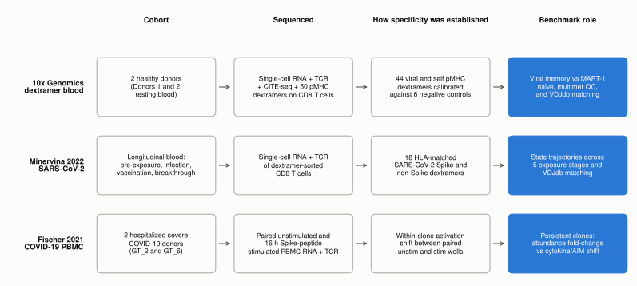
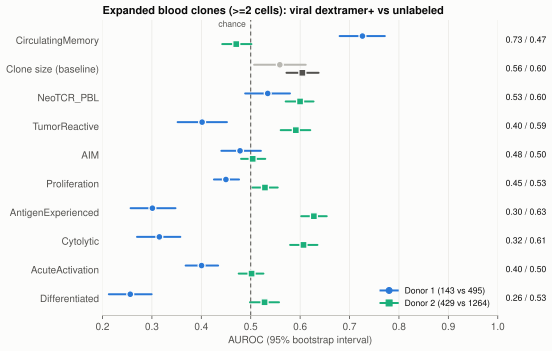
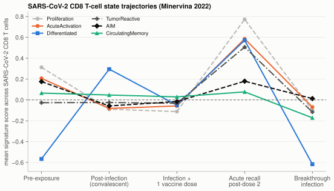
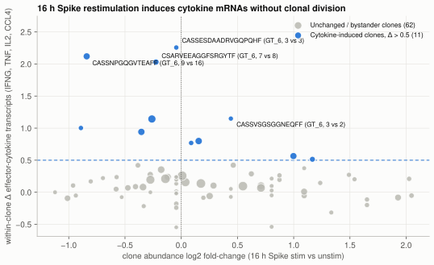
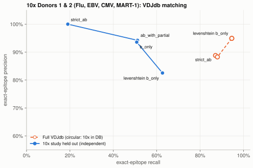
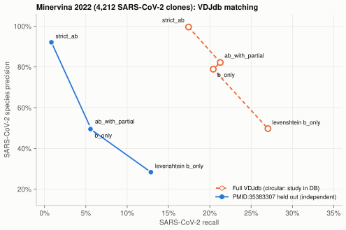

# Benchmark on infectious disease and blood

This page evaluates TCRsift outside solid tumors: peripheral-blood signature
ranking and shortlisting (`tcrsift prioritize --context blood`), public TCR
database matching (`tcrsift annotate`), pMHC multimer feature-barcode calling
(`tcrsift.multimer`), and paired peptide-restimulation scoring
(`score_stimulation_response`). It covers three public human cohorts spanning
Influenza A, Epstein–Barr virus (EBV), cytomegalovirus (CMV), SARS-CoV-2, and
naive self-antigen (`MART-1`, encoded by *MLANA*) T cells across resting blood,
longitudinal vaccination, and overnight peptide stimulation (see also the
[Benchmark overview](benchmarks-overview.md)).

## Summary

- **In resting blood, differentiation signatures separate viral memory from
  naive precursors, but not one expanded memory clone from another.** Across
  all clones (≥1 cell) in 10x Genomics Donors 1 and 2, `Differentiated`
  reaches an AUROC of 0.84 and 0.94 and `AntigenExperienced` reaches
  0.83 and 0.92 when separating Influenza, EBV, and CMV memory clones
  from naive `MART-1` (`ELAGIGILTV`) clones. Once restricted to expanded blood
  clones (≥2 cells), unlabeled expanded clones are themselves memory T cells
  against unpanelled antigens, so scores reflect memory subtype rather than
  antigen specificity (`CirculatingMemory` 0.65 and 0.61 for cleared
  Influenza M1 vs latent EBV; `AIM` and `Proliferation` 0.45 to 0.53 vs
  unlabeled expanded clones).
- **Default `--context blood` cutoffs select a compact effector and memory shortlist
  and exclude naive `MART-1` clones.** Running `tcrsift prioritize --context
  blood` (`--min-cells 2`) qualifies 55 of 743 expanded clones in Donor 1
  (15 of 143 viral, 0 of 1 expanded `MART-1`, 39 of 495 unlabeled memory, plus
  1 of 89 sticky `KLGGALQAK` clones) and 51 of 1,829 expanded clones in
  Donor 2 (21 of 429 viral, 30 of 1,264 unlabeled).
  Enabling `--exclude-known-viral` against study-held-out VDJdb removes 78% (7 of 9)
  of shortlisted Influenza M1 clones in Donor 1 while preserving 100%
  (39 of 39 and 30 of 30) of unlabeled expanded clones under `prioritize`'s
  default `--database-match strict_ab`.
- **Transient activation and tumor-reactivity modules rise during acute
  vaccine recall in blood.** Across 10,484 paired-TCR SARS-CoV-2-specific CD8 T
  cells profiled longitudinally by Minervina et al. 2022, `Proliferation`,
  `AcuteActivation`, and `TumorReactive` sit near baseline in convalescent blood
  (−0.09, −0.08, −0.02) and peak after the second mRNA vaccine
  dose (+0.77, +0.59, +0.51; `TumorReactive` AUROC 0.74 for acute
  post-dose-2 vs convalescent clones). In blood draws collected near vaccination
  or acute infection, `TumorReactive` therefore captures recently restimulated
  viral T cells alongside tumor-reactive clones.
- **Overnight (16 h) peptide restimulation requires within-clone transcriptional
  delta rather than clonal abundance fold-change.** Across 73 persistent
  β-clonotypes sequenced in paired unstimulated and 16 h SARS-CoV-2
  Spike-stimulated CD3-gated T cells (Fischer et al. 2021), 0 of 73 clones
  pass Benjamini–Hochberg FDR < 0.05 by Fisher exact count enrichment because T
  cells do not divide multiple times overnight. Comparing expression within the
  same clone across paired wells (`score_stimulation_response`) identifies 11
  persistent clones with effector-cytokine transcript (`IFNG`, `TNF`,
  `IL2`, `CCL4`) induction (Δ > 0.5, with `ΔAIMBroad` up to +1.87) despite
  small abundance changes (`log2FC` −0.89 to +1.17).
- **Default `--database-match strict_ab` in `prioritize` prevents false-positive
  β-chain collisions on private epitopes.** Both 10x Dextramer (28,040 records) and
  Minervina 2022 (`PMID:35383307`, 891 records) are indexed in VDJdb
  (`vdjdb-2026-11-06`: 280,894 `TRB` entries, 200,180 paired α/β), inflating
  full-database recall. When each queried study is held out, `strict_ab`
  achieves 100% exact-epitope precision (44 of 44 and 65 of 65) on canonical
  Influenza/EBV/CMV clones and 92.1% SARS-CoV-2 species precision (35 of 38)
  on Minervina 2022. Relaxing to `ab_with_partial` raises recall on
  canonical epitopes (30.6% to 66.7% in Donor 1; 15.2% to 45.9% in Donor
  2) at 92.1%–99.0% precision, but on mostly private SARS-CoV-2 clones
  50.1% of `ab_with_partial` matches (237 of 473; 50.5% under `b_only`) are
  false-positive collisions with public Yellow Fever, EBV, CMV, self-antigen,
  or Influenza β chains (species precision 49.9%, dropping to 28.3% at
  Levenshtein distance 1).
- **IMGT germline V+J fallback rescues full-length constructs in 5'-truncated VDJ
  deposits.** In Fischer et al. 2021 (`GSE171037`), where 98.7%–99.7% of
  called TCR contigs terminate downstream of the V-leader start codon, 0 of
  160 paired α/β clones (137 in `GT_6`, 23 in `GT_2`) assemble in strict
  contig-only mode (`--no-germline-vdj-fallback`); default germline fallback
  against cached IMGT human `V-REGION` and `J-REGION` references rescues 160 of
  160 (100%) full-length single-chain constructs (32 rescued from 5'-partial
  contigs on both chains preserving donor framework/CDR3/FR4 codons, and 23
  with donor-contig-verified J→C junctions on both chains), setting
  `construct_contig_verified = False`.
- **Clonal concordance removes >96% of sticky pMHC multimer calls.** Single-cell
  dextramer calling calibrated against negative-control multimers matches 10x
  Genomics' published calls on 100% of jointly called single-binder cells in
  both donors, yet the promiscuous `HLA-A*03:01 KLGGALQAK` (CMV IE-1) reagent
  still tags cells inside 280 and 739 expanded clones (median within-clone
  concordance 0.24 and 0.25). Requiring ≥50% clonal concordance
  across ≥2 cells removes 96.4% and 96.1% of sticky `KLGGALQAK`
  clones while preserving 88.4%–93.6% of Influenza M1 `GILGFVFTL` clones
  (median concordance 1.00).

!!! warning "Public TCR databases contain these benchmark cohorts"
    VDJdb (`vdjdb-2026-11-06`; 280,894 `TRB` entries, 200,180 paired α/β)
    contains both the 10x Genomics 4-donor dextramer dataset (`ISSUE_289.tsv`)
    and Minervina et al. 2022 (`PMID:35383307`). Evaluating database lookup or
    `--exclude-known-viral` against full VDJdb is therefore circular:
    it measures self-retrieval rather than generalization to new donors.
    Sections 1b and 4 report study-held-out VDJdb alongside full VDJdb
    (circular, drawn hollow in orange). Only the held-out evaluations
    measure out-of-sample performance.

Cohort evaluations are from TCRsift 3.38.1 and VDJdb `2026-11-06`, generated by
`benchmarks/public_infectious/` ([how to reproduce](#reproducing); full
ground-truth file and assay documentation in
`benchmarks/public_infectious/PROVENANCE.md`).

## Source studies and ground-truth provenance



*Summary schematic of the three public single-cell cohorts evaluated on this page.*

| Study | Setting | Raw GEX & VDJ Deposit | Ground-Truth Label Source | Positives | Negatives / Contrasts | How TCRsift ran |
| --- | --- | --- | --- | --- | --- | --- |
| 10x Genomics Multiplexed Dextramer | Healthy resting blood CD8 T cells | [10x Cell Ranger 3.0.2](https://www.10xgenomics.com/datasets/cd-8-plus-t-cells-of-healthy-donor-1-1-standard-3-0-2) (`*_sc5p_v2_hs_B_T_all_feature_bc_matrix_filtered.h5` + `all_contig_annotations.csv` for Donors 1 & 2; 63,201 retained cells, 22,873 clones) | Published `binarized_matrix.csv` (44 pMHC `*_binder` calls, single-binder droplets with ≥50% clonal concordance; ≥2 binder cells for expanded-clone sets) + 6 `*_NC` negative-control multimers + TotalSeq-C CD45RA/CD45RO | Viral memory: Influenza A M1 (`GILGFVFTL`), EBV (`BMLF1`, `BZLF1`, `EBNA-3A/3B`, `LMP2A`), CMV pp65 (`NLVPMVATV`) | (A) Naive `MART-1` (`ELAGIGILTV`) precursors (142 and 19 clones; CITE-seq CD45RA+ naive); (B) unlabeled expanded (≥2 cells) blood clones (495 and 1,264); (C) Flu M1 vs EBV expanded clones | Default `prioritize --context blood`, extended `--min-cells 1` AUROC run, `tcrsift.multimer`, and `match_clonotypes` |
| Minervina et al. 2022 | Longitudinal SARS-CoV-2 infection, mRNA vaccination, and breakthrough | [Zenodo 6232103](https://zenodo.org/records/6232103) (`libs_aggregate_rev.zip`: 13,614 retained paired-TCR CD8 cells, 7,317 clones) | [`pogorely/COVID_vax_CD8`](https://github.com/pogorely/COVID_vax_CD8) (`cd8_only_dextr_rev_clean.tsv`: per-barcode curated dextramer epitope & `donor_category`) | Acute post-dose-2 vaccine recall (`inf_after_2`, 46 expanded clones) and 4,212 curated SARS-CoV-2 Spike/non-Spike clones | Disjoint resting post-infection convalescent clones (`post_inf`, 603 expanded clones; shared longitudinal clones excluded) | Default `prioritize --context blood`, `score_by_name`, and `match_clonotypes` |
| Fischer et al. 2021 | Hospitalized severe COVID-19 PBMC ± 16 h Spike peptide pool | [GSE171037](https://www.ncbi.nlm.nih.gov/geo/query/acc.cgi?acc=GSE171037) (`GSM5216975`–`GSM5216978` `.h5` + `.csv.gz` + `all_contig_annotations.json.gz`; 29,184 PBMCs, 27,113 CD3-gated T cells) | GEO sample well assignment (`GT6_unstim` vs `GT6_covid_stim`; `GT_unstim` vs `GT_covid_stim`) across 73 persistent `CDR3_beta` clones (≥2 T cells in both wells) | Persistent clones inducing effector-cytokine transcripts (`IFNG`, `TNF`, `IL2`, `CCL4` Δ > 0.5; 11 clones) after 16 h Spike peptide stimulation | Persistent bystander clones present at ≥2 T cells in both wells without cytokine or AIM shift | `load_samples`, `phenotype_cells`, `apply_cd3_gate`, and `score_stimulation_response` |

### 10x Genomics: 50-dextramer peripheral blood CD8 T cells

- **Assay and ground-truth construction.** Peripheral blood CD8 T cells from
  healthy HLA-typed donors were stained simultaneously with 44 peptide-MHC class
  I dextramers, 6 negative-control (`*_NC`) dextramers, and TotalSeq-C surface
  antibodies (CD45RA and CD45RO isoforms of *PTPRC*, plus CD3 and CD8a), then
  sequenced by 10x 5' GEX, VDJ, and Feature Barcoding (34,220 GEX-QC cells in
  Donor 1; 67,789 in Donor 2). Ground-truth clone specificity is assigned from
  10x's published `binarized_matrix.csv` when a cell binds a single pMHC reagent
  and at least 50% of cells in the paired α/β clone share that call (with at
  least two single-binder cells required in expanded ≥2-cell clone
  contrasts).
- **Why `MART-1` serves as an internal naive T-cell control.** `HLA-A*02:01`
  `MART-1` (`ELAGIGILTV`) binds a large repertoire of unprimed
  thymic naive precursors in healthy melanoma-free donors (99.3% singletons in
  Donor 1, 100% in Donor 2; CITE-seq `CLR(CD45RO) - CLR(CD45RA)` mean −2.99
  and −4.61), providing an antigen-specific naive population sequenced in
  the same library as antigen-experienced viral memory T cells. The
  promiscuous reagent `A0301_KLGGALQAK_IE-1_CMV` is excluded from ground-truth
  viral positives and analyzed separately in [section 5](#5-multiplexed-pmhc-multimers-clonal-concordance-filters-sticky-reagents).

### Minervina et al. 2022: longitudinal SARS-CoV-2 CD8 T cells

[SARS-CoV-2 antigen exposure history shapes phenotypes and specificity of
memory CD8+ T cells](https://doi.org/10.1038/s41590-022-01184-4), *Nature
Immunology* 23:781–790 (`PMID:35383307`).

- **Assay and ground-truth construction.** Donors were profiled across five
  exposure stages: pre-exposure (`naive`), convalescent post-infection
  (`post_inf`), infection plus one mRNA vaccine dose (`inf_after_1`), acute
  recall shortly after a second mRNA dose (`inf_after_2`), and breakthrough
  infection (`break`), using 18 HLA-matched DNA-barcoded SARS-CoV-2 Spike and
  non-Spike (`ORF1ab`, `N`, `M`, `ORF3a`) dextramers. Joining the aggregated
  Cell Ranger GEX + VDJ archive (`libs_aggregate_rev.zip`) to the authors'
  curated dextramer table (`cd8_only_dextr_rev_clean.tsv`) labels 4,212 scored
  paired α/β clones across 19 epitope groups, led by `A01_TTD` (`HLA-A*01:01
  TTDPSFLGRY`, 1,800 clones).

### Fischer et al. 2021: paired 16 h Spike-stimulated COVID-19 PBMC

[Single-cell RNA sequencing reveals ex vivo signatures of SARS-CoV-2-reactive T
cells through 'reverse phenotyping'](https://doi.org/10.1038/s41467-021-25548-w),
*Nature Communications* 12:4515 (`PMID:34301934`).

- **Assay and 5'-truncated VDJ provenance.** PBMCs from hospitalized severe
  COVID-19 patients (`GT_2` and `GT_6` from the Gauting cohort) were split into
  parallel unstimulated control and 16 h SARS-CoV-2 Spike peptide-pool-stimulated
  wells (`GSM5216975`–`GSM5216978`). Because 98.7%–99.7% of called TCR
  contigs in this Cell Ranger 3 deposit are 5'-incomplete (`full_length ==
  False`), Cell Ranger recorded `productive == "None"` despite complete `v_gene`
  and `j_gene` alignments and stop-free canonical `C...[FW]` CDR3 sequences
  (whereas frameshift/stop contigs carry `productive == "False"`). TCRsift
  retains validated 5'-partial contigs on load and gates PBMCs to CD3-expressing
  T cells (≥3 raw `CD3D/E/G` counts) prior to normalization so monocytes, NK
  cells, and B cells do not bias gene-expression bins.

---

## Signature provenance for `--context blood`

The `blood` preset scores seven gene signatures on CD8 T cells (`NeoTCR_PBL` and
`TumorReactive` are evaluated alongside them for comparison). None of these
signatures was derived from or fitted to any cohort on this page:

| Signature | Genes | Provenance | Independent of these cohorts? |
| --- | --- | --- | --- |
| `Differentiated` | `IFNG`, `GZMB`, `PRF1`, `GNLY`, `NKG7` up; `TCF7`, `LEF1`, `CCR7`, `SELL` down | Effector minus naive/stem contrast fixed on TCRsift's in-vitro expansion pilot ([reproducibility map](reproducibility_map.md)). | Yes |
| `AntigenExperienced` | `IFNG`, `GZMB`, `PRF1`, `GNLY`, `NKG7` | Cytotoxic effector pole of `Differentiated`. | Yes |
| `CirculatingMemory` | `GZMK`, `IL7R` up; `CCR7` down | Resting circulating effector-memory (`GZMK+` / `IL7R+`, encoding CD127) minus `CCR7+` naive contrast. | Yes |
| `Cytolytic` | `PRF1`, `GZMB` | Canonical perforin / granzyme B pair ([Caushi et al. 2021](https://doi.org/10.1038/s41586-021-03752-4), [Krishna et al. 2020](https://doi.org/10.1126/science.abb9847)). | Yes |
| `AcuteActivation` | `TNFRSF9`, `MKI67` | 4-1BB and Ki-67 recent-activation / cycling pair. | Yes |
| `AIM` / `AIMBroad` | `TNFRSF9`, `TNFRSF4` (`+ CD69, IL2RA, CD40LG` in `AIMBroad`) | Transcripts encoding surface markers used in activation-induced marker (AIM) sorting assays. | Yes |
| `Proliferation` | `MKI67` | Ki-67 cell-cycle marker alone. | Yes |
| `NeoTCR_PBL` *(comparison)* | 151 human genes | Published peripheral-blood neoantigen-reactive CD8 signature from metastatic cancer patients ([Yossef et al. 2023](https://doi.org/10.1016/j.ccell.2023.10.012); `PMID:38039963`). | Yes |
| `TumorReactive` *(comparison)* | `CXCL13`, `ENTPD1`, `PDCD1`, `LAG3`, `HAVCR2`, `TIGIT`, `TOX`, `CTLA4`, `ITGAE` | Solid-tumor chronic antigen / exhaustion panel ([Simoni et al. 2018](https://doi.org/10.1038/s41586-018-0130-2)); included here to test cross-firing during acute viral recall in blood. | Yes |

---

## Questions and results

### 1. What does `--context blood` separate in resting peripheral blood?

In solid tumors, `tcrsift prioritize` relies on chronic antigen stimulation
inside the lesion to separate tumor-reactive clones from resting bystanders. In
resting peripheral blood, T cells are not encountering cognate antigen at the
moment of venipuncture. Evaluating `prioritize --context blood` (alongside
`NeoTCR_PBL` and `TumorReactive`) across three contrasts in 10x Donors 1 and 2
shows what blood expression signatures do and do not separate:





| Contrast | Donor 1 clones (+ vs −) | Donor 2 clones (+ vs −) | `Differentiated` | `AntigenExperienced` | `CirculatingMemory` | `Cytolytic` | `AIM` | `Proliferation` | `clone_size` |
| --- | --- | --- | --- | --- | --- | --- | --- | --- | --- |
| Viral memory vs naive `MART-1` (≥1 cell) | 819 vs 142 | 1,338 vs 19 | 0.84 / 0.94 | 0.83 / 0.92 | 0.80 / 0.89 | 0.70 / 0.81 | 0.53 / 0.57 | 0.52 / 0.47 | 0.59 / 0.67 |
| Expanded viral vs unlabeled expanded (≥2 cells) | 143 vs 495 | 429 vs 1,264 | 0.26 / 0.53 | 0.30 / 0.63 | 0.73 / 0.47 | 0.32 / 0.61 | 0.48 / 0.50 | 0.45 / 0.53 | 0.56 / 0.60 |
| Influenza M1 vs EBV (≥2 cells; >0.5 favors Flu) | 118 vs 25 | 244 vs 185 | 0.58 / 0.28 | 0.58 / 0.44 | 0.65 / 0.61 | 0.65 / 0.56 | 0.43 / 0.43 | 0.37 / 0.44 | 0.41 / 0.38 |

*Values are `Donor 1 / Donor 2` AUROCs from `benchmarks/public_infectious/results/blood_signature_auroc.csv`.*

- **Antigen-experienced memory vs naive precursors (≥1 cell).** Across all
  clones, `Differentiated` (0.84, 0.94), `AntigenExperienced` (0.83,
  0.92), and `CirculatingMemory` (0.80, 0.89) separate
  Influenza, EBV, and CMV pp65 clones from `MART-1` (`ELAGIGILTV`) precursors.
  Centered log-ratio (CLR) CITE-seq profiles match the transcriptional call:
  `MART-1` clones are CD45RA-skewed (`CLR(CD45RO) - CLR(CD45RA)` mean
  −2.99 in Donor 1 and −4.61 in Donor 2; 99.3% and 100% 1-cell clones),
  whereas viral dextramer+ clones shift upward by ~4 CLR units (+0.96 and
  −0.30).
- **Expanded viral clones vs unlabeled expanded blood clones (≥2 cells).**
  Once singletons are removed (`--min-cells 2`, the `prioritize` default),
  unlabeled expanded clones in healthy blood are themselves memory/TEMRA clones
  against antigens not represented on the 44-multimer panel. Consequently,
  ranking depends on which viral memory phenotype dominates each donor:
  - **Donor 1.** Because 83% (118 of 143) of expanded viral clones target
    cleared Influenza M1 (`GILGFVFTL`), `CirculatingMemory` (`GZMK`, `IL7R` up;
    `CCR7` down) reaches 0.73, while cytotoxic TEMRA panels
    (`Differentiated` 0.26, `AntigenExperienced` 0.30, `Cytolytic`
    0.32) score below unlabeled expanded clones.
  - **Donor 2.** Because latent EBV clones make up 43% (185 of 429) of expanded
    viral clones, `AntigenExperienced` reaches 0.63 and `Cytolytic` reaches
    0.61, while `CirculatingMemory` sits at 0.47.
  - **Both resting donors.** Transient activation (`AIM` 0.48 and
    0.50, `AcuteActivation` 0.40 and 0.50) and cell-cycle
    (`Proliferation` 0.45 and 0.53) signatures do not enrich for viral
    clones.
- **Cleared respiratory virus vs latent herpesvirus.** Comparing
  expanded Influenza M1 (`GILGFVFTL`) against expanded EBV clones shows
  `CirculatingMemory` favoring Influenza M1 in both donors (0.65 and
  0.61), whereas `Differentiated` in Donor 2 (0.28, equivalent to
  0.72 in favor of EBV) and `AcuteActivation` (0.33 and 0.39) skew
  toward chronically restimulated EBV memory.

#### 1b. What passes the default `--context blood` cutoffs and enters the shortlist?

Running `tcrsift prioritize --context blood` at default settings (`--min-cells
2`, 7-signature `blood` preset, size-matched 99% background floor, 90th
percentile gate, `--max-clones 200`, and study-held-out VDJdb) shows how default
selection behaves on blood repertoires (`blood_cutoffs_and_shortlist.csv`):

| Cohort (≥2-cell clones) | Command variant (held-out VDJdb) | Total shortlisted (eligible) | Viral dextramer+ shortlisted | Influenza M1 shortlisted | EBV shortlisted | Expanded `MART-1` shortlisted | Unlabeled expanded shortlisted |
| --- | --- | --- | --- | --- | --- | --- | --- |
| 10x Donor 1 (743 clones) | Default (`--exclude-known-mart1`) | 55 (55) | 15 / 143 (10.5%) | 9 / 118 | 6 / 25 | 0 / 1 | 39 / 495 (7.9%) |
| 10x Donor 1 (743 clones) | `+ --exclude-known-viral` (default `strict_ab`) | 48 (48) | 8 / 143 (5.6%) | 2 / 118 | 6 / 25 | 0 / 1 | 39 / 495 |
| 10x Donor 1 (743 clones) | `+ --exclude-known-viral --database-match ab_with_partial` | 47 (47) | 8 / 143 (5.6%) | 2 / 118 | 6 / 25 | 0 / 1 | 38 / 495 |
| 10x Donor 2 (1,829 clones) | Default (`--exclude-known-mart1`) | 51 (51) | 21 / 429 (4.9%) | 7 / 244 | 14 / 185 | 0 / 0 | 30 / 1,264 (2.4%) |
| 10x Donor 2 (1,829 clones) | `+ --exclude-known-viral` (default `strict_ab`) | 48 (48) | 18 / 429 (4.2%) | 5 / 244 | 13 / 185 | 0 / 0 | 30 / 1,264 |
| 10x Donor 2 (1,829 clones) | `+ --exclude-known-viral --database-match ab_with_partial` | 45 (45) | 16 / 429 (3.7%) | 3 / 244 | 13 / 185 | 0 / 0 | 29 / 1,264 |
| Minervina 2022 (1,501 clones) | Default (`--exclude-known-mart1`) | 46 (46) | 46 / 1,234 (3.7%) | — | — | — | 0 / 267 |
| Minervina 2022 (1,501 clones) | `+ --exclude-known-viral` (default `strict_ab`) | 45 (45) | 45 / 1,234 (3.6%) | — | — | — | 0 / 267 |
| Minervina 2022 (1,501 clones) | `+ --exclude-known-viral --database-match ab_with_partial` | 42 (42) | 42 / 1,234 (3.4%) | — | — | — | 0 / 267 |

- **No budget saturation in single-sample blood draws.** Only 46 to 55
  clones clear the size-matched 99% background floor and 90th percentile rank
  gate per cohort, well below `--max-clones 200`, so every qualifying clone is
  selected without round-robin truncation. (In Donor 1, the single shortlisted
  clone outside the viral, `MART-1`, and unlabeled columns is 1 of 89
  expanded clones carrying sticky `KLGGALQAK_IE-1_CMV` calls.)
- **`--exclude-known-viral` removes canonical public viral clones but misses
  private viral repertoires.** On canonical Influenza M1 `GILGFVFTL` in Donor 1,
  out-of-sample `--exclude-known-viral` removes 7 of 9 shortlisted clones
  under both `strict_ab` and `ab_with_partial`. On mostly private SARS-CoV-2
  clones (Minervina 2022), held-out `strict_ab` flags only 1 of 46
  shortlisted clones (46 to 45), whereas `ab_with_partial` drops 4 (3 via
  β-only collisions with non-SARS viral entries in VDJdb).

---

### 2. How do blood signatures move across acute vaccine recall vs convalescence?

Whereas 10x Donors 1 and 2 were drawn at steady state, Minervina et al. 2022
tracks paired-TCR dextramer-sorted SARS-CoV-2 CD8 T cells (10,484 cells) from
pre-exposure through acute post-boost recall:




| Exposure stage (`donor_category`) | Paired-TCR CD8 cells | Paired clones | `Differentiated` | `CirculatingMemory` | `AcuteActivation` | `Proliferation` | `AIM` | `TumorReactive` |
| --- | --- | --- | --- | --- | --- | --- | --- | --- |
| `naive` (pre-exposure) | 566 | 384 | −0.57 | +0.07 | +0.21 | +0.31 | +0.18 | −0.03 |
| `post_inf` (convalescent) | 4,387 | 1,877 | +0.29 | +0.05 | −0.08 | −0.09 | −0.06 | −0.02 |
| `inf_after_1` (infection + 1 dose) | 2,393 | 1,087 | −0.05 | +0.03 | −0.06 | −0.11 | −0.02 | −0.03 |
| `inf_after_2` (acute post-dose 2) | 911 | 157 | +0.57 | +0.08 | +0.59 | +0.77 | +0.18 | +0.51 |
| `break` (breakthrough cohort) | 2,227 | 1,328 | −0.62 | −0.17 | −0.07 | −0.10 | +0.01 | −0.12 |

- **Transient effector burst after booster vaccination.** `Proliferation`
  (+0.77), `AcuteActivation` (+0.59), `Differentiated` (+0.57), and `AIM`
  (+0.18) rise in the `inf_after_2` window and return to baseline in
  convalescent (`post_inf`) and later breakthrough (`break`) draws.
- **Cross-firing of `TumorReactive` on acute viral recall.** Across disjoint
  expanded clones (≥2 cells; 46 acute post-dose-2 vs 603 convalescent),
  `TumorReactive` separates acutely boosted SARS-CoV-2 clones from resting
  convalescent SARS-CoV-2 clones with an AUROC of 0.74 (95% CI 0.65 to
  0.81), ahead of `AcuteActivation` (0.64), `Differentiated` (0.63),
  and `Proliferation` (0.62). When prioritizing tumor-reactive clones from
  blood (`--context blood` or `blood-tumor`), recent vaccination or acute
  respiratory infection will therefore elevate non-tumor viral clones on
  activation and exhaustion lists unless matched tumor overlap or
  `--exclude-known-viral` is applied.

---

### 3. Overnight peptide restimulation: abundance fold-change vs transcriptional shift

In multi-week peptide expansion cultures (`tcrsift run`), antigen-reactive T
cells divide many times and dominate clone-frequency rankings. In overnight
(16–24 h) activation-induced marker (AIM) or cytokine-transcript scRNA
restimulations, T cells transcribe effector mRNAs without dividing. After gating
PBMCs to CD3-expressing T cells (≥3 raw `CD3D/E/G` counts), Fischer et al.
2021 tests both signals on persistent β-clonotypes (≥2 T cells in both the
unstimulated control well and the 16 h SARS-CoV-2 Spike-stimulated well):



| Donor | Loaded PBMCs / CD3-gated T cells | Evaluated β-clonotypes | Persistent clones (≥2 cells in both wells) | Fisher count-enriched (BH FDR < 0.05) | Cytokine-induced (`Δ effector_cytokines > 0.5`) | Top cytokine-induced persistent clone (`stim` vs `unstim` cells, `log2FC`, `Δ cytokines`, `Δ AIMBroad`) |
| --- | --- | --- | --- | --- | --- | --- |
| `GT_6` | 12,385 / 11,684 | 2,227 | 58 | 0 | 9 | `CASSESDAADRVGQPQHF` (3 vs 3, −0.04, +2.26, +1.48); `CASSNPGQGVTEAFF` (9 vs 16, −0.84, +2.12, +1.87) |
| `GT_2` | 16,799 / 15,429 | 1,247 | 15 | 0 | 2 | `CASIWGAGGQPQHF` (4 vs 3, +0.09, +0.77, +0.60); `CASSPGQGEGYEQYF` (9 vs 3, +1.17, +0.51, −0.01) |

- **Count enrichment misses 16 h responders and flags sampling noise.** Zero
  persistent clones (0 of 73) clear BH FDR < 0.05 by Fisher exact test. The most
  count-skewed persistent clone in `GT_6` (`CASSPFGGGINEQFF`, 25 stimulated vs 6
  unstimulated cells, `log2FC = +1.93`, raw `p = 0.0006`, `FDR = 0.088`) shows
  no cytokine or AIM induction (`Δ cytokines = −0.08`, `Δ AIMBroad = −0.10`),
  while the largest bystander clones sit flat in both count and transcription
  (`CASSLLLAAGELFF`, 184 vs 158 cells, `log2FC = +0.18`, `Δ cytokines = +0.14`;
  `CASSLAYYEQYF`, 72 vs 77 cells, `log2FC = −0.14`, `Δ cytokines = +0.21`).
- **Paired transcriptional delta isolates peptide-reactive clones.**
  `score_stimulation_response` computes each clone's change in signature or
  cytokine-transcript expression (`IFNG`, `TNF`, `IL2`, `CCL4`) between
  stimulated and control wells (`control_sample` in the sample sheet), surfacing
  11 persistent clones with `Δ effector_cytokines > 0.5` (up to +2.26
  log-normalized units alongside `Δ AIMBroad = +1.87` and `Δ AIM = +2.47`)
  despite small abundance differences (`log2FC` −0.89 to +1.17).

---

### 4. Public TCR database matching: strictness vs recall and circularity

To evaluate `tcrsift annotate` and `prioritize`'s database filters against VDJdb
`2026-11-06` (280,894 `TRB` entries; 200,180 paired α/β), we matched
expanded viral and `MART-1` clones from 10x Donors 1 and 2 (144 and 429
clones) and curated SARS-CoV-2 clones from Minervina 2022 (4,212 clones) with
`--host-species-filter same` under four rules, both on full VDJdb
(circular) and after removing all entries originating from the queried study
(independent):



*Pooled exact-epitope precision vs recall for 10x Donors 1 and 2 viral and `MART-1` clones across matching rules on full VDJdb (circular, orange) and after holding out the 10x Genomics deposit (independent, blue).*



*SARS-CoV-2 species precision vs recall across 4,212 Minervina 2022 clones on full VDJdb (circular, orange) and after holding out `PMID:35383307` (independent, blue).*

| Cohort & VDJdb scope | Rule | Matched clones | Precision (exact epitope) | Recall (exact epitope) | Precision (correct virus) | Recall (correct virus) |
| --- | --- | --- | --- | --- | --- | --- |
| 10x Donor 1 (144 clones), *full VDJdb (circular)* | `exact` `strict_ab` | 143 | 97.9% | 97.2% | — | — |
| 10x Donor 1 (144 clones), *10x held out* | `exact` `strict_ab` | 44 | 100.0% | 30.6% | — | — |
| 10x Donor 1 (144 clones), *10x held out* | `exact` `ab_with_partial` | 97 | 99.0% | 66.7% | — | — |
| 10x Donor 1 (144 clones), *10x held out* | `levenshtein` `b_only` | 128 | 90.6% | 80.6% | — | — |
| 10x Donor 2 (429 clones), *full VDJdb (circular)* | `exact` `strict_ab` | 419 | 85.7% | 83.7% | — | — |
| 10x Donor 2 (429 clones), *10x held out* | `exact` `strict_ab` | 65 | 100.0% | 15.2% | — | — |
| 10x Donor 2 (429 clones), *10x held out* | `exact` `ab_with_partial` | 214 | 92.1% | 45.9% | — | — |
| 10x Donor 2 (429 clones), *10x held out* | `levenshtein` `b_only` | 307 | 79.2% | 56.6% | — | — |
| Minervina SARS-CoV-2 (4,212 clones), *full VDJdb (circular)* | `exact` `strict_ab` | 737 | 98.0% | 17.1% | 99.6% | 17.4% |
| Minervina SARS-CoV-2 (4,212 clones), *study held out* | `exact` `strict_ab` | 38 | 78.9% | 0.7% | 92.1% | 0.8% |
| Minervina SARS-CoV-2 (4,212 clones), *study held out* | `exact` `ab_with_partial` | 473 | 44.0% | 4.9% | 49.9% | 5.6% |
| Minervina SARS-CoV-2 (4,212 clones), *study held out* | `levenshtein` `b_only` | 1,912 | 22.6% | 10.3% | 28.3% | 12.9% |

- **Study ingestion inflates naive benchmarks.** Including the queried study in
  VDJdb makes `strict_ab` appear to recover 83.7%–97.2% of 10x viral clones
  and 17.4% of Minervina SARS-CoV-2 clones. Removing the queried study drops
  `strict_ab` exact-epitope recall to 15.2%–30.6% on canonical
  Influenza/EBV/CMV epitopes (at 100.0% precision: 44 of 44 and 65 of 65) and
  0.7% exact-epitope recall / 0.8% virus recall (35 of 38 SARS-CoV-2
  species precision, 92.1%) on mostly private SARS-CoV-2 epitopes
  (1,800 of 4,212 targeting `HLA-A*01:01 TTDPSFLGRY`).
- **Why `prioritize` defaults to `strict_ab` while `annotate` defaults to
  `ab_with_partial`.** Because `tcrsift annotate` accepts both paired α/β and
  `CDR3b_only` tables, it defaults to `--database-match ab_with_partial` (require
  both chains when a database entry is α/β-paired, falling back to β-only
  matching otherwise), whereas `tcrsift prioritize` operates exclusively on
  paired α/β clones and defaults to `--database-match strict_ab` (since 3.32.0).
  On frequently studied public epitopes (Influenza M1 `GILGFVFTL`, EBV `GLCTLVAML`
  and `RAKFKQLL`), `ab_with_partial` more than doubles held-out recall (30.6%
  to 66.7% in Donor 1; 15.2% to 45.9% in Donor 2) while keeping
  exact-epitope precision at 92.1%–99.0%. On private repertoires such as
  SARS-CoV-2, however, 50.1% (237 of 473) of `ab_with_partial` hits (50.5%
  under `b_only`) are false-positive β-chain collisions with public Yellow
  Fever virus (91), EBV (44), CMV (42), human self-antigen (33), or
  Influenza A (8) entries that share a CDR3β sequence with a different α
  partner; edit-distance-1 `b_only` matching lowers virus precision further to
  28.3%. Keep `strict_ab` whenever excluding viral receptors on private
  neoantigen or novel-pathogen repertoires.

---

### 5. Multiplexed pMHC multimers: clonal concordance filters sticky reagents

`tcrsift.multimer` extracts `Antibody Capture` / `Antigen Capture` barcode
counts from 10x `.h5` or Matrix Market inputs, calls single-cell
binding against negative-control (`*_NC`) multimers (`min_umi=10`,
`min_nc_ratio=5`, `min_dominance_ratio=2`), and aggregates calls across cells of
each paired α/β clone (`summarize_clone_multimer_specificity`):


| Donor | Multimer | Expanded clones with any positive cell | Confident clones (≥2 cells & ≥50% concordance) | Retained fraction | Median clone concordance | `CLR(CD45RO) − CLR(CD45RA)` |
| --- | --- | --- | --- | --- | --- | --- |
| Donor 1 | `GILGFVFTL_Flu-MP_Influenza` | 171 | 160 | 93.6% | 1.00 | +1.46 |
| Donor 1 | `IVTDFSVIK_EBNA-3B_EBV` | 32 | 17 | 53.1% | 0.97 | +3.74 |
| Donor 1 | `GLCTLVAML_BMLF1_EBV` | 8 | 7 | 87.5% | 1.00 | +1.57 |
| Donor 1 | `FLYALALLL_LMP2A_EBV` | 5 | 5 | 100.0% | 1.00 | +5.54 |
| Donor 1 | `RAKFKQLL_BZLF1_EBV` | 19 | 3 | 15.8% | 0.50 | +0.69 |
| Donor 1 | `KLGGALQAK_IE-1_CMV` *(sticky)* | 280 | 10 | 3.6% | 0.24 | +1.89 |
| Donor 2 | `GILGFVFTL_Flu-MP_Influenza` | 335 | 296 | 88.4% | 1.00 | +0.05 |
| Donor 2 | `RAKFKQLL_BZLF1_EBV` | 251 | 207 | 82.5% | 1.00 | −0.62 |
| Donor 2 | `GLCTLVAML_BMLF1_EBV` | 37 | 30 | 81.1% | 0.97 | −0.98 |
| Donor 2 | `FLYALALLL_LMP2A_EBV` | 8 | 8 | 100.0% | 1.00 | +4.02 |
| Donor 2 | `KLGGALQAK_IE-1_CMV` *(sticky)* | 739 | 29 | 3.9% | 0.25 | +0.47 |

- **100% single-cell agreement with 10x's published calls, while single-cell gates
  still pass sticky multimers.** Across cells called as single-specificity binders by
  both methods, `call_multimer_specificity` agrees on the peptide on
  100.0% of cells in both Donor 1 and Donor 2. Even so,
  `KLGGALQAK_IE-1_CMV` tags isolated cells inside 280 expanded clones in Donor
  1 and 739 expanded clones in Donor 2, including clones whose remaining
  cells concordantly bind Influenza or EBV multimers.
- **Clonotypic TCR binding is clonally concordant.** Because every cell of a
  productive α/β clone expresses the same receptor, genuine pMHC binding marks
  most cells of the clone (median concordance 0.97–1.00 for Influenza
  `GILGFVFTL`, EBV `FLYALALLL` and `GLCTLVAML`, and HLA-matched Donor 2 EBV
  `RAKFKQLL`), whereas non-specific surface sticking scatters across
  large clones (median concordance 0.24–0.25 for `KLGGALQAK` and 0.17–0.37 for
  mismatched EBV reagents; HIV Gag background in HIV-negative donors produces
  0 confident clones). Requiring `min_specific_cells=2` and `min_concordance=0.5`
  removes 96.4% and 96.1% of sticky `KLGGALQAK` clones without reagent-specific
  hardcoding.

---

## Scope and limitations

- **Resting blood cannot identify cognate antigen without a probe, stimulation,
  or paired lesion.** In steady-state blood, expression signatures separate
  antigen-experienced memory from naive T cells and distinguish memory subtypes
  (`GZMK+` circulating memory vs `GZMB+`/CD45RA-re-expressing TEMRA), but cannot
  tell which pathogen or tumor antigen an expanded memory clone recognizes.
- **Singleton clones cannot be rescued by clonal multimer concordance.** The
  `min_concordance=0.5`, `min_specific_cells=2` filter requires at least two
  cells in a clone; singleton binders (such as naive `MART-1`
  precursors) must be evaluated with stricter per-cell UMI and negative-control
  thresholds or CITE-seq CD45RA/CD45RO gating.
- **5'-partial VDJ deposits rely on germline V+J fallback for construct
  assembly.** Retaining validated `productive == "None"` contigs recovers
  clonotype tracking and paired expression analysis in 5'-truncated deposits
  (Fischer 2021, where 98.7%–99.7% of TCR contigs are 5'-incomplete and 0
  of 160 paired α/β clones span both leader start codons). Default germline
  fallback against cached IMGT `V-REGION` and `J-REGION` references assembles
  all 160 paired clones (137 in `GT_6`, 23 in `GT_2`), including 32 clones
  rescued from 5'-partial contigs on both chains (30 + 2) and 23 with
  donor-contig-verified J→C junctions on both chains (21 + 2), while setting
  `construct_contig_verified = False` because N-terminal framework residues on
  imputed chains come from IMGT germline rather than 5'-complete donor reads.
- **Other contexts, lineages, and species.** Cancer-patient circulating
  antitumor blood (`--context blood-tumor`), longitudinal post-ACT (`T30`)
  biopsies, and human CD4+ TILs (`--tcell-type cd4`) are evaluated on the
  [paired blood-tumor & CD4+ TIL benchmark page](benchmarks-blood-cd4.md), and
  murine tumor, autoimmune, and acute viral (`GP66:I-Ab` CD4+) cohorts are
  evaluated on the [murine benchmark page](benchmarks-mouse.md). The `mpe` and
  `heme` context presets remain untested against public ground-truth labels.

## Reproducing

```bash
pip install tcrsift openpyxl
git clone https://github.com/pirl-unc/tcrsift && cd tcrsift
tcrsift data download --db vdjdb
tcrsift data download --group germline

python benchmarks/public_infectious/download.py --data-dir bench_infectious   # ~750 MB download
python benchmarks/public_infectious/run.py --data-dir bench_infectious --work-dir bench_infectious/runs
python docs/figures/make_infectious_benchmark_figures.py
```

`run.py` writes the CSV tables and `summary.json` (including
`ground_truth_provenance`, `tcrsift_version`, and `vdjdb_release`) backing the
figures and summary statistics on this page to
`benchmarks/public_infectious/results/`. AUROC confidence intervals are 95%
percentile bootstraps over clones (2,000 draws, fixed seed).

## Sources

- 10x Genomics. [A new way of exploring immunity: linking highly multiplexed
  antigen recognition to immune repertoire and phenotype](https://www.10xgenomics.com/datasets/cd-8-plus-t-cells-of-healthy-donor-1-1-standard-3-0-2)
  (Application Note; Healthy Donors 1 and 2).
- Minervina AA, Pogorelyy MV, Kirk AM, et al. [SARS-CoV-2 antigen exposure
  history shapes phenotypes and specificity of memory CD8+ T
  cells](https://doi.org/10.1038/s41590-022-01184-4). *Nat Immunol* 2022
  ([Zenodo 6232103](https://zenodo.org/records/6232103)).
- Fischer DS, Ansari M, Wagner KI, et al. [Single-cell RNA sequencing reveals ex
  vivo signatures of SARS-CoV-2-reactive T cells through 'reverse
  phenotyping'](https://doi.org/10.1038/s41467-021-25548-w). *Nat Commun* 2021
  ([GSE171037](https://www.ncbi.nlm.nih.gov/geo/query/acc.cgi?acc=GSE171037)).
- Yossef R, Krishna S, Sindiri S, et al. [Phenotypic signatures of circulating
  neoantigen-reactive CD8+ T cells in patients with metastatic
  cancers](https://doi.org/10.1016/j.ccell.2023.10.012). *Cancer Cell* 2023
  (`NeoTCR_PBL`).
- Goncharov M, Bagaev D, Shcherbinin D, et al. [VDJdb in the pandemic era: a
  compendium of T cell receptors specific for
  SARS-CoV-2](https://doi.org/10.1038/s41592-022-01578-0). *Nat Methods* 2022.
- Bagaev DV, Vroomans RMA, Samir J, et al. [VDJdb in 2019: database extension,
  new analysis infrastructure and a T-cell receptor motif
  compendium](https://doi.org/10.1093/nar/gkz874). *Nucleic Acids Res* 2020.
