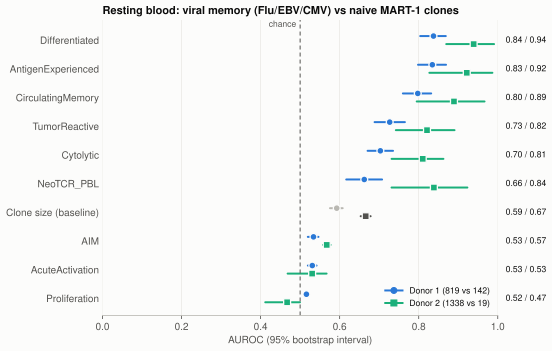
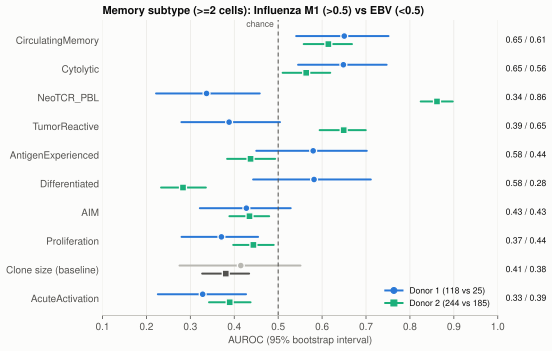
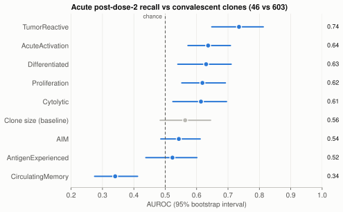
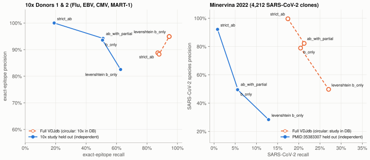
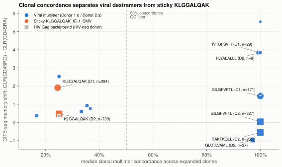

# Benchmark on infectious disease and blood

This page evaluates TCRsift outside solid tumors: peripheral-blood signature
ranking (`tcrsift prioritize --context blood`), public TCR database matching
(`tcrsift annotate`), pMHC multimer feature-barcode calling (`tcrsift.multimer`),
and paired peptide-restimulation scoring (`score_stimulation_response`). It
covers three public human cohorts spanning Influenza A, Epstein–Barr virus
(EBV), cytomegalovirus (CMV), SARS-CoV-2, and naive self-antigen (MART-1,
encoded by *MLANA*) T cells across resting blood, longitudinal vaccination, and
overnight peptide stimulation.

## Summary

- **In resting blood, differentiation signatures separate viral memory from
  naive precursors, but not one expanded memory clone from another.** Across
  all clones (`>=1` cell) in 10x Genomics Donors 1 and 2, `Differentiated`
  reaches an AUROC of **0.84** and **0.94** and `AntigenExperienced` reaches
  **0.83** and **0.92** when separating Influenza, EBV, and CMV memory clones
  from naive MART-1 (`ELAGIGILTV`) clones. Once restricted to expanded blood
  clones (`>=2` cells), unlabeled expanded clones are themselves memory T cells
  against unpanelled antigens, so scores reflect memory subtype rather than
  antigen specificity (`CirculatingMemory` **0.65** and **0.61** for cleared
  Influenza M1 vs latent EBV; `AIM` and `Proliferation` **0.45** to **0.53** vs
  unlabeled expanded clones).
- **Transient activation and tumor-reactivity modules surge during acute
  vaccine recall in blood.** Across 10,484 paired-TCR SARS-CoV-2-specific CD8 T
  cells profiled longitudinally by Minervina et al. 2022, `Proliferation`,
  `AcuteActivation`, and `TumorReactive` are quiescent in convalescent blood
  (`-0.09`, `-0.08`, `-0.02`) and peak sharply after the second mRNA vaccine
  dose (`+0.77`, `+0.59`, `+0.51`; `TumorReactive` AUROC **0.74** for acute
  post-dose-2 vs convalescent clones). In blood draw samples collected near
  vaccination or acute infection, `TumorReactive` therefore captures recently
  restimulated viral T cells alongside tumor-reactive clones.
- **Overnight (16 h) peptide restimulation requires within-clone transcriptional
  delta rather than clonal abundance fold-change.** Across 73 persistent
  β-clonotypes sequenced in paired unstimulated and 16 h SARS-CoV-2
  Spike-stimulated CD3-gated T cells (Fischer et al. 2021), **0 of 73** clones
  pass Benjamini–Hochberg FDR < 0.05 by Fisher exact count enrichment because T
  cells do not divide multiple times overnight. Comparing expression within the
  same clone across paired wells (`score_stimulation_response`) identifies 11
  persistent clones with strong effector-cytokine transcript (`IFNG`, `TNF`,
  `IL2`, `CCL4`) induction (`Δ > 0.5`, with `Δ AIMBroad` up to `+1.87`) despite
  modest abundance shifts (`log2FC` `-0.89` to `+1.17`).
- **Passing `--database-match strict_ab` prevents false-positive β-chain
  collisions on private epitopes.** Both 10x Dextramer and Minervina 2022 are
  already indexed in VDJdb, inflating full-database recall. When each queried
  study is held out, `strict_ab` achieves **100%** exact-epitope precision
  (`40/40` and `60/60`) on canonical Influenza/EBV/CMV clones and **73%**
  SARS-CoV-2 species precision on Minervina 2022. The default `ab_with_partial`
  policy (which falls back to β-only database rows) raises recall on canonical
  epitopes (**28% -> 65%** in Donor 1; **14% -> 45%** in Donor 2) at
  **95%–99%** precision, but on mostly private SARS-CoV-2 clones **54.5% of
  `ab_with_partial` matches (`54.9%` under `b_only`) are false-positive
  collisions** with public CMV, EBV, or Influenza β chains (species precision
  **45.5%**, dropping to **18.7%** at Levenshtein distance 1).
- **Clonal concordance removes >96% of sticky pMHC multimer calls.** Single-cell
  dextramer calling calibrated against negative-control multimers matches 10x
  Genomics' published calls on **100%** of jointly called single-binder cells in
  both donors, yet the promiscuous `HLA-A*03:01 KLGGALQAK` (CMV IE-1) reagent
  still tags cells inside 284 and 739 expanded clones (median within-clone
  concordance **0.24** and **0.25**). Requiring `>=50%` clonal concordance
  across `>=2` cells removes **96.5%** and **96.1%** of sticky `KLGGALQAK`
  clones while preserving **91%–94%** of Influenza M1 `GILGFVFTL` clones (median
  concordance **1.00**).

!!! warning "Public TCR databases contain these benchmark cohorts"
    VDJdb's current release (`139,744` entries; `102,654` paired α/β) already
    contains the 10x Genomics 4-donor dextramer dataset and Minervina et al.
    2022 (`PMID:35383307`). Evaluating database lookup against unmodified VDJdb
    is therefore **circular**: it measures self-retrieval rather than
    generalization to new donors. Section 4 reports both unmodified VDJdb
    (**circular**, drawn hollow in orange) and **study-held-out** VDJdb (drawn
    solid in blue). Only the held-out curves measure out-of-sample performance.

All results are from TCRsift 3.30.0, generated by
`benchmarks/public_infectious/` ([how to reproduce](#reproducing)).

## Source studies


*Summary schematic of the three public single-cell cohorts evaluated on this page.*

| Study | Setting | Accession | Cohort used here | Ground-truth signal | How TCRsift ran |
| --- | --- | --- | --- | --- | --- |
| 10x Genomics Multiplexed Dextramer | Healthy resting peripheral blood CD8 T cells | [10x Genomics Application Note](https://www.10xgenomics.com/datasets/cd-8-plus-t-cells-of-healthy-donor-1-1-standard-3-0-2) | Donors 1 and 2 (`63,201` retained paired-TCR CD8 cells; `22,873` clones) | 44 viral/self pMHC dextramers + 6 negative-control dextramers + TotalSeq-C CD45RA/CD45RO | `prioritize --context blood --min-cells 1` (plus `NeoTCR_PBL`, `TumorReactive`), `tcrsift.multimer`, and `match_clonotypes` |
| Minervina et al. 2022 | SARS-CoV-2 infection, mRNA vaccination, and breakthrough | [Zenodo 6232103](https://zenodo.org/records/6232103) | `13,614` retained paired-TCR CD8 cells (`7,317` clones; `4,212` with curated SARS-CoV-2 epitope calls) | 18 DNA-barcoded HLA class I SARS-CoV-2 dextramers across 5 exposure stages | `prioritize --context blood --min-cells 1`, `score_by_name`, and `match_clonotypes` |
| Fischer et al. 2021 | Hospitalized severe COVID-19 PBMC ± 16 h Spike peptide pool | [GSE171037](https://www.ncbi.nlm.nih.gov/geo/query/acc.cgi?acc=GSE171037) | 2 donors (`GT_2`, `GT_6`), 4 paired libraries (`29,184` loaded PBMCs; `27,113` CD3-gated T cells; `3,474` β-clonotypes) | Paired unstimulated control vs 16 h SARS-CoV-2 Spike peptide-stimulated wells | `load_samples`, `phenotype_cells`, `apply_cd3_gate`, and `score_stimulation_response` |

### 10x Genomics: 50-dextramer peripheral blood CD8 T cells

- **Study design.** Peripheral blood CD8 T cells from healthy HLA-typed donors
  were stained simultaneously with 44 peptide-MHC class I dextramers (spanning
  Influenza A M1 `GILGFVFTL`, multiple EBV lytic and latent epitopes, CMV pp65
  and IE-1, and self-antigens including MART-1 `ELAGIGILTV`), 6
  negative-control (`*_NC`) dextramers, and TotalSeq-C surface antibodies
  (CD45RA, CD45RO, CD3, CD8a), then sequenced with 10x 5' GEX, VDJ, and Feature
  Barcoding.
- **Deposited data.** Sample-prefixed `filtered_feature_bc_matrix.h5` files,
  unfiltered `all_contig_annotations.csv` tables, and 10x's published
  `binarized_matrix.csv` specificity calls (`34,220` GEX-QC cells in Donor 1;
  `67,789` in Donor 2). Ground-truth `binarized_matrix.csv` calls are assigned
  to paired α/β clonotypes when at least 50% of cells in the clone share the
  same single-binder call.
- **Strengths and pitfalls.** Because `HLA-A*02:01`-restricted MART-1
  (`ELAGIGILTV`) binds an unusually abundant population of phenotypically naive
  thymic precursors in healthy donors (CD45RA-high / CD45RO-low, `99.3%–100%`
  singletons), the cohort provides an internal contrast between true naive
  antigen-specific T cells and antigen-experienced viral memory T cells in the
  same blood draw. It also includes `A0301_KLGGALQAK_IE-1_CMV`, a known
  promiscuous reagent that tests multimer quality control.

### Minervina et al. 2022: longitudinal SARS-CoV-2 CD8 T cells

[SARS-CoV-2 antigen exposure history shapes phenotypes and specificity of
memory CD8+ T cells](https://doi.org/10.1038/s41590-022-01184-4), *Nature
Immunology* 23:781–790.

- **Study design.** Donors were sampled across five antigen-exposure histories:
  pre-exposure (`naive`), convalescent post-infection (`post_inf`), infection
  followed by one mRNA vaccine dose (`inf_after_1`), acute recall shortly after
  a second vaccine dose (`inf_after_2`), and breakthrough infection (`break`),
  using 18 HLA-matched SARS-CoV-2 Spike and non-Spike dextramers.
- **Deposited data.** Aggregated Cell Ranger `filtered_feature_bc_matrix.h5`,
  `filtered_contig_annotations.csv`, and curated dextramer-positive metadata
  (`cd8_only_dextr_rev_clean.tsv`, mapping `4,212` scored paired α/β clones to
  19 epitope labels, led by `A01_TTD` / `HLA-A*01:01 TTDPSFLGRY` with `1,801`
  clones).

### Fischer et al. 2021: paired 16 h Spike-stimulated COVID-19 PBMC

[Single-cell RNA sequencing reveals ex vivo signatures of SARS-CoV-2-reactive T
cells through 'reverse phenotyping'](https://doi.org/10.1038/s41467-021-25548-w),
*Nature Communications* 12:4515.

- **Study design.** PBMCs from hospitalized severe COVID-19 patients (`GT_2` and
  `GT_6` from the Gauting cohort) were split into parallel unstimulated control
  and 16 h SARS-CoV-2 Spike peptide-pool-stimulated wells and profiled by 10x
  5' GEX and VDJ sequencing.
- **Deposited data and compatibility edge cases.** Four Cell Ranger 3 deposits
  (`GSM5216975`–`GSM5216978`) with sample-prefixed `.h5` files, `.csv.gz` contig
  tables lacking `fwr1..fwr4` columns, and sibling `all_contig_annotations.json.gz`
  archives. In this deposit, 98.7%–99.7% of called TCR contigs are 5'-truncated
  (`full_length == False`), causing Cell Ranger to record `productive == "None"`
  despite complete `v_gene` and `j_gene` alignments and stop-free canonical
  `C...[FW]` CDR3 sequences (whereas frameshift or stop-codon contigs are
  marked `productive == "False"`). TCRsift 3.30.0 retains validated 5'-partial
  contigs on load; earlier versions dropped nearly every TCR in `GT_2`.

---

## Questions and results

### 1. What does `--context blood` separate in resting peripheral blood?

In solid tumors, `tcrsift prioritize` relies on chronic antigen stimulation
inside the lesion to separate tumor-reactive clones from resting bystanders. In
resting peripheral blood, T cells are not encountering cognate antigen at the
moment of venipuncture. Evaluating `prioritize --context blood` (alongside
`NeoTCR_PBL` and `TumorReactive`) across three contrasts in 10x Donors 1 and 2
clarifies what blood expression signatures can and cannot distinguish:






| Contrast | Donor 1 clones (+ vs −) | Donor 2 clones (+ vs −) | `Differentiated` | `AntigenExperienced` | `CirculatingMemory` | `Cytolytic` | `AIM` | `Proliferation` | `clone_size` |
| --- | --- | --- | --- | --- | --- | --- | --- | --- | --- |
| Viral memory vs naive MART-1 (`>=1` cell) | 820 vs 142 | 1,340 vs 19 | **0.84 / 0.94** | **0.83 / 0.92** | **0.80 / 0.89** | 0.70 / 0.81 | 0.53 / 0.57 | 0.52 / 0.47 | 0.59 / 0.67 |
| Expanded viral vs unlabeled expanded (`>=2` cells) | 143 vs 495 | 429 vs 1,264 | 0.26 / 0.53 | 0.30 / 0.63 | **0.73** / 0.47 | 0.32 / 0.61 | 0.48 / 0.50 | 0.45 / 0.53 | 0.56 / **0.60** |
| Influenza M1 vs EBV (`>=2` cells; >0.5 favors Flu) | 118 vs 25 | 244 vs 185 | 0.58 / 0.28 | 0.58 / 0.44 | **0.65 / 0.61** | 0.65 / 0.56 | 0.43 / 0.43 | 0.37 / 0.44 | 0.41 / 0.38 |

*Values are `Donor 1 / Donor 2` AUROCs from `benchmarks/public_infectious/results/blood_signature_auroc.csv`.*

- **Antigen-experienced memory vs naive precursors (`>=1` cell).** Across all
  clones, `Differentiated` (**0.84**, **0.94**), `AntigenExperienced` (**0.83**,
  **0.92**), and `CirculatingMemory` (**0.80**, **0.89**) cleanly separate
  Influenza, EBV, and CMV pp65 clones from MART-1 (`ELAGIGILTV`) precursors.
  Centered log-ratio (CLR) CITE-seq profiles confirm the transcriptional call:
  MART-1 clones are strongly CD45RA-skewed (`CLR(CD45RO) - CLR(CD45RA)` mean
  `-2.99` in Donor 1 and `-4.61` in Donor 2; `99.3%` and `100%` 1-cell clones),
  whereas viral dextramer+ clones shift upward by ~4 CLR units (`+0.95` and
  `-0.29`).
- **Expanded viral clones vs unlabeled expanded blood clones (`>=2` cells).**
  Once singletons are removed (`--min-cells 2`, the `prioritize` default),
  unlabeled expanded clones in healthy blood are themselves memory/TEMRA clones
  against antigens not represented on the 44-multimer panel. Consequently,
  ranking depends on which viral memory phenotype dominates each donor:
  - In **Donor 1**, where 83% (`118/143`) of expanded viral clones target
    cleared Influenza M1 (`GILGFVFTL`), `CirculatingMemory` (`GZMK`, `IL7R` up;
    `CCR7` down) reaches **0.73**, while cytotoxic TEMRA panels
    (`Differentiated` **0.26**, `AntigenExperienced` **0.30**, `Cytolytic`
    **0.32**) score below unlabeled expanded clones.
  - In **Donor 2**, where latent EBV clones make up 43% (`185/429`) of expanded
    viral clones, `AntigenExperienced` reaches **0.63** and `Cytolytic` reaches
    **0.61**, while `CirculatingMemory` sits at **0.47**.
  - In **both** resting donors, transient activation (`AIM` **0.48** and
    **0.50**, `AcuteActivation` **0.40** and **0.50**) and cell-cycle
    (`Proliferation` **0.45** and **0.53**) signatures do not enrich for viral
    clones.
- **Cleared respiratory virus vs latent herpesvirus.** Directly comparing
  expanded Influenza M1 (`GILGFVFTL`) against expanded EBV clones shows
  `CirculatingMemory` favoring Influenza M1 in both donors (**0.65** and
  **0.61**), whereas `Differentiated` in Donor 2 (**0.28**, equivalent to
  **0.72** in favor of EBV) and `AcuteActivation` (**0.33** and **0.39**) skew
  toward chronically restimulated EBV memory.

---

### 2. How do blood signatures move across acute vaccine recall vs convalescence?

Whereas 10x Donors 1 and 2 were drawn at steady state, Minervina et al. 2022
tracks paired-TCR dextramer-sorted SARS-CoV-2 CD8 T cells (`10,484` cells) from
pre-exposure through acute post-boost recall:




| Exposure stage (`donor_category`) | Paired-TCR CD8 cells | Paired clones | `Differentiated` | `CirculatingMemory` | `AcuteActivation` | `Proliferation` | `AIM` | `TumorReactive` |
| --- | --- | --- | --- | --- | --- | --- | --- | --- |
| `naive` (pre-exposure) | 566 | 384 | −0.57 | +0.07 | +0.21 | +0.31 | +0.18 | −0.03 |
| `post_inf` (convalescent) | 4,387 | 1,877 | +0.29 | +0.05 | −0.08 | −0.09 | −0.06 | −0.02 |
| `inf_after_1` (infection + 1 dose) | 2,393 | 1,087 | −0.05 | +0.03 | −0.06 | −0.11 | −0.02 | −0.03 |
| `inf_after_2` (acute post-dose 2) | 911 | 157 | **+0.57** | +0.08 | **+0.59** | **+0.77** | **+0.18** | **+0.51** |
| `break` (breakthrough cohort) | 2,227 | 1,328 | −0.62 | −0.17 | −0.07 | −0.10 | +0.01 | −0.12 |

- **Transient effector burst after booster vaccination.** `Proliferation`
  (`+0.77`), `AcuteActivation` (`+0.59`), `Differentiated` (`+0.57`), and `AIM`
  (`+0.18`) surge in the `inf_after_2` window and return to baseline in
  convalescent (`post_inf`) and later breakthrough (`break`) draws.
- **Cross-firing of `TumorReactive` on acute viral recall.** Across disjoint
  expanded clones (`>=2` cells; `46` acute post-dose-2 vs `603` convalescent),
  `TumorReactive` separates acutely boosted SARS-CoV-2 clones from resting
  convalescent SARS-CoV-2 clones with an AUROC of **0.74** (95% CI **0.65** to
  **0.81**), ahead of `AcuteActivation` (**0.64**), `Differentiated` (**0.63**),
  and `Proliferation` (**0.62**). When prioritizing tumor-reactive clones from
  blood (`--context blood` or `blood-tumor`), recent vaccination or acute
  respiratory infection will therefore elevate non-tumor viral clones on
  activation and exhaustion lists unless matched tumor overlap or
  `--exclude-known-viral` is applied.

---

### 3. Overnight peptide restimulation: abundance fold-change vs transcriptional shift

In multi-week peptide expansion cultures (`tcrsift run`), antigen-reactive T
cells divide many times and dominate clone-frequency rankings. In overnight
(16–24 h) activation-induced marker (AIM) or cytokine-transcript scRNA
restimulations, T cells transcribe effector mRNAs without dividing. After gating
PBMCs to CD3-expressing T cells (`>=3` raw `CD3D/E/G` counts), Fischer et al.
2021 tests both signals on persistent β-clonotypes (`>=2` T cells in both the
unstimulated control well and the 16 h SARS-CoV-2 Spike-stimulated well):


| Donor | Loaded PBMCs / CD3-gated T cells | Evaluated β-clonotypes | Persistent clones (`>=2` cells in both wells) | Fisher count-enriched (BH FDR < 0.05) | Cytokine-induced (`Δ effector_cytokines > 0.5`) | Top cytokine-induced persistent clone (`stim` vs `unstim` cells, `log2FC`, `Δ cytokines`, `Δ AIMBroad`) |
| --- | --- | --- | --- | --- | --- | --- |
| `GT_6` | 12,385 / 11,684 | 2,227 | 58 | **0** | **9** | `CASSESDAADRVGQPQHF` (3 vs 3, `−0.04`, `+2.26`, `+1.48`); `CASSNPGQGVTEAFF` (9 vs 16, `−0.84`, `+2.12`, `+1.87`) |
| `GT_2` | 16,799 / 15,429 | 1,247 | 15 | **0** | **2** | `CASIWGAGGQPQHF` (4 vs 3, `+0.09`, `+0.77`, `+0.60`); `CASSPGQGEGYEQYF` (9 vs 3, `+1.17`, `+0.51`, `−0.01`) |

- **Count enrichment misses 16 h responders and flags sampling noise.** Zero
  persistent clones (`0/73`) clear BH FDR < 0.05 by Fisher exact test. The most
  count-skewed persistent clone in `GT_6` (`CASSPFGGGINEQFF`, 25 stimulated vs 6
  unstimulated cells, `log2FC = +1.93`, raw `p = 0.0006`, `FDR = 0.088`) shows
  no cytokine or AIM induction (`Δ cytokines = -0.08`, `Δ AIMBroad = -0.10`),
  while the largest bystander clones sit flat in both count and transcription
  (`CASSLLLAAGELFF`, 184 vs 158 cells, `log2FC = +0.18`, `Δ cytokines = +0.14`;
  `CASSLAYYEQYF`, 72 vs 77 cells, `log2FC = -0.14`, `Δ cytokines = +0.21`).
- **Paired transcriptional delta isolates peptide-reactive clones.**
  `score_stimulation_response` computes each clone's change in signature or
  cytokine-transcript expression (`IFNG`, `TNF`, `IL2`, `CCL4`) between
  stimulated and control wells (`control_sample` in the sample sheet), surfacing
  11 persistent clones with `Δ effector_cytokines > 0.5` (up to `+2.26`
  log-normalized units alongside `Δ AIMBroad = +1.87` and `Δ AIM = +2.47`)
  despite modest abundance differences (`log2FC` `-0.89` to `+1.17`).

---

### 4. Public TCR database matching: strictness vs recall and circularity

To evaluate `tcrsift annotate` and `prioritize`'s database filters, we matched
expanded viral and MART-1 clones from 10x Donors 1 and 2 (`144` and `429`
clones) and curated SARS-CoV-2 clones from Minervina 2022 (`4,212` clones)
against VDJdb (`--host-species-filter same`) under four rules — both on
unmodified VDJdb (**circular**) and after removing all entries originating from
the queried study (**independent**):



| Cohort & VDJdb scope | Rule | Matched clones | Precision (exact epitope) | Recall (exact epitope) | Precision (correct virus) | Recall (correct virus) |
| --- | --- | --- | --- | --- | --- | --- |
| **10x Donor 1** (`144` clones) — *full VDJdb (circular)* | `exact` `strict_ab` | 139 | 97.8% | 94.4% | — | — |
| **10x Donor 1** (`144` clones) — *10x held out* | `exact` `strict_ab` | 40 | **100.0%** | 27.8% | — | — |
| **10x Donor 1** (`144` clones) — *10x held out* | `exact` `ab_with_partial` | 95 | **98.9%** | **65.3%** | — | — |
| **10x Donor 1** (`144` clones) — *10x held out* | `levenshtein` `b_only` | 125 | 93.6% | 81.2% | — | — |
| **10x Donor 2** (`429` clones) — *full VDJdb (circular)* | `exact` `strict_ab` | 425 | 97.4% | 96.5% | — | — |
| **10x Donor 2** (`429` clones) — *10x held out* | `exact` `strict_ab` | 60 | **100.0%** | 14.0% | — | — |
| **10x Donor 2** (`429` clones) — *10x held out* | `exact` `ab_with_partial` | 202 | **94.6%** | **44.5%** | — | — |
| **10x Donor 2** (`429` clones) — *10x held out* | `levenshtein` `b_only` | 290 | 85.2% | 57.6% | — | — |
| **Minervina SARS-CoV-2** (`4,212` clones) — *full VDJdb (circular)* | `exact` `strict_ab` | 719 | 98.3% | 16.8% | 99.6% | 17.0% |
| **Minervina SARS-CoV-2** (`4,212` clones) — *study held out* | `exact` `strict_ab` | 11 | **63.6%** | 0.2% | **72.7%** | 0.2% |
| **Minervina SARS-CoV-2** (`4,212` clones) — *study held out* | `exact` `ab_with_partial` | 246 | 38.2% | 2.2% | **45.5%** | 2.7% |
| **Minervina SARS-CoV-2** (`4,212` clones) — *study held out* | `levenshtein` `b_only` | 1,502 | 14.4% | 5.2% | **18.7%** | 6.7% |

- **Study ingestion inflates naive benchmarks.** Including the queried study in
  VDJdb makes `strict_ab` appear to recover **94.4%–96.5%** of 10x viral clones
  and **17.0%** of Minervina SARS-CoV-2 clones at **97.4%–99.6%** precision.
  Removing the queried study drops `strict_ab` exact-epitope recall to
  **14.0%–27.8%** on canonical Influenza/EBV/CMV epitopes and **0.2%**
  (`8/4,212` correct-virus recall; `7/4,212` exact-epitope recall across `11`
  total matches) on mostly private SARS-CoV-2 epitopes (`1,801/4,212` targeting
  `HLA-A*01:01 TTDPSFLGRY`).
- **When to pass `--database-match strict_ab` instead of the `ab_with_partial`
  default.** Both `tcrsift annotate` and `tcrsift prioritize` default to
  `--database-match ab_with_partial`, which requires both chains when a database
  entry is α/β-paired and falls back to β-only matching on unpaired database
  rows. On heavily studied public epitopes (Influenza M1 `GILGFVFTL`, EBV
  `GLCTLVAML` and `RAKFKQLL`), `ab_with_partial` more than doubles held-out
  recall (**27.8% -> 65.3%** in Donor 1; **14.0% -> 44.5%** in Donor 2) while
  keeping exact-epitope precision at **94.6%–98.9%**. On private repertoires
  such as SARS-CoV-2, however, **54.5% (`134/246`) of `ab_with_partial` hits
  (`54.9%` under `b_only`) are false-positive β-chain collisions** with public
  CMV (`78`), EBV (`18`), human self-antigen (`12`), Influenza A (`11`), or
  HIV-1 (`9`) entries that share a CDR3β sequence with a different α partner;
  edit-distance-1 `b_only` matching lowers virus precision further to **18.7%**.
  When running `--exclude-known-viral` on private neoantigen or novel-pathogen
  repertoires, pass `--database-match strict_ab` so β-only collisions do not
  discard candidate receptors.

---

### 5. Multiplexed pMHC multimers: clonal concordance filters sticky reagents

`tcrsift.multimer` extracts `Antibody Capture` / `Antigen Capture` barcode
counts directly from 10x `.h5` or Matrix Market inputs, calls single-cell
binding against negative-control (`*_NC`) multimers (`min_umi=10`,
`min_nc_ratio=5`, `min_dominance_ratio=2`), and aggregates calls across cells of
each paired α/β clone (`summarize_clone_multimer_specificity`):



| Donor | Multimer | Expanded clones with any positive cell | Confident clones (`>=2` cells & `>=50%` concordance) | Retained fraction | Median clone concordance | `CLR(CD45RO) − CLR(CD45RA)` |
| --- | --- | --- | --- | --- | --- | --- |
| Donor 1 | `GILGFVFTL_Flu-MP_Influenza` | 171 | **160** | **93.6%** | **1.00** | +1.45 |
| Donor 1 | `IVTDFSVIK_EBNA-3B_EBV` | 29 | **17** | 58.6% | **0.99** | +3.84 |
| Donor 1 | `GLCTLVAML_BMLF1_EBV` | 8 | **7** | **87.5%** | **1.00** | +1.57 |
| Donor 1 | `FLYALALLL_LMP2A_EBV` | 5 | **5** | **100.0%** | **1.00** | +5.54 |
| Donor 1 | `RAKFKQLL_BZLF1_EBV` | 22 | **3** | 13.6% | 0.35 | +0.93 |
| Donor 1 | `KLGGALQAK_IE-1_CMV` *(sticky)* | 284 | **10** | **3.5%** | **0.24** | +1.91 |
| Donor 2 | `GILGFVFTL_Flu-MP_Influenza` | 327 | **296** | **90.5%** | **1.00** | +0.04 |
| Donor 2 | `RAKFKQLL_BZLF1_EBV` | 265 | **207** | **78.1%** | **1.00** | −0.56 |
| Donor 2 | `GLCTLVAML_BMLF1_EBV` | 37 | **30** | **81.1%** | **0.97** | −0.98 |
| Donor 2 | `FLYALALLL_LMP2A_EBV` | 9 | **8** | **88.9%** | **1.00** | +3.84 |
| Donor 2 | `RTLNAWVKV_Gag-protein_HIV` *(HIV-neg)* | 5 | **0** | **0.0%** | **0.25** | +0.35 |
| Donor 2 | `KLGGALQAK_IE-1_CMV` *(sticky)* | 739 | **29** | **3.9%** | **0.25** | +0.47 |

- **100% single-cell agreement with 10x's published calls, but single-cell gates
  pass sticky multimers.** Across cells called as single-specificity binders by
  both methods, `call_multimer_specificity` agrees on the exact peptide on
  **100.0%** of cells in both Donor 1 and Donor 2. Even so,
  `KLGGALQAK_IE-1_CMV` tags isolated cells inside 284 expanded clones in Donor 1
  and 739 expanded clones in Donor 2 — including clones whose remaining cells
  concordantly bind Influenza or EBV multimers.
- **Clonotypic TCR binding is clonally concordant.** Because every cell of a
  productive α/β clone expresses the same receptor, genuine pMHC binding marks
  most cells of the clone (median concordance **0.97–1.00** for Influenza
  `GILGFVFTL`, EBV `FLYALALLL` and `GLCTLVAML`, and HLA-matched Donor 2 EBV
  `RAKFKQLL`), whereas non-specific surface sticking scatters randomly across
  large clones (median concordance **0.24–0.25** for `KLGGALQAK`, **0.25** for
  HIV Gag in HIV-negative Donor 2, and **0.17–0.37** for mismatched EBV
  reagents). Requiring `min_specific_cells=2` and `min_concordance=0.5`
  eliminates **96.5%** and **96.1%** of sticky `KLGGALQAK` clones and **100%**
  (`0/5`) of HIV Gag false positives without reagent-specific hardcoding.

---

## Scope and limitations

- **Resting blood cannot identify cognate antigen without a probe, stimulation,
  or paired lesion.** In steady-state blood, expression signatures separate
  antigen-experienced memory from naive T cells and distinguish memory subtypes
  (`GZMK+` circulating memory vs `GZMB+`/CD45RA-re-expressing TEMRA), but cannot
  tell which pathogen or tumor antigen an expanded memory clone recognizes.
- **Singleton clones cannot be rescued by clonal multimer concordance.** The
  `min_concordance=0.5`, `min_specific_cells=2` filter requires at least two
  cells in a clone; genuine singleton binders (such as naive MART-1 precursors)
  must be evaluated with stricter per-cell UMI and negative-control thresholds
  or CITE-seq CD45RA/CD45RO gating.
- **5'-partial VDJ deposits limit de novo leader assembly.** Rescuing validated
  `productive == "None"` contigs recovers clonotype tracking and paired
  expression analysis in 5'-truncated deposits (Fischer 2021, where 98.7%–99.7%
  of TCR contigs are 5'-incomplete and `0` paired clones span both leader start
  codons), whereas full-length construct assembly (`tcrsift assemble`) requires
  either 5'-complete contigs spanning FR1–FR4 or germline V-region
  reconstruction.
- **Unvalidated presets.** `--context blood-tumor`, `mpe`, and `heme`, CD4
  blood prioritization, and murine infectious-disease cohorts are not evaluated
  on this page.

## Reproducing

```bash
pip install tcrsift openpyxl
git clone https://github.com/pirl-unc/tcrsift && cd tcrsift
tcrsift data download --db vdjdb

python benchmarks/public_infectious/download.py --data-dir bench_infectious   # ~750 MB download
python benchmarks/public_infectious/run.py --data-dir bench_infectious --work-dir bench_infectious/runs
python docs/figures/make_infectious_benchmark_figures.py
```

`run.py` writes the CSV tables and `summary.json` backing the figures and
summary statistics on this page to `benchmarks/public_infectious/results/`.
AUROC confidence intervals are 95% percentile bootstraps over clones (2,000
draws, fixed seed).

## Sources

- 10x Genomics. [A new way of exploring immunity: linking highly multiplexed
  antigen recognition to immune repertoire and phenotype](https://www.10xgenomics.com/datasets/cd-8-plus-t-cells-of-healthy-donor-1-1-standard-3-0-2)
  (Application Note; Healthy Donors 1 and 2).
- Minervina AA, Pogorelyy MV, Kirk AM, et al. [SARS-CoV-2 antigen exposure
  history shapes phenotypes and specificity of memory CD8+ T
  cells](https://doi.org/10.1038/s41590-022-01184-4). *Nat Immunol* 2022
  ([Zenodo 6232103](https://zenodo.org/records/6232103)).
- Fischer DS, Ansari M, Wagner KI, et al. [Single-cell RNA sequencing reveals ex
  vivo signatures of SARS-CoV-2-reactive T cells through 'reverse
  phenotyping'](https://doi.org/10.1038/s41467-021-25548-w). *Nat Commun* 2021
  ([GSE171037](https://www.ncbi.nlm.nih.gov/geo/query/acc.cgi?acc=GSE171037)).
- Goncharov M, Bagaev D, Shcherbinin D, et al. [VDJdb in 2022: database upgrade,
  new analysis infrastructure and a silly little
  virus](https://doi.org/10.1093/nar/gkac596). *Nucleic Acids Res* 2022.
