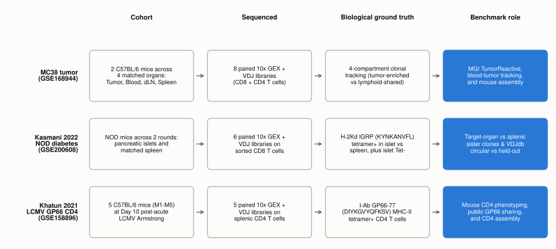
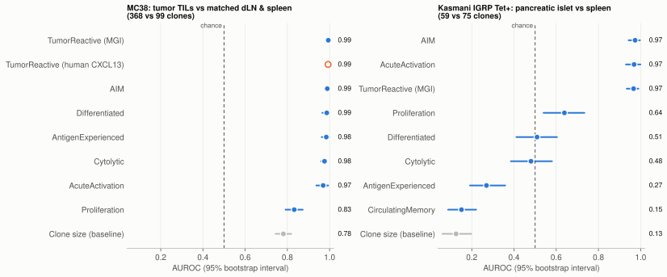
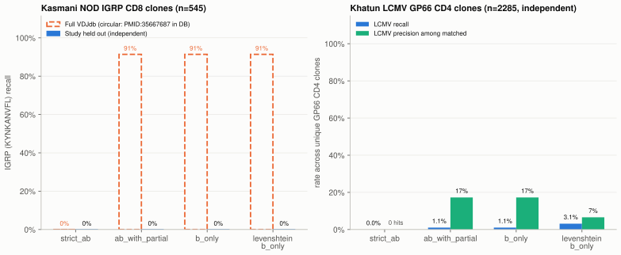
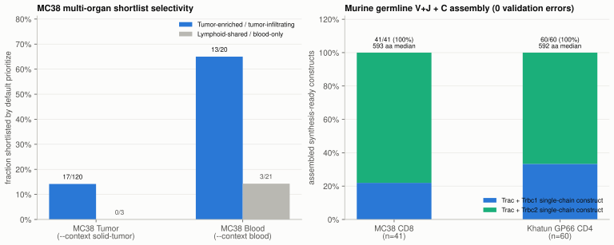

# Benchmark on murine models (`--species mouse`)

This page evaluates TCRsift's murine (`--species mouse`) workflow across three
open-access 10x Genomics single-cell RNA + paired α/β TCR cohorts (19 paired
GEX + VDJ libraries) covering syngeneic solid-tumor and multi-organ clonal
tracking, autoimmune target-organ versus splenic MHC-I tetramer sorting, acute
viral MHC-II tetramer+ CD4+ T cells, `MusMusculus` VDJdb lookup, and murine
full-length `Trac` / `Trbc1` / `Trbc2` construct assembly.

## Summary

- **Murine CD8+ TILs transcribe *Ccl3* and *Ccl4* rather than *Cxcl13*, and MGI
  signatures cleanly separate intratumoral from lymphoid CD8+ clones.** Across
  `11,779` retained CD8+ TILs in syngeneic MC38 colon adenocarcinoma
  (`GSE168944`), only **0.11%** (`0.0011`) of mouse CD8+ TILs express *Cxcl13* >
  0, whereas **38.8%** (`0.3876`) express *Ccl3* and **73.6%** (`0.7356`)
  express *Ccl4* — directly validating why `MOUSE_SIGNATURES["TumorReactive"]`
  substitutes *Ccl3*/*Ccl4* for human CD8-biased *CXCL13*. Comparing expanded
  MC38 tumor clones (`368`) against expanded draining-lymph-node and splenic
  clones (`99`), MGI `TumorReactive` reaches **0.99** (0.9939, 95% CI 0.99 to
  1.00), `AIM` **0.99** (0.9892), `Differentiated` **0.99** (0.9867),
  `AntigenExperienced` **0.98**, `Cytolytic` **0.98**, and `AcuteActivation`
  **0.97**, compared with **0.78** for raw `clone_size`.
- **Peripheral-blood effector signatures in tumor-bearing mice enrich strongly
  for tumor-infiltrating clones.** In matched MC38 peripheral blood (`3,831`
  retained CD8+ cells; `20` clones with `>=5` matched tumor cells vs `21`
  blood-only expanded clones), `Differentiated` (**0.88**, 95% CI 0.75 to 0.99),
  `Cytolytic` (**0.86**), `CirculatingMemory` (**0.85**), and
  `AntigenExperienced` (**0.84**) distinguish circulating sisters of
  intratumoral clones from blood-restricted clones, and untouched `tcrsift
  prioritize --species mouse --context blood` captures **65.0%** (`13/20`) of
  tumor-infiltrating blood clones vs **14.3%** (`3/21`) of blood-only clones.
- **Target-organ engagement drives `TumorReactive`, `AIM`, and `AcuteActivation`
  within identical antigen-specific murine TCR clonotypes.** Across NOD mouse
  `H-2Kd IGRP206-214 / NRP-V7` (`KYNKANVFL`) tetramer+ CD8+ T cells (Kasmani et
  al. 2022, `GSE200608`), `AIM` (**0.97**), `AcuteActivation` (**0.97**), and
  MGI `TumorReactive` (**0.97**) separate pancreatic-islet `IGRP+` clones (`59`)
  from splenic `IGRP+` clones (`75`) recognizing the exact same peptide-MHC,
  whereas `CirculatingMemory` (**0.15**) and `clone_size` (**0.13**) peak in the
  spleen. Across **51 identical sister `CDR3ab` clones** sequenced in both
  organs, **98.0%** (`50/51`) score higher on `TumorReactive` in islets (`mean Δ
  = +0.56`) and **94.1%** (`48/51`) score higher on `AIM` (`+1.01`) and
  `AcuteActivation` (`+0.81`). Within pancreatic islets (`59` `Islet_TetPos` vs
  `684` `Islet_TetNeg`), `TumorReactive` reaches **0.71** (0.65 to 0.77),
  moderated because `TetNeg` islet CD8+ cells include clones targeting non-IGRP
  β-cell autoantigens.
- **Default `strict_ab` database matching prevents severe β-only false positives
  on murine `MusMusculus` VDJdb lookups.** Unmodified VDJdb (`14,008`
  `MusMusculus` `TRB` rows) contains `780` `TRB`-only rows ingested from Kasmani
  et al. (`PMID:35667687`), producing an apparent **91.4%** (`498/545`) circular
  `IGRP` recall under `ab_with_partial`/`b_only` (`0.0%` under `strict_ab`).
  Holding out `PMID:35667687` reduces `IGRP` recall to **0.0%** (`0/545`) while
  exposing `5.3%` (`29/545`) false-positive viral matches under `b_only` and
  **51.4%** (`280/545`) under `b_only + levenshtein-1` (**0.0%** under default
  `strict_ab`). On independent Day-10 LCMV `GP66:I-Ab` CD4+ T cells (Khatun et
  al. 2021, `0` VDJdb rows), `b_only` matches `139/2,285` clones with only
  **17.3%** (`24/139`) `LCMV` precision (**6.6%** at edit distance 1).
- **IMGT mouse germline V+J fallback and J→C constant-region parity assemble
  100% of 5'-partial murine CD8+ and CD4+ candidates (`101/101`) with zero
  validation errors.** After normalizing Cell Ranger mouse Ensembl `-dv` gene
  names (`TRAV13-4-dv7` → `TRAV13-4/DV7`), `assemble_full_sequences(...,
  species="mouse", germline_vdj_fallback=True)` builds complete `Trac` and
  `Trbc1`/`Trbc2` constructs for **41/41** MC38 CD8+ candidates and **60/60**
  Khatun `GP66` CD4+ candidates, automatically correcting **52 Cell Ranger
  murine `Trbc1`/`Trbc2` constant-gene miscalls** (`32/41` in MC38 and `20/60`
  in Khatun).

All results are from TCRsift 3.33.0, VDJdb `2026-11-06`, and cached IMGT
`Mus_musculus` V-QUEST germline references, generated by
`benchmarks/public_mouse/` ([how to reproduce](#reproducing); full ground-truth
file and assay provenance in `benchmarks/public_mouse/PROVENANCE.md`). None of
TCRsift's gene signatures was trained on any cohort on this page.

---

## Source studies and ground-truth provenance



| Cohort | Deposit & citation | Strain & compartments | Libraries & retained cells | Ground-truth assay | VDJdb circularity |
| --- | --- | --- | --- | --- | --- |
| **MC38 multi-organ** | [GSE168944](https://www.ncbi.nlm.nih.gov/geo/query/acc.cgi?acc=GSE168944) (`GSM5172668`–`675` GEX; `GSM5172684`–`691` VDJ) | C57BL/6 subcutaneous MC38 colon adenocarcinoma (`Mouse01` & `Mouse02`: `Tumor`, `Blood`, `dLN`, `Spleen`) | 8 paired GEX+VDJ libraries (`11,779` tumor CD8+ cells / `1,763` clones; `3,831` blood CD8+ cells / `3,725` clones) | Exact paired `CDR3ab` clonal tracking across 4 organs within the same mouse | Absent from VDJdb; also serves as out-of-strain C57BL/6 specificity control |
| **Kasmani 2022 (`IGRP`)** | [GSE200608](https://www.ncbi.nlm.nih.gov/geo/query/acc.cgi?acc=GSE200608); [Kasmani et al., *Life Sci Alliance* 2022](https://doi.org/10.26508/lsa.202201503) (`PMID:35667687`) | NOD/ShiLtJ autoimmune diabetes pancreatic islets and spleen (`Round1` & `Round2`) | 6 paired GEX+VDJ libraries (`13,455` retained CD8+ cells; `545` unique `IGRP` `TetPos` paired clones) | Physical FACS sorting with `H-2Kd IGRP206-214 / NRP-V7` (`KYNKANVFL`) MHC-I tetramers (`Islet_TetPos`, `Islet_TetNeg`, `Spleen_TetPos`) | **Ingested into VDJdb (`780` `TRB` rows for `PMID:35667687`).** Reported both **circular** (full VDJdb) and **independent** (`PMID:35667687` held out) |
| **Khatun 2021 (`GP66` CD4)** | [GSE158896](https://www.ncbi.nlm.nih.gov/geo/query/acc.cgi?acc=GSE158896); [Khatun et al., *J Exp Med* 2021](https://doi.org/10.1084/jem.20200650) (`PMID:33201171`) | C57BL/6 Day-10 acute LCMV Armstrong spleen (`M1`–`M5`) | 5 paired GEX+VDJ libraries (`11,413` retained CD4+ cells with `pre_sorted=CD4`; `2,316` paired clones) | Physical FACS sorting of `CD4+ CD44hi` `I-Ab GP66-77` (`DIYKGVYQFKSV`) MHC-II tetramer+ T cells across 5 inbred mice | Independent (`0` VDJdb records for `PMID:33201171`) |

All three GEO deposits distribute pre-Cell Ranger 6 18-column
`filtered_contig_annotations.csv` files without `fwr1_nt`–`fwr4_nt` columns
(and `GSE168944` uses 2-column Cell Ranger v2 `genes.tsv.gz`), exercising both
legacy 10x input normalization and cached IMGT `Mus_musculus` germline V+J
assembly.

---

## Multi-compartment MC38 tumor, lymphoid, and blood evaluation



### Why murine `TumorReactive` replaces human *CXCL13* with *Ccl3* / *Ccl4*

In human CD8+ TILs, *CXCL13* is one of the strongest single-gene markers of
neoantigen-reactive clones. In mice, however, *Cxcl13* is predominantly
restricted to follicular helper CD4+ and stromal compartments rather than
exhausted CD8+ TILs. Measuring raw single-cell detection across all `11,779`
retained MC38 CD8+ TILs confirms this divergence directly:

- **`Cxcl13` > 0 UMI**: **0.11%** (`0.0011`) of murine CD8+ TILs
- **`Ccl3` > 0 UMI**: **38.8%** (`0.3876`) of murine CD8+ TILs
- **`Ccl4` > 0 UMI**: **73.6%** (`0.7356`) of murine CD8+ TILs

`MOUSE_SIGNATURES["TumorReactive"]` therefore pairs the eight conserved murine
exhaustion/residency orthologs (*Entpd1*, *Pdcd1*, *Lag3*, *Havcr2*, *Tigit*,
*Tox*, *Ctla4*, *Itgae*) with *Ccl3* and *Ccl4*. In an ablation comparing MGI
`TumorReactive` against a naive human ortholog translation retaining *Cxcl13*
(`TumorReactive_HumanCXCL13`), both reach **0.99** (`0.9939` vs `0.9929`)
between tumor and lymphoid organs because the eight shared exhaustion genes
already separate TILs from splenic/lymph-node T cells, while *Cxcl13* itself
contributes near-zero signal (`0.11%` positive cells) and *Ccl3*/*Ccl4* provide
active chemokine dynamic range inside the tumor (`0.53` vs `0.51`).

### Clonal ranking across MC38 anatomical compartments

| Compartment contrast | Positive vs negative clones (`>=2` cells) | `TumorReactive` (MGI) | `Differentiated` | `AntigenExperienced` | `Cytolytic` | `CirculatingMemory` | `AcuteActivation` | `AIM` | `Proliferation` | `clone_size` |
| --- | --- | --- | --- | --- | --- | --- | --- | --- | --- | --- |
| **Tumor vs dLN/Spleen** | `368` tumor vs `99` non-tumor lymphoid | **0.99** (0.99–1.00) | **0.99** (0.97–1.00) | **0.98** (0.96–1.00) | **0.98** (0.96–0.99) | — | **0.97** (0.94–0.99) | **0.99** (0.98–1.00) | **0.83** (0.79–0.87) | **0.78** (0.74–0.82) |
| **Within MC38 tumor** | `120` tumor-enriched (`>=5` cells) vs `3` lymphoid-shared non-enriched | **0.53** (0.01–0.94) | **0.88** (0.71–0.99) | **0.82** (0.52–1.00) | **0.39** (0.13–0.79) | — | **0.23** (0.00–0.61) | **0.12** (0.00–0.33) | **0.40** (0.08–0.95) | **1.00** *(by def.)* |
| **Peripheral blood** | `20` tumor-infiltrating (`>=5` tumor cells) vs `21` blood-only | — | **0.88** (0.75–0.99) | **0.84** (0.70–0.96) | **0.86** (0.72–0.97) | **0.85** (0.71–0.96) | **0.73** (0.56–0.87) | **0.60** (0.43–0.77) | **0.72** (0.56–0.87) | **0.76** (0.60–0.89) |

Within the subcutaneous MC38 tumor, confidence intervals on the internal
contrast (`120` vs `3`) are wide because naive C57BL/6 splenic and lymph-node
repertoires are ~99% singletons, while actively expanding antitumor clones spill
out of the tumor into the draining lymph node and peripheral blood rather than
behaving as non-enriched bystanders. In peripheral blood, however, that clonal
egress provides a clean test (`20` blood clones with `>=5` matched tumor cells
vs `21` blood-only expanded clones): effector/memory state panels
(`Differentiated` **0.88**, `Cytolytic` **0.86**, `CirculatingMemory` **0.85**)
outperform raw blood `clone_size` (**0.76**).

Running `tcrsift prioritize --species mouse` with untouched defaults yields:

- **MC38 tumor (`--context solid-tumor`)**: `24` shortlisted candidates (`7` in
  `Mouse01` and `17` in `Mouse02`; mean `12` per mouse), capturing `17` of `120`
  (`14.2%`) `>=5`-cell tumor-enriched clones and **0 of 3 (`0.0%`)**
  lymphoid-shared non-enriched clones.
- **MC38 blood (`--context blood`)**: `17` shortlisted candidates across `44`
  expanded blood clones, capturing **13 of 20 (`65.0%`)** circulating
  tumor-infiltrating clones vs **3 of 21 (`14.3%`)** blood-only clones (`4.5x`
  enrichment).

---

## Autoimmune target-organ vs splenic `IGRP` tetramer+ CD8+ T cells (Kasmani 2022)

Kasmani et al. sorted CD8+ T cells binding `H-2Kd IGRP206-214 / NRP-V7`
(`KYNKANVFL`) MHC-I tetramers from both the **pancreatic islets** (site of
autoimmune β-cell destruction) and the **spleen** (circulating lymphoid
reservoir) of pre-diabetic NOD mice, alongside **islet tetramer-negative** CD8+
T cells (`13,455` retained CD8+ cells across two experimental rounds).

### Same epitope specificity across target organ vs spleen

| Contrast (`>=2`-cell clones) | `AIM` | `AcuteActivation` | `TumorReactive` (MGI) | `Proliferation` | `Differentiated` | `Cytolytic` | `AntigenExperienced` | `CirculatingMemory` | `clone_size` |
| --- | --- | --- | --- | --- | --- | --- | --- | --- | --- |
| **`Islet_TetPos` (`59`) vs `Spleen_TetPos` (`75`)** | **0.97** (0.94–1.00) | **0.97** (0.93–1.00) | **0.97** (0.93–0.99) | **0.64** (0.54–0.73) | **0.51** (0.41–0.60) | **0.48** (0.39–0.58) | **0.27** (0.19–0.36) | **0.15** (0.09–0.22) | **0.13** (0.06–0.20) |
| **`Islet_TetPos` (`59`) vs `Islet_TetNeg` (`684`)** | **0.62** (0.56–0.68) | **0.66** (0.61–0.71) | **0.71** (0.65–0.77) | **0.53** (0.46–0.60) | **0.62** (0.55–0.69) | **0.58** (0.50–0.65) | **0.59** (0.52–0.66) | **0.45** (0.38–0.51) | **0.12** (0.05–0.19) |

Two biological findings stand out:

1. **Transcriptional state tracks local antigen engagement, not TCR sequence
   alone.** Even when every clone recognizes `KYNKANVFL`, clones sampled inside
   the inflamed pancreatic islets score near the top of the distribution on
   `AIM` (**0.97**), `AcuteActivation` (**0.97**), and MGI `TumorReactive`
   (**0.97**), whereas clones with the same specificity sampled in the spleen
   score higher on `CirculatingMemory` (`1 - 0.15 = 0.85` in favor of spleen)
   and reach larger sampled `clone_size` (`0.13`). Across **51 identical sister
   `CDR3ab` clonotypes** sequenced in both `Spleen_TetPos` and `Islet_TetPos` of
   the same round, **98.0%** (`50/51`) upregulate `TumorReactive` upon entering
   the islets (`mean Δ = +0.56`), **94.1%** (`48/51`) upregulate `AIM`
   (`+1.01`) and `AcuteActivation` (`+0.81`), and **92.2%** (`47/51`)
   downregulate `CirculatingMemory` (`−0.75`).
2. **Within-islet `TetPos` vs `TetNeg` reflects multi-autoantigen
   infiltration.** Inside pancreatic islets, `TumorReactive` still ranks `IGRP`
   `TetPos` clones above `TetNeg` clones (**0.71**, vs **0.12** for
   `clone_size`), but separation is moderated because NOD islet `TetNeg` CD8+ T
   cells are not passive bystanders — many recognize other β-cell autoantigens
   (insulin `InsB15-23`, GAD65, dystrophia myotonica kinase) and undergo local
   islet TCR engagement alongside `IGRP`-specific clones.

---

## Acute viral LCMV `GP66:I-Ab` murine CD4+ T cells (Khatun 2021)

Khatun et al. FACS-sorted splenic `CD4+ CD44hi` T cells bound to `I-Ab GP66-77`
(`DIYKGVYQFKSV`) MHC class II tetramers at Day 10 after acute LCMV Armstrong
infection across five inbred C57BL/6 mice (`M1`–`M5`, `GSE158896`).

- **FACS `pre_sorted: CD4` rescue in murine CD4+ sorts.** Setting `pre_sorted:
  CD4` on the sample sheet retains `11,413` `Cd3`-gated cells (`2,316` paired
  clones; `693` expanded `>=2` cells) compared with `9,046` cells (`1,886`
  clones) under unsorted gating (**+26.2%** cells and **+22.8%** clones
  recovered from *Cd4* mRNA dropout while still rejecting any `Cd8a`/`Cd8b1`+
  contaminant).
- **Cross-mouse public CD4+ TCR convergence.** Across `1,781` unique
  `CDR3_beta` sequences in five genetically identical mice responding to the
  same `GP66-77` peptide, **72 (`4.0%`)** `CDR3_beta` chains and **26** exact
  paired `CDR3ab` receptors recur independently in `>=2` mice, confirming strong
  private diversity alongside measurable public convergence.
- **Balanced Th1, memory, and Tfh/AIM clonal selection.** Running `tcrsift
  prioritize --species mouse --tcell-type cd4 --context blood` selects `60`
  candidates (`10`–`16` per mouse across `M1`–`M5`; mean `12`) spanning
  `CirculatingMemory` (`15`), `Differentiated` (`14`), `AntigenExperienced`
  (`8`), `Cytolytic` (`8`), `AcuteActivation` (`7`), `Proliferation` (`4`), and
  `AIM` (`4`), capturing
  both cytolytic/Th1 effectors and `AIM`+/Tfh-skewed responders. Unlike chronic
  solid-tumor CD4+ TIL infiltrates (where `FOXP3+` Tregs reach `38%` of
  unfiltered shortlists; see [paired blood-tumor & CD4+ TIL
  benchmark](benchmarks-blood-cd4.md)), acute viral `GP66` tetramer+ effectors
  contain only `10.4%` (`240/2,316`) `Foxp3+` Treg-like clones overall and
  **6.7%** (`4/60`) on the shortlist.

---

## `MusMusculus` VDJdb specificity matching and circularity control



`vdjdb-2026-11-06` contains `14,008` `MusMusculus` `TRB` rows (`9,647` paired
α/β rows), pre-filtered via `host_species_filter="same"` when `--species mouse`
is active.

!!! warning "Circularity disclosure for Kasmani 2022 (`PMID:35667687`)"
    VDJdb `2026-11-06` includes **780 `MusMusculus` `TRB`-only rows** (`0`
    paired `TRA` chains) imported directly from Kasmani et al. (`PMID:35667687`),
    which is VDJdb's sole `KYNKANVFL` / `IGRP` deposit. Querying Kasmani clones
    against unmodified VDJdb is therefore **circular** self-retrieval. The table
    below reports both unmodified VDJdb (**circular**) and study-held-out VDJdb
    with all `PMID:35667687` rows removed (**independent**), alongside `1,763`
    out-of-strain C57BL/6 MC38 tumor clones as a false-positive specificity
    control.

| Query cohort & database | `--database-match` | Query clones | Any VDJdb match | Target (`IGRP` / `LCMV`) recall | Target precision among matched | C57BL/6 MC38 (`1,763`) any match | C57BL/6 MC38 false `IGRP` hits |
| --- | --- | --- | --- | --- | --- | --- | --- |
| **Kasmani `IGRP`** — Full VDJdb (**circular**) | `strict_ab` *(default)* | `545` | `0` (0.0%) | `0` (0.0%) | — | `1` (0.06%) | `0` (0.0%) |
| **Kasmani `IGRP`** — Full VDJdb (**circular**) | `ab_with_partial` / `b_only` | `545` | `508` (93.2%) | `498` (**91.4%**) | **98.0%** | `138` (7.8%) | `5` (0.28%) |
| **Kasmani `IGRP`** — Full VDJdb (**circular**) | `b_only` + `lev-1` | `545` | `518` (95.0%) | `498` (**91.4%**) | **96.1%** | `977` (**55.4%**) | **`65` (3.7%)** |
| **Kasmani `IGRP`** — Held-out VDJdb (**independent**) | `strict_ab` *(default)* | `545` | `0` (0.0%) | `0` (0.0%) | — | `1` (0.06%) | `0` |
| **Kasmani `IGRP`** — Held-out VDJdb (**independent**) | `ab_with_partial` / `b_only` | `545` | `29` (5.3%) | `0` (0.0%) | **0.0%** | `135` (7.7%) | `0` |
| **Kasmani `IGRP`** — Held-out VDJdb (**independent**) | `b_only` + `lev-1` | `545` | `280` (**51.4%**) | `0` (0.0%) | **0.0%** | `954` (**54.1%**) | `0` |
| **Khatun `GP66` CD4** — Full VDJdb (**independent**) | `strict_ab` *(default)* | `2,285` | `0` (0.0%) | `0` (0.0%) | — | — | — |
| **Khatun `GP66` CD4** — Full VDJdb (**independent**) | `ab_with_partial` / `b_only` | `2,285` | `139` (6.1%) | `24` (1.1%) | **17.3%** | — | — |
| **Khatun `GP66` CD4** — Full VDJdb (**independent**) | `b_only` + `lev-1` | `2,285` | `1,094` (**47.9%**) | `72` (3.15%) | **6.6%** | — | — |

These controls demonstrate two practical rules for murine database annotation:

1. **Why `strict_ab` is the safe default.** Under `strict_ab`, false-positive
   annotation on held-out Kasmani NOD clones is **0.0%** (`0/545`) and
   out-of-strain C57BL/6 MC38 collisions are `1/1,763` (`0.06%`). Relaxing to
   `b_only` causes `5.3%` (`29/545`) of NOD `IGRP` clones and `7.7%`
   (`135/1,763`) of MC38 tumor clones to collide with unrelated viral entries
   (`MCMV`, `LCMV`, `InfluenzaA`), and Levenshtein-1 β matching inflates false
   positives to **51.4%–55.4%** of the entire repertoire (including **65**
   C57BL/6 MC38 tumor clones falsely annotated as `H-2Kd` NOD diabetes `IGRP`
   under unmodified VDJdb).
2. **Paired α/β gaps in historical murine VDJdb submissions.** Because legacy
   murine deposits in VDJdb (including `PMID:35667687` for `IGRP` and most older
   `I-Ab GP66` entries) were sequenced by bulk `TRB` amplicon without paired
   `TRA` chains, `strict_ab` achieves `0%` recall on those `TRB`-only deposits.
   Users intentionally screening against legacy `TRB`-only murine epitopes can
   opt into `--database-match ab_with_partial` for exploratory annotation, while
   keeping `--exclude-known-viral` disabled or paired-strict.

---

## Murine full-length single-chain TCR construct assembly



Because all three GEO datasets provide pre-Cell Ranger 6 VDJ tables lacking
framework nucleotide columns (`fwr1_nt`–`fwr4_nt`), full-length synthesis-ready
constructs (`leader + VDJ + Trac/Trbc1/Trbc2` linked by `T2A`) were built via
`assemble_full_sequences(..., species="mouse", germline_vdj_fallback=True)`
using cached IMGT `Mus_musculus` V-QUEST `V-REGION` and `J-REGION` references
and checked with `validate_sequences(..., species="mouse")`:

| Shortlist cohort | Candidates | Complete single-chain constructs | Germline α / β reconstructed | `Trbc1` / `Trbc2` constructs | Cell Ranger `Trbc` miscalls corrected | Median construct length | Load-bearing validation errors |
| --- | --- | --- | --- | --- | --- | --- | --- |
| **MC38 CD8 (`24` tumor + `17` blood)** | `41` | **`41` (100.0%)** | `41` / `41` | `9` `Trbc1`, `32` `Trbc2` | **`32` / `41` (78.0%)** | `593` aa | **`0`** |
| **Khatun `GP66` CD4 (`M1`–`M5`)** | `60` | **`60` (100.0%)** | `60` / `60` | `20` `Trbc1`, `40` `Trbc2` | **`20` / `60` (33.3%)** | `592` aa | **`0`** |

Two murine-specific assembly edge cases uncovered on these cohorts are handled
automatically in 3.33.0:

- **Cell Ranger mouse Ensembl `-dv` V-gene naming (`TRAV13-4-dv7`).** Cell
  Ranger's mouse Ensembl VDJ reference formats shared α/δ V segments with a
  lowercase hyphenated `-dv` suffix (`TRAV13-4-dv7`, `TRAV6-7-dv9`,
  `TRAV16d-dv11`), whereas IMGT `Mus_musculus` FASTA headers use uppercase slash
  notation (`TRAV13-4/DV7`, `TRAV6-7/DV9`, `TRAV16D/DV11`). Normalizing `-dv`
  segments in `normalize_vgene` recovered all `7/41` MC38 candidates (`82.9%` →
  **100.0%**) that previously failed α-chain leader and `V-REGION` lookup.
- **High-frequency Cell Ranger `Trbc1`/`Trbc2` constant-region miscalls.**
  Murine `Trbc1` and `Trbc2` share >96% coding identity in their 5' exons, so
  short 5' VDJ reads frequently misassign `Trbc1` to `Trbj2`-rearranged β chains
  (`32/41` in MC38 and `20/60` in Khatun). TCRsift enforces genomic J→C locus
  parity (`Trbj1*` → `Trbc1`, `Trbj2*` → `Trbc2`) and records every correction
  in `qc_warnings` while stamping `construct_contig_verified = False` on
  germline-imputed VDJ chains.

---

## Scope and limitations

- **No murine `NeoTCR4`/`NeoTCR8`/`MANAscore` equivalents.** Human `NeoTCR8`,
  `NeoTCR4`, `NeoTCR_PBL`, and `MANAscore` were derived on human tumors and rely
  on primate-biased transcripts (such as human CD8 *CXCL13*); `--species mouse`
  uses MGI-curated `MOUSE_SIGNATURES` (`TumorReactive`, `Differentiated`,
  `AntigenExperienced`, `Cytolytic`, `CirculatingMemory`, `AcuteActivation`,
  `Proliferation`, `AIM`).
- **Germline fallback imputes framework regions on pre-Cell Ranger 6 deposits.**
  When `fwr1_nt`–`fwr4_nt` and contig FASTAs are absent from public deposits,
  `--germline-vdj-fallback` reconstructs full `V-REGION` + `CDR3` + `J-REGION`
  sequences from `*01` IMGT alleles (`construct_contig_verified = False`). When
  full `all_contig.fasta` or Cell Ranger 6+ `airr_rearrangement.tsv` files are
  available, donor-read VDJ assembly remains preferred to preserve non-`*01`
  allelic polymorphisms.
- **Historical `TRB`-only gaps in `MusMusculus` VDJdb.** Only `9,647` of
  `14,008` `MusMusculus` VDJdb entries include paired `TRA` chains; `strict_ab`
  prioritizes zero false positives over matching legacy β-only records.

## Reproducing

```bash
pip install tcrsift
git clone https://github.com/pirl-unc/tcrsift && cd tcrsift
tcrsift data download --db vdjdb
tcrsift data download --group germline_mouse

python benchmarks/public_mouse/download.py --data-dir bench_mouse_data
python benchmarks/public_mouse/run.py --data-dir bench_mouse_data --work-dir bench_mouse_data/runs
python docs/figures/make_mouse_benchmark_figures.py
```

`run.py` writes the CSV tables (`auroc_mouse.csv`, `vdjdb_mouse_recovery.csv`,
`shortlist_mc38.csv`, `mouse_assembly.csv`) and `summary.json` (including
`ground_truth_provenance`, `tcrsift_version`, and `vdjdb_release`) to
`benchmarks/public_mouse/results/`. AUROC confidence intervals are 95%
percentile bootstraps over clones (2,000 draws, fixed seed).

## Sources

- Multi-tissue murine MC38 colon adenocarcinoma single-cell RNA + TCR-seq
  ([GSE168944](https://www.ncbi.nlm.nih.gov/geo/query/acc.cgi?acc=GSE168944)).
- Kasmani MY, Ciecko AE, Brown AK, Petrova G, Gorski J, Chen YG, Cui W.
  [Autoreactive CD8 T cells in NOD mice exhibit phenotypic heterogeneity but
  restricted TCR gene usage](https://doi.org/10.26508/lsa.202201503). *Life Sci
  Alliance* 2022
  ([GSE200608](https://www.ncbi.nlm.nih.gov/geo/query/acc.cgi?acc=GSE200608);
  `PMID:35667687`).
- Khatun A, Kasmani MY, Zander R, et al. [Single-cell lineage mapping of a
  diverse virus-specific naive CD4 T cell
  repertoire](https://doi.org/10.1084/jem.20200650). *J Exp Med* 2021
  ([GSE158896](https://www.ncbi.nlm.nih.gov/geo/query/acc.cgi?acc=GSE158896);
  `PMID:33201171`).
- Goncharov M, Bagaev D, Shcherbinin D, et al. [VDJdb in the pandemic era: a
  compendium of T cell receptors specific for
  SARS-CoV-2](https://doi.org/10.1038/s41592-022-01578-0). *Nat Methods* 2022.
- Bagaev DV, Vroomans RMA, Samir J, et al. [VDJdb in 2019: database extension,
  new analysis infrastructure and a T-cell receptor motif
  compendium](https://doi.org/10.1093/nar/gkz874). *Nucleic Acids Res* 2020.
