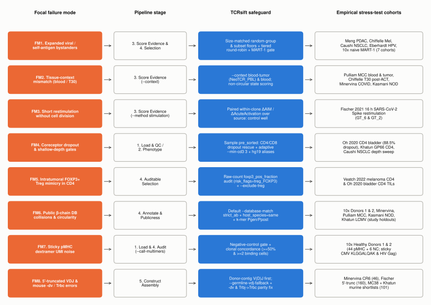
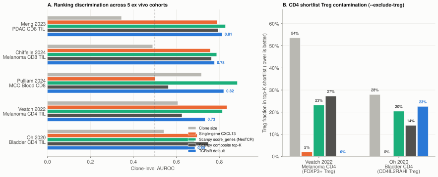
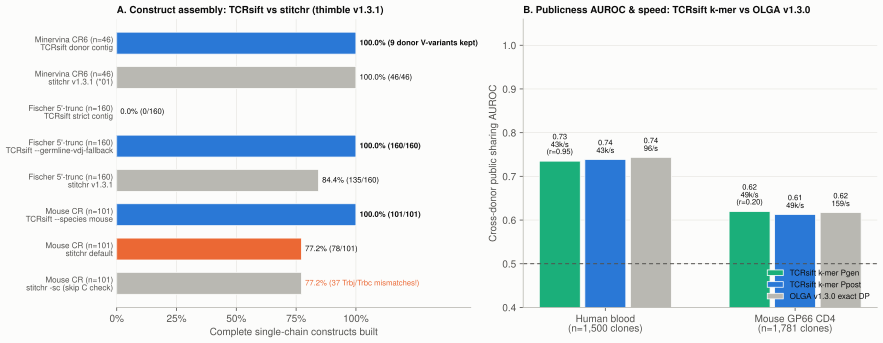
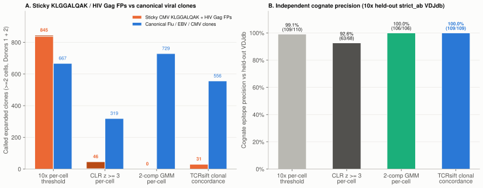

# Benchmark Overview: 8 Focal Failure Modes & Head-to-Head Comparisons

TCRsift is built around **one five-stage workflow** — `1. Load & QC → 2. Phenotype & Clonotype → 3. Score Evidence → 4. Auditable Selection → 5. Construct Assembly` — evaluated across **15 open-access human and murine single-cell cohorts**. Rather than treating those cohorts as disconnected case studies, this page organizes the entire empirical benchmark suite around **8 concrete biological and bioinformatic failure modes** (`FM1`–`FM8`) and reports **direct head-to-head comparisons** against widely used open-source tools (`Scanpy score_genes`, single-gene `CXCL13`, `stitchr` / `thimble v1.3.1`, `OLGA v1.3.0`, and per-cell/CLR/GMM multimer callers).

---

## 1. Which workflow & flags should I use?

Every TCRsift run shares Stages 1, 2, 4, and 5; only the **Stage 3 evidence signal** changes with experimental design:

| Experimental design | Recommended command | Key safeguards activated | Failure modes guarded |
| --- | --- | --- | --- |
| **Fresh solid-tumor CD8+ TIL** (human or mouse) | `tcrsift prioritize samples.yaml -o out/ --context solid-tumor --assemble` | Size-matched random-group + subset floors, tiered round-robin (`TumorReactive`, `MANAscore`, `NeoTCR8`), `strict_ab` MART-1 exclusion, donor-contig assembly | `FM1`, `FM6`, `FM8` |
| **Fresh solid-tumor CD4+ TIL** (FACS-sorted or unsorted) | `tcrsift prioritize samples.yaml -o out/ --context solid-tumor --tcell-type cd4 --exclude-treg --assemble` *(set `pre_sorted: CD4` on FACS-sorted rows)* | `NeoTCR4` + `hg19`↔`GRCh38` aliases, `pre_sorted` *CD4* dropout rescue, raw-count `FOXP3+` Treg exclusion (`risk_flags=treg_FOXP3`) | `FM1`, `FM4`, `FM5`, `FM8` |
| **Cancer-patient peripheral blood** (circulating antitumor CD8+ T cells) | `tcrsift prioritize samples.yaml -o out/ --context blood-tumor --assemble` | `NeoTCR_PBL` Tier-1 prioritization (`CXCL13`-independent circulating antitumor program), `strict_ab` viral/MART-1 auditing | `FM2`, `FM6`, `FM8` |
| **Infection / vaccine blood** (with optional 10x pMHC dextramers) | `tcrsift prioritize samples.yaml -o out/ --context blood [--call-multimers] [--assemble]` | `CirculatingMemory` + `Differentiated` state panels, negative-control + clonal-concordance (`>=50%`, `>=2` cells) multimer calling | `FM2`, `FM6`, `FM7` |
| **Peptide-stimulated culture or 16 h restimulation** (with `source: control`) | `tcrsift run -s samples.yaml -o out/ [--method stimulation] [--germline-vdj-fallback]` | Expansion tiers (`threshold`/`logistic`) or paired within-clone `ΔAIM` / `ΔAcuteActivation` over unstimulated control (`stimulation`) | `FM3`, `FM6`, `FM8` |
| **Murine syngeneic tumor, autoimmune, or viral models** | Add `--species mouse` (auto-detected from MGI / `ENSMUSG*` / mouse VDJ) and `--germline-vdj-fallback` when contig FASTAs are absent | MGI *Ccl3*/*Ccl4* `TumorReactive`, `MusMusculus` `strict_ab` DB matching, `-dv` V-gene normalization, `Trbj1→Trbc1` / `Trbj2→Trbc2` parity enforcement | `FM2`, `FM4`, `FM6`, `FM8` |

---

## 2. Master Scorecard: 8 Focal Failure Modes Across 15 Public Cohorts



| ID | Focal failure mode | What goes wrong without a guard | TCRsift safeguard | Empirical benchmark result | Cohort deep-dive |
| --- | --- | --- | --- | --- | --- |
| **FM1** | **Expanded bystander clones in uncultured biopsies** | Most large clones in fresh tumors or blood are viral/self memory bystanders; ranking by `clone_size` selects non-reactive clones (`AUROC 0.34` in PDAC, `0.49` in melanoma, `0.45` in NSCLC). | Size-matched random-group (`99th` pct) & hypergeometric high-cell subset (`p <= 0.01`, `>=5` cells) calibration + tiered round-robin + default `MART-1` (`MLANA`/`Mlana`) exclusion. | `TumorReactive` reaches **0.81** AUROC in Meng PDAC (`94 TR vs 55 NTR`; top-200 shortlist `58 TR / 12 NTR = 82.9%` precision vs `45 TR / 40 NTR = 52.9%` for within-donor `clone_size` rank), **0.78** in Chiffelle melanoma (`72 TR vs 94 NTR`), and **0.69** in Caushi NSCLC (`18 MANA vs 13 viral`; **0.87** on the `20` clones passing `--min-cd3 10`). Naive `MART-1` clones (`99.3%`–`100%` singletons, `CLR(CD45RO)-CLR(CD45RA) = -2.99` / `-4.61`) are excluded (`0` shortlisted). *Candid limit:* in virus-driven HPV+ HNSCC (`0.47`) and MCC tumor (`0.58`), `TumorReactive` does not beat `clone_size` (`0.74`, `0.73`). | [TIL Prioritization](benchmarks.md), [Infectious & Blood](benchmarks-infectious.md) |
| **FM2** | **Tissue-context & post-therapy transcriptional drift** | *CXCL13* is silent in circulating antitumor blood T cells (`AUROC 0.50`) and murine CD8+ TILs (`0.11%` *Cxcl13*+ cells), and post-ACT `T30` biopsies lose baseline exhaustion contrast. | Explicit `--context` presets (`blood-tumor` `NeoTCR_PBL`; `blood` `CirculatingMemory`; murine MGI `TumorReactive` substituting *Ccl3*/*Ccl4*). | In Pulliam MCC blood (`32 MCPyV vs 14 CMV/EBV/Flu`), `NeoTCR_PBL` reaches **0.82** AUROC vs **0.33** for `CirculatingMemory` and **0.50** for `CXCL13`. In murine MC38 (`11,779` CD8+ TILs: `38.8%` *Ccl3*+, `73.6%` *Ccl4*+), MGI `TumorReactive` reaches **0.99** vs dLN/spleen (`clone_size` **0.78**), and in Kasmani NOD diabetes (`59` islet vs `75` splenic `IGRP` Tet+ clones) reaches **0.97** (`50/51 = 98.0%` sister clones higher in target islets). *Candid limit:* in Chiffelle Day-30 post-ACT biopsies (`T30`), `TumorReactive` drops from **0.74** (`T0`, shortlist precision `62.5%`) to **0.61** (`T30`, precision `28.6%`). | [Blood-Tumor, ACT & CD4](benchmarks-blood-cd4.md), [Murine Models](benchmarks-mouse.md) |
| **FM3** | **Short restimulation (`16 h`) without clonal division** | Overnight peptide-pool restimulation induces effector cytokines before T cells divide, so count-based Fisher expansion tests miss true responders (`0/58` and `0/15` clones at `FDR < 0.05`). | `tcrsift run --method stimulation` (`score_stimulation_response`): pairs each clone against its own `source: control` well on `ΔAIM` / `ΔAcuteActivation` alongside fold-change. | Across persistent clones (`>=2` CD3+ cells in both unstimulated and 16 h SARS-CoV-2 Spike wells in Fischer 2021), **9/58** (`GT_6`) and **2/15** (`GT_2`) clones show paired cytokine induction (`Δeffector_cytokines > 0.5`) with `ΔAIM` shifts up to **+2.47**, despite zero statistically significant count expansion. | [Infectious & Blood](benchmarks-infectious.md) |
| **FM4** | **Coreceptor mRNA dropout (`CD4`/`CD8`), shallow depth, & `hg19` aliases** | 3'/5' droplet scRNA-seq drops *CD4* mRNA in up to `88.5%` of FACS-sorted CD4+ T cells; legacy `hg19` renames `NeoTCR4` symbols (`GPR56`↔`ADGRG1`); `--min-cd3 10` culls >50% of shallow libraries. | `pre_sorted: CD4`/`CD8` rescues `CD3+` double-zero (`CD4=0, CD8=0`) cells; `18` `hg19`↔`GRCh38` aliases in `GENE_SYNONYMS`; default `--min-cd3 3` with >50%-removal warning. | `pre_sorted: CD4` rescues **8.7x** more cells in Oh 2020 human bladder CD4+ TILs (`708 → 6,144` cells; shortlist `7 → 103` clones) and **+26.2%** in Khatun murine `GP66:I-Ab` CD4+ T cells (`9,046 → 11,413` cells); `hg19` harmonization resolves **40/40 (100%)** `NeoTCR4` genes. | [Blood-Tumor, ACT & CD4](benchmarks-blood-cd4.md), [Murine Models](benchmarks-mouse.md), [TIL Prioritization](benchmarks.md) |
| **FM5** | **Intratumoral `FOXP3+` Treg mimicry on `--tcell-type cd4`** | Intratumoral Tregs express `ENTPD1`, `CTLA4`, `TIGIT`, `TNFRSF9`, and `TNFRSF4`, scoring high on `TumorReactive` and `AIM` (`AIM` AUROC **0.16** for effector vs `CD4IL2RAHI` Tregs in Oh 2020). | Always-on raw-count `foxp3_pos_fraction` audit (`risk_flags=treg_FOXP3`) + opt-in `--exclude-treg` (`--treg-foxp3-fraction`, default `0.5`). | On Veatch 2022 melanoma CD4+ TILs (`28 CD4_neo`, `13 CD4_self`, `477 FOXP3+` Tregs), `--exclude-treg` removes **61/61 (100%)** `FOXP3+` Treg picks (`38.1% → 0.0%` shortlist contamination) while retaining **9/9** `CD4_neo` and **5/5** `CD4_self` clones. On shallow Oh 2020 bladder CD4+ TILs, `--treg-foxp3-fraction 0.25` cuts `CD4IL2RAHI` Tregs from `28` to `17` while retaining `58/61` (`95.1%`) `CD4CXCL13`/`CD4GZMB`/`CD4GZMK` effector picks. | [Blood-Tumor, ACT & CD4](benchmarks-blood-cd4.md) |
| **FM6** | **Public β-chain database collisions & VDJdb circularity** | Matching paired α/β clones by `TRB` alone (`b_only` / `ab_with_partial`) hits unrelated donors' public viral β-chains; benchmark cohorts already indexed in VDJdb inflate apparent recall. | `--database-match` defaults to **`strict_ab`** in `prioritize`; `host_species_filter="same"` blocks human↔mouse leakage; bundled k-mer `Pgen`/`Ppost` flags public chains. | On study-held-out Minervina SARS-CoV-2 (`4,212` clones), `strict_ab` achieves **92.1%** virus / **78.9%** epitope precision vs **49.9%** / **44.0%** under `ab_with_partial` (`237/473` off-target hits, including `218` across YFV/EBV/CMV/self/Flu). On 10x Donors 1 & 2 (held-out VDJdb), `strict_ab` achieves **100.0%** epitope precision (`44/44`, `65/65`). On Kasmani NOD `IGRP`, recall drops from **91.4%** (circular) to **0.0%** once `PMID:35667687` is held out, and `strict_ab` reduces false hits on C57BL/6 MC38 TILs from `135/1,763` (`7.7%`) to `1/1,763` (`0.06%`). | [Infectious & Blood](benchmarks-infectious.md), [Murine Models](benchmarks-mouse.md) |
| **FM7** | **Sticky pMHC dextramer UMI noise** | Aggregate-prone pMHC reagents (e.g. `A0301_KLGGALQAK_IE-1_CMV`) bind isolated cells across hundreds of unrelated expanded clones even after per-cell UMI and negative-control gates. | `--call-multimers` combines per-cell `UMI >= 10` & `>=5x max(NC, 1)` with **clonal concordance** (`>=50%` of clone cells and `>=2` specific cells). | Across 10x Healthy Donors 1 & 2 (`44` pMHC + `6` NC), clonal concordance cuts sticky `KLGGALQAK` false-positive clones by **96.3%** (`837 → 31`), eliminates HIV Gag false positives (`8 → 0`), and reaches **100.0% (`109/109`)** cognate epitope precision against 10x-held-out `strict_ab` VDJdb. | [Infectious & Blood](benchmarks-infectious.md), [Section 3.3 below](#33-multiplexed-pmhc-multimer-calling-tcrsift-vs-per-cell-clr-and-bimodal-gmm) |
| **FM8** | **5'-truncated VDJ deposits, donor framework variants, & murine `-dv` / `Trbc` errors** | Truncated deposits lack 5' leader/FR1 bases (`0/160` strict assembly); `*01`-only germline tools overwrite donor V-region polymorphisms; murine Cell Ranger emits `-dv` V-gene names and ~50% `Trbc1`/`Trbc2` miscalls. | Donor-contig V(D)J assembly by default; explicit `--germline-vdj-fallback` (`construct_contig_verified=False` + germline `M...` leader fallback); mouse `-dv` normalization + `Trbj1→Trbc1` / `Trbj2→Trbc2` parity override. | Preserves **9/46 (19.6%)** polymorphic donor V-regions on Minervina CR6 contigs (`46/46` assembled); rescues **160/160 (100%)** 5'-truncated Fischer 2021 clones with full `M...` leaders (`33` partial 5' contigs rescued, `16` distinct germline/constant variants logged); and assembles **101/101 (100%)** murine MC38 + Khatun clones with **0** validation errors while correcting **52** Cell Ranger `Trbc1`/`Trbc2` miscalls. | [Infectious & Blood](benchmarks-infectious.md), [Murine Models](benchmarks-mouse.md), [Section 3.2 below](#32-construct-assembly-vs-stitchr-v131-and-pgen-vs-olga-v130) |

---

## 3. Head-to-Head Comparisons Against Open-Source Tools

To test whether TCRsift's design choices add concrete value over standard open-source tools used for individual steps, `benchmarks/head_to_head/run.py` runs external baselines on the exact same cached single-cell inputs across four stages.

!!! note "Why `predicTCR` and `TRTpred` are documented rather than executed"
    Two commercial/clinical TIL classifiers from 2024 are frequently cited in the literature:
    **`predicTCR`** (Tan et al., *Nature Biotechnology* 2024) restricts its trained XGBoost/scVI weights to a proprietary DKFZ web portal (`predictcr.com`) that cannot be run reproducibly offline, and **`TRTpred`** (Pétremand et al., *Nature Biotechnology* 2024) was trained directly on melanoma TIL cohorts overlapping published melanoma test sets. Every comparator executed below (`Scanpy v1.12.3`, `stitchr / thimble v1.3.1`, `OLGA v1.3.0`, and per-cell/CLR/GMM multimer callers) is 100% open-source, untrained on the evaluation cohorts, and reproducible offline.

---

### 3.1 Ex vivo clonotype prioritization: `tcrsift` vs `Scanpy score_genes` & `CXCL13`

Across five labeled human TIL and cancer-blood cohorts, we compare unmodified `tcrsift prioritize` (at its selected shortlist size $K$, evaluating single-column AUROC uniformly on the context preset's first Tier-1 signature: `TumorReactive` for all `--context solid-tumor` cohorts and `NeoTCR_PBL` for `--context blood-tumor`) against four baselines selecting the top-$K$ expanded (`>=2`-cell) clones:

1. **`clone_size`**: Within-donor clonal abundance rank (`size_percentile`, ties broken by `cell_count`).
2. **`raw_CXCL13`**: Mean `log1p(CP10K)` *CXCL13* single-gene expression.
3. **`scanpy_score_genes_NeoTCR`**: `scanpy.tl.score_genes` (`ctrl_size=50, n_bins=25`, HGNC/`hg19` harmonized) on the published `NeoTCR8` (CD8 TIL), `NeoTCR_PBL` (MCC blood), or `NeoTCR4` (CD4 TIL) gene set.
4. **`scanpy_composite_topk`**: Equal-weighted mean of `scanpy.tl.score_genes` across all signatures in the context preset.



| Cohort (`pos` vs `neg`) | Method | AUROC (95% CI) | Budget $K$ | Positives in top-$K$ | Negatives in top-$K$ | Tested precision | Treg fraction in top-$K$ |
| --- | --- | --- | ---: | ---: | ---: | ---: | ---: |
| **Meng 2023 PDAC CD8 TIL** (`94 TR` vs `55 NTR`) | `clone_size` | 0.345 (0.252–0.445) | 200 | 45 | 40 | 52.9% | — |
| | `raw_CXCL13` | 0.790 (0.717–0.858) | 200 | 42 | 1 | **97.7%** | — |
| | `scanpy_score_genes_NeoTCR` (`NeoTCR8`) | **0.829** (0.758–0.895) | 200 | 56 | 2 | 96.6% | — |
| | `scanpy_composite_topk` | 0.793 (0.717–0.864) | 200 | 54 | 3 | 94.7% | — |
| | **`tcrsift_default`** (`TumorReactive`) | 0.813 (0.739–0.887) | 200 | **58** | 12 | 82.9% | — |
| **Chiffelle 2024 Melanoma CD8 TIL** (`72 TR` vs `94 NTR`) | `clone_size` | 0.490 (0.402–0.575) | 200 | 41 | 64 | 39.0% | — |
| | `raw_CXCL13` | 0.758 (0.684–0.826) | 200 | 5 | 1 | **83.3%** | — |
| | `scanpy_score_genes_NeoTCR` (`NeoTCR8`) | **0.788** (0.717–0.852) | 200 | 12 | 7 | 63.2% | — |
| | `scanpy_composite_topk` | 0.763 (0.686–0.830) | 200 | 14 | 8 | 63.6% | — |
| | **`tcrsift_default`** (`TumorReactive`) | 0.777 (0.702–0.840) | 200 | **24** | 17 | 58.5% | — |
| **Pulliam 2024 MCC Blood CD8** (`32 MCPyV` vs `14 CMV/EBV/Flu`) | `clone_size` | 0.717 (0.526–0.874) | 18 | 2 | 1 | 66.7% | — |
| | `raw_CXCL13` | 0.500 (0.500–0.500) | 18 | 7 | 2 | 77.8% | — |
| | `scanpy_score_genes_NeoTCR` (`NeoTCR_PBL`) | **0.884** (0.759–0.980) | 18 | **8** | 0 | **100.0%** | — |
| | `scanpy_composite_topk` | 0.563 (0.368–0.741) | 18 | 4 | 0 | **100.0%** | — |
| | **`tcrsift_default`** (`NeoTCR_PBL`, `--context blood-tumor`) | 0.820 (0.686–0.933) | 18 | 3 | 1 | 75.0% | — |
| **Veatch 2022 Melanoma CD4 TIL** (`28 CD4_neo` vs `1,122 untested`; `477` Tregs) | `clone_size` | 0.607 (0.488–0.717) | 99 | 6 | 91 | 6.2% | 53.5% (`53/99`) |
| | `raw_CXCL13` | **0.835** (0.775–0.880) | 99 | 4 | 95 | 4.0% | 2.0% (`2/99`) |
| | `scanpy_score_genes_NeoTCR` (`NeoTCR4`) | 0.814 (0.735–0.881) | 99 | **10** | 85 | **10.5%** | 23.2% (`23/99`) |
| | `scanpy_composite_topk` | 0.626 (0.534–0.714) | 99 | 3 | 94 | 3.1% | 27.3% (`27/99`) |
| | **`tcrsift_default_excl_treg`** (`TumorReactive`) | 0.734 (0.666–0.802) | 99 | 9 | 85 | 9.6% | **0.0% (`0/99`)** |
| **Oh 2020 Bladder CD4 TIL** (`163 Effector` vs `119 CD4CM/TH17`; `163` Tregs) | `clone_size` | 0.542 (0.474–0.607) | 93 | 40 | 20 | 66.7% | 28.0% (`26/93`) |
| | `raw_CXCL13` | 0.696 (0.639–0.750) | 93 | **70** | 19 | 78.7% | **0.0% (`0/93`)** |
| | `scanpy_score_genes_NeoTCR` (`NeoTCR4`) | 0.684 (0.621–0.744) | 93 | 54 | 9 | 85.7% | 20.4% (`19/93`) |
| | `scanpy_composite_topk` | **0.749** (0.691–0.804) | 93 | 64 | 10 | **86.5%** | 14.0% (`13/93`) |
| | **`tcrsift_default_excl_treg`** (`TumorReactive`) | 0.686 (0.619–0.748) | 93 | 58 | 10 | 85.3% | 22.6% (`21/93`) |

**Key takeaways:**

- **Where `Scanpy score_genes` is strong — and why calibration + subset evidence still matter:** On pure ranking AUROC for CD8 TIL (`0.829` vs `0.813` in Meng; `0.788` vs `0.777` in Chiffelle), MCC blood (`0.884` vs `0.820` on `NeoTCR_PBL`), and bladder CD4 (`0.684` `NeoTCR4` vs `0.686` `TumorReactive`, while `tcrsift`'s `AntigenExperienced` reaches `0.804` and `NeoTCR4` reaches `0.756` on Veatch), `scanpy.tl.score_genes` performs comparably to single-signature `tcrsift` rankings (95% CIs overlap substantially; note `tcrsift` itself dispatches `NeoTCR4`/`NeoTCR8`/`NeoTCR_PBL` through expression-matched control subtraction). However, when converting scores into a **multi-patient shortlist**, uncalibrated `scanpy_score_genes_NeoTCR` top-$K$ pools raw scores across donors and favours tiny 2-cell clones with noisy means: in 11-patient Chiffelle melanoma, `tcrsift`'s size-matched random-group floors + hypergeometric subset route recover **twice as many verified tumor-reactive clones (`24` vs `12`)** at the same 200-clone budget (`4.8x` single-gene `raw_CXCL13`, which recovers only `5` TR clones because most reactive melanoma clones have sparse *CXCL13* counts). Conversely, when a user wants a narrow `NeoTCR_PBL`-only blood ranking, passing `--signatures NeoTCR_PBL` to `tcrsift prioritize` avoids sharing the `K=18` shortlist across secondary memory/effector panels (`8/18` vs `3/18` tested MCPyV clones in Pulliam blood, where the remaining slots in `tcrsift_default` go to untested tumor-shared effector clones).
- **Single-gene `CXCL13` has high precision in *CXCL13*-high TIL subsets, but fails completely in blood and mice:** `raw_CXCL13` achieves high precision among the subset of clones with abundant *CXCL13* transcripts (`97.7%` in Meng PDAC; `0%` Tregs in Oh bladder CD4 where `CD4CXCL13` is one of the three positive author clusters alongside `CD4GZMB`/`CD4GZMK`), **but collapses to `0.500` AUROC in cancer-patient blood** (Pulliam MCC, where *CXCL13* is unexpressed; the `7` shortlisted clones come purely from deterministic clone-size tie-breaking among zeros!) and is expressed in only `0.11%` of murine MC38 CD8+ TILs.
- **Unfiltered `Scanpy` CD4 rankings suffer heavy `FOXP3+` Treg contamination:** On Veatch 2022 melanoma CD4+ TILs, `scanpy_score_genes_NeoTCR` (`NeoTCR4`) and `scanpy_composite_topk` fill **23.2% (`23/99`)** and **27.3% (`27/99`)** of their shortlists with suppressive `FOXP3+` Tregs (`53.5%` for `clone_size`), whereas `tcrsift --exclude-treg` eliminates **100% (`0/99`)** of `FOXP3+` Tregs while recovering `9` neoantigen-reactive clones (`2.25x` `raw_CXCL13`'s `4`). On shallow Oh 2020 bladder 10x libraries (where *FOXP3* UMI dropout leaves some `CD4IL2RAHI` cells with zero *FOXP3* counts at the default `0.50` threshold), lowering `--treg-foxp3-fraction 0.25` further reduces Treg picks from `21` to `17` while retaining `58` effector clones.

---

### 3.2 Construct assembly vs `stitchr v1.3.1` and `Pgen` vs `OLGA v1.3.0`



#### A. Full-length TCR construct assembly: `tcrsift assemble` vs `stitchr` (`thimble v1.3.1`)

`stitchr` (`thimble`, Heather et al., *Nucleic Acids Res* 2022) reconstructs TCR coding sequences from `(TRAV, TRAJ, CDR3α, TRBV, TRBJ, CDR3β)` calls by looking up `*01` IMGT germline references. By contrast, `tcrsift assemble` uses **actual sequenced donor V(D)J contigs** (`fwr1_nt`–`fwr4_nt` and native contig leaders) whenever available and falls back to cached IMGT V+J germlines and germline `M...` signal peptides when `--germline-vdj-fallback` is explicitly requested:

| Cohort | Tool / mode | Clones ($n$) | Complete `M...` constructs | Donor V-framework variants preserved | Mismatched `Trbc` shipped | Contig / build QC flags | Runtime (s) |
| --- | --- | ---: | ---: | ---: | ---: | ---: | ---: |
| **Minervina 2022 Human CR6** (`minervina_blood_default` shortlist) | **`tcrsift_donor_contig`** | 46 | **46 (100.0%)** | **9 (19.6%)** | 0 | 0 | 0.90 |
| | `stitchr / thimble v1.3.1` (`-s HUMAN`) | 46 | **46 (100.0%)** | 0 *(overwritten with `*01`)* | 0 | 0 | 0.09 |
| **Fischer 2021 Human 5'-Truncated** (`98.7%–99.7%` 5'-truncated deposit) | `tcrsift_donor_contig_only` *(strict default)* | 160 | 0 (0.0%) *(fails closed)* | 0 | 0 | 0 | 0.94 |
| | **`tcrsift_germline_vdj_fallback`** | 160 | **160 (100.0%)** | **33** *(partial 5' contigs)* | 0 | 28 *(raw JSON C-tail flags)* | 9.67 |
| | `stitchr / thimble v1.3.1` (`-s HUMAN`) | 160 | 135 (84.4%) | 0 | 0 | 25 *(unbuilt)* | 0.16 |
| **Murine Cell Ranger Shortlists** (`41` MC38 CD8 + `60` Khatun CD4) | **`tcrsift_mouse_germline_fallback`** (`--species mouse`) | 101 | **101 (100.0%)** | 0 | **0** *(52 `Trbc` fixed)* | **0** | 2.91 |
| | `stitchr / thimble v1.3.1` (`-s MOUSE` default) | 101 | 78 (77.2%) | 0 | 0 | 23 *(unbuilt)* | 0.11 |
| | `stitchr / thimble v1.3.1` (`-s MOUSE -sc` skip C check) | 101 | 78 (77.2%) | 0 | **37 (47.4% of built!)** | 23 *(unbuilt)* | 0.10 |

- **Donor allelic fidelity on standard Cell Ranger 6+ human data:** Nearly **1 in 5 (`9/46 = 19.6%`)** shortlisted human clones carry real donor V-region amino-acid differences from the IMGT `*01` allele; `tcrsift` preserves the donor's sequenced receptor verbatim, whereas `stitchr` silently substitutes `*01` germline framework sequences.
- **5'-truncated public archives (`Fischer 2021`):** Strict `tcrsift` refuses to emit chimeric constructs (`0/160`), whereas `--germline-vdj-fallback` builds **160/160 (100.0%)** complete `M...` single-chain constructs (`vs 135/160 = 84.4%` in `stitchr`, which leaves `25` clones unbuilt), rescuing `33` partial 5' donor contigs, logging `16` distinct germline/constant-allele variants (including `3` donor constant-allele divergences), and surfacing `28` `load_bearing` flags where unfiltered `all_contig_annotations.json.gz` reads carry 3' C-region primer/junction sequencing errors (codon-optimized `single_chain_nt_optimized` remains in-frame across all `160/160` constructs).
- **Murine Cell Ranger compatibility (`-dv` paralogs & `Trbc1`/`Trbc2` parity):** Raw 10x Cell Ranger mouse annotations emit lowercase Ensembl shared α/δ V-gene symbols (`TRAV13-4-dv7`, `TRAV16d-dv11`, `TRAV15d-1-dv6d-1`) and frequently misassign `Trbc1` to `Trbj2*` rearrangements. Default `stitchr -s MOUSE` fails on **22.8% (`23/101`)** of murine candidates, and passing `-sc` (`--skip_c_checks`) still fails on all `23` `-dv` clones while **silently shipping `37` (`47.4%` of built constructs) non-physiological `Trbj2+Trbc1` / `Trbj1+Trbc2` constant-region chimeras**. `tcrsift --species mouse` normalizes `-dv` paralogs and enforces genomic `Trbj1→Trbc1` / `Trbj2→Trbc2` parity (`52` Cell Ranger miscalls corrected), producing **101/101 (100.0%)** validated constructs with `0` errors.

#### B. TCR generation probability & publicness: `tcrsift` k-mer vs `OLGA v1.3.0`

`OLGA` (Sethna et al., *Bioinformatics* 2019; GPLv3) computes exact V(D)J recombination generation probabilities via dynamic programming, whereas `tcrsift` ships a zero-dependency Apache-2.0 NumPy k-mer `Pgen`/`Ppost` model in core:

| Repertoire (`public >=2 donors`) | Model | Pearson $r$ vs `OLGA` ($\beta$ / $\alpha$) | Spearman $\rho$ vs `OLGA` ($\beta$ / $\alpha$) | Cross-donor public sharing AUROC (95% CI) | Throughput (clones/s) | Speedup vs `OLGA` |
| --- | --- | --- | --- | --- | ---: | ---: |
| **Human Blood (`n = 1,500`; `420` public)** | **`tcrsift` k-mer `pgen_beta`** | **0.954** / 0.763 | **0.957** / 0.755 | 0.735 (0.704–0.766) | **43,038 / s** | **451x** |
| | **`tcrsift` k-mer `ppost_beta`** | — | — | 0.739 (0.708–0.770) | **43,038 / s** | **451x** |
| | `OLGA v1.3.0` exact VDJ `pgen_beta` | 1.000 | 1.000 | **0.744** (0.712–0.774) | 95.5 / s | 1.0x |
| **Mouse GP66 CD4 (`n = 1,781`; `72` public)** | **`tcrsift` AA-Markov fallback `pgen_beta`** | 0.198 / 0.224 | 0.235 / 0.208 | **0.620** (0.555–0.680) | **49,069 / s** | **308x** |
| | **`tcrsift` AA-Markov fallback `ppost_beta`** | — | — | 0.613 (0.550–0.674) | **49,069 / s** | **308x** |
| | `OLGA v1.3.0` `mouse_T_beta` exact DP | 1.000 | 1.000 | 0.617 (0.542–0.686) | 159.1 / s | 1.0x |

- **Human repertoire:** `tcrsift`'s bundled k-mer `pgen_beta` tracks `OLGA` exact V(D)J dynamic programming at **$r = 0.954$ / $\rho = 0.957$**, achieves indistinguishable empirical cross-donor public sharing discrimination (**0.735** `Pgen` and **0.739** `Ppost` vs **0.744** `OLGA`), and scores **43,038 clones/s (`0.035 s`) vs 95.5 clones/s (`15.71 s`) — a 451x speedup** without requiring GPL dependencies.
- **Candid murine scope note:** Because `tcrsift` does not bundle a murine-trained V(D)J k-mer weight table out-of-the-box, it logs an explicit notice and falls back to its gene-agnostic amino-acid Markov model (`tcrsift pgen train --species mouse` trains a custom murine model). Consequently, direct correlation with murine `OLGA` drops ($r = 0.198$), **yet on empirical cross-mouse public sharing across 5 C57BL/6 mice (`72` public vs `1,709` private `GP66` CD4 clones), `tcrsift` (`0.620` AUROC) matches `OLGA mouse_T_beta` (`0.617` AUROC) at 308x speed**.

---

### 3.3 Multiplexed pMHC multimer calling: `tcrsift` vs per-cell, CLR, and bimodal GMM

On 10x Genomics Healthy Donors 1 & 2 (`2,572` expanded `>=2`-cell paired α/β CD8+ clones stained simultaneously with `44` viral/cancer dCODE dextramers and `6` negative-control dextramers), we compare four callers:



| Multimer caller | Total called clones (`>=2` cells) | Sticky `KLGGALQAK` FP clones | HIV Gag FP clones | Canonical Flu / EBV / CMV clones | Independent VDJdb `strict_ab` matches | Cognate epitope precision (held-out VDJdb) |
| --- | ---: | ---: | ---: | ---: | ---: | ---: |
| **`10x_per_cell_threshold`** (`UMI >= 10`, `>=5x max(NC, 1)` in `>=1` cell) | 1,540 | 837 | 8 | 667 | 110 | 99.1% (`109/110`) |
| **`clr_z3_per_cell`** (`CLR z >= 3` across 44 pMHCs, `UMI >= 5` in `>=1` cell) | 627 | 2 | 44 | 319 | 68 | 92.6% (`63/68`) |
| **`gmm_bimodal_per_cell`** (2-comp `log1p` EM `P >= 0.95`, `UMI >= 10`, `>5x max(NC, 1)` in `>=1` cell) | 729 | **0** | **0** | **729** | 106 | **100.0% (`106/106`)** |
| **`tcrsift_clonal_concordance`** (`UMI >= 10`, `>=5x max(NC, 1)`, `>=2` cells & `>=50%` clone concordance) | 605 | 31 (**-96.3%**) | **0** | 556 | **109** | **100.0% (`109/109`)** |

- **Why per-cell thresholds and CLR struggle:** A standard per-cell UMI + negative-control rule (`10x_per_cell_threshold`) flags **837** expanded clones as binding the sticky `KLGGALQAK` CMV IE-1 reagent (`54.4%` of all called clones) because even a 25% per-cell false-positive rate hits at least one cell in almost every large clone. Conversely, `CLR z >= 3` suppresses `KLGGALQAK` (whose ubiquitous background inflates the column mean/SD) at the cost of **44 HIV Gag false-positive clones**, losing half of canonical Flu/EBV/CMV memory clones (`319` vs `556`–`729`), and dropping held-out VDJdb precision to **92.6% (`63/68`)**.
- **Clonal concordance vs bimodal GMM:** Fitting a 2-component Gaussian mixture per multimer (`gmm_bimodal_per_cell`) rejects unimodal sticky `KLGGALQAK` (`0` clones) and reaches **100.0% (`106/106`)** held-out VDJdb precision, but requires a well-populated positive mode in every library and still assigns specificity from single discordant cells within a clone. `tcrsift --call-multimers` enforces biological **clonal concordance** (`>=50%` of sibling cells sharing an identical paired TCR must bind the same pMHC, with `>=2` binding cells), eliminating **96.3%** of sticky `KLGGALQAK` clones and **100%** of HIV Gag false positives while recovering **109/109 (100.0% cognate precision)** VDJdb-verified clones deterministically on any sample size.

---

## 4. Reproducing All Overview & Head-to-Head Results

All scripts, provenance notes, and CSV outputs live in `benchmarks/head_to_head/` alongside the four cohort benchmark suites:

```bash
# Isolated external comparator environment (inherits .venv site-packages while keeping GPL OLGA & IMGT caches out of tcrsift's wheel)
.venv/bin/python -m venv --system-site-packages /tmp/h2h_venv
/tmp/h2h_venv/bin/pip install stitchr==1.3.1 olga==1.3.0
/tmp/h2h_venv/bin/stitchrdl -s HUMAN && /tmp/h2h_venv/bin/stitchrdl -s MOUSE

# Regenerate all 4 head-to-head CSV tables + summary.json (~2.5 min)
MPLCONFIGDIR=/tmp/mpl_cache /tmp/h2h_venv/bin/python benchmarks/head_to_head/run.py

# Regenerate all 4 SVG figures directly from benchmarks/head_to_head/results/
MPLCONFIGDIR=/tmp/mpl_cache .venv/bin/python docs/figures/make_overview_benchmark_figures.py
```

For per-cohort experimental assay details, patient-level breakdowns, and study-specific sensitivity sweeps, continue to the four cohort deep-dives:

1. **[Benchmark on Public Solid-Tumor CD8+ TIL Data](benchmarks.md)** — Meng 2023 PDAC, Chiffelle 2024 Melanoma, Caushi 2021 NSCLC, Eberhardt 2021 HPV+ HNSCC, Pulliam 2024 MCC Tumor (`33` patients).
2. **[Benchmark on Infectious Disease & Peripheral Blood](benchmarks-infectious.md)** — 10x Healthy Donors 1 & 2 (`50` dextramers), Minervina 2022 longitudinal SARS-CoV-2, Fischer 2021 `16 h` Spike restimulation.
3. **[Benchmark on Paired Blood-Tumor, Post-ACT & CD4+ TILs](benchmarks-blood-cd4.md)** — Pulliam 2024 MCC Blood (`NeoTCR_PBL`), Chiffelle `T0` vs `T30` post-ACT, Veatch 2022 Melanoma CD4+ (`--exclude-treg`), Oh 2020 Bladder CD4+ (`pre_sorted: CD4`).
4. **[Benchmark on Murine Models (`--species mouse`)](benchmarks-mouse.md)** — Multi-organ MC38 colon adenocarcinoma, Kasmani 2022 NOD `IGRP` islet vs spleen, Khatun 2021 LCMV `GP66:I-Ab` CD4+ T cells (`19` libraries).
