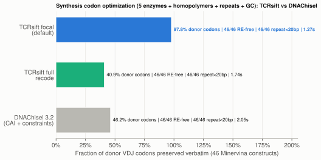
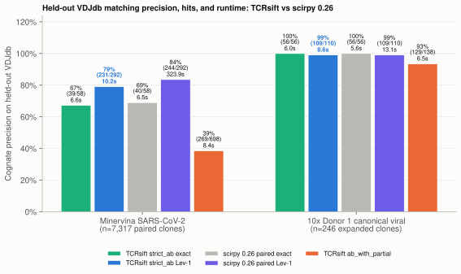
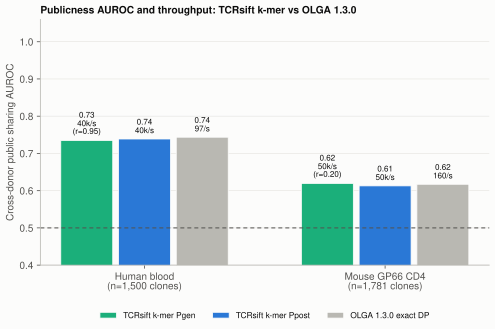
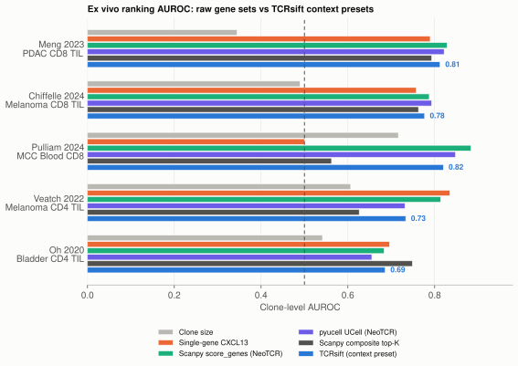
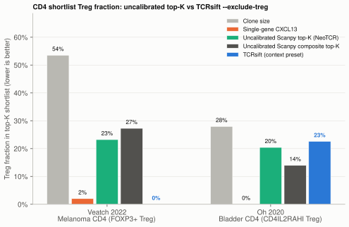

# Benchmark overview and head-to-head comparisons

This page evaluates TCRsift across 13 public human and mouse single-cell datasets (15 cohort evaluations, with Pulliam `GSE227708` and Chiffelle `GSE222448` each evaluated in two clinical contexts) and compares every pipeline stage against nine external open-source Python tools (`stitchr`, `DNAChisel`, `scirpy`, `tcrdist3`, `muon` DSB, `OLGA`, `soNNia`, `Scanpy score_genes`, and `pyucell` UCell).

The benchmarks are ordered from **objective sequence and antigen-binding ground truth** out to **context-dependent transcriptional heuristics**:

1. **[Stage 1 — Construct assembly & codon optimization](#stage-1-do-we-assemble-correct-tcrs)** (`tcrsift assemble` vs `stitchr` and `DNAChisel`)
2. **[Stage 2 — Identifying expected / known antigen-specific TCRs](#stage-2-do-we-identify-expected-antigen-specific-tcrs)** (`tcrsift annotate` vs `scirpy` & `tcrdist3`, `--call-multimers` vs 10x/CLR/`muon` DSB/GMM, `Pgen`/`Ppost` vs `OLGA` & `soNNia`, and paired 16 h restimulation)
3. **[Stage 3 — Expression signatures & selection heuristics](#stage-3-expression-signatures-and-selection-heuristics)** (`tcrsift prioritize` context presets vs `clone_size`, raw `CXCL13`, `Scanpy score_genes`, and `pyucell` UCell)

## High-level results summary

| Stage | Capability | Headline result | Where it degrades / caveat |
| --- | --- | --- | --- |
| **1a** | Construct assembly (`tcrsift assemble` vs `stitchr`) | **100%** complete constructs with **0** validation errors across intact human CR6 (46/46; **9 donor V-variants kept** vs 0 in `stitchr`), 5'-truncated human (160/160 vs 135/160), and mouse Cell Ranger (101/101, **52 `Trbc` fixed** vs 78/101 & 37 chimeras in `stitchr -sc`). | Imputed chains set `construct_contig_verified=False` and require cached IMGT V/J refs; pass `--no-germline-vdj-fallback` for strict contig-only ordering. |
| **1b** | Synthesis codon optimization (`tcrsift` vs `DNAChisel`) | Both `tcrsift` focal (default) and full modes achieve **46/46 (100%)** in-frame, restriction-free, homopolymer-free, repeat-free (`max 13 bp` focal / `17 bp` full vs `19 bp` `DNAChisel`), GC-valid constructs; `focal` keeps **97.8%** of donor VDJ codons verbatim (vs **46.2%** in `DNAChisel`) and runs faster (`1.27s` vs `2.05s`). | `full` recoding replaces donor VDJ codons (`40.9%` kept) with CAI-optimal synonymous codons while avoiding cross-chain β↔α FR2/FR4 repeats; keep `focal` (default) to preserve native donor codons. |
| **2a** | Held-out public DB matching (`tcrsift` vs `scirpy` & `tcrdist3`) | Exact `strict_ab` matches `scirpy` 1:1 (**92.1%** Minervina 35/38, **100%** 10x D1 56/56); paired Lev-1 matches `scirpy` (**210/226** Minervina, **109/110** 10x D1) **18.4x faster** (10.9s vs 200.2s). Native **`tcrsift --match-mode tcrdist`** (`r <= 48`, zero external deps) matches/exceeds `tcrdist3 0.3` on both cohorts (**567/607** = 93.4%, 13.5% recall vs 557/596 on Minervina; **143/145** = 98.6%, 58.1% recall vs 143/144 on 10x D1) while running **15.8x faster** end-to-end (12.9s vs 204.1s). | Public DBs ingest published cohorts, so independent evaluation requires study holdout; V-gene loop scoring requires `alpha_v_gene`/`beta_v_gene` (gracefully degrades to BLOSUM62 CDR3-only when absent). |
| **2b** | Multiplexed pMHC multimer calling (`--call-multimers` vs 10x/CLR/`muon` DSB/GMM) | **100%** cognate precision on held-out VDJdb (109/109), **0** HIV Gag FPs, and **−96.3%** sticky `KLGGALQAK` clones (837 → 31; vs 369 in `muon` DSB `>= 3.0`, which reaches 98.1% precision 101/103). Per-multimer GMM hits 0 `KLGGALQAK` but detects only **6** mega-abundant donor-epitopes vs **20** in `tcrsift`. | Clonal concordance requires ≥2 cells per clone, so singleton binders (e.g. naive `MART-1`) cannot be rescued by clonal concordance alone. |
| **2c** | Sequence publicness (`Pgen`/`Ppost` vs `OLGA` & `soNNia`) | Matches `OLGA` `Pgen` on **both human** ($r=0.954$, AUROC 0.739 vs `soNNia` 0.740 & `OLGA` 0.744) and **mouse** ($r=0.910$ vs `soNNia` $r=0.877$; AUROC 0.600–0.613 vs `OLGA` 0.617 & `soNNia` 0.583) while running **266x–325x faster than `OLGA`** and **846x–943x faster than `soNNia`**. | Bundled mouse model is `Pgen` only (mouse `Ppost` falls back to gene-agnostic Markov unless trained via `tcrsift pgen train --species mouse`). |
| **2d** | Paired 16 h peptide restimulation (`--method stimulation`) | Detects **11/73** cytokine-induced Spike-reactive clones (`Δ > 0.5`, `ΔAIM` up to `+2.47`) where count-based Fisher expansion tests find **0/73** (no overnight division). | Requires a paired unstimulated control well from the same donor. |
| **3** | Expression-based prioritization (`tcrsift` vs `Scanpy` & `pyucell`) | Matches `Scanpy` & `pyucell` on single-signature AUROC (0.81 PDAC, 0.78 melanoma, 0.82 MCC blood), doubles multi-patient Chiffelle recall (**24** vs 15 `pyucell` / 12 `Scanpy`), and cuts Veatch CD4 Treg contamination to **0%** (vs **41.4%** `pyucell` / **23.2%** `Scanpy`). | Does **not** enrich viral-antigen clones in virus-driven tumors (AUROC 0.47–0.58), degrades in Day-30 post-ACT melanoma biopsies (0.74 → 0.61), and rises transiently in blood after acute vaccination (`TumorReactive` 0.74). |

## Why these 13 datasets were included

Each dataset was chosen to test a specific biological setting, experimental ground truth, or known failure mode rather than to maximize favorable scores:

| Cohort group | Datasets included | Why included (what it tests) | Detail page |
| --- | --- | --- | --- |
| **Fresh solid-tumor CD8 TILs** | Meng 2023 (PDAC), Chiffelle 2024 (melanoma `T0`), Caushi 2021 (NSCLC), Eberhardt 2021 (HPV+ HNSCC), Pulliam 2024 (MCC tumor) | Tests `--context solid-tumor` against **direct autologous tumor-reactivity screens with tested negatives** (Meng, Chiffelle), **neoantigen vs viral peptide contrasts** (Caushi, also documenting `MANAscore` circularity), and **virus-driven tumors** (Eberhardt, Pulliam) as negative-result stress tests where chronic exhaustion signatures fail to beat clone size. | [Solid-tumor CD8 TILs](benchmarks.md) |
| **Healthy/infectious blood & restimulation** | 10x Healthy Donors 1 & 2, Minervina 2022 (longitudinal SARS-CoV-2), Fischer 2021 (16 h Spike restimulation) | Tests **outside-tumor calibration**: resting memory vs naive `MART-1` and sticky pMHC dextramers (10x), acute post-vaccine activation confounding `TumorReactive` + CR6 donor V-allele preservation + VDJdb circularity (Minervina), and **overnight restimulation without division + 5'-truncated contigs** (Fischer). | [Infectious & blood](benchmarks-infectious.md) |
| **Cancer blood, post-ACT, & CD4 TILs** | Pulliam 2024 (MCC blood + tumor), Chiffelle 2024 (`T0` vs `T30` ACT), Veatch 2022 (melanoma CD4), Oh 2020 (bladder CD4) | Tests **four non-default edge cases**: circulating `CXCL13`-negative antitumor blood CD8 (`--context blood-tumor`, Pulliam), **post-ACT signature attenuation** (Chiffelle `T30`), **intratumoral `FOXP3+` Treg confounding** in CD4 TILs (`--exclude-treg`, Veatch/Oh), and **88.5% *CD4* mRNA dropout** in FACS-sorted 10x libraries (`pre_sorted: CD4`, Oh). | [Blood-tumor, ACT & CD4](benchmarks-blood-cd4.md) |
| **Murine models (`--species mouse`)** | MC38 multi-organ (`GSE168944`), Kasmani 2022 (NOD `IGRP`), Khatun 2021 (LCMV `GP66` CD4) | Tests **cross-species biology & plumbing**: mouse CD8 TILs lack *Cxcl13* (0.11%+) and rely on *Ccl3*/*Ccl4* (MC38); **within-clone tissue vs spleen control** on identical paired TCRs (Kasmani); pre-CR6 Ensembl `-dv` V-genes, `Trbc1`/`Trbc2` miscalls, and `MusMusculus` VDJdb circularity (MC38, Kasmani, Khatun). | [Murine models](benchmarks-mouse.md) |

For CLI usage and context presets, see [Choose a workflow](index.md#choose-a-workflow) and [Clone Prioritization](user-guide/til-signatures.md).

---

## Stage 1: Do we assemble correct TCRs?

### Full-length construct assembly: `tcrsift assemble` vs `stitchr` (`thimble 1.3.1`)

`stitchr` (`thimble`, Heather et al., *Nucleic Acids Res* 2022) builds TCR coding sequences from `(TRAV, TRAJ, CDR3α, TRBV, TRBJ, CDR3β)` calls using `*01` IMGT germline references. `tcrsift assemble` preserves intact sequenced donor V(D)J contigs (`fwr1_nt`–`fwr4_nt` and native contig leaders) verbatim whenever present, and by default automatically detects 5'-truncated or missing contigs to rescue them from cached IMGT V+J germlines (`{chain}_vdj_source`, `qc_warnings`, and `construct_contig_verified=False` always audit imputed chains; pass `--no-germline-vdj-fallback` for strict contig-only mode).


*Fraction of complete single-chain TCR constructs built by `tcrsift assemble` and `stitchr` (`thimble 1.3.1`) across human Cell Ranger 6 contigs (Minervina 2022, $n=46$), 5'-truncated human deposits (Fischer 2021, $n=160$), and mouse Cell Ranger shortlists (MC38 and Khatun, $n=101$).*

| Cohort | Tool / mode | Clones ($n$) | Complete `M...` constructs | Donor V-framework variants kept | Mismatched `Trbc` shipped | Load-bearing validation errors | Runtime (s) |
| --- | --- | ---: | ---: | ---: | ---: | ---: | ---: |
| Minervina 2022 human CR6 shortlist | `tcrsift_assemble_default` (donor contigs intact) | 46 | 46 (100.0%) | 9 (19.6%) | 0 | **0** | 2.24 |
| | `stitchr / thimble 1.3.1` (`-s HUMAN`) | 46 | 46 (100.0%) | 0 (uses `*01`) | 0 | 0 | 0.23 |
| Fischer 2021 human 5'-truncated | `tcrsift_assemble_default` (auto-rescue) | 160 | 160 (100.0%) | 32 (partial 5' contigs) | 0 | **0** | 18.80 |
| | `tcrsift_strict_contig_only` (`--no-germline-vdj-fallback`) | 160 | 0 (0.0%) | 0 | 0 | 0 | 0.59 |
| | `stitchr / thimble 1.3.1` (`-s HUMAN`) | 160 | 135 (84.4%) | 0 | 0 | 25 (unbuilt) | 0.52 |
| Mouse Cell Ranger shortlists (MC38 + Khatun) | `tcrsift_assemble_default_mouse` (`--species mouse`) | 101 | 101 (100.0%) | 0 | 0 (52 `Trbc` fixed) | **0** | 4.92 |
| | `stitchr / thimble 1.3.1` (`-s MOUSE` default) | 101 | 78 (77.2%) | 0 | 0 | 23 (unbuilt) | 0.21 |
| | `stitchr / thimble 1.3.1` (`-s MOUSE -sc` skip C check) | 101 | 78 (77.2%) | 0 | 37 (47.4% of built) | 23 (unbuilt) | 0.17 |

- **Donor V-region alleles on Cell Ranger 6+ human contigs.** Nine of 46 (19.6%) shortlisted human clones in Minervina 2022 carry donor V-region amino-acid differences from IMGT `*01`; default `tcrsift assemble` retains every intact donor VDJ verbatim (`contig_full`), whereas `stitchr` substitutes `*01` framework residues.
- **5'-truncated deposits (Fischer 2021).** Default `tcrsift assemble` auto-detects the 5' truncation and builds 160 of 160 complete `M...` single-chain constructs with **0** load-bearing validation errors (vs 135/160 = 84.4% in `stitchr`), rescuing 32 partial 5' donor contigs, rejecting unspliced intronic C-tail reads, normalizing Cell Ranger 3 `TRAJ37` J→C boundaries, and logging 15 germline and constant-allele variants. Passing `--no-germline-vdj-fallback` enforces strict contig-only assembly (0/160).
- **Mouse Cell Ranger outputs (`-dv` names and `Trbc` parity).** Default `stitchr -s MOUSE` fails on 23 of 101 (22.8%) mouse candidates due to Ensembl `-dv` V-gene names (`TRAV13-4-dv7`, `TRAV16d-dv11`) and C-gene checks; adding `-sc` (`--skip_c_checks`) still fails on the 23 `-dv` clones and ships 37 `Trbj2+Trbc1` or `Trbj1+Trbc2` chimeras. `tcrsift --species mouse` normalizes `-dv` names and enforces `Trbj1->Trbc1` / `Trbj2->Trbc2` parity (52 Cell Ranger miscalls corrected), building 101 of 101 constructs with 0 validation errors.

### 1b. Synthesis codon optimization: `tcrsift` vs `DNAChisel 3.2.16`

On the 46 Minervina 2022 human single-chain constructs (`β-T2A-α`), we benchmark `tcrsift`'s focal (default) and full codon optimizers against `DNAChisel` (Zulkower & Rosser, *Bioinformatics* 2020) under identical synthesis constraints: avoiding 5 cloning/Golden Gate restriction enzymes (`EcoRI`, `BamHI`, `XhoI`, `BsaI`, `BsmBI`), eliminating ≥9-nt homopolymers, and keeping 50-bp GC windows within 30%–70%, while also auditing direct repeats (`< 20 bp`).



*Fraction of native donor V(D)J codons preserved verbatim while clearing all 5 restriction enzymes, ≥9-nt homopolymers, ≥20-bp direct repeats, and 50-bp GC-window hazards across the 46 Minervina human single-chain constructs.*

| Optimizer | Constructs ($n$) | Exact in-frame AA | Restriction-free (5 enzymes) | Homopolymer < 9 nt | Repeat < 20 bp (max bp) | GC window 30–70% | Donor VDJ codons preserved | Runtime (s) |
| --- | ---: | ---: | ---: | ---: | ---: | ---: | ---: | ---: |
| `tcrsift_focal_opt` (default) | 46 | 46 (100%) | 46 (100%) | 46 (100%) | **46 (13 bp)** | 46 (100%) | **97.8%** | **1.27** |
| `tcrsift_full_opt` | 46 | 46 (100%) | 46 (100%) | 46 (100%) | **46 (17 bp)** | 46 (100%) | 40.9% | 1.74 |
| `DNAChisel 3.2.16` (`CodonOptimize` + constraints) | 46 | 46 (100%) | 46 (100%) | 46 (100%) | **46 (19 bp)** | 46 (100%) | 46.2% | 2.05 |

Both `tcrsift` focal (default) and `full` optimization clear **46/46 (100%)** of all five synthesis-hazard criteria (restriction sites, ≥9-nt homopolymers, ≥20-bp direct repeats, and 30–70% 50-bp GC windows) faster than `DNAChisel` (`1.27s` / `1.74s` vs `2.05s`). In `full` mode, optimizing β before α and passing β's k-mers into `optimize_codons(..., avoid_kmers=...)` prevents conserved α/β framework motifs (`WYRQDPG` FR2, `FGPGTRL` FR4) from creating homologous ≥20 bp repeats across the single-chain construct (`max 17 bp` vs `19 bp` in `DNAChisel`), while `focal` remains the default because it preserves **97.8%** of native donor V(D)J codons verbatim (`max 13 bp`).

---

## Stage 2: Do we identify expected antigen-specific TCRs?

### 2a. Held-out public TCR database matching: `tcrsift annotate` vs `scirpy 0.26.1` & `tcrdist3 0.3`

Across study-held-out VDJdb (`vdjdb-2026-11-06`, holding out `PMID:35383307` for the **4,212 dextramer-verified SARS-CoV-2 paired clones** in Minervina 2022 and holding out all 10x entries for the **246 canonical viral clones** in 10x Healthy Donor 1), we compare `tcrsift annotate` (`strict_ab` exact, `ab_with_partial` exact, `strict_ab` paired Levenshtein-1 `ab_near`, and native zero-dependency `--match-mode tcrdist` at paired `r <= 24`, `r <= 48`, and TRB `r = 0`) against `scirpy` (`ir.pp.ir_dist` + `ir.tl.ir_query`, Sturm et al., *Bioinformatics* 2020) and `tcrdist3` (`TCRrep` paired αβ and β-only CDR1/CDR2/pMHC+CDR3 distance, Mayer-Blackwell et al., *eLife* 2021) using identical modal-consensus species aggregation on Minervina and cognate epitope matching on 10x Donor 1:



*Cognate species/epitope precision, matched counts, and query runtime on study-held-out VDJdb (`vdjdb-2026-11-06`) across Minervina 2022 verified SARS-CoV-2 paired clones ($n=4{,}212$) and 10x Healthy Donor 1 canonical viral multimer clones ($n=246$).*

| Cohort (study held out of VDJdb) | Tool / mode | Query clones ($n$) | Matched clones | Cognate hits | Cognate precision | Cognate recall | Runtime (s) |
| --- | --- | ---: | ---: | ---: | ---: | ---: | ---: |
| Minervina 2022 SARS-CoV-2 (verified) | `tcrsift_strict_ab_exact` | 4,212 | 38 | 35 | **92.1%** | 0.8% | 7.34 |
| | `scirpy 0.26` paired exact (`identity`, `all`) | 4,212 | 38 | 35 | **92.1%** | 0.8% | 6.96 |
| | `tcrsift_strict_ab_lev1` (`ab_near`, ≤1/chain) | 4,212 | 226 | 210 | **92.9%** | 5.0% | **10.86** |
| | `scirpy 0.26` paired Lev-1 (`cutoff=1`, `all`) | 4,212 | 226 | 208 | 92.0% | 4.9% | 200.23 |
| | `tcrsift_strict_ab_tcrdist_r24` (`--match-mode tcrdist`) | 4,212 | 308 | **291** | **94.5%** | **6.9%** | **9.79** |
| | `tcrdist3 0.3` paired αβ (`r <= 24`) | 4,212 | 305 | 288 | **94.4%** | 6.8% | 204.05* |
| | `tcrsift_strict_ab_tcrdist_r48` (`--match-mode tcrdist`) | 4,212 | 607 | **567** | **93.4%** | **13.5%** | **12.89** |
| | `tcrdist3 0.3` paired αβ (`r <= 48`) | 4,212 | 596 | 557 | **93.5%** | 13.2% | 204.05* |
| | `tcrsift_trb_tcrdist_r0` (`b_only`, `tcrdist`, `r = 0`) | 4,212 | 291 | 238 | 81.8% | 5.7% | **9.34** |
| | `tcrdist3 0.3` TRB-only (`r = 0`, CDR3β + TRBV) | 4,212 | 291 | 239 | 82.1% | 5.7% | 194.50 |
| | `tcrsift_ab_with_partial_exact` | 4,212 | 473 | 236 | 49.9% | 5.6% | 10.04 |
| | `scirpy 0.26` TRB-only (`identity`, `VDJ`) | 4,212 | 473 | 235 | 49.7% | 5.6% | 5.01 |
| 10x Donor 1 canonical viral | `tcrsift_strict_ab_exact` | 246 | 56 | 56 | **100.0%** | 22.8% | 7.40 |
| | `scirpy 0.26` paired exact (`identity`, `all`) | 246 | 56 | 56 | **100.0%** | 22.8% | 6.06 |
| | `tcrsift_strict_ab_lev1` (`ab_near`, ≤1/chain) | 246 | 110 | 109 | **99.1%** | 44.3% | **10.53** |
| | `scirpy 0.26` paired Lev-1 (`cutoff=1`, `all`) | 246 | 110 | 109 | **99.1%** | 44.3% | 13.70 |
| | `tcrsift_strict_ab_tcrdist_r24` (`--match-mode tcrdist`) | 246 | 115 | **115** | **100.0%** | **46.7%** | **7.45** |
| | `tcrdist3 0.3` paired αβ (`r <= 24`) | 246 | 114 | 114 | **100.0%** | 46.3% | 8.70* |
| | `tcrsift_strict_ab_tcrdist_r48` (`--match-mode tcrdist`) | 246 | 145 | **143** | 98.6% | **58.1%** | **7.98** |
| | `tcrdist3 0.3` paired αβ (`r <= 48`) | 246 | 144 | **143** | **99.3%** | **58.1%** | 8.70* |
| | `tcrsift_trb_tcrdist_r0` (`b_only`, `tcrdist`, `r = 0`) | 246 | 137 | 134 | 97.8% | 54.5% | 8.05 |
| | `tcrdist3 0.3` TRB-only (`r = 0`, CDR3β + TRBV) | 246 | 137 | 134 | 97.8% | 54.5% | 6.04 |
| | `tcrsift_ab_with_partial_exact` | 246 | 138 | 129 | 93.5% | 52.4% | 9.37 |
| | `scirpy 0.26` TRB-only (`identity`, `VDJ`) | 246 | 138 | 129 | 93.5% | 52.4% | 4.02 |

*\*One paired `tcrdist3` distance computation yields both `r <= 24` and `r <= 48`.*

- **Exact agreement & 18.4x faster paired Levenshtein-1 vs `scirpy`.** Under identical modal-consensus aggregation on the 4,212 verified SARS-CoV-2 clones, `tcrsift` and `scirpy` match the exact same clone sets across paired exact (`35/38 = 92.1%` Minervina, `56/56 = 100.0%` 10x), TRB-only (`473` Minervina, `138` 10x), and paired Levenshtein-1 (`226` Minervina, `110` 10x). `tcrsift`'s deletion-canonical index finishes paired Levenshtein-1 in **10.9 s** vs **200.2 s** in `scirpy` (**18.4x faster**).
- **Native zero-dependency `tcrsift --match-mode tcrdist` matches `tcrdist3` 15.8x faster.** `tcrsift.tcrdist` implements Dash/tcrdist3 V-gene CDR1/CDR2/CDR2.5 loop weighting + BLOSUM62 trimmed-CDR3 alignment in pure Python + NumPy (using bundled 4.3 KB human/mouse IMGT V-gene loops and admissible V-gene + CDR3-length branch-and-bound pruning, without `parasail` or `tcrdist3`). On Minervina, native `tcrsift` `r <= 48` recovers **567/607 (93.4% precision, 13.5% recall)** in **12.9 s** end-to-end (vs **557/596 = 93.5%** in **204.1 s** for `tcrdist3`, **15.8x faster**; ~7.3 s of `tcrsift`'s runtime is shared DB species/antigen canonicalization). The +10 extra cognate hits vs `tcrdist3` come from `tcrsift`'s V-gene canonicalization resolving `TRAV14DV4`/`TRAV14/DV4` and allele variants that `tcrdist3` drops. For β-only exact matching (`r = 0`), requiring `TRBV` agreement cuts Minervina single-chain false positives from 237 (`49.9%` precision) down to 53 (**`81.8%` precision** in **9.3 s** vs **194.5 s** in `tcrdist3`).
- **Database circularity.** Because public VDJdb (`2026-11-06`) ingests published single-cell cohorts (including 10x dextramers, Minervina `PMID:35383307`, and Kasmani `PMID:35667687`), full-DB evaluation measures self-retrieval rather than out-of-sample recall (e.g., Kasmani NOD IGRP recall drops from 91.4% on full VDJdb to 0.0% once `PMID:35667687` is held out). All precision claims in TCRsift benchmarks therefore hold out the evaluated study.

### 2b. Multiplexed pMHC multimer calling

On 10x Genomics Healthy Donors 1 and 2 (2,572 expanded ≥2-cell paired α/β CD8 clones passing `CD3 >= 3` and `UMI >= 2` stained with 44 viral/cancer dextramers and 6 negative-control dextramers), five callers are compared — including `muon 0.2.1` DSB (`muon.prot.pp.dsb` at the standard Mulè et al. 2022 `>= 3.0` cutoff). Note that the [infectious-disease page](benchmarks-infectious.md) evaluates all paired VDJ clones prior to CD8/CD3/UMI filtering (reporting 1,019 → 39 sticky `KLGGALQAK` clones), whereas the head-to-head table below evaluates the CD8/CD3/UMI-filtered expanded repertoire with modal per-cell calls (837 → 31 sticky `KLGGALQAK` clones).


*Expanded clone counts (≥2 cells, Donors 1 and 2 combined) assigned to sticky CMV `KLGGALQAK` or HIV Gag (in HIV-negative donors) versus canonical Influenza, EBV, and CMV multimers across five callers.*


*Cognate epitope precision among called clones matching 10x-held-out `strict_ab` VDJdb (`n_concordant / n_matched`).*

| Multimer caller | Called clones (≥2 cells) | Distinct donor-epitopes called | Sticky `KLGGALQAK` clones | HIV Gag FP clones | Canonical Flu / EBV / CMV clones | Held-out VDJdb `strict_ab` matches | Cognate precision (held-out VDJdb) |
| --- | ---: | ---: | ---: | ---: | ---: | ---: | ---: |
| `10x_per_cell_threshold` (`UMI >= 10`, `>=5x max(NC, 1)` in ≥1 cell) | 1,540 | 28 | 837 | 8 | 667 | 110 | 99.1% (109/110) |
| `clr_z3_per_cell` (`CLR z >= 3` across 44 pMHCs, `UMI >= 5` in ≥1 cell) | 627 | 61 | 2 | 44 | 319 | 68 | 92.6% (63/68) |
| `muon_dsb_per_cell` (`muon 0.2.1` DSB `>= 3.0`, `UMI >= 10`, non-T bg + 6 NC isotypes) | 1,095 | 35 | 369 | 16 | 576 | 103 | 98.1% (101/103) |
| `gmm_bimodal_per_cell` (2-comp `log1p` EM `P >= 0.95`, `UMI >= 10`, `>5x max(NC, 1)` in ≥1 cell) | 729 | **6** | 0 | 0 | 729 | 106 | 100.0% (106/106) |
| `tcrsift_clonal_concordance` (`UMI >= 10`, `>=5x max(NC, 1)`, ≥2 cells & ≥50% concordance) | 605 | **20** | **31** | **0** | 556 | 109 | **100.0% (109/109)** |

- **Per-cell thresholds, CLR, and `muon` DSB.** `10x_per_cell_threshold` labels 837 expanded clones with the sticky `KLGGALQAK` CMV IE-1 reagent (54.4% of called clones). `muon` DSB at the standard `>= 3.0` cutoff achieves strong VDJdb cognate precision (**98.1%**, 101/103) and trims `KLGGALQAK` roughly in half vs 10x (837 → 369), but because it operates per cell it still leaks 369 sticky `KLGGALQAK` and 16 HIV Gag false-positive clones (raising DSB cutoff to `>= 8` suppresses high-background canonical `GILGFVFTL` binders and drops precision to 37.5%). `clr_z3_per_cell` suppresses `KLGGALQAK` (2) but introduces 44 HIV Gag FPs and halves canonical recall (319 vs 556–729).
- **Bimodal GMM vs clonal concordance.** A per-multimer 2-component Gaussian mixture (`gmm_bimodal_per_cell`) rejects unimodal `KLGGALQAK` (0 clones; Donor 2 `KLGGALQAK` peaked at `P=0.9489`, just under `0.95`) at 100.0% (106/106) precision, **but only detects 6 total donor-epitopes** (the 3 mega-abundant specificities >1,400 cells/donor), silently dropping all rarer epitopes (`CMV pp65`, `MART-1`, minor EBV specificities). `tcrsift --call-multimers` requires ≥50% of cells in a clone (≥2 cells) to bind the same pMHC, detecting **20** donor-epitopes while cutting `KLGGALQAK` clones by **96.3%** vs 10x (837 → 31; **−91.6%** vs `muon` DSB), eliminating HIV Gag FPs (**0**), and keeping **109 of 109 (100.0%)** held-out VDJdb matches.

### 2c. Generation probability and post-selection publicness: `tcrsift` k-mer vs `OLGA 1.3.0` & `soNNia 0.4.0`

`OLGA` (Sethna et al., *Bioinformatics* 2019; GPLv3) computes exact V(D)J recombination `Pgen` by dynamic programming, and `soNNia` (`Sonia`, Isacchini et al., *PNAS* 2021) multiplies `Pgen` by a pretrained thymic selection factor $Q$ to compute post-selection `Ppost`. `tcrsift` bundles Apache-2.0 NumPy k-mer `Pgen` models for both human and mouse (and human `Ppost`) in the base package.



*Cross-donor public sharing AUROC, throughput (clones/s), and Pearson correlation with `OLGA 1.3.0` on human blood ($n=1{,}500$; 420 public across donors) and mouse GP66 CD4 ($n=1{,}781$; 72 public across mice).*

| Repertoire (`public >=2 donors`) | Model | Pearson $r$ vs `OLGA` ($\beta$ / $\alpha$) | Spearman $\rho$ vs `OLGA` ($\beta$ / $\alpha$) | Public sharing AUROC (95% CI) | Throughput (clones/s) | Speedup vs `OLGA` / `soNNia` |
| --- | --- | --- | --- | --- | ---: | ---: |
| Human blood ($n = 1{,}500$; 420 public) | `tcrsift` k-mer `pgen_beta` | **0.954** / 0.763 | **0.957** / 0.755 | 0.735 (0.704–0.766) | 30,182 / s | **325x / 943x** |
| | `tcrsift` k-mer `ppost_beta` | — | — | 0.739 (0.708–0.770) | 30,182 / s | **325x / 943x** |
| | `OLGA 1.3.0` exact VDJ `pgen_beta` | 1.000 | 1.000 | 0.744 (0.712–0.774) | 92.8 / s | 1.0x |
| | `soNNia 0.4.0` pretrained `ppost_beta` | 0.980 | 0.973 | 0.740 (0.709–0.770) | 32.0 / s | 0.3x |
| Mouse GP66 CD4 ($n = 1{,}781$; 72 public) | `tcrsift` mouse k-mer `pgen_beta` | **0.910** / 0.665 | **0.904** / 0.648 | 0.600 (0.528–0.667) | 40,529 / s | **266x / 846x** |
| | `tcrsift` AA-Markov `ppost_beta` | — | — | 0.613 (0.550–0.674) | 40,529 / s | **266x / 846x** |
| | `OLGA 1.3.0` `mouse_T_beta` exact DP | 1.000 | 1.000 | 0.617 (0.542–0.686) | 152.5 / s | 1.0x |
| | `soNNia 0.4.0` pretrained `mouse_T_beta` `ppost_beta` | 0.877 | 0.828 | 0.583 (0.514–0.649) | 47.9 / s | 0.3x |

- **Human blood.** `tcrsift` k-mer `pgen_beta` correlates with `OLGA` at $r = 0.954$ ($\rho = 0.957$), `tcrsift` `ppost_beta` matches pretrained `soNNia` `ppost_beta` on cross-donor public sharing AUROC (**0.739** vs **0.740** `soNNia` and **0.744** `OLGA`), and runs **325x faster than `OLGA`** and **943x faster than `soNNia`** (0.050 s vs 16.16 s and 46.84 s).
- **Mouse GP66 CD4.** With bundled murine `kmer_pgen_mouse_{alpha,beta}.npz` tables (fit offline on 500k `OLGA mouse_T_{alpha,beta}` draws), `tcrsift` `pgen_beta` correlates with `OLGA mouse_T_beta` at **$r = 0.910$** ($\rho = 0.904$; exceeding pretrained `soNNia mouse_T_beta`'s $r = 0.877$) while running **266x faster than `OLGA`** and **846x faster than `soNNia`** (0.044 s vs 11.68 s and 37.14 s), with overlapping cross-mouse public sharing AUROC (0.600–0.613 vs 0.617 `OLGA` and 0.583 `soNNia`).

### 2d. Overnight (16 h) peptide restimulation (direct functional assay)

In Fischer 2021 SARS-CoV-2 Spike PBMC restimulation (`GT_6` and `GT_2`; full results on [Infectious disease & blood](benchmarks-infectious.md)), T cells transcribe activation markers and cytokines overnight without dividing, so count-based Fisher expansion tests detect **0 of 58** persistent clones in `GT_6` and **0 of 15** in `GT_2` at FDR < 0.05. Comparing each clone directly against its paired unstimulated control well (`tcrsift run --method stimulation` / `score_stimulation_response`) identifies **9 of 58** clones in `GT_6` and **2 of 15** in `GT_2` with `Δeffector_cytokines > 0.5` and `ΔAIM` shifts up to `+2.47` despite flat cell counts.

---

## Stage 3: Expression signatures and selection heuristics

!!! info "Published gene sets (`NeoTCR8`, `NeoTCR4`, `NeoTCR_PBL`, `MANAscore`) are built into TCRsift"
    `NeoTCR8`, `NeoTCR4`, `NeoTCR_PBL`, and `MANAscore` are **not** external competitors — all four are implemented inside `tcrsift` and run directly inside the `--context solid-tumor` and `--context blood-tumor` presets alongside `TumorReactive` and the 6 core state panels. What the head-to-head table below tests is **shortlist calibration and selection design**: taking the naive uncalibrated top-$K$ of a single published signature (`scanpy.tl.score_genes`) versus running `tcrsift prioritize --context <preset>` (which combines those same published signatures with size-matched random-group floors, hypergeometric subset enrichment, tiered round-robin across patients/samples, `strict_ab` MART-1 exclusion, and `--exclude-treg` for CD4 TILs).

Two published 2024 TIL classifiers are omitted from execution: `predicTCR` (Tan et al., *Nature Biotechnology* 2024) hosts its trained weights behind a proprietary web portal (`predictcr.com`), and `TRTpred` (Pétremand et al., *Nature Biotechnology* 2024) was trained on melanoma cohorts overlapping public melanoma test sets.

### Calibrated context presets (`tcrsift prioritize`) vs uncalibrated top-$K$ baselines

Across five human TIL and cancer-blood cohorts, `tcrsift prioritize` (run with its matching biological context preset at shortlist size $K$) is compared against five uncalibrated baselines taking the top $K$ expanded (≥2-cell) clones:

1. `clone_size`: within-donor clonal abundance rank (`size_percentile`, ties broken by `cell_count`).
2. `raw_CXCL13`: clone mean `log1p(CP10K)` *CXCL13* expression.
3. `Scanpy score_genes (NeoTCR)`: raw `scanpy.tl.score_genes` (`ctrl_size=50, n_bins=25`, with HGNC/`hg19` symbol harmonization) on `NeoTCR8` (CD8 TIL), `NeoTCR_PBL` (MCC blood), or `NeoTCR4` (CD4 TIL).
4. `pyucell UCell (NeoTCR)`: rank-based Mann-Whitney U scoring (`pyucell 0.8.0`, Andreatta & Carmona 2021) on the exact same signed `NeoTCR8` / `NeoTCR_PBL` / `NeoTCR4` gene sets.
5. `Scanpy composite top-K`: equal-weighted mean of `scanpy.tl.score_genes` across all signatures in the context preset.

Because `select_round_robin` produces a discrete shortlist rather than a single global score across unselected clones, the `tcrsift` AUROC column reports the first Tier-1 signature of each context preset (`TumorReactive` for `--context solid-tumor` and `NeoTCR_PBL` for `--context blood-tumor`; per-signature AUROCs for `NeoTCR8`, `NeoTCR4`, `MANAscore`, and all core panels are reported on the cohort pages).



*Clone-level AUROC across five human TIL and cancer-blood cohorts comparing `tcrsift`'s first Tier-1 preset signature against `clone_size`, single-gene `CXCL13`, `scanpy.tl.score_genes` (`NeoTCR8`/`NeoTCR4`/`NeoTCR_PBL`), `pyucell` UCell (`NeoTCR8`/`NeoTCR4`/`NeoTCR_PBL`), and a Scanpy composite across preset signatures.*



*Fraction of top-$K$ shortlisted CD4+ TIL clones annotated as `FOXP3+` Tregs (Veatch 2022, $K=99$) or `CD4IL2RAHI` Tregs (Oh 2020, $K=93$); `tcrsift` is run with `--context solid-tumor --tcell-type cd4 --exclude-treg`.*

| Cohort (positives vs negatives) | Selection strategy | AUROC (95% CI) | Budget $K$ | Positives in top $K$ | Negatives in top $K$ | Tested precision | Treg fraction in top $K$ |
| --- | --- | --- | ---: | ---: | ---: | ---: | ---: |
| Meng 2023 PDAC CD8 TIL (94 TR vs 55 NTR) | `clone_size` | 0.345 (0.252–0.445) | 200 | 45 | 40 | 52.9% | — |
| | `raw_CXCL13` | 0.790 (0.717–0.858) | 200 | 42 | 1 | 97.7% | — |
| | `Scanpy score_genes` (`NeoTCR8`) | 0.829 (0.758–0.895) | 200 | 56 | 2 | 96.6% | — |
| | `pyucell` UCell (`NeoTCR8`) | 0.822 (0.749–0.888) | 200 | 57 | 2 | 96.6% | — |
| | `Scanpy` composite | 0.793 (0.717–0.864) | 200 | 54 | 3 | 94.7% | — |
| | `tcrsift --context solid-tumor` (Tier-1 `TumorReactive`) | 0.813 (0.739–0.887) | 200 | 58 | 12 | 82.9% | — |
| Chiffelle 2024 Melanoma CD8 TIL (72 TR vs 94 NTR) | `clone_size` | 0.490 (0.402–0.575) | 200 | 41 | 64 | 39.0% | — |
| | `raw_CXCL13` | 0.758 (0.684–0.826) | 200 | 5 | 1 | 83.3% | — |
| | `Scanpy score_genes` (`NeoTCR8`) | 0.788 (0.717–0.852) | 200 | 12 | 7 | 63.2% | — |
| | `pyucell` UCell (`NeoTCR8`) | 0.793 (0.722–0.857) | 200 | 15 | 9 | 62.5% | — |
| | `Scanpy` composite | 0.763 (0.686–0.830) | 200 | 14 | 8 | 63.6% | — |
| | `tcrsift --context solid-tumor` (Tier-1 `TumorReactive`) | 0.777 (0.702–0.840) | 200 | **24** | 17 | 58.5% | — |
| Pulliam 2024 MCC Blood CD8 (32 MCPyV vs 14 CMV/EBV/Flu) | `clone_size` | 0.717 (0.526–0.874) | 18 | 2 | 1 | 66.7% | — |
| | `raw_CXCL13` | 0.500 (0.500–0.500) | 18 | 7 | 2 | 77.8% | — |
| | `Scanpy score_genes` (`NeoTCR_PBL`) | 0.884 (0.759–0.980) | 18 | 8 | 0 | 100.0% | — |
| | `pyucell` UCell (`NeoTCR_PBL`) | 0.848 (0.705–0.964) | 18 | 9 | 0 | 100.0% | — |
| | `Scanpy` composite | 0.563 (0.368–0.741) | 18 | 4 | 0 | 100.0% | — |
| | `tcrsift --context blood-tumor` (Tier-1 `NeoTCR_PBL`) | 0.820 (0.686–0.933) | 18 | 3 | 1 | 75.0% | — |
| Veatch 2022 Melanoma CD4 TIL (28 `CD4_neo` vs 1,122 untested; 477 Tregs) | `clone_size` | 0.607 (0.488–0.717) | 99 | 6 | 91 | 6.2% | 53.5% (53/99) |
| | `raw_CXCL13` | 0.835 (0.775–0.880) | 99 | 4 | 95 | 4.0% | 2.0% (2/99) |
| | `Scanpy score_genes` (`NeoTCR4`) | 0.814 (0.735–0.881) | 99 | 10 | 85 | 10.5% | 23.2% (23/99) |
| | `pyucell` UCell (`NeoTCR4`) | 0.732 (0.651–0.804) | 99 | 5 | 90 | 5.3% | 41.4% (41/99) |
| | `Scanpy` composite | 0.626 (0.534–0.714) | 99 | 3 | 94 | 3.1% | 27.3% (27/99) |
| | `tcrsift --context solid-tumor --tcell-type cd4 --exclude-treg` | 0.734 (0.666–0.802) | 99 | 9 | 85 | 9.6% | **0.0% (0/99)** |
| Oh 2020 Bladder CD4 TIL (163 Effector vs 119 `CD4CM`/`TH17`; 163 Tregs) | `clone_size` | 0.542 (0.474–0.607) | 93 | 40 | 20 | 66.7% | 28.0% (26/93) |
| | `raw_CXCL13` | 0.696 (0.639–0.750) | 93 | 70 | 19 | 78.7% | 0.0% (0/93) |
| | `Scanpy score_genes` (`NeoTCR4`) | 0.684 (0.621–0.744) | 93 | 54 | 9 | 85.7% | 20.4% (19/93) |
| | `pyucell` UCell (`NeoTCR4`) | 0.655 (0.593–0.718) | 93 | 49 | 11 | 81.7% | 25.8% (24/93) |
| | `Scanpy` composite | 0.749 (0.691–0.804) | 93 | 64 | 10 | 86.5% | 14.0% (13/93) |
| | `tcrsift --context solid-tumor --tcell-type cd4 --exclude-treg` | 0.686 (0.619–0.748) | 93 | 58 | 10 | 85.3% | 22.6% (21/93) |

- **Ranking AUROC vs multi-patient shortlist recall.** On single-signature AUROC, `scanpy.tl.score_genes`, `pyucell` UCell, and `tcrsift` perform similarly with overlapping confidence intervals across Meng PDAC (0.829 vs 0.822 vs 0.813), Chiffelle melanoma (0.788 vs 0.793 vs 0.777), Pulliam blood (0.884 vs 0.848 vs 0.820), and Oh bladder CD4 (0.684 vs 0.655 vs 0.686). When pooling raw scores across 11 patients into a top-200 shortlist on Chiffelle melanoma, uncalibrated `NeoTCR8` top-$K$ recovers 12 (`Scanpy`) and 15 (`pyucell`) tumor-reactive clones, whereas `tcrsift --context solid-tumor`'s size-matched random-group floors and hypergeometric subset route recover **24**. Conversely, on small blood cohorts where a single signature is preferred ($K=18$ in Pulliam blood), `NeoTCR_PBL` alone captures 8–9 MCPyV clones vs 3 under multi-signature `--context blood-tumor` (pass `--signatures NeoTCR_PBL` to restrict `tcrsift` to `NeoTCR_PBL` alone).
- **Single-gene `CXCL13` precision vs biological context.** Ranking by *CXCL13* alone has high precision in *CXCL13*-expressing human tumors (97.7% in Meng PDAC; 0% Tregs in Oh bladder CD4, where `CD4CXCL13` is part of the positive label), but recovers only 5 of 72 reactive clones in Chiffelle melanoma, collapses to 0.500 AUROC in Pulliam MCC blood where *CXCL13* is unexpressed (its 7 shortlisted clones come from clone-size tie-breaking among zeros), and is detected in only 0.11% of mouse MC38 CD8 TILs.
- **Treg contamination in CD4 TIL shortlists.** On Veatch 2022 melanoma CD4 TILs, uncalibrated `NeoTCR4` top-$K$ places `FOXP3+` Tregs in **41.4%** (41/99, `pyucell`), **23.2%** (23/99, `Scanpy`), and **27.3%** (27/99, `Scanpy` composite) of shortlist slots (53.5% for `clone_size`). `tcrsift --exclude-treg` reduces `FOXP3+` Treg picks to **0.0% (0/99)** while retaining 9 `CD4_neo` clones (vs 5 for `pyucell` and 4 for `raw_CXCL13`). On shallower Oh 2020 bladder 10x libraries, lowering `--treg-foxp3-fraction 0.25` reduces `CD4IL2RAHI` Treg picks from 21 to 17 while keeping 58 effector clones.

### Cross-cohort summary across all 15 evaluations

| Setting | Cohorts | Main finding | Cohort page |
| --- | --- | --- | --- |
| Fresh solid-tumor CD8 TILs (`--context solid-tumor`) | Meng PDAC, Chiffelle melanoma, Caushi NSCLC, Eberhardt HPV+ HNSCC, Pulliam MCC tumor | Ranking by clone size is at or below chance where reactivity was tested directly (AUROC 0.34 in PDAC, 0.49 in melanoma, 0.45 in NSCLC). `TumorReactive` reaches 0.81 in Meng PDAC (94 reactive vs 55 non-reactive; top-200 shortlist 58 reactive and 12 non-reactive, 82.9% precision vs 52.9% for within-donor clone size), 0.78 in Chiffelle melanoma (72 vs 94), and 0.69 in Caushi NSCLC (18 vs 13; 0.87 on the 20 clones passing `--min-cd3 10`). In two virus-driven tumors without tested negatives (Eberhardt HPV+ HNSCC, 0.47; Pulliam MCC tumor, 0.58), `TumorReactive` does not improve over clone size (0.74 and 0.73). | [TIL](benchmarks.md) |
| Cancer blood, post-ACT biopsies, and mouse tissues | Pulliam MCC blood, Chiffelle `T0`/`T30` melanoma, MC38 multi-organ, Kasmani NOD diabetes | *CXCL13* is absent in circulating antitumor blood CD8 T cells (AUROC 0.50) and mouse CD8 TILs (0.11% *Cxcl13*+ cells). In Pulliam MCC blood (32 MCPyV vs 14 CMV/EBV/Flu clones), `NeoTCR_PBL` reaches 0.82 vs 0.33 for `CirculatingMemory` and 0.50 for `CXCL13`. In mouse MC38 (11,779 CD8 TILs: 38.8% *Ccl3*+, 73.6% *Ccl4*+), MGI `TumorReactive` reaches 0.99 vs lymph node and spleen (clone size 0.78); in Kasmani NOD diabetes (59 islet vs 75 splenic IGRP tetramer+ clones) it reaches 0.97, with 50 of 51 shared sister clones scoring higher in islets. In Chiffelle Day-30 post-ACT melanoma biopsies (`T30`), all ex vivo expression signatures degrade after lymphodepletion, rapid expansion, and high-dose IL-2 (`TumorReactive` drops from 0.74 at `T0` [62.5% shortlist precision] to 0.61 at `T30` [28.6% precision], `AIM` is 0.55, `Cytolytic` 0.48, and `AntigenExperienced` 0.33), because infused non-reactive bystander TILs retain an effector/experienced state. | [Blood & CD4](benchmarks-blood-cd4.md), [Mouse](benchmarks-mouse.md) |
| Human and mouse CD4+ TILs, *CD4* dropout, and Tregs | Veatch 2022 melanoma CD4, Oh 2020 bladder CD4, Khatun 2021 mouse GP66 CD4 | Droplet scRNA-seq misses *CD4* mRNA in 88.5% of FACS-sorted human CD4 T cells; setting `pre_sorted: CD4` increases retention from 708 to 6,144 cells (8.7x; shortlist 103 vs 7 clones) in Oh 2020 and from 9,046 to 11,413 cells (+26.2%) in Khatun 2021, while `hg19` symbol aliases resolve all 40 `NeoTCR4` genes. Because intratumoral `FOXP3+` Tregs express `ENTPD1`, `CTLA4`, `TIGIT`, and `TNFRSF9` (`AIM` AUROC 0.16 for effectors vs `CD4IL2RAHI` Tregs), `--exclude-treg` removes all 61 `FOXP3+` Treg picks on Veatch 2022 (38.1% to 0.0% of shortlist) while keeping 9 of 9 `CD4_neo` and 5 of 5 `CD4_self` picks. | [Blood & CD4](benchmarks-blood-cd4.md), [Mouse](benchmarks-mouse.md) |

---

## Reproducing

Run the four cohort benchmark suites first so their cached datasets and scored clone tables exist (see each cohort page below), then install the comparator tools and execute the head-to-head script:

```bash
pip install stitchr==1.3.1 dnachisel==3.2.16 scirpy==0.26.1 muon==0.2.1 \
    olga==1.3.0 sonnia==0.4.0 pyucell==0.8.0 scanpy
stitchrdl -s HUMAN && stitchrdl -s MOUSE

# Isolated tcrdist3 environment (prebuilt bioconda parasail avoids macOS arm64 source builds;
# alternatively build benchmarks/head_to_head/Dockerfile.tcrdist)
micromamba create -y -p /tmp/tcrdist_env -c conda-forge -c bioconda \
    python=3.11 numpy scipy pandas parasail-python
/tmp/tcrdist_env/bin/pip install tcrdist3==0.3

KERAS_BACKEND=torch python benchmarks/head_to_head/run.py \
    --tcrdist-python /tmp/tcrdist_env/bin/python
python scripts/figures/make_overview_benchmark_figures.py
```

Cohort-specific methods, downloads, and patient-level tables are documented on each benchmark page:

1. [Benchmark on public TIL data](benchmarks.md) (Meng 2023 PDAC, Chiffelle 2024 melanoma, Caushi 2021 NSCLC, Eberhardt 2021 HPV+ HNSCC, Pulliam 2024 MCC tumor).
2. [Benchmark on infectious disease and blood](benchmarks-infectious.md) (10x Healthy Donors 1 and 2, Minervina 2022 SARS-CoV-2, Fischer 2021 16 h Spike restimulation).
3. [Benchmark on paired blood-tumor, post-ACT, and CD4+ TILs](benchmarks-blood-cd4.md) (Pulliam 2024 MCC blood, Chiffelle `T0` vs `T30` ACT, Veatch 2022 melanoma CD4, Oh 2020 bladder CD4).
4. [Benchmark on murine models (`--species mouse`)](benchmarks-mouse.md) (MC38 colon adenocarcinoma, Kasmani 2022 NOD IGRP, Khatun 2021 LCMV GP66 CD4).
