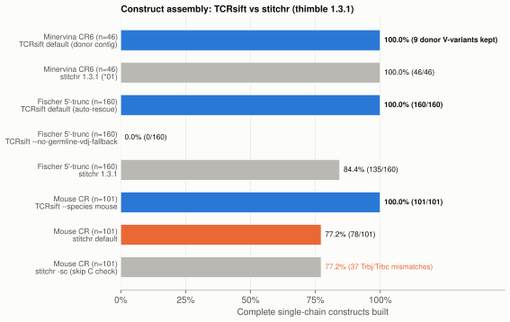
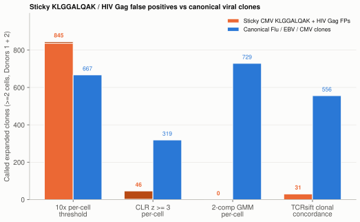
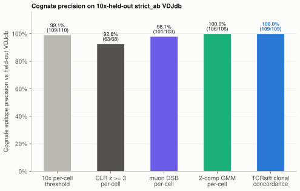

# Benchmark overview and head-to-head comparisons

This page evaluates TCRsift across 13 public human and mouse single-cell datasets (15 cohort evaluations, with Pulliam `GSE227708` and Chiffelle `GSE222448` each evaluated in two distinct clinical contexts; all five benchmark suites regenerated on `tcrsift 3.38.1`) and compares each pipeline stage against external open-source tools (`stitchr`, `OLGA`, per-cell/CLR/GMM multimer callers, and uncalibrated `Scanpy score_genes`).

The evaluation is organized from **objective sequence and antigen-binding ground truth** out to **context-dependent transcriptional heuristics**:

1. **[Stage 1 — Construct assembly correctness](#stage-1-do-we-assemble-correct-tcrs)**: Do we build valid, donor-faithful full-length TCR constructs (`tcrsift assemble` vs `stitchr`)?
2. **[Stage 2 — Identifying expected / known antigen-specific TCRs](#stage-2-do-we-identify-expected-antigen-specific-tcrs)**: Do we accurately call known cognate TCRs via public database matching (`strict_ab`), multiplexed pMHC multimers (`--call-multimers`), sequence publicness (`Pgen`/`Ppost` vs `OLGA`), and overnight peptide restimulation (`ΔAIM`/`Δcytokines`)?
3. **[Stage 3 — Expression signatures & context-dependent selection heuristics](#stage-3-expression-signatures-and-selection-heuristics)**: How well do transcriptional signatures and calibrated shortlist selection recover experimentally verified reactive clones across fresh TILs, cancer blood, post-ACT biopsies, CD4 TILs, and murine tissues?

Per-patient tables and sensitivity analyses live on the cohort pages for [solid-tumor CD8 TILs](benchmarks.md), [infectious disease and blood](benchmarks-infectious.md), [paired blood-tumor, post-ACT, and CD4 TILs](benchmarks-blood-cd4.md), and [murine models](benchmarks-mouse.md).

---

## Ontology of biological contexts and assays

TCRsift does **not** apply one universal expression heuristic across all T-cell assays. What a transcriptional signature means depends on both the **assay regime** (direct sequencing vs pMHC multimer vs peptide stimulation vs multi-day expansion culture) and the **anatomical compartment / antigen-exposure history** (fresh solid-tumor TIL vs post-ACT biopsy vs cancer blood vs infection blood):

| Regime | Biological compartment & exposure | Assay / signal | Command & mode | Primary (Tier-1) expression or selection signal |
| --- | --- | --- | --- | --- |
| **Tumor-resident TILs** | Fresh / untreated solid-tumor TIL (chronic in-situ antigen) | Ex vivo 10x VDJ + GEX | `tcrsift prioritize -o out/ --context solid-tumor [--tcell-type cd4 --exclude-treg] --assemble` | `TumorReactive`, `MANAscore`, `NeoTCR8` (CD8) / `NeoTCR4` (CD4); mouse uses MGI `TumorReactive` + 6 core panels |
| **Tumor-resident TILs** | Post-ACT / infused TIL biopsy (recently infused expanded cells) | Ex vivo 10x VDJ + GEX | `tcrsift prioritize -o out/ --context post-act --assemble` | `AntigenExperienced`, `Cytolytic`, `Differentiated` (does not assume chronic *CXCL13*/*CD39* residency) |
| **Circulating T cells** | Cancer-patient peripheral blood (circulating antitumor, *CXCL13*-negative) | Ex vivo 10x VDJ + GEX | `tcrsift prioritize -o out/ --context blood-tumor --assemble` | `NeoTCR_PBL` (Tier 1), then `CirculatingMemory` + 6 core panels |
| **Circulating T cells** | Infection, vaccine, healthy, or hematologic-malignancy blood/marrow | Ex vivo VDJ + GEX (± pMHC multimers) | `tcrsift prioritize -o out/ --context blood [--call-multimers] --assemble` | `CirculatingMemory` + 6 core panels; with `--call-multimers`, clonal pMHC concordance + NC gating |
| **Peptide-stimulated T cells** | Short-term (6–24 h) restimulation **with paired unstimulated control** | Paired-control acute activation (no division) | `tcrsift run -s samples.yaml -o out/ --method stimulation` | Within-clone `ΔAIM` and `Δeffector_cytokines` vs `source: control` well |
| **Peptide-stimulated T cells** | Short-term (6–24 h) restimulation **without paired unstimulated control** | Single-sample acute activation | `tcrsift prioritize -o out/ --context peptide-stim --assemble` | `AIM`, `AcuteActivation`, `Proliferation`, `Cytolytic` (no chronic exhaustion assumption) |
| **Peptide-stimulated T cells** | Multi-day (7–14 d) peptide / minigene expansion culture | Clonal expansion across antigen pools | `tcrsift run -s samples.yaml -o out/ --method threshold` *(or `logistic`)* | Clonal frequency & specificity tiers across culture pools |
| **Tissue-agnostic fallback** | Unspecified tissue or exploratory run | Ex vivo 10x VDJ + GEX | `tcrsift prioritize -o out/ --context generic` *(CLI default if `--context` is omitted)* | 6 core state panels only (`Differentiated`, `AntigenExperienced`, `Cytolytic`, `AcuteActivation`, `Proliferation`, `AIM`) |

Two legacy anatomy-specific variants remain accepted for backward compatibility: `--context heme` (identical alias for `blood`) and `--context mpe` (effusion variant of `solid-tumor` omitting epithelial `ITGAE`-containing `TumorReactive`). For murine datasets, `--species mouse` (auto-detected under `--species auto`) automatically switches to MGI gene symbols, omits primate/human-lncRNA sets (`NeoTCR4`/`NeoTCR8`/`NeoTCR_PBL`/`MANAscore`), normalizes Cell Ranger `-dv` V-gene names, and enforces `Trbj`/`Trbc` constant parity.

---

## Stage 1: Do we assemble correct TCRs?

### Full-length construct assembly: `tcrsift assemble` vs `stitchr` (`thimble 1.3.1`)

`stitchr` (`thimble`, Heather et al., *Nucleic Acids Res* 2022) builds TCR coding sequences from `(TRAV, TRAJ, CDR3α, TRBV, TRBJ, CDR3β)` calls using `*01` IMGT germline references. `tcrsift assemble` uses sequenced donor V(D)J contigs (`fwr1_nt`–`fwr4_nt` and native contig leaders) when present and falls back to cached IMGT V+J germlines and germline `M...` leaders when `--germline-vdj-fallback` is set.



*Fraction of complete single-chain TCR constructs built by `tcrsift assemble` and `stitchr` (`thimble 1.3.1`) across human Cell Ranger 6 contigs (Minervina 2022, $n=46$), 5'-truncated human deposits (Fischer 2021, $n=160$), and mouse Cell Ranger shortlists (MC38 and Khatun, $n=101$).*

| Cohort | Tool / mode | Clones ($n$) | Complete `M...` constructs | Donor V-framework variants kept | Mismatched `Trbc` shipped | Contig / build QC flags | Runtime (s) |
| --- | --- | ---: | ---: | ---: | ---: | ---: | ---: |
| Minervina 2022 human CR6 shortlist | `tcrsift_donor_contig` | 46 | 46 (100.0%) | 9 (19.6%) | 0 | 0 | 1.47 |
| | `stitchr / thimble 1.3.1` (`-s HUMAN`) | 46 | 46 (100.0%) | 0 (uses `*01`) | 0 | 0 | 0.16 |
| Fischer 2021 human 5'-truncated | `tcrsift_donor_contig_only` (strict default) | 160 | 0 (0.0%) | 0 | 0 | 0 | 0.49 |
| | `tcrsift_germline_vdj_fallback` | 160 | 160 (100.0%) | 32 (partial 5' contigs) | 0 | 29 (raw JSON C-tail flags) | 11.34 |
| | `stitchr / thimble 1.3.1` (`-s HUMAN`) | 160 | 135 (84.4%) | 0 | 0 | 25 (unbuilt) | 0.19 |
| Mouse Cell Ranger shortlists (MC38 + Khatun) | `tcrsift_mouse_germline_fallback` (`--species mouse`) | 101 | 101 (100.0%) | 0 | 0 (52 `Trbc` fixed) | 0 | 3.59 |
| | `stitchr / thimble 1.3.1` (`-s MOUSE` default) | 101 | 78 (77.2%) | 0 | 0 | 23 (unbuilt) | 0.13 |
| | `stitchr / thimble 1.3.1` (`-s MOUSE -sc` skip C check) | 101 | 78 (77.2%) | 0 | 37 (47.4% of built) | 23 (unbuilt) | 0.12 |

- **Donor V-region alleles on Cell Ranger 6+ human contigs.** Nine of 46 (19.6%) shortlisted human clones in Minervina 2022 carry donor V-region amino-acid differences from IMGT `*01`; `tcrsift` retains the sequenced donor VDJ, whereas `stitchr` substitutes `*01` framework residues.
- **5'-truncated deposits (Fischer 2021).** Strict `tcrsift` refuses to build incomplete contigs (0/160). Adding `--germline-vdj-fallback` builds 160 of 160 complete `M...` single-chain constructs (vs 135/160 = 84.4% in `stitchr`), rescuing 32 partial 5' donor contigs, logging 15 germline and constant-allele variants (including 3 donor constant-allele divergences), and flagging 29 clones where unfiltered `all_contig_annotations.json.gz` reads carry 3' C-region primer or junction errors (`single_chain_nt_optimized` remains in-frame for all 160).
- **Mouse Cell Ranger outputs (`-dv` names and `Trbc` parity).** Default `stitchr -s MOUSE` fails on 23 of 101 (22.8%) mouse candidates due to Ensembl `-dv` V-gene names (`TRAV13-4-dv7`, `TRAV16d-dv11`) and C-gene checks; adding `-sc` (`--skip_c_checks`) still fails on the 23 `-dv` clones and ships 37 `Trbj2+Trbc1` or `Trbj1+Trbc2` chimeras. `tcrsift --species mouse` normalizes `-dv` names and enforces `Trbj1->Trbc1` / `Trbj2->Trbc2` parity (52 Cell Ranger miscalls corrected), building 101 of 101 constructs with 0 validation errors.

---

## Stage 2: Do we identify expected antigen-specific TCRs?

### 2a. Public TCR database matching and VDJdb circularity

Across 10x Healthy Donors 1 & 2, Minervina 2022 SARS-CoV-2, Kasmani 2022 NOD islet IGRP, and MC38 murine TILs (detailed on [Infectious disease & blood](benchmarks-infectious.md) and [Murine models](benchmarks-mouse.md)):

- **Paired `strict_ab` vs partial β-chain matching.** On study-held-out Minervina SARS-CoV-2 (4,212 clones), paired `strict_ab` achieves **92.1% virus precision and 78.9% epitope precision** vs 49.9% and 44.0% under `ab_with_partial` (which generates 237 off-target β-chain hits out of 473 matches). On held-out 10x Donors 1 & 2, `strict_ab` achieves **100.0% epitope precision** (44/44 and 65/65). On C57BL/6 MC38 murine TILs, `strict_ab` cuts false public-DB matches from 135/1,763 (7.7%) to 1/1,763 (0.06%).
- **Database circularity.** Because public VDJdb (`2026-11-06`) ingests published single-cell cohorts (including 10x dextramers, Minervina `PMID:35383307`, and Kasmani `PMID:35667687`), full-DB evaluation measures self-retrieval rather than out-of-sample recall (e.g., Kasmani NOD IGRP recall drops from 91.4% on full VDJdb to 0.0% once `PMID:35667687` is held out). All precision claims in TCRsift benchmarks therefore hold out the evaluated study.

### 2b. Multiplexed pMHC multimer calling

On 10x Genomics Healthy Donors 1 and 2 (2,572 expanded ≥2-cell paired α/β CD8 clones passing `CD3 >= 3` and `UMI >= 2` stained with 44 viral/cancer dextramers and 6 negative-control dextramers), four callers are compared. Note that the [infectious-disease page](benchmarks-infectious.md) evaluates all paired VDJ clones prior to CD8/CD3/UMI filtering (reporting 1,019 → 39 sticky `KLGGALQAK` clones), whereas the head-to-head table below evaluates the CD8/CD3/UMI-filtered expanded repertoire with modal per-cell calls (837 → 31 sticky `KLGGALQAK` clones).



*Expanded clone counts (≥2 cells, Donors 1 and 2 combined) assigned to sticky CMV `KLGGALQAK` or HIV Gag (in HIV-negative donors) versus canonical Influenza, EBV, and CMV multimers across four callers.*



*Cognate epitope precision among called clones matching 10x-held-out `strict_ab` VDJdb (`n_concordant / n_matched`).*

| Multimer caller | Called clones (≥2 cells) | Sticky `KLGGALQAK` clones | HIV Gag FP clones | Canonical Flu / EBV / CMV clones | Held-out VDJdb `strict_ab` matches | Cognate precision (held-out VDJdb) |
| --- | ---: | ---: | ---: | ---: | ---: | ---: |
| `10x_per_cell_threshold` (`UMI >= 10`, `>=5x max(NC, 1)` in ≥1 cell) | 1,540 | 837 | 8 | 667 | 110 | 99.1% (109/110) |
| `clr_z3_per_cell` (`CLR z >= 3` across 44 pMHCs, `UMI >= 5` in ≥1 cell) | 627 | 2 | 44 | 319 | 68 | 92.6% (63/68) |
| `gmm_bimodal_per_cell` (2-comp `log1p` EM `P >= 0.95`, `UMI >= 10`, `>5x max(NC, 1)` in ≥1 cell) | 729 | 0 | 0 | 729 | 106 | 100.0% (106/106) |
| `tcrsift_clonal_concordance` (`UMI >= 10`, `>=5x max(NC, 1)`, ≥2 cells & ≥50% concordance) | 605 | 31 | 0 | 556 | 109 | 100.0% (109/109) |

- **Per-cell thresholds and CLR.** `10x_per_cell_threshold` labels 837 expanded clones with the sticky `KLGGALQAK` CMV IE-1 reagent (54.4% of called clones) because single-cell background hits at least one cell in most large clones. `clr_z3_per_cell` suppresses `KLGGALQAK` (whose widespread background raises column mean and SD) but introduces 44 HIV Gag false-positive clones in HIV-negative donors, misses half of canonical Flu/EBV/CMV clones (319 vs 556–729), and lowers held-out VDJdb precision to 92.6% (63/68).
- **Bimodal GMM vs clonal concordance.** Fitting a 2-component Gaussian mixture per multimer (`gmm_bimodal_per_cell`) rejects unimodal `KLGGALQAK` (0 clones) at 100.0% (106/106) held-out VDJdb precision, provided each multimer has a distinct positive mode in the library. `tcrsift --call-multimers` requires at least 50% of cells in a clone (and at least 2 cells) to bind the same pMHC, cutting `KLGGALQAK` clones by 96.3% (837 to 31) and HIV Gag false positives to 0 while retaining 109 of 109 (100.0%) held-out VDJdb matches without fitting per-library mixture models.

### 2c. Generation probability and publicness: `tcrsift` k-mer vs `OLGA 1.3.0`

`OLGA` (Sethna et al., *Bioinformatics* 2019; GPLv3) computes exact V(D)J generation probabilities by dynamic programming. `tcrsift` bundles an Apache-2.0 NumPy k-mer `Pgen`/`Ppost` model in the base package.


*Cross-donor public sharing AUROC, throughput (clones/s), and Pearson correlation with `OLGA 1.3.0` on human blood ($n=1{,}500$; 420 public across donors) and mouse GP66 CD4 ($n=1{,}781$; 72 public across mice).*

| Repertoire (`public >=2 donors`) | Model | Pearson $r$ vs `OLGA` ($\beta$ / $\alpha$) | Spearman $\rho$ vs `OLGA` ($\beta$ / $\alpha$) | Public sharing AUROC (95% CI) | Throughput (clones/s) | Speedup vs `OLGA` |
| --- | --- | --- | --- | --- | ---: | ---: |
| Human blood ($n = 1{,}500$; 420 public) | `tcrsift` k-mer `pgen_beta` | 0.954 / 0.763 | 0.957 / 0.755 | 0.735 (0.704–0.766) | 44,009 / s | 453x |
| | `tcrsift` k-mer `ppost_beta` | — | — | 0.739 (0.708–0.770) | 44,009 / s | 453x |
| | `OLGA 1.3.0` exact VDJ `pgen_beta` | 1.000 | 1.000 | 0.744 (0.712–0.774) | 97.2 / s | 1.0x |
| Mouse GP66 CD4 ($n = 1{,}781$; 72 public) | `tcrsift` AA-Markov fallback `pgen_beta` | 0.198 / 0.224 | 0.235 / 0.208 | 0.620 (0.555–0.680) | 50,328 / s | 323x |
| | `tcrsift` AA-Markov fallback `ppost_beta` | — | — | 0.613 (0.550–0.674) | 50,328 / s | 323x |
| | `OLGA 1.3.0` `mouse_T_beta` exact DP | 1.000 | 1.000 | 0.617 (0.542–0.686) | 155.8 / s | 1.0x |

- **Human blood.** `tcrsift` k-mer `pgen_beta` correlates with `OLGA` at $r = 0.954$ ($\rho = 0.957$), reaches similar cross-donor public sharing AUROC (0.735 `Pgen` and 0.739 `Ppost` vs 0.744 `OLGA`), and runs 453x faster (0.034 s vs 15.44 s).
- **Mouse fallback.** Because `tcrsift` does not ship a pre-trained mouse V(D)J k-mer table (`tcrsift pgen train --species mouse` fits one from repertoire data), it logs a fallback notice and scores mouse chains with the bundled human-fitted amino-acid Markov table. Correlation with `OLGA mouse_T_beta` is low ($r = 0.198$), though empirical cross-mouse public sharing AUROC across the five Khatun C57BL/6 mice is similar (0.620 vs 0.617).

### 2d. Overnight (16 h) peptide restimulation (direct functional assay)

In Fischer 2021 SARS-CoV-2 Spike PBMC restimulation (`GT_6` and `GT_2`; full results on [Infectious disease & blood](benchmarks-infectious.md)), T cells transcribe activation markers and cytokines overnight without dividing, so count-based Fisher expansion tests detect **0 of 58** persistent clones in `GT_6` and **0 of 15** in `GT_2` at FDR < 0.05. Comparing each clone directly against its paired unstimulated control well (`tcrsift run --method stimulation` / `score_stimulation_response`) identifies **9 of 58** clones in `GT_6` and **2 of 15** in `GT_2` with `Δeffector_cytokines > 0.5` and `ΔAIM` shifts up to `+2.47` despite flat cell counts.

---

## Stage 3: Expression signatures and selection heuristics

!!! info "Published gene sets (`NeoTCR8`, `NeoTCR4`, `NeoTCR_PBL`, `MANAscore`) are built into TCRsift"
    `NeoTCR8`, `NeoTCR4`, `NeoTCR_PBL`, and `MANAscore` are **not** external competitors — all four are implemented inside `tcrsift` and run directly inside the `--context solid-tumor` and `--context blood-tumor` presets alongside `TumorReactive` and the 6 core state panels. What the head-to-head table below tests is **shortlist calibration and selection design**: taking the naive uncalibrated top-$K$ of a single published signature (`scanpy.tl.score_genes`) versus running `tcrsift prioritize --context <preset>` (which combines those same published signatures with size-matched random-group floors, hypergeometric subset enrichment, tiered round-robin across patients/samples, `strict_ab` MART-1 exclusion, and `--exclude-treg` for CD4 TILs).

Two published 2024 TIL classifiers are omitted from execution: `predicTCR` (Tan et al., *Nature Biotechnology* 2024) hosts its trained weights behind a proprietary web portal (`predictcr.com`), and `TRTpred` (Pétremand et al., *Nature Biotechnology* 2024) was trained on melanoma cohorts overlapping public melanoma test sets.

### Calibrated context presets (`tcrsift prioritize`) vs uncalibrated top-$K$ baselines

Across five human TIL and cancer-blood cohorts, `tcrsift prioritize` (run with its matching biological context preset at shortlist size $K$) is compared against four uncalibrated baselines taking the top $K$ expanded (≥2-cell) clones:

1. `clone_size`: within-donor clonal abundance rank (`size_percentile`, ties broken by `cell_count`).
2. `raw_CXCL13`: clone mean `log1p(CP10K)` *CXCL13* expression.
3. `Uncalibrated Scanpy top-K (NeoTCR)`: raw `scanpy.tl.score_genes` (`ctrl_size=50, n_bins=25`, with HGNC/`hg19` symbol harmonization) on `NeoTCR8` (CD8 TIL), `NeoTCR_PBL` (MCC blood), or `NeoTCR4` (CD4 TIL), ranked directly without size-matched background floors or Treg filtering.
4. `Uncalibrated Scanpy composite top-K`: equal-weighted mean of `scanpy.tl.score_genes` across all signatures in the context preset.

Because `select_round_robin` produces a discrete shortlist rather than a single global score across unselected clones, the `tcrsift` AUROC column reports the first Tier-1 signature of each context preset (`TumorReactive` for `--context solid-tumor` and `NeoTCR_PBL` for `--context blood-tumor`; per-signature AUROCs for `NeoTCR8`, `NeoTCR4`, `MANAscore`, and all core panels are reported on the cohort pages).


*Clone-level AUROC across five human TIL and cancer-blood cohorts comparing `tcrsift`'s first Tier-1 preset signature against `clone_size`, single-gene `CXCL13`, uncalibrated `scanpy.tl.score_genes` (`NeoTCR8`/`NeoTCR4`/`NeoTCR_PBL`), and an uncalibrated Scanpy composite across preset signatures.*


*Fraction of top-$K$ shortlisted CD4+ TIL clones annotated as `FOXP3+` Tregs (Veatch 2022, $K=99$) or `CD4IL2RAHI` Tregs (Oh 2020, $K=93$); `tcrsift` is run with `--context solid-tumor --tcell-type cd4 --exclude-treg`.*

| Cohort (positives vs negatives) | Selection strategy | AUROC (95% CI) | Budget $K$ | Positives in top $K$ | Negatives in top $K$ | Tested precision | Treg fraction in top $K$ |
| --- | --- | --- | ---: | ---: | ---: | ---: | ---: |
| Meng 2023 PDAC CD8 TIL (94 TR vs 55 NTR) | `clone_size` | 0.345 (0.252–0.445) | 200 | 45 | 40 | 52.9% | — |
| | `raw_CXCL13` | 0.790 (0.717–0.858) | 200 | 42 | 1 | 97.7% | — |
| | Uncalibrated Scanpy (`NeoTCR8`) | 0.829 (0.758–0.895) | 200 | 56 | 2 | 96.6% | — |
| | Uncalibrated Scanpy composite | 0.793 (0.717–0.864) | 200 | 54 | 3 | 94.7% | — |
| | `tcrsift --context solid-tumor` (Tier-1 `TumorReactive`) | 0.813 (0.739–0.887) | 200 | 58 | 12 | 82.9% | — |
| Chiffelle 2024 Melanoma CD8 TIL (72 TR vs 94 NTR) | `clone_size` | 0.490 (0.402–0.575) | 200 | 41 | 64 | 39.0% | — |
| | `raw_CXCL13` | 0.758 (0.684–0.826) | 200 | 5 | 1 | 83.3% | — |
| | Uncalibrated Scanpy (`NeoTCR8`) | 0.788 (0.717–0.852) | 200 | 12 | 7 | 63.2% | — |
| | Uncalibrated Scanpy composite | 0.763 (0.686–0.830) | 200 | 14 | 8 | 63.6% | — |
| | `tcrsift --context solid-tumor` (Tier-1 `TumorReactive`) | 0.777 (0.702–0.840) | 200 | 24 | 17 | 58.5% | — |
| Pulliam 2024 MCC Blood CD8 (32 MCPyV vs 14 CMV/EBV/Flu) | `clone_size` | 0.717 (0.526–0.874) | 18 | 2 | 1 | 66.7% | — |
| | `raw_CXCL13` | 0.500 (0.500–0.500) | 18 | 7 | 2 | 77.8% | — |
| | Uncalibrated Scanpy (`NeoTCR_PBL`) | 0.884 (0.759–0.980) | 18 | 8 | 0 | 100.0% | — |
| | Uncalibrated Scanpy composite | 0.563 (0.368–0.741) | 18 | 4 | 0 | 100.0% | — |
| | `tcrsift --context blood-tumor` (Tier-1 `NeoTCR_PBL`) | 0.820 (0.686–0.933) | 18 | 3 | 1 | 75.0% | — |
| Veatch 2022 Melanoma CD4 TIL (28 `CD4_neo` vs 1,122 untested; 477 Tregs) | `clone_size` | 0.607 (0.488–0.717) | 99 | 6 | 91 | 6.2% | 53.5% (53/99) |
| | `raw_CXCL13` | 0.835 (0.775–0.880) | 99 | 4 | 95 | 4.0% | 2.0% (2/99) |
| | Uncalibrated Scanpy (`NeoTCR4`) | 0.814 (0.735–0.881) | 99 | 10 | 85 | 10.5% | 23.2% (23/99) |
| | Uncalibrated Scanpy composite | 0.626 (0.534–0.714) | 99 | 3 | 94 | 3.1% | 27.3% (27/99) |
| | `tcrsift --context solid-tumor --tcell-type cd4 --exclude-treg` | 0.734 (0.666–0.802) | 99 | 9 | 85 | 9.6% | 0.0% (0/99) |
| Oh 2020 Bladder CD4 TIL (163 Effector vs 119 `CD4CM`/`TH17`; 163 Tregs) | `clone_size` | 0.542 (0.474–0.607) | 93 | 40 | 20 | 66.7% | 28.0% (26/93) |
| | `raw_CXCL13` | 0.696 (0.639–0.750) | 93 | 70 | 19 | 78.7% | 0.0% (0/93) |
| | Uncalibrated Scanpy (`NeoTCR4`) | 0.684 (0.621–0.744) | 93 | 54 | 9 | 85.7% | 20.4% (19/93) |
| | Uncalibrated Scanpy composite | 0.749 (0.691–0.804) | 93 | 64 | 10 | 86.5% | 14.0% (13/93) |
| | `tcrsift --context solid-tumor --tcell-type cd4 --exclude-treg` | 0.686 (0.619–0.748) | 93 | 58 | 10 | 85.3% | 22.6% (21/93) |

- **Ranking AUROC vs multi-patient shortlist recall.** On single-signature AUROC, `scanpy.tl.score_genes` and `tcrsift` perform similarly with overlapping confidence intervals across Meng PDAC (0.829 vs 0.813), Chiffelle melanoma (0.788 vs 0.777), Pulliam blood (0.884 vs 0.820), and Oh bladder CD4 (0.684 `NeoTCR4` vs 0.686 `TumorReactive`; `tcrsift`'s `AntigenExperienced` reaches 0.804 on Oh and `NeoTCR4` reaches 0.756 on Veatch). When pooling raw scores across 11 patients into a top-200 shortlist on Chiffelle melanoma, uncalibrated `NeoTCR8` top-$K$ favors noisy 2-cell clones with extreme means and recovers 12 tumor-reactive clones, whereas `tcrsift --context solid-tumor`'s size-matched random-group floors and hypergeometric subset route recover 24. Conversely, on small blood cohorts where a single signature is preferred ($K=18$ in Pulliam blood), `NeoTCR_PBL` alone captures 8 MCPyV clones vs 3 under multi-signature `--context blood-tumor` (pass `--signatures NeoTCR_PBL` to restrict `tcrsift` to `NeoTCR_PBL` alone).
- **Single-gene `CXCL13` precision vs biological context.** Ranking by *CXCL13* alone has high precision in *CXCL13*-expressing human tumors (97.7% in Meng PDAC; 0% Tregs in Oh bladder CD4, where `CD4CXCL13` is part of the positive label), but recovers only 5 of 72 reactive clones in Chiffelle melanoma, collapses to 0.500 AUROC in Pulliam MCC blood where *CXCL13* is unexpressed (its 7 shortlisted clones come from clone-size tie-breaking among zeros), and is detected in only 0.11% of mouse MC38 CD8 TILs.
- **Treg contamination in CD4 TIL shortlists.** On Veatch 2022 melanoma CD4 TILs, uncalibrated `NeoTCR4` and composite top-$K$ place `FOXP3+` Tregs in 23.2% (23/99) and 27.3% (27/99) of shortlist slots (53.5% for `clone_size`). `tcrsift --exclude-treg` reduces `FOXP3+` Treg picks to 0.0% (0/99) while retaining 9 `CD4_neo` clones (vs 4 for `raw_CXCL13`). On shallower Oh 2020 bladder 10x libraries, lowering `--treg-foxp3-fraction 0.25` reduces `CD4IL2RAHI` Treg picks from 21 to 17 while keeping 58 effector clones.

### Cross-cohort summary across all 15 evaluations

| Setting | Cohorts | Main finding | Cohort page |
| --- | --- | --- | --- |
| Fresh solid-tumor CD8 TILs (`--context solid-tumor`) | Meng PDAC, Chiffelle melanoma, Caushi NSCLC, Eberhardt HPV+ HNSCC, Pulliam MCC tumor | Ranking by clone size is at or below chance where reactivity was tested directly (AUROC 0.34 in PDAC, 0.49 in melanoma, 0.45 in NSCLC). `TumorReactive` reaches 0.81 in Meng PDAC (94 reactive vs 55 non-reactive; top-200 shortlist 58 reactive and 12 non-reactive, 82.9% precision vs 52.9% for within-donor clone size), 0.78 in Chiffelle melanoma (72 vs 94), and 0.69 in Caushi NSCLC (18 vs 13; 0.87 on the 20 clones passing `--min-cd3 10`). In two virus-driven tumors without tested negatives (Eberhardt HPV+ HNSCC, 0.47; Pulliam MCC tumor, 0.58), `TumorReactive` does not improve over clone size (0.74 and 0.73). | [TIL](benchmarks.md) |
| Cancer blood, post-ACT biopsies, and mouse tissues | Pulliam MCC blood, Chiffelle `T0`/`T30` melanoma, MC38 multi-organ, Kasmani NOD diabetes | *CXCL13* is absent in circulating antitumor blood CD8 T cells (AUROC 0.50) and mouse CD8 TILs (0.11% *Cxcl13*+ cells). In Pulliam MCC blood (32 MCPyV vs 14 CMV/EBV/Flu clones), `NeoTCR_PBL` reaches 0.82 vs 0.33 for `CirculatingMemory` and 0.50 for `CXCL13`. In mouse MC38 (11,779 CD8 TILs: 38.8% *Ccl3*+, 73.6% *Ccl4*+), MGI `TumorReactive` reaches 0.99 vs lymph node and spleen (clone size 0.78); in Kasmani NOD diabetes (59 islet vs 75 splenic IGRP tetramer+ clones) it reaches 0.97, with 50 of 51 shared sister clones scoring higher in islets. In Chiffelle Day-30 post-ACT melanoma biopsies (`T30`), `TumorReactive` drops from 0.74 (`T0`, 62.5% shortlist precision) to 0.61 (`T30`, 28.6% precision) — motivating `--context post-act`. | [Blood & CD4](benchmarks-blood-cd4.md), [Mouse](benchmarks-mouse.md) |
| Human and mouse CD4+ TILs, *CD4* dropout, and Tregs | Veatch 2022 melanoma CD4, Oh 2020 bladder CD4, Khatun 2021 mouse GP66 CD4 | Droplet scRNA-seq misses *CD4* mRNA in 88.5% of FACS-sorted human CD4 T cells; setting `pre_sorted: CD4` increases retention from 708 to 6,144 cells (8.7x; shortlist 103 vs 7 clones) in Oh 2020 and from 9,046 to 11,413 cells (+26.2%) in Khatun 2021, while `hg19` symbol aliases resolve all 40 `NeoTCR4` genes. Because intratumoral `FOXP3+` Tregs express `ENTPD1`, `CTLA4`, `TIGIT`, and `TNFRSF9` (`AIM` AUROC 0.16 for effectors vs `CD4IL2RAHI` Tregs), `--exclude-treg` removes all 61 `FOXP3+` Treg picks on Veatch 2022 (38.1% to 0.0% of shortlist) while keeping 9 of 9 `CD4_neo` and 5 of 5 `CD4_self` picks. | [Blood & CD4](benchmarks-blood-cd4.md), [Mouse](benchmarks-mouse.md) |

---

## Reproducing

Run the four cohort benchmark suites first so their cached datasets and scored clone tables exist (see each cohort page below), then install the comparator tools and execute the head-to-head script:

```bash
pip install stitchr==1.3.1 olga==1.3.0
stitchrdl -s HUMAN && stitchrdl -s MOUSE

python benchmarks/head_to_head/run.py
python docs/figures/make_overview_benchmark_figures.py
```

Cohort-specific methods, downloads, and patient-level tables are documented on each benchmark page:

1. [Benchmark on public TIL data](benchmarks.md) (Meng 2023 PDAC, Chiffelle 2024 melanoma, Caushi 2021 NSCLC, Eberhardt 2021 HPV+ HNSCC, Pulliam 2024 MCC tumor).
2. [Benchmark on infectious disease and blood](benchmarks-infectious.md) (10x Healthy Donors 1 and 2, Minervina 2022 SARS-CoV-2, Fischer 2021 16 h Spike restimulation).
3. [Benchmark on paired blood-tumor, post-ACT, and CD4+ TILs](benchmarks-blood-cd4.md) (Pulliam 2024 MCC blood, Chiffelle `T0` vs `T30` ACT, Veatch 2022 melanoma CD4, Oh 2020 bladder CD4).
4. [Benchmark on murine models (`--species mouse`)](benchmarks-mouse.md) (MC38 colon adenocarcinoma, Kasmani 2022 NOD IGRP, Khatun 2021 LCMV GP66 CD4).
