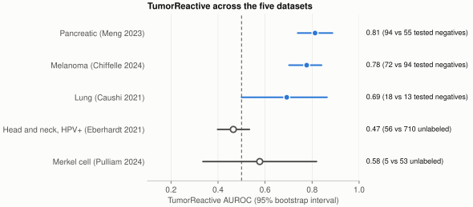
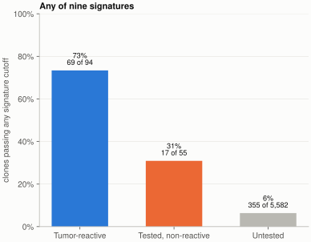
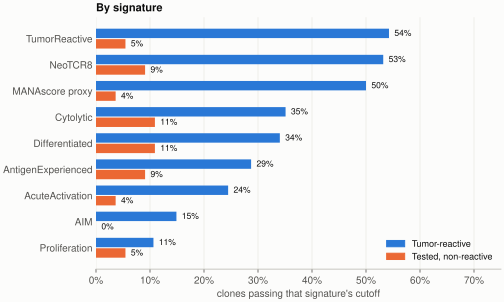
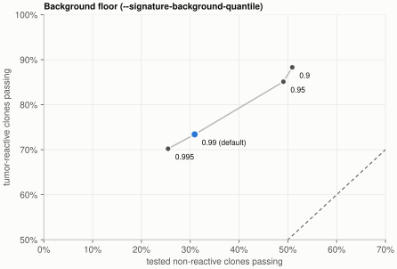
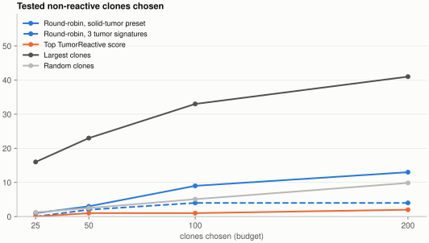
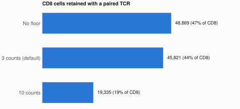
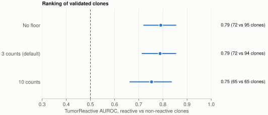

# Benchmark on public TIL data

This page evaluates whether `tcrsift prioritize --context solid-tumor` finds
the clones that experiments showed to be tumor-reactive. It uses five public
datasets, 33 patients in all, and reports what works and what does not.

## Summary

- **Ranking works where clones were tested against tumor.** The TumorReactive
  signature separates reactive from non-reactive clones in pancreatic cancer
  (AUROC 0.81, 149 tested clones) and melanoma (0.79, 166 tested clones).
  NeoTCR8 follows at 0.79 and 0.75.
- **Lung cancer is weaker and has few labels.** On 31 labelled clones
  TumorReactive reaches 0.69 (0.50 to 0.86). Twelve of those clones have a
  median of one cell and score at chance; on the other 19 it is 0.88.
- **It does not work in the two virus-driven tumors.** In HPV-positive head and
  neck cancer and in Merkel cell carcinoma, clones that bind virus multimers
  score no higher than other clones (TumorReactive 0.48 and 0.58, both
  intervals spanning 0.5). Neither dataset has tested negatives and the Merkel
  cell one has five labelled clones, but they are not evidence in TCRsift's
  favor.
- **Clone size alone is not informative** where clones were tested against
  tumor (0.34 to 0.50). In the two virus-driven tumors the virus-specific
  clones are larger than unlabelled ones (0.72 and 0.73).
- **The cutoffs enrich in both datasets with tested negatives, unequally.** In
  pancreatic cancer 73% of reactive and 31% of non-reactive clones pass a
  default cutoff. In melanoma it is 41% and 24%.
- **The `solid-tumor` preset dilutes short lists.** At a 50-clone budget in
  pancreatic cancer it picked 11 reactive and 3 non-reactive clones; the three
  tumor-reactivity signatures alone picked 27 and 2. Melanoma points the same
  way, weakly.
- **The default CD3 floor is now 3 counts, down from 10.** A floor of 10
  discarded 65% to 92% of CD8 cells and did not rank the same clones any
  better. Lowering it helps in melanoma, Merkel cell carcinoma and non-tumor
  lung tissue. It costs the lung tumor shortlist, which held 6
  neoantigen-specific clones at a floor of 10 and holds 1 now
  ([section 4](#4-what-do-the-cell-gates-cost)).

!!! warning "One result is circular"
    TCRsift's **MANAscore** proxy uses genes taken from a model that was trained
    on the Caushi lung data. Scoring MANAscore on that same data is not an
    independent test, so every lung MANAscore number below is marked
    **circular** and should be ignored when judging the tool. No other
    signature was derived from a dataset used here.

All results are from TCRsift 3.27.0, run from `benchmarks/public_til/`
([how to reproduce](#reproducing)). Nothing was tuned to these labels.

## The source studies

Each dataset comes from a study that sequenced tumor-infiltrating T cells one
cell at a time and then established, by experiment, what some of their
receptors recognize. The benchmark borrows those experimental labels.


*Schematic drawn for this page from each paper's abstract and data deposit.*

| Study | Tumor | Accession | Used here | Positives | Negatives | How TCRsift ran |
| --- | --- | --- | --- | --- | --- | --- |
| Meng et al. 2023 | Pancreatic adenocarcinoma | [GSE254250](https://www.ncbi.nlm.nih.gov/geo/query/acc.cgi?acc=GSE254250) | 9 patients, 14,396 CD8 cells | 94 clones tested tumor-reactive | 55 clones tested non-reactive | Scoring, cutoff and selection functions on the authors' cells |
| Chiffelle et al. 2024 | Melanoma, before TIL therapy | [GSE222448](https://www.ncbi.nlm.nih.gov/geo/query/acc.cgi?acc=GSE222448) | 11 patients, 13 tumor samples | 72 clones tested tumor-reactive | 94 clones tested non-reactive | The unmodified `prioritize` command |
| Caushi et al. 2021 | Non-small-cell lung, after anti-PD-1 | [GSE176021](https://www.ncbi.nlm.nih.gov/geo/query/acc.cgi?acc=GSE176021) | 8 patients, 57 samples (tumor, metastasis, lymph node, normal lung) | Neoantigen-specific beta chains | Virus-specific beta chains | The unmodified `prioritize` command |
| Eberhardt et al. 2021 | HPV-positive head and neck | [GSE180268](https://www.ncbi.nlm.nih.gov/geo/query/acc.cgi?acc=GSE180268) | 3 patients, 6 bulk PD-1+ CD8 TIL samples | Beta chains found in HPV-tetramer sorts | None; compared with all unlabelled clones | The unmodified `prioritize` command |
| Pulliam et al. 2024 | Merkel cell carcinoma | [GSE227708](https://www.ncbi.nlm.nih.gov/geo/query/acc.cgi?acc=GSE227708) | 2 patients, 2 tumor samples | Beta chains of polyomavirus-multimer-binding clones | None in the same tumor; compared with unlabelled clones | The unmodified `prioritize` command |

### Meng et al. 2023: pancreatic cancer

[Transcriptome-based identification of tumor-reactive and bystander CD8+ T cell
receptor clonotypes in human pancreatic cancer](https://doi.org/10.1126/scitranslmed.adh9562),
*Science Translational Medicine* 15:eadh9562.

- **What they did.** They profiled CD8 T cells from nine pancreatic tumors by
  single-cell RNA and TCR sequencing, then tested individual receptors for
  reactivity against each patient's own tumor cells. Receptors that responded
  are "tumor-reactive"; those that did not are "bystanders". From these they
  derived their own gene signature.
- **What the data is.** Cell Ranger expression matrices and a metadata table
  giving, for 14,396 CD8 cells, a clonotype id and a reactive / non-reactive
  call. The deposit labels 94 reactive and 55 non-reactive clonotypes (the
  abstract reports 93 and 65).
- **Why it is one of the two best tests here.** The negatives were tested and
  failed, and none of TCRsift's signatures was derived from it.
- **Limits.** GEO has no TCR contig files, only clonotype ids, so the loader,
  lineage classification and paired-chain gates are not exercised. The authors
  chose which clones to test.

### Chiffelle et al. 2024: melanoma before TIL therapy

[Tumor-reactive T cell clonotype dynamics underlying clinical response to TIL
therapy in melanoma](https://doi.org/10.1016/j.immuni.2024.08.014), *Immunity*
57:2466-2482. The single-cell data were deposited with [Barras et al.
2024](https://doi.org/10.1126/sciimmunol.adg7995), *Science Immunology*.

- **What they did.** In a trial of TIL therapy for melanoma, they cloned
  T-cell receptors found in the tumor before treatment or in the infused cell
  product and tested each against the patient's own tumor cells. They then
  followed the reactive and non-reactive clonotypes from tumor to product to
  blood.
- **What the data is.** Per-sample gene-by-cell count tables and unfiltered
  contig tables for the baseline tumors, and a supplementary table (S3) of
  123 reactive and 124 non-reactive clonotypes. This benchmark uses the 13
  baseline tumor samples of the 11 patients with tested clonotypes; 72
  reactive and 94 non-reactive ones are present among the cells that pass
  TCRsift's gates.
- **Why it is useful.** It is the second dataset with tested negatives, and
  the only one with tested negatives on which the whole `prioritize` command
  runs. None of TCRsift's signatures was derived from it.
- **Limits.** The authors chose which clones to test: about a third because
  they were expanded in the baseline tumor, others because they were expanded
  in the cell product or found among CD137+ cells after stimulation. The count
  tables are the authors' filtered cells, converted to matrix format by the
  download script. The same group trained a predictor on this cohort
  ([Pétremand et al. 2025](https://doi.org/10.1038/s41587-024-02232-0),
  TRTpred), which TCRsift does not use.

### Caushi et al. 2021: lung cancer after anti-PD-1

[Transcriptional programs of neoantigen-specific TIL in anti-PD-1-treated lung
cancers](https://doi.org/10.1038/s41586-021-03752-4), *Nature* 596:126-132
(open access).

- **What they did.** In patients given anti-PD-1 before surgery, they found
  T-cell clones specific for mutation-associated neoantigens (MANA) with the
  MANAFEST assay, which expands T cells against candidate peptides and reads
  out which receptors respond. They found virus-specific clones (influenza,
  EBV, CMV) the same way, then used each receptor as a barcode to locate those
  clones in single-cell RNA and TCR data from tumor, lymph node and normal lung.
- **What the data is.** Per-sample Cell Ranger matrices and filtered contig
  tables for 16 patients; a supplementary table of 74 neoantigen-specific and
  82 virus-specific beta chains. This benchmark uses all 57 samples of the 8
  patients that have labelled clones.
- **Why it is useful.** It is the only dataset here on which the whole
  `prioritize` command runs from raw Cell Ranger output with real negatives.
- **Limits.** The negatives are virus-specific, not tested against tumor. Few
  labelled clones are present in the tumor samples. Labels are beta chains
  only. **MANAscore was derived from this dataset**, so its score here is
  circular. Some neoantigen-specific receptors were chosen for cloning because
  of their expression profile.

### Eberhardt et al. 2021: HPV-positive head and neck cancer

[Functional HPV-specific PD-1+ stem-like CD8 T cells in head and neck
cancer](https://doi.org/10.1038/s41586-021-03862-z), *Nature* 597:279-284
([free full text](https://pmc.ncbi.nlm.nih.gov/articles/PMC10201342/)).

- **What they did.** They identified HPV epitopes and used MHC class I
  tetramers to sort HPV-specific CD8 T cells out of tumors, then sequenced the
  sorted cells and the remaining bulk PD-1+ CD8 TIL. They report that
  HPV-specific cells fall into three states: stem-like (TCF7+), transitory, and
  terminally differentiated.
- **What the data is.** Cell Ranger matrices and unfiltered contig tables for
  tetramer-sorted and bulk samples. Three patients have both. A beta chain
  counts as HPV-specific here when at least five tetramer-sorted cells carry
  it and it is at least as frequent in the sort as in the bulk sample.
- **Why it is included.** A third tumor type, and a virus-driven one.
- **Limits.** There are no tested negatives. The bulk samples were depleted of
  tetramer-binding cells before sequencing, so the positives that remain are
  the ones the sort missed. The bulk cells were pre-gated on PD-1. And the
  paper's own finding, that many HPV-specific cells are stem-like rather than
  exhausted, means an exhaustion-leaning signature should not be expected to
  find all of them.

### Pulliam et al. 2024: Merkel cell carcinoma

[Circulating cancer-specific CD8 T cell frequency is associated with response
to PD-1 blockade in Merkel cell carcinoma](https://doi.org/10.1016/j.xcrm.2024.101412),
*Cell Reports Medicine* 5:101412 (open access).

- **What they did.** Most Merkel cell carcinomas are driven by a polyomavirus
  (MCPyV). The authors used barcoded MHC class I multimers to find CD8 T cells
  specific for that virus, and for CMV, EBV and influenza, in blood and tumor,
  and related their frequency in blood to response to PD-1 blockade.
- **What the data is.** Cell Ranger matrices and unfiltered contig tables for
  eight runs, each pooling hashtag-labelled tumor and blood samples, and a
  supplementary table (S4) of virus-specific paired receptors.
- **Why it is included.** A second virus-driven tumor. Its cells were sorted
  to enrich for multimer-binding cells, not depleted of them, and were not
  gated on PD-1, so the two design problems of the head and neck data are
  absent.
- **Limits.** Very little of it is usable. Only two runs have labelled clones
  in a tumor sample whose hashtags match the deposited sample sheet. One tumor
  has 22 polyomavirus-specific beta chains; the other has only CMV-specific
  ones, so there are no negatives within a tumor. Because the sort enriched
  for multimer binders, some unlabelled clones are probably virus-specific
  too. With the default cell gates five polyomavirus-specific clones with two
  or more cells remain. Cells are assigned to a sample when their top
  hashtag has at least 10 counts and three times the runner-up.

### Cohorts that could not be used

Other studies with experimentally labelled clones were considered and set
aside, each for a specific reason.

| Study | Why it is not used |
| --- | --- |
| Lowery et al. 2022, [Molecular signatures of antitumor neoantigen-reactive T cells from metastatic human cancers](https://doi.org/10.1126/science.abl5447), *Science*. Source of NeoTCR8 and NeoTCR4. | Single-cell data are under controlled access (dbGaP phs002748). |
| Hanada et al. 2022, [A phenotypic signature that identifies neoantigen-reactive T cells in fresh human lung cancers](https://doi.org/10.1016/j.ccell.2022.03.012), *Cancer Cell*. | Controlled access (dbGaP phs002792). |
| Oliveira et al. 2021, [Phenotype, specificity and avidity of antitumour CD8+ T cells in melanoma](https://doi.org/10.1038/s41586-021-03704-y), *Nature*. | Controlled access (dbGaP phs001451). |
| Zheng et al. 2022, [Transcriptomic profiles of neoantigen-reactive T cells in human gastrointestinal cancers](https://doi.org/10.1016/j.ccell.2022.03.005), *Cancer Cell*. | Controlled access (dbGaP phs002765); the open portion has no TCR contig files. |
| Chow et al. 2023, [The ectonucleotidase CD39 identifies tumor-reactive CD8+ T cells predictive of immune checkpoint blockade efficacy in human lung cancer](https://doi.org/10.1016/j.immuni.2022.12.001), *Immunity*. | Open ([GSE218262](https://www.ncbi.nlm.nih.gov/geo/query/acc.cgi?acc=GSE218262)), with 6 reactive and 33 non-reactive receptors, but only 896 CD8 cells and most clones have one to three cells. |
| Monteiro et al. 2026, [Tumor reactivity assessment using clonal expression reveals tumor reactive CD8+ T cell heterogeneity across solid tumors](https://doi.org/10.3389/fimmu.2026.1815974), *Frontiers in Immunology* (the TRACE model). | The melanoma donor on [Zenodo](https://doi.org/10.5281/zenodo.19096905) has expression data and clone ids, without the reactivity labels or receptor sequences. |

## 1. Do the signatures rank reactive clones higher?

Each clone gets a percentile for each signature within its own sample. The
AUROC is the probability that a random positive clone outranks a random
negative one; 0.5 is chance.

These are the nine signatures the `solid-tumor` preset scores for CD8 cells.
Where each came from decides whether a result is an independent test.

| Signature | Genes | Where the gene list comes from | Independent of the data here? |
| --- | --- | --- | --- |
| TumorReactive | CXCL13, ENTPD1, PDCD1, LAG3, HAVCR2, TIGIT, TOX, CTLA4, ITGAE | Chosen by TCRsift's authors; not a published gene set. CD39 (ENTPD1) and CD103 (ITGAE) follow [Simoni et al. 2018](https://doi.org/10.1038/s41586-018-0130-2) and [Duhen et al. 2018](https://doi.org/10.1038/s41467-018-05072-0), which showed they mark tumor-reactive CD8 TIL. CXCL13 and the six exhaustion genes are the authors' selection of widely used markers, with no single source. | Yes |
| MANAscore proxy | CXCL13 and ENTPD1 up, IL7R down | The three genes of the MANAscore model, which was trained on the **Caushi 2021** lung data ([Zeng et al. 2025](https://doi.org/10.1038/s41467-024-55059-3)). TCRsift scores them without the model's weights. | **No for lung: circular.** Yes for the other four. |
| NeoTCR8 | 243 genes, including GZMB, ENTPD1 and KIR2DL4 | Published gene set, used as published: [Lowery et al. 2022](https://doi.org/10.1126/science.abl5447), metastatic gastrointestinal cancers. | Yes |
| Differentiated | IFNG, GZMB, PRF1, GNLY, NKG7 up; TCF7, LEF1, CCR7, SELL down | Chosen by TCRsift's authors from textbook effector and naive markers; not a published gene set. Its composition was settled on TCRsift's own in-vitro MART-1 expansion pilot ([reproducibility map](reproducibility_map.md)), not on tumor data. | Yes |
| AntigenExperienced | IFNG, GZMB, PRF1, GNLY, NKG7 | Chosen by TCRsift's authors: the "up" half of Differentiated. Same pilot. | Yes |
| Cytolytic | PRF1, GZMB | Chosen by TCRsift's authors: the perforin and granzyme B pair. The code cites its use in [Caushi et al. 2021](https://doi.org/10.1038/s41586-021-03752-4), [Krishna et al. 2020](https://doi.org/10.1126/science.abb9847) and [Hanada et al. 2022](https://doi.org/10.1016/j.ccell.2022.03.012). | Mostly. Caushi is one of the three papers cited for it, though no genes were selected from Caushi data. |
| AcuteActivation | TNFRSF9, MKI67 | Chosen by TCRsift's authors: 4-1BB and Ki-67, split out of AntigenExperienced after the same pilot. No published source. | Yes |
| AIM | TNFRSF9, TNFRSF4 | Chosen by TCRsift's authors: the transcripts of 4-1BB and OX40, the two surface markers read by activation-induced-marker assays. No published source. | Yes |
| Proliferation | MKI67 | Chosen by TCRsift's authors: Ki-67 alone. No published source. | Yes |

Only NeoTCR8 is a published gene set used as published. MANAscore is a proxy
for a published model. The other seven are short lists that TCRsift's authors
wrote down from markers in common use; where a paper or an internal experiment
informed the choice, it is named above. None of the seven was fitted to any
dataset on this page.

The first three are the "tumor-reactivity signatures" referred to throughout;
the other six are the "general state signatures". Several overlap: CXCL13 and
ENTPD1 are in all three tumor-reactivity signatures, and GZMB and PRF1 recur in
the state signatures, so they are correlated views, not independent votes. Gene
lists, scoring methods and citations are in the
[signature reference](api/signatures.md).

TumorReactive, which is independent of every dataset and leads in both
datasets with tested negatives, across all five. Hollow points are datasets with no tested
negatives, where positives are compared with unlabelled clones.



All signatures, for the three datasets with negatives. In the lung figure the
circular row is drawn hollow, in orange, and starred.


| Signature | Pancreatic (94 vs 55) | Melanoma (72 vs 94) | Lung tumor (18 vs 13) | Head and neck (56 vs 691 unlabelled) |
| --- | --- | --- | --- | --- |
| TumorReactive | 0.81 (0.74 to 0.89) | 0.79 (0.71 to 0.85) | 0.69 (0.50 to 0.86) | 0.48 (0.41 to 0.55) |
| MANAscore proxy | 0.80 (0.72 to 0.87) | 0.72 (0.64 to 0.79) | **circular** (0.80) | 0.43 (0.36 to 0.50) |
| NeoTCR8 | 0.79 (0.71 to 0.87) | 0.75 (0.67 to 0.82) | 0.57 (0.37 to 0.77) | 0.41 (0.35 to 0.48) |
| AcuteActivation | 0.70 (0.62 to 0.79) | 0.61 (0.53 to 0.70) | 0.76 (0.56 to 0.92) | 0.51 (0.45 to 0.58) |
| Differentiated | 0.70 (0.61 to 0.80) | 0.63 (0.54 to 0.70) | 0.55 (0.34 to 0.75) | 0.36 (0.30 to 0.43) |
| Cytolytic | 0.69 (0.60 to 0.78) | 0.61 (0.52 to 0.69) | 0.52 (0.31 to 0.72) | 0.37 (0.31 to 0.44) |
| AntigenExperienced | 0.68 (0.58 to 0.77) | 0.63 (0.54 to 0.71) | 0.56 (0.35 to 0.76) | 0.36 (0.29 to 0.43) |
| AIM | 0.64 (0.56 to 0.73) | 0.62 (0.53 to 0.70) | 0.85 (0.71 to 0.97) | 0.58 (0.52 to 0.64) |
| Proliferation | 0.51 (0.41 to 0.60) | 0.58 (0.49 to 0.66) | 0.31 (0.14 to 0.51) | 0.64 (0.57 to 0.71) |
| Clone size (baseline) | 0.34 (0.25 to 0.45) | 0.50 (0.42 to 0.59) | 0.41 (0.21 to 0.61) | 0.72 (0.64 to 0.78) |

Reading the table:

- In pancreatic cancer and melanoma the three signatures that the
  `solid-tumor` preset adds carry the signal, with TumorReactive first both
  times. Proliferation is near chance in both.
- Melanoma is the weaker of the two datasets with tested negatives. The six
  general state signatures sit between 0.58 and 0.63 there.
- Lung is mixed. AIM (0.85) and AcuteActivation (0.76) lead, TumorReactive is
  0.69 and NeoTCR8 0.57. The 31 labelled clones are two groups: 19 that also
  survive a CD3 floor of 10, on which TumorReactive is 0.88 (0.70 to 1.00) and
  NeoTCR8 0.86, and 12 with a median of one cell, on which they are 0.44 and
  0.22. A clone of one cell cannot be shortlisted, so the first group is the
  relevant one for selection, but it is small.
- Clone size is below chance in pancreatic cancer, where the tested
  non-reactive clones tend to be the larger ones, and at chance in melanoma.
- The pooled numbers hide patient-to-patient spread. Per-patient AUROC for
  TumorReactive runs from 0.39 to 1.00 across the eight pancreatic patients
  with both labels (NeoTCR8: 0.44 to 1.00; 3 to 13 negatives each), and from
  0.48 to 1.00 across the eleven melanoma patients (NeoTCR8: 0.31 to 1.00; 3
  to 15 negatives each).
- In head and neck cancer, tetramer-positive clones score *lower* than
  unlabelled clones on most signatures. Only Proliferation (0.64) and clone
  size (0.72) are clearly above chance.
  Three things could produce this without the signatures being wrong: the
  unlabelled clones are PD-1+ TIL that include other tumor- and virus-reactive
  clones; the bulk samples were depleted of tetramer-binding cells; and PD-1
  gating compresses the exhaustion axis these signatures read. None of that
  turns it into a positive result.
- In Merkel cell carcinoma, 5 polyomavirus-specific clones with two or more
  cells are compared with 51 unlabelled clones from the same tumors:
  TumorReactive 0.58 (0.33 to 0.83), MANAscore proxy 0.58, NeoTCR8 0.41 (0.14
  to 0.69). That tumor was not gated on PD-1 or depleted of multimer-binding
  cells, so those two explanations for the head and neck result do not apply
  here. Five clones settle nothing, but neither virus-driven tumor shows
  enrichment.

In lung, the ranking holds about as well outside the tumor. In lymph node and
adjacent normal lung (16 neoantigen-specific against 31 virus-specific
clonotypes) the AUROC is 0.77 for TumorReactive and 0.70 for NeoTCR8. Lymph
node alone is weaker for TumorReactive (0.62, 0.42 to 0.82).

## 2. Do the default cutoffs keep reactive clones?

Pancreatic data, every setting at its default:





69 of 94 reactive clones (73%) pass at least one signature's cutoff. So do 17
of 55 non-reactive clones (31%) and 355 of 5,582 untested clones (6%). Among
tested clones that pass, 80% are reactive, against 63% of all tested clones.

**Which signatures.** Splitting the preset into its two halves:

| Signatures used | Reactive passing | Non-reactive passing | Untested passing |
| --- | --- | --- | --- |
| All nine (`solid-tumor` preset) | 69 of 94 | 17 of 55 | 355 |
| Three tumor-reactivity signatures | 58 of 94 | 7 of 55 | 123 |
| Six general state signatures | 50 of 94 | 12 of 55 | 272 |

The general signatures add 11 reactive clones and 10 non-reactive ones.

**Which evidence route.** The mean route alone passes 66 reactive and 12
non-reactive clones. Adding the high-cell subset route (the default) brings 3
more reactive and 5 more non-reactive clones. On this dataset the subset route
contributes little.

**Where the thresholds sit.**




The default rank gate (0.9) sits at a corner: loosening it to 0.8 admits 3 more
reactive and 7 more non-reactive clones. Loosening the background floor from
0.99 to 0.95 recovers 11 more reactive clones at the cost of 10 more
non-reactive ones and three times as many untested clones (1,080 against 355).
Neither default looks misplaced on this dataset.

**Melanoma, with the full command.** The same question on the second dataset
with tested negatives gives a different answer. Among clones with two or more
cells:

| | Reactive passing | Non-reactive passing | Untested passing |
| --- | --- | --- | --- |
| All nine (`solid-tumor` preset) | 25 of 61 (41%) | 19 of 80 (24%) | 214 of 1,327 (16%) |
| Three tumor-reactivity signatures | 18 of 61 | 12 of 80 | 101 of 1,327 |

Reactive clones pass more often than non-reactive ones, by a much smaller
margin than in pancreatic cancer, and tested non-reactive clones still pass
more often than untested ones. The median reactive clone sits at the 79th
percentile of its sample for TumorReactive and the median non-reactive clone
at the 51st, but a cutoff needs a clone in the top tenth of its sample, and at
the top the two groups are more mixed. In pancreatic cancer most reactive
clones reach the top; in melanoma many are merely above average.

## 3. What ends up on the shortlist?

Passing a cutoff is not the same as being chosen. The round-robin takes one
clone from each qualifying list in turn until the budget is spent. Here it is
compared with simpler ways of choosing the same number of clones, among
pancreatic clones with at least two cells.




| Clones chosen | Preset round-robin | Three tumor signatures, round-robin | Top TumorReactive score | Largest clones |
| --- | --- | --- | --- | --- |
| 25 | 6 reactive, 1 non-reactive | 12, 0 | 19, 0 | 6, 16 |
| 50 | 11, 3 | 27, 2 | 27, 1 | 16, 23 |
| 100 | 33, 7 | 42, 4 | 39, 1 | 32, 33 |
| 200 | 57, 13 | 50, 4 (only 123 qualify) | 53, 2 | 45, 41 |

- With a small budget the preset does worse than the narrower lists. A budget
  smaller than the number of lists is shared across signatures and patients,
  and six of the nine signatures are general state signatures, so most early
  picks go to clones that are differentiated or cytolytic but not
  tumor-reactive.
- Restricting the same round-robin to the three tumor-reactivity signatures,
  or simply ranking by TumorReactive, finds two to three times as many
  reactive clones at 25 and 50.
- At 200 the preset catches up on reactive clones but carries more
  non-reactive ones.
- Choosing the largest clones selects as many non-reactive as reactive ones.

For a TIL study whose goal is tumor-reactive receptors and whose budget is
small, this supports running:

```bash
tcrsift prioritize samples.yaml -o candidates/ --context solid-tumor \
  --signatures TumorReactive MANAscore NeoTCR8
```

The melanoma data point the same way only weakly (below), and in both datasets
the authors chose which clones to test, so the preset has not been changed.
The broad preset remains the safer choice when the aim is coverage of several
cell states.

On melanoma the full command shortlisted 200 clones: 21 of 61 reactive and 18
of 80 non-reactive ones. Restricting it to the three tumor-reactivity
signatures shortlisted 121: 18 reactive and 12 non-reactive. Taking each
patient's ten highest TumorReactive clones gives 11 and 8. The narrower list
is somewhat cleaner here too, by far less than in pancreatic cancer.

On the lung tumors the full command, with its default 200-clone budget,
shortlisted 1 of 18 neoantigen-specific clonotypes and 1 of 13 virus-specific
ones. Across 33 samples, 414 clones qualified for the 200 places. The one
neoantigen-specific clonotype came from the TumorReactive list, not the
circular MANAscore one. With `--min-cd3 10`, 237 clones qualified and the
shortlist held 6 of 10 and 1 of 9. In lymph node and normal lung the default
command shortlisted 7 of 16 and 1 of 31; one of those seven came from the
circular MANAscore list. In head and neck it shortlisted 10 of 56
tetramer-positive clonotypes with two or more cells (18%), against 100 of 691
unlabelled ones (14%). In Merkel cell carcinoma it shortlisted 2 of 5
polyomavirus-specific clonotypes and 8 of 51 unlabelled ones.

## 4. What do the cell gates cost?

With defaults on the 33 lung tumor samples, 45,821 of 248,332 cells are
retained (18%). The CD8 classification removes 58%, the CD3 floor removes 14%
of the CD8 cells that remain, and the paired-receptor gates remove about half
of the rest.

The CD3 floor is the sum of raw CD3D, CD3E and CD3G counts in a cell. Until
3.27.0 the default was 10, and it is now 3. Because it is a raw count it acts
as a sequencing-depth filter, and at 10 it removed most CD8 cells in every
dataset run here.

**Lung.**




| `--min-cd3` | CD8 cells kept | Labelled clonotypes scored | TumorReactive AUROC | NeoTCR8 AUROC | Shortlisted (neoantigen, viral) |
| --- | --- | --- | --- | --- | --- |
| 0 | 48,869 | 18 and 13 | 0.70 | 0.54 | 1, 1 |
| 3 (default) | 45,821 | 18 and 13 | 0.69 | 0.57 | 1, 1 |
| 10 | 19,335 | 10 and 9 | 0.97 | 0.87 | 6, 1 |
| 0, but at least 4,000 UMIs per cell | 17,518 | 8 and 4 | 0.81 | 0.69 | 3, 1 |

**Melanoma**, which has five times as many labelled clones:




| `--min-cd3` | CD8 cells kept | Labelled clonotypes scored | TumorReactive AUROC | NeoTCR8 AUROC | Shortlisted (reactive, non-reactive) |
| --- | --- | --- | --- | --- | --- |
| 0 | 12,395 | 72 and 95 | 0.79 | 0.73 | 22, 19 |
| 3 (default) | 11,712 | 72 and 94 | 0.79 | 0.75 | 21, 18 |
| 10 | 4,925 | 65 and 65 | 0.75 | 0.67 | 16, 17 |

**Does a floor of 10 rank clones better, or only score fewer of them?** The
lung AUROC of 0.97 at a floor of 10 against 0.69 at 3 compares different sets
of clones. Splitting the clones scored at 3 by whether they are also scored at
10 separates the two effects:

| Clones, all scored at the default floor of 3 | Lung: TumorReactive | Lung: NeoTCR8 | Melanoma: TumorReactive | Melanoma: NeoTCR8 |
| --- | --- | --- | --- | --- |
| Also scored at a floor of 10 | 0.88 (10 vs 9) | 0.86 | 0.77 (65 vs 65) | 0.71 |
| Dropped by a floor of 10 | 0.44 (8 vs 4) | 0.22 | 0.71 (7 vs 29) | 0.69 |
| The same first group, scored at a floor of 10 | 0.97 | 0.87 | 0.75 | 0.67 |

- In lung, most of the gap comes from the 12 clones that a floor of 10 drops.
  They have a median of one cell and rank at chance or worse. The other 19 fall from
  0.97 to 0.88, which on 10 against 9 clones is within the interval (0.70 to
  1.00).
- In melanoma the same clones rank slightly better at the lower floor, and the
  36 clones a floor of 10 drops still rank well above chance.

So a floor of 10 does not make a given clone's score more reliable. It decides
which clones are scored at all, and it removes 72% of CD8 cells in lung, 65% in
melanoma and 92% in Merkel cell carcinoma, where it leaves 159 cells. A floor
of 3 removes 14%, 9% and 45%.

**What lowering it costs.** The lung tumor shortlist is worse at the new
default: 1 neoantigen-specific clone among 200, against 6 at a floor of 10.
More cells make more clones qualify (414 against 237) for the same 200 places.
The other three comparisons go the other way: at 3 against 10 the shortlist
holds 21 against 16 reactive clones in melanoma, 7 against 3
neoantigen-specific clones in lymph node and normal lung, and 2 against 0
polyomavirus-specific clones in Merkel cell carcinoma. For a deeply sequenced cohort of many
samples, `--min-cd3 10` or a larger `--max-clones` is worth comparing.

The command warns when any single gate removes more than half of the cells;
the `cell_filters` block of `prioritization.json` records what each gate
removed.

Every full-command run still shows heavy attrition, most of it from the CD8
classification and the paired-receptor gates. Cells retained at the defaults:
45,821 of 248,332 in lung, 11,712 of 54,837 in melanoma, 8,198 of 32,735 in
head and neck, and 652 of 8,311 in Merkel cell carcinoma.

**Speed.** The 33-sample lung run (248,332 cells) took 165 seconds on a laptop
with 32 GB of memory.

## What this does not show

- **Antigen specificity.** The signatures describe a state that tumor-reactive
  cells often share. They do not identify what a receptor binds.
- **Generalization.** CD8 cells only. The `blood`, `mpe` and `heme` presets,
  CD4 selection, and the culture `run` workflow are untested. Two of five
  tumor types, both virus-driven, showed no enrichment.
- **A score for virus-specific clones.** None of the nine signatures ranks
  virus-specific clones above other clones in either virus-driven tumor, and
  no alternative score is offered here.
- **Unbiased labels.** The original authors chose which clones to test, often
  among expanded or phenotypically interesting ones. In melanoma, tested
  clones that proved non-reactive still pass the cutoffs more often than
  untested ones (24% against 16%), which is what that selection would
  produce. Some Caushi labels came from receptors picked for their expression profile, which favors expression
  signatures.
- **A comparison with other tools.** No trained predictor (predicTCR, TRTpred,
  TRACE, the original MANAscore model) was run. TCRsift's MANAscore is a
  three-gene proxy.
- **Tuned settings.** Nothing was fitted here, and these labels should not be
  used to tune cutoffs or presets without a held-out cohort.

## Open questions

- Is a raw CD3 count the right gate at all? It scales with sequencing depth. A
  gate relative to each cell's depth has not been tried.
- Should the 200-clone budget grow with the number of samples? In the
  33-sample lung run 414 clones qualified for 200 places.
- Should the `solid-tumor` preset lead with, or be limited to, the three
  tumor-reactivity signatures? Pancreatic cancer argues for it and melanoma
  weakly agrees.
- Why do many reactive melanoma clones rank above average but not at the top?
  If that is general, a cutoff at the top tenth of each sample is too strict
  for some tumors, and the pancreatic sweep above says loosening it there
  costs precision.
- Is there a transcriptional state that marks virus-specific clones in
  virus-driven tumors? A dataset with tested negatives in such a tumor is
  needed to ask.

## Reproducing

```bash
pip install tcrsift openpyxl
git clone https://github.com/pirl-unc/tcrsift && cd tcrsift

python benchmarks/public_til/download.py --data-dir bench_data    # about 3 GB
python benchmarks/public_til/run.py --data-dir bench_data --work-dir bench_data/runs
python docs/figures/make_benchmark_figures.py
```

`run.py` writes the tables behind every number on this page to
`benchmarks/public_til/results/`. Intervals are percentile bootstraps over
clones (2,000 draws, fixed seed). Labels given as beta chains are counted once
per patient, represented by the largest alpha-beta clone carrying that beta.

## Sources

Datasets evaluated:

- Meng Z, et al. [Transcriptome-based identification of tumor-reactive and
  bystander CD8+ T cell receptor clonotypes in human pancreatic
  cancer](https://doi.org/10.1126/scitranslmed.adh9562). *Sci Transl Med* 2023.
- Caushi JX, et al. [Transcriptional programs of neoantigen-specific TIL in
  anti-PD-1-treated lung cancers](https://doi.org/10.1038/s41586-021-03752-4).
  *Nature* 2021.
- Eberhardt CS, et al. [Functional HPV-specific PD-1+ stem-like CD8 T cells in
  head and neck cancer](https://doi.org/10.1038/s41586-021-03862-z). *Nature* 2021.
- Chiffelle J, et al. [Tumor-reactive T cell clonotype dynamics underlying
  clinical response to TIL therapy in
  melanoma](https://doi.org/10.1016/j.immuni.2024.08.014). *Immunity* 2024.
  Data deposited with Barras D, et al. [Response to tumor-infiltrating
  lymphocyte adoptive therapy is associated with preexisting CD8+ T-myeloid
  cell networks in melanoma](https://doi.org/10.1126/sciimmunol.adg7995).
  *Sci Immunol* 2024.
- Pulliam T, et al. [Circulating cancer-specific CD8 T cell frequency is
  associated with response to PD-1 blockade in Merkel cell
  carcinoma](https://doi.org/10.1016/j.xcrm.2024.101412). *Cell Rep Med* 2024.

Signature sources:

- Lowery FJ, et al. [Molecular signatures of antitumor neoantigen-reactive T
  cells from metastatic human cancers](https://doi.org/10.1126/science.abl5447).
  *Science* 2022. NeoTCR8.
- Zeng Z, et al. [A minimal gene set characterizes TIL specific for diverse
  tumor antigens across different cancer
  types](https://doi.org/10.1038/s41467-024-55059-3). *Nat Commun* 2025. MANAscore.
