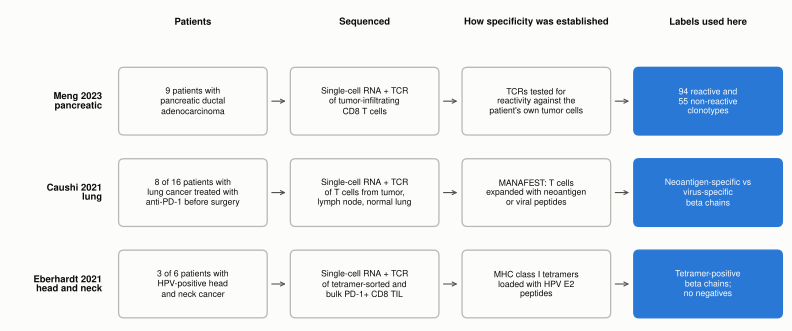
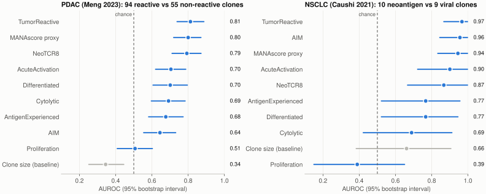
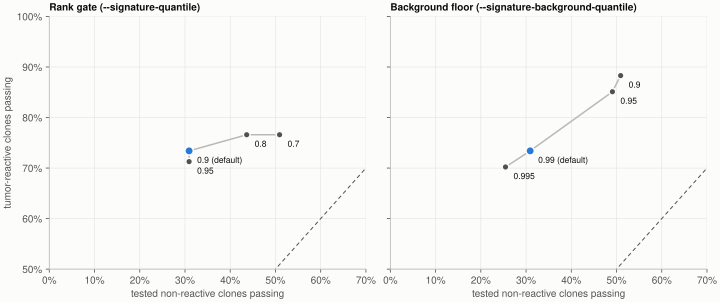
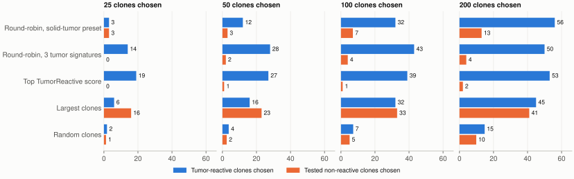
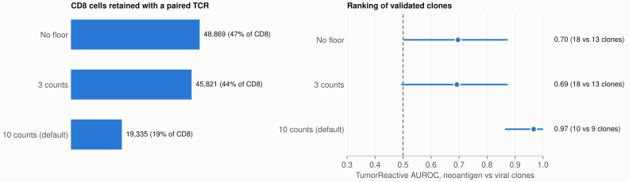

# Benchmark on public TIL data

This page asks whether `tcrsift prioritize --context solid-tumor` finds the
clones that experiments later showed to be tumor-reactive. It uses three public
datasets, 20 patients in all, and reports what worked, what did not, and what
the exercise changed in TCRsift.

## Summary

- **Ranking works in two of three datasets.** In pancreatic cancer (149 tested
  clones) the tumor-reactivity signatures separate reactive from non-reactive
  clones with AUROC 0.79 to 0.81. In lung cancer the same signatures reach 0.87
  to 0.97, on only 19 labelled clones.
- **It does not work in the third.** In HPV-positive head and neck cancer,
  clones known to bind HPV tetramers scored no higher than other clones (AUROC
  0.39 to 0.50). That dataset has design problems described below, but it is
  not evidence in TCRsift's favor.
- **Clone size alone is not informative** in any of the three.
- **The default cutoffs enrich, but do not separate.** 73% of reactive and 31%
  of non-reactive pancreatic clones pass at least one signature's cutoff.
- **The `solid-tumor` preset dilutes short lists.** Its six general state
  signatures take turns with the three tumor-reactivity signatures. At a
  50-clone budget the preset picked 12 reactive and 3 non-reactive clones;
  the three tumor signatures alone picked 28 and 2.
- **The CD3 floor matters and should stay.** It discards 72% of CD8 cells in
  the lung data, yet the clones that remain are ranked far better.
- **Four bugs** surfaced and are fixed in 3.25.1 to 3.25.4.

Everything here was run with TCRsift 3.25.5 from `benchmarks/public_til/`
([how to reproduce](#reproducing)). Nothing was tuned to these labels.

## The source studies

Each dataset comes from a study that sequenced tumor-infiltrating T cells one
cell at a time and then established, by experiment, what some of their
receptors recognize. The benchmark borrows those experimental labels.



*Schematic drawn for this page from each paper's abstract and data deposit.*

| | Meng et al. 2023 | Caushi et al. 2021 | Eberhardt et al. 2021 |
| --- | --- | --- | --- |
| Tumor | Pancreatic adenocarcinoma | Non-small-cell lung, after anti-PD-1 | HPV-positive head and neck |
| Accession | [GSE254250](https://www.ncbi.nlm.nih.gov/geo/query/acc.cgi?acc=GSE254250) | [GSE176021](https://www.ncbi.nlm.nih.gov/geo/query/acc.cgi?acc=GSE176021) | [GSE180268](https://www.ncbi.nlm.nih.gov/geo/query/acc.cgi?acc=GSE180268) |
| Used here | 9 patients, 14,396 CD8 cells | 8 patients, 57 samples (tumor, metastasis, lymph node, normal lung) | 3 patients, 6 bulk PD-1+ CD8 TIL samples |
| Positives | 94 clones tested tumor-reactive | Neoantigen-specific beta chains | Beta chains found in HPV-tetramer sorts |
| Negatives | 55 clones tested non-reactive | Virus-specific beta chains | None; compared with all unlabelled clones |
| How TCRsift ran | Scoring, cutoff and selection functions on the authors' cells | The unmodified `prioritize` command | The unmodified `prioritize` command |

### Meng et al. 2023: pancreatic cancer

[Transcriptome-based identification of tumor-reactive and bystander CD8+ T cell
receptor clonotypes in human pancreatic cancer](https://doi.org/10.1126/scitranslmed.adh9562),
*Science Translational Medicine* 15:eadh9562.

- **What they did.** They profiled CD8 T cells from nine pancreatic tumors by
  single-cell RNA and TCR sequencing, then tested individual receptors for
  reactivity against each patient's own tumor cells. Receptors that responded
  are "tumor-reactive"; those that did not are "bystanders". From these they
  derived their own gene signature.
- **What the data is.** Cell Ranger expression matrices and a metadata table
  giving, for 14,396 CD8 cells, a clonotype id and a reactive / non-reactive
  call. The deposit labels 94 reactive and 55 non-reactive clonotypes (the
  abstract reports 93 and 65).
- **Why it is the best test here.** The negatives were tested and failed, and
  none of TCRsift's signatures was derived from it.
- **Limits.** GEO has no TCR contig files, only clonotype ids, so the loader,
  lineage classification and paired-chain gates are not exercised. The authors
  chose which clones to test.

### Caushi et al. 2021: lung cancer after anti-PD-1

[Transcriptional programs of neoantigen-specific TIL in anti-PD-1-treated lung
cancers](https://doi.org/10.1038/s41586-021-03752-4), *Nature* 596:126-132
(open access).

- **What they did.** In patients given anti-PD-1 before surgery, they found
  T-cell clones specific for mutation-associated neoantigens (MANA) with the
  MANAFEST assay, which expands T cells against candidate peptides and reads
  out which receptors respond. They found virus-specific clones (influenza,
  EBV, CMV) the same way, then used each receptor as a barcode to locate those
  clones in single-cell RNA and TCR data from tumor, lymph node and normal lung.
- **What the data is.** Per-sample Cell Ranger matrices and filtered contig
  tables for 16 patients; a supplementary table of 74 neoantigen-specific and
  82 virus-specific beta chains. This benchmark uses all 57 samples of the 8
  patients that have labelled clones.
- **Why it is useful.** It is the only dataset here on which the whole
  `prioritize` command runs from raw Cell Ranger output with real negatives.
- **Limits.** The negatives are virus-specific, not tested against tumor. Few
  labelled clones are present in the tumor samples. Labels are beta chains
  only. **MANAscore was derived from this dataset**, so its score here is
  circular. Some neoantigen-specific receptors were chosen for cloning because
  of their expression profile.

### Eberhardt et al. 2021: HPV-positive head and neck cancer

[Functional HPV-specific PD-1+ stem-like CD8 T cells in head and neck
cancer](https://doi.org/10.1038/s41586-021-03862-z), *Nature* 597:279-284
([free full text](https://pmc.ncbi.nlm.nih.gov/articles/PMC10201342/)).

- **What they did.** They identified HPV epitopes and used MHC class I
  tetramers to sort HPV-specific CD8 T cells out of tumors, then sequenced the
  sorted cells and the remaining bulk PD-1+ CD8 TIL. They report that
  HPV-specific cells fall into three states: stem-like (TCF7+), transitory, and
  terminally differentiated.
- **What the data is.** Cell Ranger matrices and unfiltered contig tables for
  tetramer-sorted and bulk samples. Three patients have both. A beta chain
  counts as HPV-specific here when at least five tetramer-sorted cells carry
  it and it is at least as frequent in the sort as in the bulk sample.
- **Why it is included.** A third tumor type, and a virus-driven one.
- **Limits.** There are no tested negatives. The bulk samples were depleted of
  tetramer-binding cells before sequencing, so the positives that remain are
  the ones the sort missed. The bulk cells were pre-gated on PD-1. And the
  paper's own finding, that many HPV-specific cells are stem-like rather than
  exhausted, means an exhaustion-leaning signature should not be expected to
  find all of them.

### Cohorts that could not be used

Lowery 2022, Hanada 2022, Oliveira
2021 and Zheng 2022 keep single-cell data under controlled access. The TRACE
melanoma donor on Zenodo ships expression data without the reactivity labels.
Pétremand 2024 has open data but no per-clone label table.

## 1. Do the signatures rank reactive clones higher?

Each clone gets a percentile for each signature within its own sample. The
AUROC is the probability that a random positive clone outranks a random
negative one; 0.5 is chance.



| Signature | Pancreatic (94 vs 55) | Lung tumor (10 vs 9) | Head and neck (48 vs 376 unlabelled) |
| --- | --- | --- | --- |
| TumorReactive | 0.81 (0.74 to 0.89) | 0.97 (0.87 to 1.00) | 0.50 (0.43 to 0.58) |
| MANAscore proxy | 0.80 (0.72 to 0.87) | 0.94, circular | 0.39 (0.31 to 0.48) |
| NeoTCR8 | 0.79 (0.71 to 0.87) | 0.87 (0.67 to 1.00) | 0.40 (0.32 to 0.48) |
| AcuteActivation | 0.70 (0.62 to 0.79) | 0.90 (0.72 to 1.00) | 0.44 (0.36 to 0.52) |
| Differentiated | 0.70 (0.61 to 0.80) | 0.77 (0.52 to 0.94) | 0.32 (0.25 to 0.39) |
| Cytolytic | 0.69 (0.60 to 0.78) | 0.69 (0.42 to 0.91) | 0.35 (0.28 to 0.43) |
| AntigenExperienced | 0.68 (0.58 to 0.77) | 0.77 (0.52 to 0.96) | 0.33 (0.26 to 0.40) |
| AIM | 0.64 (0.56 to 0.73) | 0.96 (0.84 to 1.00) | 0.54 (0.45 to 0.63) |
| Proliferation | 0.51 (0.41 to 0.60) | 0.39 (0.15 to 0.65) | 0.57 (0.50 to 0.66) |
| Clone size (baseline) | 0.34 (0.25 to 0.45) | 0.66 (0.38 to 0.91) | 0.58 (0.49 to 0.67) |

Reading the table:

- In pancreatic and lung tumors the three signatures that the `solid-tumor`
  preset adds carry the signal. Proliferation is at chance in both.
- Clone size is below chance in pancreatic cancer, where the tested
  non-reactive clones tend to be the larger ones.
- The pooled pancreatic number hides patient-to-patient spread. Per-patient
  AUROC for TumorReactive runs from 0.39 to 1.00 across the eight patients with
  both labels (NeoTCR8: 0.44 to 1.00), with 3 to 13 negatives each.
- In head and neck cancer, tetramer-positive clones score *lower* than
  unlabelled clones on most signatures. Three things could produce this without
  the signatures being wrong: the unlabelled clones are PD-1+ TIL that include
  other tumor- and virus-reactive clones; the bulk samples were depleted of
  tetramer-binding cells; and PD-1 gating compresses the exhaustion axis these
  signatures read. None of that turns it into a positive result.

In lung, the ranking also holds outside the tumor, more weakly. In lymph node
and adjacent normal lung (12 neoantigen-specific against 21 virus-specific
clonotypes) the AUROC is 0.77 for TumorReactive and 0.78 for NeoTCR8. Lymph
node alone is weaker for TumorReactive (0.61, 0.35 to 0.85).

## 2. Do the default cutoffs keep reactive clones?

Pancreatic data, every setting at its default:


69 of 94 reactive clones (73%) pass at least one signature's cutoff. So do 17
of 55 non-reactive clones (31%) and 355 of 5,582 untested clones (6%). Among
tested clones that pass, 80% are reactive, against 63% of all tested clones.

**Which signatures.** Splitting the preset into its two halves:

| Signatures used | Reactive passing | Non-reactive passing | Untested passing |
| --- | --- | --- | --- |
| All nine (`solid-tumor` preset) | 69 of 94 | 17 of 55 | 355 |
| Three tumor-reactivity signatures | 58 of 94 | 7 of 55 | 123 |
| Six general state signatures | 50 of 94 | 12 of 55 | 272 |

The general signatures add 11 reactive clones and 10 non-reactive ones.

**Which evidence route.** The mean route alone passes 66 reactive and 12
non-reactive clones. Adding the high-cell subset route (the default) brings 3
more reactive and 5 more non-reactive clones. On this dataset the subset route
contributes little.

**Where the thresholds sit.**



The default rank gate (0.9) sits at a corner: loosening it to 0.8 admits 3 more
reactive and 7 more non-reactive clones. Loosening the background floor from
0.99 to 0.95 recovers 11 more reactive clones at the cost of 10 more
non-reactive ones and three times as many untested clones (1,080 against 355).
Neither default looks misplaced on this dataset.

## 3. What ends up on the shortlist?

Passing a cutoff is not the same as being chosen. The round-robin takes one
clone from each qualifying list in turn until the budget is spent. Here it is
compared with simpler ways of choosing the same number of clones, among
pancreatic clones with at least two cells.



| Clones chosen | Preset round-robin | Three tumor signatures, round-robin | Top TumorReactive score | Largest clones |
| --- | --- | --- | --- | --- |
| 25 | 3 reactive, 3 non-reactive | 14, 0 | 19, 0 | 6, 16 |
| 50 | 12, 3 | 28, 2 | 27, 1 | 16, 23 |
| 100 | 32, 7 | 43, 4 | 39, 1 | 32, 33 |
| 200 | 56, 13 | 50, 4 (only 123 qualify) | 53, 2 | 45, 41 |

- With a small budget the preset does poorly. Its lists are visited in order,
  general state signatures first, so the early picks are spent on clones that
  are differentiated or cytolytic but not tumor-reactive.
- Restricting the same round-robin to the three tumor-reactivity signatures,
  or simply ranking by TumorReactive, finds several times as many reactive
  clones at 25 and 50.
- At 200 the preset catches up on reactive clones but carries more
  non-reactive ones.
- Choosing the largest clones selects as many non-reactive as reactive ones.

For a TIL study whose goal is tumor-reactive receptors and whose budget is
small, this supports running:

```bash
tcrsift prioritize samples.yaml -o candidates/ --context solid-tumor \
  --signatures TumorReactive MANAscore NeoTCR8
```

This is one dataset, and its authors chose which clones to test, so the preset
has not been changed. The broad preset remains the safer choice when the aim is
coverage of several cell states.

On the lung tumors the full command, with its default 200-clone budget,
shortlisted 5 of 10 neoantigen-specific clonotypes and 1 of 9 virus-specific
ones, in a list holding 4% of all scored clones. In lymph node and normal lung
it shortlisted 3 of 12 and 1 of 21. In head and neck it shortlisted 4 of 48
tetramer-positive clonotypes with two or more cells (8%), against 59 of 376
unlabelled ones (16%).

## 4. What do the cell gates cost?

With defaults on the 33 lung tumor samples, 19,335 of 248,332 cells are
retained (8%). The CD8 classification removes 58%, and the floor of ten CD3
counts removes 72% of the CD8 cells that remain.

That floor is a raw count, so it behaves as a sequencing-depth filter. The
obvious fix is to lower it. The benchmark says not to:



| `--min-cd3` | CD8 cells kept | Labelled clonotypes scored | TumorReactive AUROC | NeoTCR8 AUROC | Shortlisted (neoantigen, viral) |
| --- | --- | --- | --- | --- | --- |
| 0 | 48,869 | 18 and 13 | 0.70 | 0.54 | 2, 2 |
| 3 | 45,821 | 18 and 13 | 0.69 | 0.57 | 1, 2 |
| 10 (default) | 19,335 | 10 and 9 | 0.97 | 0.87 | 5, 1 |
| 0, but at least 4,000 UMIs per cell | 17,518 | 8 and 4 | 0.81 | 0.69 | 2, 1 |

Lower floors keep more cells and more labelled clones, and rank them worse. A
plain depth filter that keeps a similar number of cells lands in between, with
too few labels to say more. The default therefore stays at 10, and since 3.25.3
the command warns when any single gate removes more than half of the cells.

The head and neck run shows the same attrition: 3,647 of 32,735 cells retained.

**Speed.** The 33-sample lung run (248,332 cells) took 139 seconds on a laptop
with 32 GB of memory.

## What this does not show

- **Antigen specificity.** The signatures describe a state that tumor-reactive
  cells often share. They do not identify what a receptor binds.
- **Generalization.** CD8 cells only. The `blood`, `mpe` and `heme` presets,
  CD4 selection, and the culture `run` workflow are untested. One of three
  tumor types showed no enrichment.
- **Unbiased labels.** The original authors chose which clones to test, often
  among expanded or phenotypically interesting ones. Some Caushi labels came
  from receptors picked for their expression profile, which favors expression
  signatures.
- **A comparison with other tools.** No trained predictor (predicTCR, TRTpred,
  TRACE, the original MANAscore model) was run. TCRsift's MANAscore is a
  three-gene proxy.
- **Tuned settings.** Nothing was fitted here, and these labels should not be
  used to tune cutoffs or presets without a held-out cohort.

## What the benchmark changed in TCRsift

| Release | Problem found on public data | Status |
| --- | --- | --- |
| 3.25.1 | Loading two or more matrix-directory samples lost the gene symbols, and `--context solid-tumor` stopped with "genes absent from matrix". | Fixed |
| 3.25.2 | NeoTCR8 failed on current Cell Ranger references because PLA2G16 is now PLAAT3 (similar renames affect NeoTCR4 and NeoTCR_PBL). | Fixed with a gene-synonym table |
| 3.25.3 | The CD3 floor silently removed most cells. | Warning added; default kept, for the reason shown above |
| 3.25.4 | With only `all_contig_annotations.csv`, non-cell and unannotated contigs were loaded and the run stopped. | Fixed |

Still open: whether the preset should lead with the tumor-reactivity
signatures, and whether a depth-normalized quality gate can replace the raw CD3
count.

## Reproducing

```bash
pip install tcrsift openpyxl
git clone https://github.com/pirl-unc/tcrsift && cd tcrsift

python benchmarks/public_til/download.py --data-dir bench_data    # about 2.8 GB
python benchmarks/public_til/run.py --data-dir bench_data --work-dir bench_data/runs
python docs/figures/make_benchmark_figures.py
```

`run.py` writes the tables behind every number on this page to
`benchmarks/public_til/results/`. Intervals are percentile bootstraps over
clones (2,000 draws, fixed seed). Labels given as beta chains are counted once
per patient, represented by the largest alpha-beta clone carrying that beta.

## Sources

- Meng Z, et al. *Sci Transl Med* 2023 (tumor-reactive and bystander CD8 TCR
  clonotypes in pancreatic cancer). [PMID 37967201](https://pubmed.ncbi.nlm.nih.gov/37967201/)
- Caushi JX, et al. Transcriptional programs of neoantigen-specific TIL in
  anti-PD-1-treated lung cancers. *Nature* 2021.
  [PMID 34290408](https://pubmed.ncbi.nlm.nih.gov/34290408/)
- Eberhardt CS, et al. Functional HPV-specific PD-1+ stem-like CD8 T cells in
  head and neck cancer. *Nature* 2021. [GSE180268](https://www.ncbi.nlm.nih.gov/geo/query/acc.cgi?acc=GSE180268)
- Lowery FJ, et al. Molecular signatures of antitumor neoantigen-reactive T
  cells from metastatic human cancers. *Science* 2022.
  [PMID 35113651](https://pubmed.ncbi.nlm.nih.gov/35113651/)
