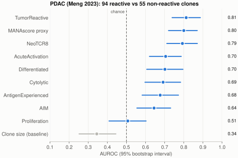
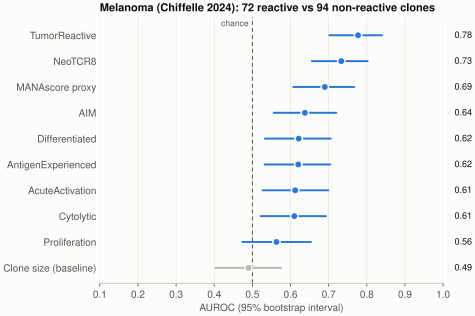
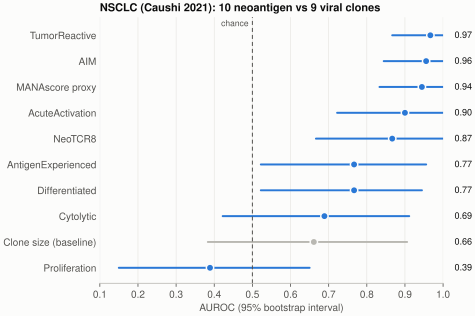
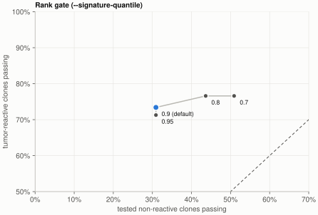
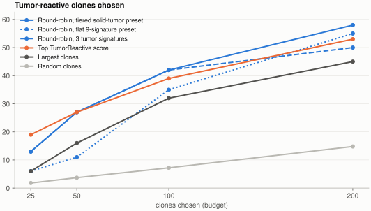
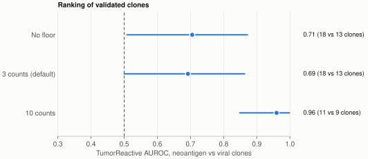
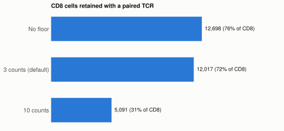

# Benchmark on public TIL data

This page evaluates whether `tcrsift prioritize --context solid-tumor` finds
clones that experiments showed to be tumor-reactive. It covers five public
datasets across 33 patients and reports both where the method works and where
it fails (for cross-cohort and external-tool comparisons, see the
[Benchmark overview](benchmarks-overview.md)).

## Summary

- **Ranking separates tumor-reactive from non-reactive clones where both were
  tested.** The TumorReactive signature reaches an AUROC of 0.81 in pancreatic
  cancer (149 tested clones) and 0.78 in melanoma (166 tested clones). NeoTCR8
  follows at 0.79 and 0.73.
- **Lung cancer is weaker and has few labels.** Across 31 labeled tumor clones,
  TumorReactive reaches 0.69 (95% CI 0.50 to 0.86). Eleven of those clones have
  a median of one cell and score below chance; on the remaining 20 clones,
  TumorReactive reaches 0.87.
- **Expression signatures do not enrich for virus-specific clones in the two
  virus-driven tumors.** In HPV-positive head and neck cancer and in Merkel
  cell carcinoma, clones that bind viral multimers score no higher than
  unlabeled clones (TumorReactive AUROC 0.47 and 0.58, both intervals spanning
  0.5). Neither dataset has tested negatives, and Merkel cell carcinoma
  contributes only five labeled clones, so neither supports using these
  signatures to find viral tumor antigens.
- **Clone size alone does not separate tumor-reactive from non-reactive clones**
  where reactivity was tested directly against tumor (AUROC 0.34 to 0.49). In
  the two virus-driven tumors, virus-multimer-binding clones are larger than
  unlabeled ones (0.74 and 0.73).
- **Default cutoffs enrich for reactive clones in both datasets with tested
  negatives.** In
  pancreatic cancer, 73% of reactive clones and 31% of non-reactive clones pass
  at least one default cutoff; in melanoma, the rates are 44% and 25%.
- **Priority-tiered round-robin scheduling prevents small-budget signature
  dilution while preserving broad recall at larger budgets.** Scheduling the
  three tumor-reactivity signatures (`TumorReactive`, `MANAscore`, `NeoTCR8`) in
  Tier 1 ahead of Tier-2 general state backfill (`--round-robin-mode tiered`,
  default since 3.32.0) picks 27 reactive and 2 non-reactive clones at a
  50-clone budget in pancreatic cancer (matching the three tumor-reactivity
  signatures alone, versus 11 reactive and 3 non-reactive under
  `--round-robin-mode flat`), and reaches 58 reactive clones (12
  non-reactive) at a 200-clone budget versus 50 (4 non-reactive) when
  general state panels are omitted (123 qualify).
- **The default CD3 count floor is 3 (lowered from 10 in 3.27.0).** A floor of
  10 discarded 65% to 92% of CD8 cells without ranking surviving clones more
  accurately. Lowering it recovers reactive clones on the shortlist in
  melanoma (24 vs 15), Merkel cell carcinoma (2 vs 0), and non-tumor
  lung tissue (7 vs 4), while reducing the lung tumor shortlist from 5
  neoantigen-specific clones (1 viral) to 4 (0 viral)
  ([section 4](#4-what-do-the-cell-filters-drop)).

!!! warning "One result is circular"
    TCRsift's **MANAscore** proxy uses three genes selected by a model that was
    trained on the Caushi 2021 lung dataset. Scoring MANAscore on that same
    dataset is not an independent test, so every lung MANAscore result below is
    marked **circular** and should be ignored when judging performance. No
    other signature was derived from any dataset on this page.

All results are from TCRsift 3.37.1 and VDJdb `2026-11-06` (used for default
`--exclude-known-mart1` filtering under `--database-match strict_ab`), generated
by `benchmarks/public_til/`
([how to reproduce](#reproducing); full ground-truth file, sheet, and assay
provenance in `benchmarks/public_til/PROVENANCE.md`). No thresholds, weights,
or gene lists were fitted to these datasets.

## Source studies and ground-truth provenance

Each dataset comes from a study that profiled tumor-infiltrating T cells by
single-cell RNA and TCR sequencing and experimentally tested what a subset of
receptors recognize. This benchmark evaluates TCRsift against those published
experimental labels.


*Summary schematic compiled from each paper and data deposit.*

| Study | Tumor | Raw GEX & VDJ deposit | Ground-truth label source | Positives | Negatives | How TCRsift ran |
| --- | --- | --- | --- | --- | --- | --- |
| Meng et al. 2023 | Pancreatic adenocarcinoma | [GSE254250](https://www.ncbi.nlm.nih.gov/geo/query/acc.cgi?acc=GSE254250) (9 patients, 14,396 CD8 cells) | `GSE254250_PDAC_9sample_CD8_RNA_metadata_matrix.csv.gz` (`TR` vs `NTR` from autologous tumor co-culture) | 94 tumor-reactive clones | 55 tumor-non-reactive clones | Scoring, cutoff, and selection functions on the authors' filtered CD8 cells |
| Chiffelle et al. 2024 | Melanoma, before TIL therapy | [GSE222448](https://www.ncbi.nlm.nih.gov/geo/query/acc.cgi?acc=GSE222448) (11 patients, 13 `T0` tumor samples) | Table S3 (`mmc3.xlsx`, `Tumor-reactivity` `yes` vs `no` against autologous melanoma lines) | 72 tumor-reactive clones | 94 tumor-non-reactive clones | Unmodified `prioritize` command |
| Caushi et al. 2021 | Non-small-cell lung, after anti-PD-1 | [GSE176021](https://www.ncbi.nlm.nih.gov/geo/query/acc.cgi?acc=GSE176021) (8 patients, 57 samples: tumor, metastasis, lymph node, normal lung) | Supplementary Table 8 (`MOESM8_ESM.xlsx`, MANAFEST peptide expansion) | Neoantigen-specific beta chains (`MANA`) | Virus-specific beta chains (Influenza, EBV, CMV) | Unmodified `prioritize` command |
| Eberhardt et al. 2021 | HPV-positive head and neck | [GSE180268](https://www.ncbi.nlm.nih.gov/geo/query/acc.cgi?acc=GSE180268) (3 patients, 6 bulk PD-1+ CD8 samples: 3 primary tumor, 3 metastatic lymph node) | Paired `GSE180268` HLA-A\*01:01 HPV16 E2 tetramer-sorted VDJ libraries (`>=5` sorted cells, enriched over bulk) | Beta chains enriched in HPV-tetramer sorts | None; compared against unlabeled `>=2`-cell clones | Unmodified `prioritize` command |
| Pulliam et al. 2024 | Merkel cell carcinoma | [GSE227708](https://www.ncbi.nlm.nih.gov/geo/query/acc.cgi?acc=GSE227708) (2 patients, 2 hashtag-demultiplexed tumor samples) | Table S4 (`mmc5.xlsx`, DNA-barcoded MCPyV T-antigen multimer calls) | Beta chains of polyomavirus-multimer-binding clones | None in the same tumor; compared against unlabeled `>=2`-cell clones | Unmodified `prioritize` command |

### Meng et al. 2023: pancreatic cancer

[Transcriptome-based identification of tumor-reactive and bystander CD8+ T cell
receptor clonotypes in human pancreatic cancer](https://doi.org/10.1126/scitranslmed.adh9562),
*Science Translational Medicine* 15:eadh9562.

- **Study design.** CD8 T cells from nine pancreatic tumors were profiled by
  single-cell RNA and TCR sequencing, and individual receptors were tested for
  reactivity against each patient's autologous tumor cells. Receptors that
  responded were labeled tumor-reactive; those that did not were labeled
  bystanders. The authors derived their own gene signature from this cohort.
- **Deposited data.** Cell Ranger expression matrices and a cell metadata table
  assigning a clonotype ID and reactivity label to 14,396 CD8 cells. The deposit
  labels 94 reactive and 55 non-reactive clonotypes (the abstract reports 93
  and 65).
- **Strengths for benchmarking.** Negative clones were directly tested against
  autologous tumor and failed to respond, and none of TCRsift's signatures was
  derived from this cohort.
- **Limitations.** GEO does not include TCR contig files (only clonotype IDs),
  so VDJ contig loading, CD4/CD8 phenotyping, and paired-chain filters are not
  exercised. Tested clones were chosen by the original authors rather than
  sampled at random.

### Chiffelle et al. 2024: melanoma before TIL therapy

[Tumor-reactive T cell clonotype dynamics underlying clinical response to TIL
therapy in melanoma](https://doi.org/10.1016/j.immuni.2024.08.014), *Immunity*
57:2466–2482. Single-cell data were deposited with [Barras et al.
2024](https://doi.org/10.1126/sciimmunol.adg7995), *Science Immunology*.

- **Study design.** In a melanoma TIL-therapy trial, the authors cloned T-cell
  receptors from baseline tumors or infused TIL products, tested each against
  autologous tumor cells, and tracked reactive and non-reactive clonotypes
  across tumor, product, and blood.
- **Deposited data.** Per-sample gene-by-cell count tables, unfiltered contig
  tables for baseline tumors, and a supplementary table (Table S3) of 123
  reactive and 124 non-reactive clonotypes. This benchmark uses the 13 baseline
  tumor samples from the 11 patients with tested clonotypes; 72 reactive and 94
  non-reactive clonotypes survive TCRsift's default cell filters.
- **Strengths for benchmarking.** This is the only cohort with experimentally
  tested negatives on which the full `prioritize` command runs end to end, and
  none of TCRsift's signatures was derived from it.
- **Limitations.** Tested clones were selected by the authors: roughly a third
  for baseline tumor expansion, and the rest for expansion in the infusion
  product or CD137 upregulation after stimulation. Expression tables contain the
  authors' pre-filtered cells, converted to Matrix Market format by the
  download script. (The same group later trained TRTpred on this cohort in
  [Pétremand et al. 2025](https://doi.org/10.1038/s41587-024-02232-0); TCRsift
  does not use TRTpred.)

### Caushi et al. 2021: lung cancer after anti-PD-1

[Transcriptional programs of neoantigen-specific TIL in anti-PD-1-treated lung
cancers](https://doi.org/10.1038/s41586-021-03752-4), *Nature* 596:126–132
(open access).

- **Study design.** In non-small-cell lung cancer patients treated with
  neoadjuvant anti-PD-1, the MANAFEST peptide-stimulation assay identified
  T-cell beta chains responsive to mutation-associated neoantigens (MANA) or
  common viruses (influenza, EBV, CMV). Those CDR3β sequences were then matched
  to single-cell RNA and TCR data from resected tumor, lymph node, and adjacent
  normal lung.
- **Deposited data.** Per-sample Cell Ranger expression matrices and filtered
  contig tables for 16 patients, plus a supplementary table of 74
  neoantigen-specific and 82 virus-specific beta chains. This benchmark uses
  all 57 samples from the 8 patients with labeled clones.
- **Strengths for benchmarking.** This is the only cohort with labeled
  negatives where `prioritize` runs directly on raw Cell Ranger VDJ and GEX
  outputs.
- **Limitations.** Negatives are virus-specific clones rather than clones
  tested for lack of tumor reactivity. Only 31 labeled clones appear in the
  tumor samples, labels provide beta chains only, and MANAscore was derived
  from this dataset, making its lung score circular. In addition, several
  neoantigen-specific receptors were originally chosen for testing based on
  their transcriptional profile.

### Eberhardt et al. 2021: HPV-positive head and neck cancer

[Functional HPV-specific PD-1+ stem-like CD8 T cells in head and neck
cancer](https://doi.org/10.1038/s41586-021-03862-z), *Nature* 597:279–284
([free full text](https://pmc.ncbi.nlm.nih.gov/articles/PMC10201342/)).

- **Study design.** HLA-A\*01:01 tetramers loaded with HPV16 E2 epitopes were
  used to sort HPV-specific CD8 T cells from head and neck primary tumors and
  metastatic lymph nodes; both the tetramer-positive fraction and the remaining
  PD-1+ CD8 T cells were sequenced. The study showed that HPV-specific T cells
  span stem-like (TCF7+), transitory, and terminally differentiated states.
- **Deposited data.** Cell Ranger expression matrices and unfiltered contig
  tables for tetramer-sorted and bulk PD-1+ samples (three primary tumors and
  three metastatic lymph nodes) across three patients with paired data. Here, a
  beta chain is labeled HPV-specific if it appears in at least five
  tetramer-sorted cells and is at least as frequent in the tetramer sort as in
  the paired bulk sample.
- **Strengths for benchmarking.** Adds a virus-driven tumor type.
- **Limitations.** There are no tested negatives. Bulk samples were pre-gated
  on PD-1 and depleted of tetramer-binding cells before sequencing, so the
  labeled positives remaining in bulk are cells missed by sorting. Moreover,
  because many HPV-specific cells in this cohort are TCF7+ stem-like rather
  than exhausted, exhaustion-weighted signatures are poorly matched to them.

### Pulliam et al. 2024: Merkel cell carcinoma

[Circulating cancer-specific CD8 T cell frequency is associated with response
to PD-1 blockade in Merkel cell carcinoma](https://doi.org/10.1016/j.xcrm.2024.101412),
*Cell Reports Medicine* 5:101412 (open access).

- **Study design.** Most Merkel cell carcinomas are driven by Merkel cell
  polyomavirus (MCPyV). Barcoded MHC class I multimers identified CD8 T cells
  recognizing MCPyV, CMV, EBV, or influenza in blood and tumor.
- **Deposited data.** Cell Ranger matrices and unfiltered contig tables for
  eight hashed runs pooling blood and tumor samples, plus a supplementary table
  (Table S4) of virus-specific paired receptors. Cells are assigned to a sample
  when their top hashtag has at least 10 counts and at least three times the
  runner-up count.
- **Strengths for benchmarking.** Provides a second virus-driven tumor without
  PD-1 pre-gating or multimer depletion: sorting enriched for multimer-binding
  cells rather than removing them.
- **Limitations.** Only two of the eight runs contain labeled clones in a tumor
  sample whose hashtags match the deposited sample sheet. One tumor contains 22
  MCPyV-specific beta chains and no viral negatives; the other contains only
  CMV-specific chains, leaving no within-tumor negative controls. Because the
  sort enriched for multimer binders, some unlabeled clones are likely
  virus-specific as well. After default cell filtering, only five
  MCPyV-specific clones with at least two cells remain.

### Cohorts considered and excluded

| Study | Reason excluded |
| --- | --- |
| Lowery et al. 2022, [Molecular signatures of antitumor neoantigen-reactive T cells from metastatic human cancers](https://doi.org/10.1126/science.abl5447), *Science* (source of NeoTCR8 and NeoTCR4) | Single-cell data are under controlled access (dbGaP phs002748). |
| Hanada et al. 2022, [A phenotypic signature that identifies neoantigen-reactive T cells in fresh human lung cancers](https://doi.org/10.1016/j.ccell.2022.03.012), *Cancer Cell* | Controlled access (dbGaP phs002792). |
| Oliveira et al. 2021, [Phenotype, specificity and avidity of antitumour CD8+ T cells in melanoma](https://doi.org/10.1038/s41586-021-03704-y), *Nature* | Controlled access (dbGaP phs001451). |
| Zheng et al. 2022, [Transcriptomic profiles of neoantigen-reactive T cells in human gastrointestinal cancers](https://doi.org/10.1016/j.ccell.2022.03.005), *Cancer Cell* | Controlled access (dbGaP phs002765); the open files omit TCR contigs. |
| Chow et al. 2023, [The ectonucleotidase CD39 identifies tumor-reactive CD8+ T cells predictive of immune checkpoint blockade efficacy in human lung cancer](https://doi.org/10.1016/j.immuni.2022.12.001), *Immunity* | Open ([GSE218262](https://www.ncbi.nlm.nih.gov/geo/query/acc.cgi?acc=GSE218262)), with 6 reactive and 33 non-reactive receptors, but only 896 CD8 cells total and mostly 1–3 cells per clone. |
| Monteiro et al. 2026, [Tumor reactivity assessment using clonal expression reveals tumor reactive CD8+ T cell heterogeneity across solid tumors](https://doi.org/10.3389/fimmu.2026.1815974), *Frontiers in Immunology* (TRACE) | The [Zenodo deposit](https://doi.org/10.5281/zenodo.19096905) includes expression matrices and clone IDs for one melanoma donor, without reactivity labels or TCR sequences. |

## 1. Do the signatures rank reactive clones higher?

Within each sample, every clone receives a percentile rank on each signature.
The AUROC measures the probability that a randomly chosen positive clone
outranks a randomly chosen negative clone (0.5 is chance).

The `solid-tumor` preset scores nine signatures on CD8 cells. Their provenance
determines which evaluations are independent:

| Signature | Genes | Provenance | Independent of these datasets? |
| --- | --- | --- | --- |
| TumorReactive | CXCL13, ENTPD1, PDCD1, LAG3, HAVCR2, TIGIT, TOX, CTLA4, ITGAE | Assembled by TCRsift's authors; not a single published gene set. CD39 (ENTPD1) and CD103 (ITGAE) follow [Simoni et al. 2018](https://doi.org/10.1038/s41586-018-0130-2) and [Duhen et al. 2018](https://doi.org/10.1038/s41467-018-05072-0); CXCL13 and the six exhaustion genes are standard TIL exhaustion markers. | Yes |
| MANAscore proxy | CXCL13, ENTPD1 up; IL7R down | Unweighted signed z-score over the three genes of MANAscore, which was trained on the Caushi 2021 lung cohort ([Zeng et al. 2025](https://doi.org/10.1038/s41467-024-55059-3)). | No for lung (circular). Yes for the other four. |
| NeoTCR8 | 243 genes (including GZMB, ENTPD1, KIR2DL4) | Published CD8 gene set from metastatic gastrointestinal cancers ([Lowery et al. 2022](https://doi.org/10.1126/science.abl5447)), scored with Scanpy `score_genes`. | Yes |
| Differentiated | IFNG, GZMB, PRF1, GNLY, NKG7 up; TCF7, LEF1, CCR7, SELL down | Canonical effector minus naive/stem markers, fixed on TCRsift's in-vitro MART-1 expansion pilot ([reproducibility map](reproducibility_map.md)) rather than tumor data. | Yes |
| AntigenExperienced | IFNG, GZMB, PRF1, GNLY, NKG7 | Positive arm of Differentiated, fixed on the same pilot. | Yes |
| Cytolytic | PRF1, GZMB | Perforin and granzyme B, following [Caushi et al. 2021](https://doi.org/10.1038/s41586-021-03752-4), [Krishna et al. 2020](https://doi.org/10.1126/science.abb9847), and [Hanada et al. 2022](https://doi.org/10.1016/j.ccell.2022.03.012). | Mostly; Caushi is cited for the pair, though the genes were not fitted to Caushi data. |
| AcuteActivation | TNFRSF9, MKI67 | 4-1BB and Ki-67, separated from AntigenExperienced after the MART-1 pilot. | Yes |
| AIM | TNFRSF9, TNFRSF4 | Transcripts of 4-1BB and OX40, the surface markers used in activation-induced-marker assays. | Yes |
| Proliferation | MKI67 | Ki-67 alone. | Yes |

Only NeoTCR8 is a published multi-gene set used verbatim; MANAscore is an
unweighted proxy for a published three-gene model; and the remaining seven are
compact marker panels defined without fitting to any cohort evaluated here.

Throughout this page, the first three are called the *tumor-reactivity
signatures* and the other six the *general state signatures*. Because
CXCL13 and ENTPD1 appear in all three tumor-reactivity signatures and GZMB and
PRF1 recur across the state panels, the nine lists are correlated views rather
than independent votes. Exact gene lists and scoring formulas are in the
[signature reference](api/signatures.md).

The figure below shows TumorReactive across all five cohorts (it is independent
of every dataset and leads in both cohorts with tested negatives). Hollow
points denote cohorts without tested negatives, where positives are compared
against unlabeled clones.


The next three figures compare all nine signatures (plus clone size) in the
three cohorts that have negative labels. In the lung plot, the circular
MANAscore row is drawn hollow in orange and marked with an asterisk.







| Signature | Pancreatic (94 vs 55) | Melanoma (72 vs 94) | Lung tumor (18 vs 13) | Head and neck (56 vs 710 unlabeled) |
| --- | --- | --- | --- | --- |
| TumorReactive | 0.81 (0.74 to 0.89) | 0.78 (0.70 to 0.84) | 0.69 (0.50 to 0.86) | 0.47 (0.40 to 0.53) |
| MANAscore proxy | 0.80 (0.72 to 0.87) | 0.69 (0.61 to 0.77) | circular (0.78) | 0.41 (0.34 to 0.47) |
| NeoTCR8 | 0.79 (0.71 to 0.87) | 0.73 (0.66 to 0.80) | 0.60 (0.39 to 0.80) | 0.40 (0.34 to 0.46) |
| AcuteActivation | 0.70 (0.62 to 0.79) | 0.61 (0.53 to 0.70) | 0.72 (0.52 to 0.90) | 0.51 (0.44 to 0.57) |
| Differentiated | 0.70 (0.61 to 0.80) | 0.62 (0.53 to 0.71) | 0.57 (0.37 to 0.76) | 0.34 (0.28 to 0.40) |
| Cytolytic | 0.69 (0.60 to 0.78) | 0.61 (0.52 to 0.69) | 0.49 (0.28 to 0.69) | 0.36 (0.30 to 0.43) |
| AntigenExperienced | 0.68 (0.58 to 0.77) | 0.62 (0.53 to 0.70) | 0.58 (0.36 to 0.77) | 0.35 (0.29 to 0.41) |
| AIM | 0.64 (0.55 to 0.73) | 0.64 (0.56 to 0.72) | 0.86 (0.71 to 0.97) | 0.57 (0.51 to 0.63) |
| Proliferation | 0.51 (0.41 to 0.60) | 0.56 (0.47 to 0.65) | 0.34 (0.15 to 0.55) | 0.60 (0.52 to 0.67) |
| Clone size (baseline) | 0.34 (0.25 to 0.44) | 0.49 (0.40 to 0.58) | 0.45 (0.25 to 0.66) | 0.74 (0.67 to 0.80) |

Key observations:

- **Pancreatic cancer and melanoma.** The three tumor-reactivity signatures
  carry most of the signal, led by TumorReactive in both cohorts. Proliferation
  alone is near chance in both, and the six general state signatures sit
  between 0.56 and 0.64 in melanoma.
- **Lung cancer.** AIM (0.86) and AcuteActivation (0.72) rank highest, while
  TumorReactive reaches 0.69 and NeoTCR8 0.60. The 31 labeled clones fall into
  two subsets: 20 clones that also pass a CD3 count floor of 10, where
  TumorReactive reaches 0.87 (0.68 to 1.00) and NeoTCR8 0.83; and 11 low-count
  clones (median one cell), where they score 0.32 and 0.25. Single-cell clones
  cannot pass the two-cell minimum for shortlisting, so the 20-clone subset is
  the one relevant to candidate selection, though small.
- **Non-tumor lung tissue.** Ranking in lymph node and adjacent normal lung
  (16 neoantigen-specific vs 30 virus-specific clonotypes) is comparable to
  tumor: AUROC 0.78 for TumorReactive and 0.70 for NeoTCR8 (lymph node alone:
  0.61, 0.40 to 0.82).
- **Clone size.** Clone size ranks below chance in pancreatic cancer (where the
  tested non-reactive clones tend to be more expanded) and at chance in
  melanoma and lung.
- **Patient-level spread.** Pooled AUROCs mask wide variation across patients.
  Per-patient TumorReactive AUROC ranges from 0.39 to 1.00 across the eight
  pancreatic patients with both labels (NeoTCR8: 0.44 to 1.00; 3 to 13
  negatives per patient) and from 0.50 to 1.00 across the eleven melanoma
  patients (NeoTCR8: 0.28 to 1.00; 3 to 15 negatives per patient).
- **Head and neck cancer.** HPV-tetramer-positive clones score *lower* than
  unlabeled clones on most signatures; only Proliferation (0.60) and clone size
  (0.74) exceed chance. Three features of the dataset could explain this even
  if the signatures were informative: unlabeled PD-1+ TIL likely contain other
  tumor- and virus-reactive clones, tetramer-binding cells were depleted prior
  to bulk sequencing, and PD-1 sorting compresses variation along the
  exhaustion axis. Even so, the dataset offers no positive support.
- **Merkel cell carcinoma.** Comparing 5 MCPyV-specific clones (≥2 cells)
  against 53 unlabeled clones from the same tumor gives AUROCs of 0.58 (0.34
  to 0.82) for TumorReactive, 0.57 for MANAscore proxy, and 0.44 (0.15 to 0.74)
  for NeoTCR8. As in head and neck cancer, Proliferation (0.76, 0.53 to 0.95)
  and clone size (0.73) rank highest. Because this cohort was neither PD-1
  gated nor depleted of multimer binders, those two confounds do not explain
  the flat tumor-reactivity scores. Five clones are too few to be conclusive,
  but neither virus-driven tumor shows enrichment on the tumor-reactivity
  panels.

## 2. Do the default cutoffs keep reactive clones?

On the pancreatic dataset with all parameters at their defaults, 69 of 94
reactive clones (73%) pass at least one signature cutoff, compared with 17 of
55 non-reactive clones (31%) and 355 of 5,582 untested clones (6%). Among
tested clones that pass, 80% are tumor-reactive, up from a 63% base rate among
all tested clones.


**Contribution of signature groups.** Splitting the nine-signature preset into
its two components shows where the false positives enter:

| Signatures used | Reactive passing | Non-reactive passing | Untested passing |
| --- | --- | --- | --- |
| All nine (`solid-tumor` preset) | 69 of 94 | 17 of 55 | 355 |
| Three tumor-reactivity signatures | 58 of 94 | 7 of 55 | 123 |
| Six general state signatures | 50 of 94 | 12 of 55 | 272 |

Adding the six general state signatures to the three tumor-reactivity
signatures recovers 11 more reactive clones while admitting 10 more
non-reactive ones and nearly tripling the untested pool.

**Mean vs subset evidence.** The mean route alone passes 66 reactive and 12
non-reactive clones. Enabling the high-cell subset route alongside it (the
default) adds 3 reactive and 5 non-reactive clones, contributing little on this
cohort.

**Sensitivity to cutoff thresholds.** Sweeping the within-sample rank gate and
the size-matched background quantile on the pancreatic cohort places both
defaults near the bend of the tradeoff curve:




Loosening the rank gate from 0.9 to 0.8 admits 3 more reactive clones and 7
more non-reactive ones. Loosening the background floor from 0.99 to 0.95
recovers 11 more reactive clones while adding 10 non-reactive ones and tripling
the passing untested clones (1,080 vs 355).

**Melanoma (full `prioritize` command).** Among melanoma clones with two or
more cells, enrichment past the cutoffs is weaker:

| Signatures used | Reactive passing | Non-reactive passing | Untested passing |
| --- | --- | --- | --- |
| All nine (`solid-tumor` preset) | 27 of 61 (44%) | 20 of 80 (25%) | 208 of 1,360 (15%) |
| Three tumor-reactivity signatures | 19 of 61 (31%) | 12 of 80 (15%) | 98 of 1,360 (7%) |

Reactive clones still pass nearly twice as often as tested non-reactive ones,
and tested non-reactive clones pass more often than untested clones (consistent
with the authors' selection of expanded or stimulated clones for testing).
Although the median reactive clone across all 166 scored clones sits at the 79th
percentile of its sample on TumorReactive (versus the 53rd for non-reactive
clones; 79th vs 57th among ≥2-cell clones), passing a cutoff requires reaching
the top decile, where reactive and non-reactive melanoma clones overlap much
more than in pancreatic cancer.

## 3. What ends up on the shortlist?

Passing a cutoff makes a clone eligible, not selected. By default
(`--round-robin-mode tiered`), `solid-tumor` visits qualifying lists for the
three tumor-reactivity signatures (`TumorReactive`, `MANAscore`,
`NeoTCR8`) in Tier 1 until all Tier-1 candidates (123 in pancreatic cancer) are chosen or the budget
is spent, and then backfills remaining budget slots from the six general state
signatures in Tier 2. Below, default tiered round-robin is compared against flat
9-signature round-robin (`--round-robin-mode flat`), the three tumor-reactivity
signatures alone, and simpler single-metric rules on pancreatic clones with at
least two cells:




| Budget (clones) | Preset round-robin, tiered (reactive, non-reactive) | Flat round-robin (`--round-robin-mode flat`) | Three tumor signatures only | Top TumorReactive score | Largest clones |
| --- | --- | --- | --- | --- | --- |
| 25 | 13, 0 | 6, 1 | 13, 0 | 19, 0 | 6, 16 |
| 50 | 27, 2 | 11, 3 | 27, 2 | 27, 1 | 16, 23 |
| 100 | 42, 4 | 35, 8 | 42, 4 | 39, 1 | 32, 33 |
| 200 | 58, 12 | 55, 13 | 50, 4 (123 qualify) | 53, 2 | 45, 41 |

- **Tiered scheduling prevents small-budget dilution.** Under flat 9-signature
  rotation, two-thirds of early turns go to general effector, activation, or
  proliferation panels (6 reactive and 1 non-reactive at budget 25; 11 and 3 at budget 50). Scheduling
  the three tumor-reactivity panels in Tier 1 matches tumor-signatures-only
  selection through 123 clones (13 and 0 at 25; 27 and 2 at 50;
  42 and 4 at 100).
- **At a 200-clone budget**, Tier-2 backfill after the 123 Tier-1 clones
  recovers 8 additional tumor-reactive clones (58 vs 50) at
  the cost of 8 additional non-reactive clones (12 vs 4).
- **Selecting the largest clones** picks roughly equal numbers of non-reactive
  and reactive clones at every budget.

When experimental screening capacity exceeds the Tier-1 pool and higher
precision is preferred over broader state recall, omit the Tier-2 panels
explicitly:

```bash
tcrsift prioritize samples.yaml -o candidates/ --context solid-tumor \
  --signatures TumorReactive MANAscore NeoTCR8
```

**Shortlists in the other four cohorts (200-clone default cap):**

- **Melanoma.** The default preset shortlisted 200 clones (out of 225 eligible),
  capturing 24 of 61 reactive and 17 of 80 non-reactive clones (with
  default `--exclude-known-mart1` under `--database-match strict_ab` against
  VDJdb `2026-11-06`). Restricting to the three tumor-reactivity signatures
  yielded 119 qualifying clones (18 reactive and 12 non-reactive); those
  119 clones form Tier 1 of the default shortlist before Tier-2 state
  panels backfill 81 additional clones (+6 reactive, +5 non-reactive).
  Taking each patient's top ten TumorReactive clones gave 10 reactive and 8
  non-reactive.
- **Lung.** Across the 33 lung tumor samples, 408 clones qualified for 200
  places; the shortlist captured 4 of 18 neoantigen-specific clonotypes (3
  via `TumorReactive` and 1 via the circular `MANAscore` list) and 0 of 13
  virus-specific ones. At `--min-cd3 10`, only 222 clones qualified and the
  shortlist held 5 of 11 neoantigen-specific and 1 of 9 virus-specific
  clonotypes. In lymph node and normal lung (307 qualifying), default settings
  shortlisted 7 of 16 neoantigen-specific (1 via circular `MANAscore`) and
  2 of 30 virus-specific clonotypes.
- **Head and neck.** Default settings shortlisted 8 of 56 HPV-tetramer-positive
  clonotypes with ≥2 cells (14%), matching the rate among unlabeled clones (106
  of 710, 15%).
- **Merkel cell carcinoma.** Default settings shortlisted 14 clones across the
  two tumors: 2 of 5 MCPyV-specific clonotypes, 1 of 2 CMV-specific clonotypes,
  and 11 unlabeled ones.

## 4. What do the cell filters drop?

Before scoring signatures, `prioritize` restricts the dataset to cells that
classify as the requested T-cell lineage, clear the summed CD3 count floor
(`--min-cd3`), and carry productive primary alpha and beta chains above the VDJ
UMI threshold. On the 33 lung tumor samples, 46,625 of 248,332 cells after GEX
QC are retained (19%): CD8 lineage selection removes 58% of all cells, the
default CD3 floor removes 14% of remaining CD8 cells, and paired-chain
requirements remove roughly half of what remains. Across all four full-command
cohorts, retained cells at default settings are 46,625 of 248,332 in lung,
12,017 of 54,837 in melanoma, 8,534 of 32,735 in head and neck, and 667 of
8,311 in Merkel cell carcinoma.

The command logs a warning whenever any non-lineage filter removes more than
half of the remaining cells, and records step-by-step counts in the
`cell_filters` block of `prioritization.json`.

### Effect of the CD3 count floor (`--min-cd3`)

`--min-cd3` sums raw `CD3D`, `CD3E`, and `CD3G` GEX counts per cell. Before
version 3.27.0, `prioritize` defaulted to 10 (while `run` and `phenotype`
defaulted to 3). Because raw UMI counts scale with sequencing depth, a floor of
10 acted as a strict depth filter and discarded 65% to 92% of CD8 cells across
these cohorts.

In the 33 lung tumor samples:




| `--min-cd3` | CD8 cells kept | Labeled clones scored (neoantigen, viral) | TumorReactive AUROC | NeoTCR8 AUROC | Shortlisted (neoantigen, viral) |
| --- | --- | --- | --- | --- | --- |
| 0 | 49,619 | 18, 13 | 0.71 | 0.59 | 4, 0 |
| 3 (default) | 46,625 | 18, 13 | 0.69 | 0.60 | 4, 0 |
| 10 | 19,739 | 11, 9 | 0.96 | 0.81 | 5, 1 |
| 0, with `--min-counts 4000` | 17,934 | 9, 4 | 0.81 | 0.67 | 2, 1 |

In melanoma, which has five times as many labeled clones:




| `--min-cd3` | CD8 cells kept | Labeled clones scored (reactive, non-reactive) | TumorReactive AUROC | NeoTCR8 AUROC | Shortlisted (reactive, non-reactive) |
| --- | --- | --- | --- | --- | --- |
| 0 | 12,698 | 72, 95 | 0.78 | 0.73 | 22, 18 |
| 3 (default) | 12,017 | 72, 94 | 0.78 | 0.73 | 24, 17 |
| 10 | 5,091 | 65, 66 | 0.75 | 0.66 | 15, 17 |

**Does `--min-cd3 10` improve per-clone scores, or simply drop small clones?**
Comparing the lung AUROC at a floor of 10 (0.96) against a floor of 3 (0.69)
mixes two different sets of clones. Partitioning the clones scored at `--min-cd3
3` by whether they survive `--min-cd3 10` separates score accuracy from clone
attrition:

| Clone subset (all scored at `--min-cd3 3` unless noted) | Lung: TumorReactive | Lung: NeoTCR8 | Melanoma: TumorReactive | Melanoma: NeoTCR8 |
| --- | --- | --- | --- | --- |
| Clones that also survive `--min-cd3 10` | 0.87 (11 vs 9) | 0.83 | 0.76 (65 vs 66) | 0.70 |
| Clones dropped at `--min-cd3 10` | 0.32 (7 vs 4) | 0.25 | 0.72 (7 vs 28) | 0.64 |
| Surviving subset, scored at `--min-cd3 10` | 0.96 | 0.81 | 0.75 | 0.66 |

- **Lung.** Most of the apparent AUROC jump comes from excluding 11 small
  clones (median one cell) that score below chance. On the 20 clones scored
  under both settings, TumorReactive moves from 0.87 to 0.96, within the
  11-vs-9 bootstrap interval (0.68 to 1.00), and NeoTCR8 barely changes (0.83
  vs 0.81).
- **Melanoma.** The shared 131 clones rank as well or better at `--min-cd3
  3` than at 10, and the 35 clones dropped at 10 still rank above
  chance (0.72).

A floor of 10 therefore does not make individual clone scores cleaner; it
primarily restricts which clones remain in the table, removing 72% of CD8 cells
in lung, 65% in melanoma, and 92% in Merkel cell carcinoma (leaving 168 cells),
compared with 14%, 9%, and 45% at a floor of 3.

**Effect of lowering the CD3 floor on the shortlist.** Lowering the default
from 10 to 3 reduces neoantigen-specific picks on the lung tumor shortlist from
5 (plus 1 viral) to 4 (0 viral) because nearly twice as many clones qualify
(408 vs 222) for the fixed 200-clone cap. In the other three comparisons, the
lower floor recovers more positives: 24 vs 15 reactive clones in melanoma, 7 vs
4 neoantigen-specific clones in lymph node and normal lung, and 2 vs 0
MCPyV-specific clones in Merkel cell carcinoma. On deeply sequenced cohorts
with many samples, comparing `--min-cd3 10` or raising `--max-clones` is
worthwhile.

### Runtime

The 33-sample lung tumor run (248,332 cells after GEX QC) completed in 186
seconds on a laptop with 32 GB of RAM.

## Scope and limitations

- **State, not antigen identity.** Gene signatures measure transcriptional
  programs often shared by tumor-reactive TIL; they do not predict cognate
  epitope or MHC restriction.
- **Other contexts, lineages, and species.** Only `--context solid-tumor` on
  human CD8 T cells is evaluated on this page. Companion benchmark pages
  evaluate [infectious-disease peripheral blood (`--context blood`), VDJdb
  matching, multimer calling, and short-term peptide stimulation](benchmarks-infectious.md),
  [cancer-patient blood (`--context blood-tumor`), post-ACT (`T30`) TILs, and
  human CD4+ TILs (`--tcell-type cd4`, `--exclude-treg`)](benchmarks-blood-cd4.md),
  and [murine models (`--species mouse`)](benchmarks-mouse.md). The `mpe` and
  `heme` context presets and multi-week expansion cultures remain untested
  against public ground-truth labels.
- **Virus-driven tumors.** None of the nine signatures ranked virus-specific
  clones above unlabeled TIL in either virus-driven cancer, and TCRsift ships
  no dedicated viral-TIL state signature.
- **Ascertainment bias in published labels.** Original study authors chose
  which receptors to clone and test, often prioritizing expanded or
  phenotypically notable clones. In melanoma, tested non-reactive clones pass
  TCRsift's cutoffs more often than untested clones (25% vs 15%), as expected
  under that selection bias. Several Caushi lung clones were likewise selected
  for testing from transcriptional clusters.
- **No head-to-head comparison with fitted classifiers.** Trained models such
  as predicTCR, TRTpred, TRACE, and the full random-forest/linear MANAscore
  ensemble were not run here; TCRsift's MANAscore entry is an unweighted
  three-gene proxy.
- **No threshold tuning.** All results reflect untouched defaults. Tuning
  cutoffs or signature weights on these cohorts would require an independent
  held-out validation set.

## Open design questions

- **Depth-normalized CD3 filtering.** Raw CD3 UMI counts scale with library
  depth; gating on CD3 fraction or normalized expression rather than raw counts
  has not yet been evaluated.
- **Scaling the shortlist cap with cohort size.** A fixed `--max-clones 200`
  cap becomes tight across large multi-sample cohorts (408 qualifying clones in
  the 33-sample lung run).
- **Tier-2 state backfill vs strict Tier-1 cutoff.** Scheduling `TumorReactive`,
  `MANAscore`, and `NeoTCR8` in Tier 1 (`--round-robin-mode tiered`, default in
  3.32.0) prevents small-budget dilution, while Tier-2 general state panels
  still backfill budgets beyond the Tier-1 pool (58 vs 50 reactive clones at
  budget 200 in pancreatic cancer; 24 vs 18 in melanoma) at lower precision
  among tested clones (83% vs 93% in pancreatic cancer; 59% vs 60% in
  melanoma).
- **Sample-adaptive rank gates.** Reactive melanoma clones cluster around the
  79th percentile rather than the 90th+, yet relaxing `--signature-quantile`
  below 0.90 degrades precision in pancreatic cancer.
- **Signatures for viral oncoprotein-reactive TIL.** Testing whether a distinct
  transcriptional program separates tumor-virus-reactive from bystander TIL
  requires a virus-driven tumor cohort with experimentally confirmed negatives.

## Reproducing

```bash
pip install tcrsift openpyxl
git clone https://github.com/pirl-unc/tcrsift && cd tcrsift
tcrsift data download --db vdjdb

python benchmarks/public_til/download.py --data-dir bench_data    # ~3 GB download
python benchmarks/public_til/run.py --data-dir bench_data --work-dir bench_data/runs
python docs/figures/make_benchmark_figures.py
```

`run.py` writes the summary tables and `summary.json` (including
`tcrsift_version` and `ground_truth_provenance`) backing every figure and number
on this page to `benchmarks/public_til/results/`. Confidence intervals are 95%
percentile bootstraps over clones (2,000 draws, fixed seed). Where published
labels are CDR3β sequences without alpha chains, each labeled beta chain is
counted once per patient using the largest paired alpha-beta clone carrying that
beta chain.

## Sources

Evaluated datasets:

- Meng Z, et al. [Transcriptome-based identification of tumor-reactive and
  bystander CD8+ T cell receptor clonotypes in human pancreatic
  cancer](https://doi.org/10.1126/scitranslmed.adh9562). *Sci Transl Med* 2023.
- Caushi JX, et al. [Transcriptional programs of neoantigen-specific TIL in
  anti-PD-1-treated lung cancers](https://doi.org/10.1038/s41586-021-03752-4).
  *Nature* 2021.
- Eberhardt CS, et al. [Functional HPV-specific PD-1+ stem-like CD8 T cells in
  head and neck cancer](https://doi.org/10.1038/s41586-021-03862-z). *Nature* 2021.
- Chiffelle J, et al. [Tumor-reactive T cell clonotype dynamics underlying
  clinical response to TIL therapy in
  melanoma](https://doi.org/10.1016/j.immuni.2024.08.014). *Immunity* 2024.
  Data deposited with Barras D, et al. [Response to tumor-infiltrating
  lymphocyte adoptive therapy is associated with preexisting CD8+ T-myeloid
  cell networks in melanoma](https://doi.org/10.1126/sciimmunol.adg7995).
  *Sci Immunol* 2024.
- Pulliam T, et al. [Circulating cancer-specific CD8 T cell frequency is
  associated with response to PD-1 blockade in Merkel cell
  carcinoma](https://doi.org/10.1016/j.xcrm.2024.101412). *Cell Rep Med* 2024.

Published signature gene sets:

- Lowery FJ, et al. [Molecular signatures of antitumor neoantigen-reactive T
  cells from metastatic human cancers](https://doi.org/10.1126/science.abl5447).
  *Science* 2022 (NeoTCR8, NeoTCR4).
- Zeng Z, et al. [A minimal gene set characterizes TIL specific for diverse
  tumor antigens across different cancer
  types](https://doi.org/10.1038/s41467-024-55059-3). *Nat Commun* 2025 (MANAscore).
