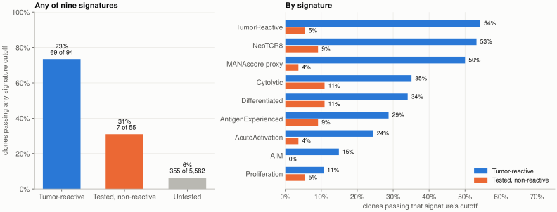
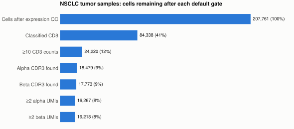

# Benchmark on public TIL data

This page measures one thing: when `tcrsift prioritize --context solid-tumor`
ranks CD8 clones in tumor samples, do clones that were later shown
experimentally to recognize the tumor rank above clones that were shown not to?

Short answer, from two public datasets:

- In pancreatic cancer (149 tested clones), the three tumor-reactivity
  signatures separate reactive from non-reactive clones with AUROC about 0.80,
  and 73% of reactive clones pass a default cutoff against 31% of non-reactive
  ones.
- In lung cancer the direction is the same, but only 17 labelled clones survive
  the default cell gates, so that result is an anecdote, not an estimate.
- Clone size alone does not find tumor-reactive clones in either dataset.

Everything here was run with TCRsift 3.25.1 and can be reproduced from
`benchmarks/public_til/` ([how to reproduce](#reproducing)).

## Data

| | Meng et al. 2023 | Caushi et al. 2021 |
| --- | --- | --- |
| Tumor | Pancreatic ductal adenocarcinoma | Non-small-cell lung cancer after anti-PD-1 |
| Accession | [GSE254250](https://www.ncbi.nlm.nih.gov/geo/query/acc.cgi?acc=GSE254250) | [GSE176021](https://www.ncbi.nlm.nih.gov/geo/query/acc.cgi?acc=GSE176021) |
| Used here | 9 patients, 14,396 CD8 cells, 5,731 clones | 5 patients, 25 tumor and metastasis samples, 207,761 cells after expression QC |
| Positives | 94 clones tested tumor-reactive | Neoantigen-specific (MANA) beta chains, Supplementary Table 8 |
| Negatives | 55 clones tested non-reactive | Virus-specific beta chains (influenza, CMV, EBV), same table |
| How TCRsift was run | Scoring, background calibration and cutoffs called on the authors' cells and clonotype ids | The unmodified `tcrsift prioritize` command on a sample sheet |

Both are open on GEO with no access request. The other well-known labelled
cohorts (Lowery 2022, Hanada 2022, Oliveira 2021) keep their single-cell data
in dbGaP and could not be used.

Two things about these datasets limit what can be claimed:

- **Meng has no TCR contig files on GEO**, only a per-cell clonotype id. The
  loader, CD4/CD8 classification and paired-chain gates are therefore not
  exercised on it; the scoring and selection functions are.
- **MANAscore was derived from the Caushi data.** Its score there is circular
  and is shown only for completeness. NeoTCR8 (Lowery 2022) and the other
  signatures are independent of both datasets.

## Do the signatures rank reactive clones higher?

Each clone gets a percentile for each signature within its own sample. The
AUROC is the probability that a randomly chosen positive clone has a higher
percentile than a randomly chosen negative one; 0.5 is chance.


Pancreatic cancer, 94 reactive against 55 non-reactive clones:

| Signature | AUROC | 95% interval |
| --- | --- | --- |
| TumorReactive | 0.81 | 0.74 to 0.89 |
| MANAscore proxy | 0.80 | 0.72 to 0.87 |
| NeoTCR8 | 0.79 | 0.71 to 0.87 |
| AcuteActivation | 0.70 | 0.62 to 0.79 |
| Differentiated | 0.70 | 0.61 to 0.80 |
| Cytolytic | 0.69 | 0.60 to 0.78 |
| AntigenExperienced | 0.68 | 0.58 to 0.77 |
| AIM | 0.64 | 0.56 to 0.73 |
| Proliferation | 0.51 | 0.41 to 0.60 |
| Clone size (baseline) | 0.34 | 0.25 to 0.45 |

What this shows:

- The three signatures that the `solid-tumor` preset adds do carry the signal;
  the general state signatures are weaker, and Proliferation is at chance.
- Clone size is *below* chance: in these tumors the tested non-reactive clones
  tend to be the larger ones. Ranking by expansion alone would have favored
  bystanders.
- The pooled number hides large differences between patients. For
  TumorReactive, the per-patient AUROC ranges from 0.39 to 1.00 across the
  eight patients that have both labels (NeoTCR8: 0.44 to 1.00). Patients have
  between 3 and 13 negatives each, so single-patient values are noisy.

In lung cancer every signature except Proliferation points the same way, but
with 10 positives and 7 negatives the intervals span most of the scale.

## Do the default cutoffs keep reactive clones?

A ranking is only useful if the cutoff lands in a sensible place. In the
pancreatic data, with every setting at its default:



- 69 of 94 reactive clones (73%) pass at least one signature's cutoff.
- 17 of 55 non-reactive clones (31%) also pass.
- 355 of 5,582 untested clones (6%) pass.

Among tested clones that pass, 80% are reactive (69 of 86), against 63% of all
tested clones. The cutoffs enrich; they do not cleanly separate. The most
selective single lists are TumorReactive (54% of reactive, 5% of non-reactive)
and MANAscore (50% and 4%).

"Passes a cutoff" is not the same as "on the shortlist". The command then
applies an abundance filter and a total budget, which this dataset's adapter
does not run.

## The full command on lung cancer

On the Caushi samples the whole command runs, so the cell gates matter.



With defaults, 8% of cells are retained. The two large losses are the CD8
classification (59% of cells are CD4 or unclassified) and the floor of ten CD3
counts, which removes 71% of the CD8-classified cells in this dataset.

| | Default | `--min-cd3 0` |
| --- | --- | --- |
| Cells retained | 16,218 | 38,753 |
| Clones scored | 4,157 | 9,139 |
| Shortlist | 186 | 200 (cap reached; 333 eligible) |
| Neoantigen-specific clonotypes scored | 10 | 16 |
| ...of which shortlisted | 6 | 3 |
| Virus-specific clonotypes scored | 7 | 8 |
| ...of which shortlisted | 0 | 1 |

With defaults, 6 of the 10 neoantigen-specific clonotypes present are
shortlisted and none of the 7 virus-specific ones, in a shortlist that holds
4.5% of all scored clones. Turning the CD3 gate off recovers more labelled
clones but the shortlist fills its 200-clone budget and keeps fewer of them.
These counts are too small to choose between the two settings.

The published table lists 74 neoantigen-specific and 82 virus-specific beta
chains across 16 patients and all tissues. Most were found in blood, lymph node
or patients not downloaded here, which is why so few appear above.

## What this does not show

- **Antigen specificity.** The signatures describe a cell state shared by
  tumor-reactive cells. They do not identify what a receptor binds.
- **Generalization.** Two tumor types, CD8 cells only, fourteen patients. The
  `blood`, `mpe` and `heme` presets, CD4 selection, and the culture `run`
  workflow are not tested here.
- **Unbiased labels.** The tested clones were chosen by the original authors,
  often among expanded or phenotypically interesting clones. Some of the Caushi
  neoantigen labels came from receptors picked for their expression profile,
  which favors expression signatures.
- **Negatives of the same kind.** Meng's negatives were tested against tumor
  and failed. Caushi's negatives are virus-specific receptors, which were not
  tested against tumor.
- **A comparison with other tools.** No trained predictor (predicTCR, TRTpred,
  the original MANAscore model) was run. TCRsift's MANAscore is a three-gene
  proxy, not the published model.
- **Tuned settings.** Nothing was fitted to these labels, and the results
  should not be used to tune cutoffs without a held-out cohort.

## What the benchmark changed in TCRsift

Running on outside data found three problems:

- **Fixed in 3.25.1.** Loading two or more samples from
  `filtered_feature_bc_matrix/` directories discarded the gene symbols that
  come with the matrices. Symbols were then looked up in a different Ensembl
  release, and the `solid-tumor` preset stopped with "genes absent from matrix"
  for genes the matrices contained.
- **Open.** On references built with the GRCh38-2020-A annotation or later,
  NeoTCR8 fails because one of its 243 genes, PLA2G16, is now named PLAAT3.
  Until symbol aliases are handled, use `--exclude-signatures NeoTCR8` or
  rename the gene in the matrix, as the benchmark does.
- **Open.** The default `--min-cd3 10` is strict for lower-depth libraries.
  Check the `cell_filters` block of `prioritization.json` before trusting a
  shortlist built from a small fraction of the cells.

## Reproducing

```bash
pip install tcrsift openpyxl
git clone https://github.com/pirl-unc/tcrsift && cd tcrsift

python benchmarks/public_til/download.py --data-dir bench_data    # about 1.4 GB
python benchmarks/public_til/run.py --data-dir bench_data --work-dir bench_data/runs
python docs/figures/make_benchmark_figures.py
```

`run.py` writes the tables behind every number on this page to
`benchmarks/public_til/results/`: `signature_auroc.csv`, `summary.json`,
per-clone tables for both datasets, and per-patient AUROCs. Intervals are
percentile bootstraps over clones (2,000 draws, fixed seed).

## Sources

- Meng Z, et al. *Sci Transl Med* 2023 (tumor-reactive and bystander CD8 TCR
  clonotypes in pancreatic cancer). [PMID 37967201](https://pubmed.ncbi.nlm.nih.gov/37967201/)
- Caushi JX, et al. Transcriptional programs of neoantigen-specific TIL in
  anti-PD-1-treated lung cancers. *Nature* 2021.
  [PMID 34290408](https://pubmed.ncbi.nlm.nih.gov/34290408/)
- Lowery FJ, et al. Molecular signatures of antitumor neoantigen-reactive T
  cells from metastatic human cancers. *Science* 2022.
  [PMID 35113651](https://pubmed.ncbi.nlm.nih.gov/35113651/)
