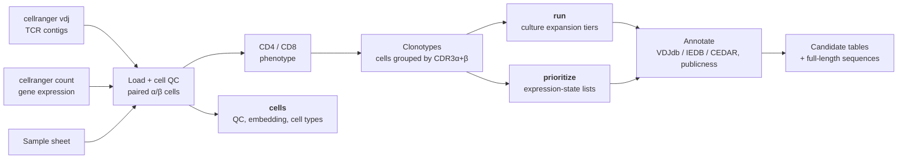
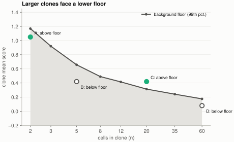
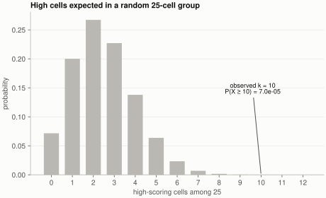

# How TCRsift works

TCRsift turns 10x Genomics Cell Ranger single-cell output into a short,
auditable list of T-cell receptor clonotypes for experimental testing. It ranks
clones using observable signals: clonal abundance, CD4/CD8 lineage, gene
expression programs, public TCR database matches, and sequence generation
probability. None of these signals predicts which epitope a receptor binds;
confirming specificity still requires a functional assay.

## From Cell Ranger output to candidates

All three primary commands share loading and cell QC, then branch according to
study design:

| Command | Question answered | Primary evidence | Guide |
| --- | --- | --- | --- |
| `tcrsift run` | Which clones expanded in an antigen-stimulated culture? | Clone cell count and frequency, CD4/CD8 match to the stimulus, optional overlap with matched TIL | [Culture pipeline](user-guide/pipeline.md), [Filtering](user-guide/filtering.md) |
| `tcrsift prioritize` | Which clones in blood, TIL, pleural effusion, or marrow express an activation or tumor-reactivity program? | Per-clone gene-signature scores calibrated against random cell groups from the same sample | [Clone prioritization](user-guide/til-signatures.md) |
| `tcrsift cells` | What cell types and states make up this sample? | Per-cell QC, Harmony/UMAP/Leiden embedding, cluster-level marker scoring | [Single-cell atlas](user-guide/atlas.md) |

## Evidence sources and their limits

| Signal | Source | What it measures and its limits |
| --- | --- | --- |
| Clonal abundance | Cell count and within-sample frequency | Strong evidence of response after in-vitro peptide stimulation; in fresh tissue, expansion reflects cumulative history rather than reactivity to a specific target. |
| Lineage | Per-cell `CD4`, `CD8A`, and `CD8B` (human) or `Cd4`, `Cd8a`, and `Cd8b1` (mouse) counts | Restricts signature scoring and abundance ranking to the intended T-cell compartment. |
| Expression state | Gene signatures scored per cell and summarized per clone | Captures transcriptional state (activated, cytolytic, exhausted, proliferating) using species-matched HGNC or MGI symbols. See the [reproducibility map](reproducibility_map.md) for cross-donor behavior in stimulated cultures. |
| Database matches | VDJdb, IEDB, CEDAR | Flags receptors matching cataloged viral or MART-1 (`MLANA`/`Mlana`-encoded) specificities, recording both canonical protein labels (`db_protein_canonical`) and endogenous encoding gene symbols (`db_antigen_gene`). Absence of a match means uncataloged, not tumor-specific. |
| Sequence publicness | Bundled k-mer and TCRpeg probability models | Estimates how readily a CDR3 sequence is generated and shared across donors; useful for deprioritizing common bystander sequences, not for calling antigen specificity. |

## How `prioritize` selects clones

Unlike culture experiments with unstimulated controls, fresh tissue or blood
cohorts must rank clones within each sample and lineage without pooling raw
scores across samples. The four figures below use **simulated cell scores**
(`docs/figures/make_figures.py`) to illustrate the exact resampling and
enrichment rules implemented in `tcrsift prioritize`.

### 1. Mean route: a clone's mean must beat size-matched random cell groups

Each signature is scored per cell on `log1p(CP10K)` within a single sample and
lineage, then averaged across the cells of each clone. Because a two-cell clone
produces extreme means by chance much more often than a twenty-cell clone, a
flat score threshold would systematically favor tiny clones. Instead, for each
observed clone size *n*, TCRsift draws random groups of *n* cells without
replacement from the same sample and lineage and requires the clone's mean to
exceed the 99th percentile of those random-group means (as well as the top
decile of clone means in that sample).

Means of random 2-cell groups spread far wider than means of random 20-cell
groups, so the 99th-percentile floor drops as clone size grows:

Clones B and C share the same mean score (0.42): B has 5 cells and falls below
its size-matched floor, whereas C has 20 cells and clears it.

### 2. Subset route: an enriched fraction of high-scoring cells can also qualify

Cells of a single clone often span multiple transcriptional states, diluting the
clone mean even when a subset of cells strongly expresses a signature. TCRsift
marks cells above the sample's 90th percentile as high-scoring and computes the
exact hypergeometric tail probability that a random group of *n* cells from the
same sample and lineage would contain at least *k* high-scoring cells,
requiring at least 5 high-scoring cells, a tail probability ≤ 0.01, and a
top-decile clone rank in that sample.

Here, the 25-cell clone's mean (0.22) sits below the 25-cell mean floor (0.30),
so the mean route rejects it. However, 10 of its 25 cells are high-scoring
(versus 2–3 expected by chance), so the subset route retains it:

### 3. Round-robin selection across qualifying lists

Each combination of signature, evidence route (mean or subset), sample, and
lineage produces its own ranked list of clones that cleared both cutoffs.
TCRsift steps through those lists in rounds, taking the highest-ranked unused
clone from each list and skipping clones already chosen by an earlier list. If
the clone budget ends partway through a round, the remaining slots go to the
signatures and samples with the fewest picks in that round. Exhausted lists drop
out, and the shortlist is never padded with clones that missed the cutoffs.

Avoiding weighted composite scores keeps every pick auditable:
`candidate_clones.csv` records the exact list (`selected_signature`,
`selected_evidence`, `selected_sample`, `selected_lineage`) that contributed
each candidate. Full details, CLI flags, and statistical assumptions are in the
[prioritization guide](user-guide/til-signatures.md).

## Empirical validation

Default cutoffs are fixed operating choices rather than parameters fitted to
labeled training data. Three empirical evaluations are documented:

- [Benchmark on public TIL data](benchmarks.md): evaluation of `tcrsift
  prioritize --context solid-tumor` across five public tumor cohorts (33
  patients) with experimentally tested clones. TumorReactive separates reactive
  from non-reactive clones in pancreatic cancer (AUROC 0.81) and melanoma
  (0.78), more weakly in lung cancer (0.69 across 31 labeled clones), and shows
  no enrichment for virus-multimer-binding clones in two virus-driven tumors.
- [Benchmark on infectious disease and blood](benchmarks-infectious.md):
  evaluation of `tcrsift prioritize --context blood`, VDJdb specificity matching
  with study holdouts, pMHC multimer clonal concordance, and paired 16 h peptide
  restimulation (`score_stimulation_response`) across Influenza, EBV, CMV,
  SARS-CoV-2, and naive `MART-1` cohorts.
- [Signature reproducibility map](reproducibility_map.md): cross-donor behavior
  of expression signatures versus TCR sequence probability in an in-vitro
  MART-1 peptide-expansion pilot.

Expression signatures measure T-cell transcriptional state rather than cognate
epitope identity; the `blood-tumor`, `mpe`, and `heme` context presets remain
untested against ground-truth labels.
