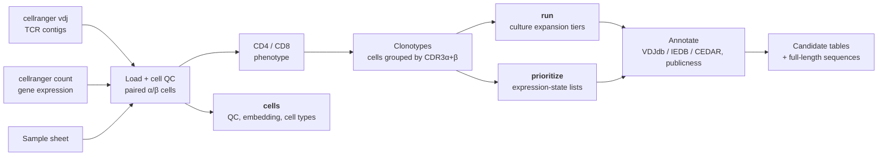
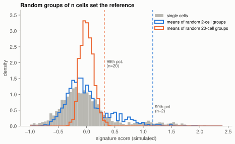
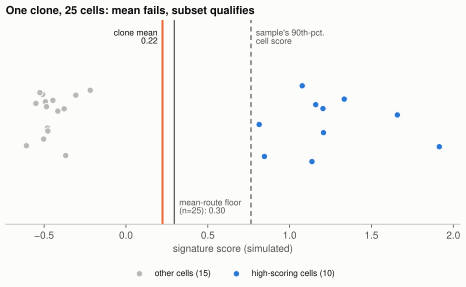
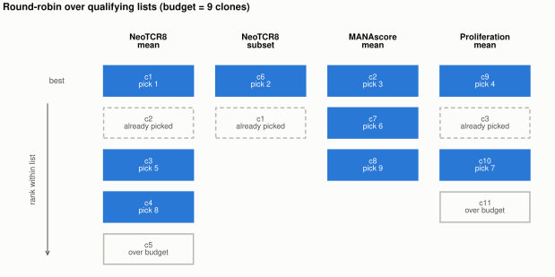

# How TCRsift works

TCRsift turns Cell Ranger single-cell output into a short, auditable list of
T-cell receptor clonotypes worth testing. It ranks clones by observable
evidence (abundance, cell state, database matches, sequence publicness). It
does not predict which antigen a receptor binds; that still takes an
experiment.

## From Cell Ranger output to candidates

Every workflow shares the first three steps and then diverges by study design:

| Workflow | Question it answers | Main evidence | Guide |
| --- | --- | --- | --- |
| `tcrsift run` | Which clones expanded in an antigen-stimulated culture? | Clone frequency and cell count, CD4/CD8 match to the antigen, optional match to tumor | [Culture pipeline](user-guide/pipeline.md), [Filtering](user-guide/filtering.md) |
| `tcrsift prioritize` | Which clones in blood, TIL, effusion or marrow sit in an informative expression state? | Per-clone gene-signature scores against a size-matched background | [Clone prioritization](user-guide/til-signatures.md) |
| `tcrsift cells` | What cell types and states are in this sample? | Per-cell QC, embedding, cluster annotation | [Atlas path](user-guide/atlas.md) |

## The evidence TCRsift uses

| Signal | Where it comes from | What it can and cannot tell you |
| --- | --- | --- |
| Clonal expansion | Cells per clone and frequency within a sample | Expansion after stimulation is the most direct evidence in culture. In fresh tissue it reflects history, not a specific antigen. |
| Lineage | CD4/CD8 expression per cell | Lets signatures and thresholds be applied within the right lineage. |
| Expression state | Published and compact gene signatures scored per cell, averaged per clone | Describes state (activated, exhausted, proliferating). The [reproducibility map](reproducibility_map.md) records which signatures held up across donors and which did not. |
| Database matches | VDJdb, IEDB, CEDAR | Flags known viral or MART-1 receptors. No match means unknown, not novel. |
| Publicness | Bundled sequence-probability models | Highlights receptors that are easy to generate and therefore often shared; an optional exclusion, not a specificity call. |

## How `prioritize` picks clones

The prioritization command is the part of TCRsift with the most moving pieces.
The three figures below use **simulated scores** to show the rule; they are
illustrations of the method, not performance measurements. They are generated
by `docs/figures/make_figures.py` with the same resampling helper and
hypergeometric calculation the command uses.

### 1. A clone's mean must beat random groups of the same size

Each signature is scored per cell within one sample and lineage, then averaged
over a clone's cells. A two-cell clone can reach a high mean by chance far more
easily than a twenty-cell clone, so a single cutoff would favor tiny clones.
TCRsift instead draws random groups of *n* cells from the same sample and
lineage and requires the clone mean to exceed the 99th percentile of those
group means.

Means of random 2-cell groups spread much wider than means of random 20-cell
groups, so the 99th percentile a clone must beat depends on its size.

Clones B and C have the same mean score. B has 5 cells and falls
below its floor; C has 20 cells and clears it.

### 2. A subset of high-scoring cells can also qualify a clone

Cells of one clone are not always in the same state. A clone whose mean is
unremarkable can still hold many more high-scoring cells than chance allows.
TCRsift labels the top-decile cells in the sample as high-scoring and asks how
likely a random group of the same size would be to contain at least as many.

Here the clone mean (0.22) is below the 25-cell floor (0.30), so the mean route
rejects it. Ten of its 25 cells are high-scoring, against two or three expected,
so the subset route keeps it.

### 3. Lists take turns until the budget is spent

Every signature, evidence route, sample and lineage produces its own ranked list
of qualifying clones. TCRsift visits the lists in a fixed order and takes the
best unused clone from each, skipping clones another list already supplied.
Lists that run out simply stop; the shortlist is never padded with clones below
the cutoffs.

There are no weighted composite scores, so each candidate can be traced to the
one list that supplied it (`selected_signature`, `selected_evidence`,
`selected_sample` in `candidate_clones.csv`).

The full rule, every option, and the caveats on interpreting the tail
probabilities are in the [prioritization guide](user-guide/til-signatures.md).

## What has and has not been validated

The cutoffs above are transparent operating choices, not thresholds fitted to
experimentally confirmed receptors. Two sets of measurements exist:

- [Benchmark on public TIL data](benchmarks.md): three public tumor datasets
  with experimentally labelled clones. The tumor-reactivity signatures rank
  reactive clones well in pancreatic and lung tumors (AUROC about 0.8 to 0.97)
  and show no enrichment in a head and neck dataset. The same page shows that
  short lists improve when only those three signatures are used.
- [Signature reproducibility map](reproducibility_map.md): which signatures
  held up across two donors in an in-vitro MART-1 expansion pilot.

Neither establishes antigen specificity, and neither covers the blood,
effusion or hematologic presets.
