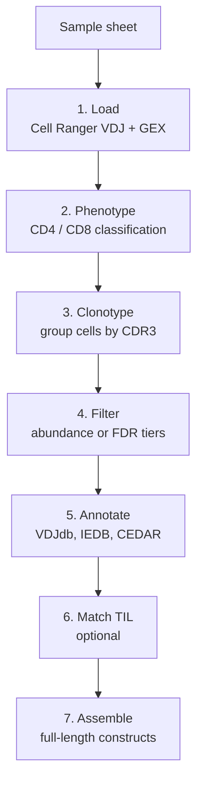

# Culture Pipeline

`tcrsift run` processes antigen-stimulated T-cell cultures (with optional
matched TIL) through seven sequential stages, writing intermediate files and QC
summaries at each step.

## Pipeline stages



## 1. Load data

Reads Cell Ranger VDJ (`filtered_contig_annotations.csv`, dropping
non-productive contigs) and GEX (`filtered_feature_bc_matrix/` or
`filtered_feature_bc_matrix.h5`) outputs and pairs them by cell barcode:

```bash
tcrsift load --sample-sheet samples.yaml -o loaded.h5ad
```

The resulting `AnnData` stores cell barcodes in `obs_names`, expression counts
in `X`, and primary α/β chain annotations plus T-cell marker counts in `obs`.

## 2. Phenotype cells

Classifies each cell into CD4+ or CD8+ categories from `CD4`, `CD8A`, and
`CD8B` counts and applies the minimum CD3 count filter (`--min-cd3-reads 3` by
default):

```bash
tcrsift phenotype -i loaded.h5ad -o phenotyped.h5ad --cd4-cd8-ratio 3.0
```

| Category | Rule (default `ratio = 3.0`) |
| --- | --- |
| `Confident CD8+` | `(CD8A + CD8B + 1) / (CD4 + 1) > ratio` |
| `Confident CD4+` | `(CD4 + 1) / (CD8A + CD8B + 1) > ratio` |
| `Likely CD8+` | `CD8A + CD8B > 0` and `CD4 = 0` |
| `Likely CD4+` | `CD4 > 0` and `CD8A + CD8B = 0` |
| `Unknown` | Comparable non-zero expression, or zero on both |

## 3. Aggregate clonotypes

Collapses retained cells into clonotypes by CDR3 amino-acid sequence and
computes cell counts, within-sample frequencies, and consensus T-cell lineage
(when run through `tcrsift run`, bundled k-mer `Pgen`/`Ppost` log-probabilities
are also attached automatically; run `tcrsift pgen annotate` when executing
steps individually):

```bash
tcrsift clonotype -i phenotyped.h5ad -o clonotypes.csv --group-by CDR3ab
```

- `CDR3ab` (default): requires matching α and β CDR3 sequences.
- `CDR3b_only`: groups by β-chain CDR3 alone.

## 4. Filter clonotypes

Assigns clonotypes to confidence tiers (`tier1`–`tier5`) using fixed abundance
thresholds or logistic FDR estimation:

```bash
tcrsift filter -i clonotypes.csv -o filtered/ --method threshold --tcell-type cd8
```

See [Filtering Strategies](filtering.md) for tier definitions, `--fdr-scope`,
and multi-method overlap outputs.

## 5. Annotate clonotypes

Flags clonotypes matching known epitopes in VDJdb, IEDB, or CEDAR (using
explicit file paths or the managed `tcrsift data` cache):

```bash
tcrsift annotate -i filtered/tier1.csv -o annotated.csv \
    --vdjdb /path/to/vdjdb \
    --iedb /path/to/iedb
```

## 6. Match TIL (optional)

When TIL samples (`source: til`) are listed on the same sample sheet as culture
samples, `tcrsift run` automatically excludes them from culture aggregation and
annotates culture clonotypes with `til_match`, `til_cell_count`, and
`til_frequency`.

To match culture clonotypes against TIL processed separately, run `match-til`:

```bash
tcrsift match-til -i annotated.csv --til-csv til_clonotypes.csv -o matched.csv

# Multiple TIL inputs without a sample sheet:
tcrsift match-til -i annotated.csv -o matched.csv \
  --til-sample T1=csv:/path/to/til_t1.csv \
  --til-sample T2=h5ad:/path/to/til_t2.h5ad
```

`match-til` annotates rows already present in the input culture table; it does
not add clones found only in TIL. For TIL-only datasets without culture samples:

- **Expression-state prioritization (standard Cell Ranger VDJ + GEX):** use
  `tcrsift prioritize samples.yaml -o candidates/ --context solid-tumor` (or
  `tcrsift til-prioritize`; see [Clone Prioritization](til-signatures.md)).
- **Count/frequency harmonization across TIL samples:** use `tcrsift
  til-clonotype`.
- **Longitudinal TIL samples in the legacy v2 file layout:** use `tcrsift
  til-select` (see [CLI Reference](cli.md#tcrsift-til-select)).

## 7. Assemble full-length sequences

Constructs full-length α, β, and single-chain (`β-linker-α`) amino-acid and DNA
sequences for synthesis:

```bash
tcrsift assemble -i annotated.csv -o sequences.csv \
    --contigs-dir /path/to/vdj \
    --include-constant \
    --single-chain \
    --linker T2A \
    --fasta sequences.fasta
```

Pass `--allow-canonical-fallback` when assembling without `--contigs-dir`.
Assembled constructs combine:

- **Leader peptides:** `CD28` on α and `CD8A` on β by default (murine `mCD28`,
  `mCD8B`, `H2Kb`, and `IgK` are also bundled), or native V-gene leaders
  extracted from Cell Ranger FASTA contigs (`--leaders-from-contigs`).
- **Variable regions:** assembled V(D)J sequences from clonotyping.
- **Constant regions:** packaged canonical human (`TRAC`, `TRBC1`, `TRBC2`) and
  mouse (`Trac`, `Trbc1`, `Trbc2`) references (`--species {auto,human,mouse}`,
  with `--constant-species mouse` for chimeric human-VDJ / murine-constant
  constructs). When contig FASTAs are supplied, compatible donor nucleotides at
  the J→C junction are preserved before switching to codon-optimized canonical
  sequence; see [Assembly API](../api/assemble.md#constant-region-construction).
- **2A linker:** `T2A` by default (`P2A`, `E2A`, and `F2A` are also supported).

## Running the full pipeline at once

```bash
tcrsift run \
    --sample-sheet samples.yaml \
    --output-dir results/ \
    --vdjdb /path/to/vdjdb \
    --tcell-type cd8 \
    --method threshold
```

Pass `--no-report` to skip PDF report generation or `--skip-plots` to skip PNG
figures.
