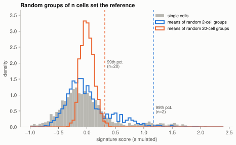
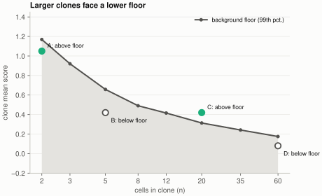
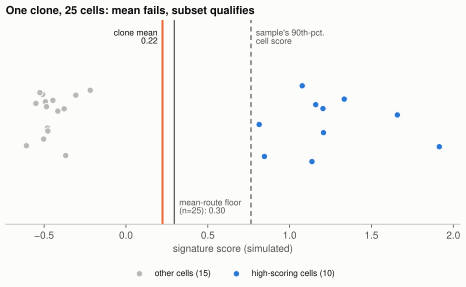
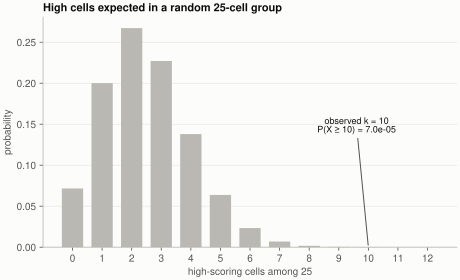

# Clone prioritization by expression state

`tcrsift prioritize` ranks paired Cell Ranger VDJ and GEX clonotypes across one
or more samples using gene-expression state signatures. Include `patient_id` on
the sample sheet whenever a study spans multiple donors.

```bash
# Vaccine or peripheral-blood study (CD8 default)
tcrsift prioritize samples.yaml -o candidates/ --context blood

# Malignant pleural effusion, scoring both CD4 and CD8 lineages
tcrsift prioritize samples.yaml -o candidates/ --context mpe --tcell-type both

# AML or other hematologic malignancy
tcrsift prioritize samples.yaml -o candidates/ --context heme

# Solid-tumor TIL (these two commands are identical)
tcrsift prioritize samples.yaml -o candidates/ --context solid-tumor
tcrsift til-prioritize samples.yaml -o candidates/

# Assemble full-length β-T2A-α constructs in the same command
tcrsift prioritize samples.yaml -o candidates/ --context solid-tumor --assemble
```

`til-prioritize` and `examples/multi_sample_til.py` run the same workflow with
`--context solid-tumor` as the default. The older `til-select` subcommand
remains separate for longitudinal datasets stored in the legacy v2 per-timepoint
file layout.

!!! note "What expression prioritization measures"
    Signatures rank transcriptional states associated with activation, memory,
    or tumor reactivity; they do not predict epitope specificity or prove that
    a clone was induced by vaccination. Empirical performance across public
    human and mouse cohorts is reported in the
    [Benchmark overview](../benchmarks-overview.md) and
    [Benchmark on public TIL data](../benchmarks.md).

## Selection algorithm

1. **Filter cells.** Apply GEX quality bounds, CD4/CD8 lineage classification,
   `--min-cd3`, paired productive α/β chain checks, and any `--min-expression`
   or `--max-expression` filters. The retained cells define both clone counts
   and the reference pool for score calibration.
2. **Score signatures per stratum.** Normalize counts to `log1p(CP10K)` and
   score each enabled signature independently within each `(patient, sample,
   lineage)` stratum.
3. **Qualify clones by mean or subset evidence.** Within each stratum and
   signature, evaluate every clone on two routes (both enabled by default):
   elevated clone mean relative to size-matched random cell groups, and
   hypergeometric enrichment of high-scoring cells. Each route also requires the
   clone to sit in the top decile of clones in that stratum
   (`--signature-quantile 0.90`). Reference calibration uses all retained cells
   in the stratum before clone-level exclusions.
4. **Apply clone-level exclusions and rank each list.** Remove clones failing
   minimum abundance (`--min-cells`, `--min-frequency`) or sequence/database
   exclusions (known MART-1 by default, optional viral, V/J gene, CDR3 length,
   or publicness filters). Rank mean lists by decreasing mean score, frequency,
   cell count, and CDR3 sequence; rank subset lists by increasing tail
   probability, decreasing high-cell fraction, cell count, and CDR3 sequence.
5. **Take turns across lists up to the budget.** Visit active lists in
   round-robin order, picking the highest-ranked unselected clone from each list
   until 200 candidates are chosen across the run (`--max-clones 200`, or
   `0` for no cap) or all lists are exhausted. Lists that run out drop out of
   rotation; the shortlist is never padded with clones that missed the cutoffs.

### Budget sharing and list ordering

The budget is shared across patients, samples, signatures, evidence routes, and
lineages. Within one patient, a clone shared across multiple samples occupies a
single shortlist slot; an identical CDR3 sequence appearing in two different
patients is treated as two distinct rows.

By default (`--round-robin-mode tiered`, active whenever `--signatures` is not
explicitly overridden), context presets schedule dedicated tumor/neoantigen
signatures in Tier 1 (`TumorReactive`, `MANAscore`, `NeoTCR8`, `NeoTCR4` in
`solid-tumor`; `MANAscore`, `NeoTCR8`, `NeoTCR4` in `mpe`; `NeoTCR_PBL` in
`blood-tumor`) until all Tier-1 lists are exhausted or `--max-clones` is
reached, and then backfill remaining budget slots from the six general state
panels in Tier 2. Pass `--round-robin-mode flat` to give every signature
equal weight from round 1.

Within each tier, full rounds visit lists by signature order (preset order below,
or the order given to `--signatures`), then evidence route (`mean`, `subset`),
then lexical `patient_id`, `sample`, and `lineage`. If `--max-clones` ends
partway through a round, remaining slots go to the signature (and within it, the
sample) with the fewest selections so far in that round, preventing signatures
listed late in a tier from being starved.

## Two complementary evidence routes

Under the default `--signature-cutoff background --signature-evidence either`,
a clone can qualify through an elevated mean or an enriched subset of
high-scoring cells. Keeping separate ranked lists for the two routes ensures
that a clone with heterogeneous cell states is not buried by a modest overall
mean. If a clone qualifies on both routes, it consumes one shortlist slot and
counts the signature once toward `--min-signature-support`.

Pass `--signature-evidence mean` or `subset` to restrict to a single route.
`--signature-cutoff legacy` uses mean scores only (`score > 0` and top decile)
and rejects `subset` or `either`.

### Mean route: size-matched background floors

Within each `(patient, sample, lineage)` stratum and signature, TCRsift
computes a separate mean floor for each observed clone cell count `n`:

1. Draw 2,000 random groups of `n` cells uniformly without replacement from all
   retained cells in that stratum (exact enumeration when fewer than 2,000
   combinations exist; all cells for `n = 1`). Sampling is shared across
   signatures using deterministic seed `0` (`--signature-background-seed`).
2. Compute the mean signature score of each random group.
3. Require the clone's mean score to strictly exceed the **99th percentile** of
   those group means (`--signature-background-quantile 0.99`, using the
   `higher` order statistic so ties fail), in addition to the top-decile clone
   rank gate.

Resampling from observed cell scores preserves skewness, zero inflation, and
gene-gene correlation without parametric assumptions. Because group-mean
variance shrinks with `n`, a 2-cell clone faces a much higher bar than a
20-cell clone:



*Simulated cell scores: means of random 2-cell groups spread much wider than
means of random 20-cell groups.*



*Resulting 99th-percentile floor by clone size: a mean of 0.42 fails for a
5-cell clone (B) and passes for a 20-cell clone (C).*

Exported Monte Carlo tail probabilities use `(exceedances + 1) / (draws + 1)`
(including ties), or the exact fraction under full enumeration.

### Subset route: hypergeometric enrichment of high-scoring cells

Within each `(patient, sample, lineage)` stratum and signature:

1. Mark a cell **high-scoring** when its score strictly exceeds the observed
   90th-percentile cell score (`--signature-high-quantile 0.90`, `higher` order
   statistic; flat score distributions mark zero high cells).
2. Count high-scoring cells `k` among the clone's `n` cells in that stratum. By
   default, require `k >= 5` (`--min-signature-high-cells 5`) with no minimum
   fraction (`--min-signature-high-fraction 0`).
3. Given `K` high-scoring cells among `N` retained cells in the stratum,
   compute the exact upper-tail probability `P(X >= k)` under
   `Hypergeometric(N, K, n)`.
4. Require `P(X >= k) <= 0.01` (`--signature-subset-pvalue 0.01`) and a clone
   rank in the top decile by that tail probability (`--signature-quantile`).

Thus a 25-cell clone with 10 high-scoring cells (40% vs ≤10% background)
qualifies even when its remaining 15 cells pull the clone mean below the
25-cell floor:



*Simulated scores: the clone mean (0.22) sits below the 25-cell mean floor
(0.30).*



*Observing 10 or more high-scoring cells in a random 25-cell draw has
probability `5.4e-5`.*

### Statistical assumptions and threshold tuning

- **Competitive within-sample reference.** Both routes test whether a clone
  stands out against random draws of T cells from the same sample and lineage
  (including the candidate clone's own cells, making heavily expanded samples
  conservative). A sample composed uniformly of activated cells offers no
  internal contrast, and very small strata may yield no qualifying clones.
- **Unadjusted operating cutoffs.** Tail probabilities are not adjusted for
  multiple testing across clones, signatures, routes, or samples; the shortlist
  does not control a false discovery rate. Strata with flat scores or a single
  clone are skipped automatically.
- **Relationship to published methods.** Adapting cutoffs per sample and
  requiring ≥5 high-scoring cells follows qualitative ideas from
  [Zeng et al. 2025 (MANAscore)](https://www.nature.com/articles/s41467-024-55059-3),
  [Lowery et al. 2022 (NeoTCR4/8)](https://pmc.ncbi.nlm.nih.gov/articles/PMC8996692/),
  and [Yossef et al. 2023 (NeoTCR_PBL)](https://pmc.ncbi.nlm.nih.gov/articles/PMC10843665/),
  but TCRsift's scoring scales differ from theirs: `NeoTCR4`, `NeoTCR8`, and
  `NeoTCR_PBL` are scored via [Scanpy
  `score_genes`](https://scanpy.readthedocs.io/en/stable/generated/scanpy.tl.score_genes.html)
  (signature mean minus expression-matched control mean on `log1p(CP10K)`, **not
  scGSEA**), and `MANAscore` is an unweighted three-gene signed-z proxy rather
  than the published random-forest/linear ensemble. Numeric cutoffs from those
  papers do not transfer directly.

Common threshold adjustments:

```bash
# Relax the within-stratum rank gate while keeping the 99th-percentile floor
tcrsift prioritize samples.yaml -o candidates/ --context blood \
  --max-clones 200 --signature-quantile 0.80

# Stricter background quantile (increase draws so at least 10 fall in the tail)
tcrsift prioritize samples.yaml -o candidates/ --context blood \
  --signature-background-quantile 0.995 --signature-background-draws 4000

# Require at least 5 high cells AND at least 20% of the clone on the subset route
tcrsift prioritize samples.yaml -o candidates/ --context blood \
  --min-signature-high-cells 5 --min-signature-high-fraction 0.20

# Require a clone to pass all cutoffs on at least two distinct signatures
tcrsift prioritize samples.yaml -o candidates/ --context solid-tumor \
  --min-signature-support 2

# Reproduce the 3.23.1 fixed-zero cutoff rule
tcrsift prioritize samples.yaml -o candidates/ --context blood \
  --signature-cutoff legacy --signature-quantile 0.90 --min-signature-score 0
```

Additional boundary rules:

- `--signature-quantile 0` disables the rank-decile gate while keeping the
  background floor.
- `--min-signature-score VALUE` adds a strict raw-score floor on top of the
  background floor (and also requires subset-route candidates to clear that
  clone mean). In background mode there is no default zero cutoff: a negative
  mean can qualify if the reference distribution is lower still.
- `--min-signature-support N` requires `N` distinct signatures where each
  supporting signature passes all of its cutoffs within a single `(sample,
  lineage)` stratum; different supporting signatures may qualify in different
  strata of that patient.
- `--signature-background-draws` must be at least 1,000 and leave at least 10
  expected draws above `--signature-background-quantile`.

## Context presets and biological ontology

TCRsift separates **assay regime** (ex vivo single-cell state via `tcrsift prioritize`, pMHC barcoding via `--call-multimers`, paired-control overnight restimulation via `tcrsift run --method stimulation`, and multi-day expansion culture via `tcrsift run --method threshold|logistic`) from **biological compartment / antigen-exposure context** (`--context`).

Every `prioritize` preset combines the six core state panels (**Differentiated, AntigenExperienced, Cytolytic, AcuteActivation, Proliferation, AIM**) with context-appropriate Tier-1 signatures placed ahead of the core panels:

| Regime | Context | Tier-1 priority signatures (human) | Biological compartment & exposure assumption |
| --- | --- | --- | --- |
| **Tumor-resident TILs** | `solid-tumor` | `TumorReactive`, `MANAscore`, `NeoTCR8`, `NeoTCR4` | Fresh / untreated solid-tumor TIL with chronic in-situ antigen exposure (add `--exclude-treg` for CD4 TILs) |
| **Tumor-resident TILs** | `post-act` | `AntigenExperienced`, `Cytolytic`, `Differentiated` | Post-ACT / infused TIL biopsies where chronic *CXCL13*/*CD39* residency exhaustion is attenuated |
| **Circulating T cells** | `blood-tumor` | `NeoTCR_PBL` | Circulating antitumor CD8 T cells in cancer-patient blood (*CXCL13*-negative) |
| **Circulating T cells** | `blood` | *(none; `CirculatingMemory` + core)* | Infection, vaccine, healthy, or hematologic-malignancy peripheral blood / marrow (add `--call-multimers` for pMHC-barcoded libraries) |
| **Peptide-stimulated T cells** | `peptide-stim` | `AIM`, `AcuteActivation`, `Proliferation`, `Cytolytic` | Short-term (6–24 h) restimulation without a paired unstimulated control (if a paired control well is available, use `tcrsift run --method stimulation`; for 7–14 d expansion culture, use `tcrsift run --method threshold` or `logistic`) |
| **Tissue-agnostic fallback** | `generic` *(default)* | *(none; 6 core panels only)* | Unspecified tissue or exploratory state coverage (no tumor-residency or circulation assumption) |

Legacy compatibility variants `--context heme` (alias for `blood`) and `--context mpe` (effusion variant of `solid-tumor` omitting epithelial `ITGAE`-containing `TumorReactive`) remain supported. This ontology is exposed programmatically via `tcrsift.PRIMARY_CONTEXTS` and `tcrsift.CONTEXT_ONTOLOGY` (`dict[str, ContextSpec]`). When `--tcell-type cd4` or `both` is used with `--context solid-tumor` or `mpe` and `--exclude-treg` is disabled, `tcrsift prioritize` logs a warning whenever `FOXP3+` Treg-like clones are detected.

Context applies to the entire run and is never inferred from sample names,
`tissue`, or `source`.

**Lineage compatibility:** `--tcell-type` defaults to `cd8` (`cd4` and `both`
are also supported; `Confident` and `Likely` cells of the requested lineage are
kept, and `Unknown` cells are dropped — except on samples explicitly tagged with
`pre_sorted: CD4` or `pre_sorted: CD8` in the sample sheet, where `CD3`-passing
coreceptor-dropout cells with `CD4 == 0` and `CD8 == 0` are retained as `Likely
CD4+` or `Likely CD8+`). `NeoTCR4` is CD4-only, while `NeoTCR8`,
`NeoTCR_PBL`, and `MANAscore` are CD8-only. Presets automatically drop
signatures incompatible with `--tcell-type` (under `both`, each scores only in
its compatible lineage); explicitly passing an incompatible signature to
`--signatures` raises an error.

Override or trim a preset:

```bash
# Score only the three tumor-reactivity signatures on a tight screening budget
tcrsift prioritize samples.yaml -o candidates/ --context solid-tumor \
  --signatures TumorReactive MANAscore NeoTCR8 --max-clones 50

# Score both CD4 and CD8 while dropping the MANAscore proxy
tcrsift prioritize samples.yaml -o candidates/ --context solid-tumor \
  --exclude-signatures MANAscore --tcell-type both
```

Signature names are case-insensitive. Missing signature genes raise an error
rather than silently dropping genes, after checking a built-in alias table for
renamed HGNC symbols (such as `PLA2G16`/`PLAAT3` and `CARS`/`CARS1`) and 1:1
mouse MGI orthologs (such as `Cd8b1` for `CD8B`). When `--species mouse` is set
(or inferred under `--species auto` from MGI gene symbols, `ENSMUSG*` IDs, or
murine VDJ genes), presets score MGI-symbol signatures (`CONTEXT_SIGNATURES_MOUSE`)
and omit human-cohort-derived `NeoTCR4`/`NeoTCR8`/`NeoTCR_PBL` sets. Gene lists
and formulas are documented in [Gene-expression signatures](../api/signatures.md).

## Input sheet and output files

```yaml
samples:
  - sample: patient1_pre
    patient_id: patient1
    tissue: blood
    timepoint: pre
    vdj_dir: /data/patient1_pre/vdj
    gex_dir: /data/patient1_pre/gex
  - sample: patient1_post
    patient_id: patient1
    tissue: blood
    timepoint: post
    vdj_dir: /data/patient1_post/vdj
    gex_dir: /data/patient1_post/gex
```

YAML and CSV sample sheets are both accepted. Every row must have a unique
`sample` name plus `vdj_dir` and `gex_dir` (or `gex_path`). If `patient_id` is supplied on
any row, supply it on every row; if omitted everywhere, all samples are treated
as a single patient. `tissue` and `timepoint` are recorded as metadata, and
`source` can be omitted.

Outputs written to `-o`:

- `candidate_clones.csv`: shortlisted clones ordered by global `selection_rank`,
  recording `selected_signature`, `selected_evidence`, `selected_sample`,
  `selected_lineage`, `selected_cells`, `selected_mean_score`,
  `selected_high_cells`, and `selected_high_fraction` from the exact list that
  contributed each pick.
- `all_scored_clones.csv`: every clone surviving cell filters, with scores,
  `eligible_for_review`, `selected_for_review`, database/publicness flags, and
  `excluded_reason` (eligible clones beyond `--max-clones` remain unselected).
  Clone-level `max_frequency` uses all retained cells across requested lineages
  in the sample (coinciding with `clone_sample_scores.csv` when a single
  lineage is selected).
- `clone_sample_scores.csv`: per-`(clone, sample, lineage)` counts,
  within-lineage frequencies, signature means, percentiles,
  `signature_NAME_noise_floor`, `signature_NAME_background_tail_probability`,
  `signature_NAME_high_cell_threshold`, `high_cells`, `high_fraction`,
  `subset_tail_probability`, `subset_percentile`, and separate
  `mean_passes_cutoff`, `subset_passes_cutoff`, and combined `passes_cutoff`
  booleans (evaluated prior to clone-level exclusions and budgeting).
- `signature_background.csv` (background mode): one calibration row per
  `(signature, patient, sample, lineage, clone_size)` recording background cell
  count, floor, quantile, draw count, exact vs Monte Carlo method, high-cell
  threshold, and reference high-cell count.
- `multimer_specificity.csv` (when `--call-multimers` is passed): per-`(donor,
  CDR3ab)` pMHC multimer specificity calls, binding cell counts, and clonal
  concordance.
- `candidate_constructs.csv` and `candidate_constructs.fasta` (when
  `--assemble` is passed): validated full-length α, β, and single-chain
  (`β-linker-α`, default `--single-chain-linker T2A`) protein and codon-optimized
  DNA constructs for every shortlisted candidate. When `vdj_dir` entries on the
  sample sheet contain Cell Ranger `*contig*.fasta` files, native V-gene leader
  peptides (`from_contig`) and J→C junction checks are used automatically; pass
  `--germline-vdj-fallback` (with cached IMGT `germline` / `germline_mouse`
  references) when 5' V-regions are truncated or contig FASTAs were not
  deposited.
- `prioritization.json`: package version, CLI arguments, resolved signatures,
  sequential `cell_filters` counts, per-sample retained cell counts,
  reference-database status, and `assembly` summary statistics.

## Cell and clone filters

| Flags | Default and behavior |
| --- | --- |
| `--min-cells`, `--min-frequency` | Clone must have ≥2 cells across a patient's samples and ≥0.001 frequency in at least one sample. |
| `--min-genes`, `--max-genes` | 250–15,000 detected genes per cell. |
| `--min-counts`, `--max-counts` | 500–100,000 total GEX UMI counts per cell. |
| `--min-mito-pct`, `--max-mito-pct` | 0–8% mitochondrial GEX counts (no minimum floor by default). |
| `--min-vdj-umis`, `--min-vdj-reads` | ≥2 UMIs on each primary α and β contig; read threshold disabled (`0`). |
| `--min-cd3` | ≥3 summed raw `CD3D + CD3E + CD3G` GEX counts per cell (`0` disables; default was `10` prior to 3.27.0). Because raw counts scale with sequencing depth, high values can discard most cells in shallow libraries; `prioritize` warns if >50% of cells fail. |
| `--min-expression GENE=VAL`, `--max-expression GENE=VAL` | Repeatable per-cell `log1p(CP10K)` bounds (combined with AND; missing genes raise an error). |
| `--include-v-gene`, `--exclude-v-gene` | Exact V-gene match on either chain, ignoring allele suffix and case (repeatable). |
| `--include-j-gene`, `--exclude-j-gene` | Corresponding J-gene filters; missing gene calls fail active filters. |
| `--min-alpha-cdr3-length`, `--min-beta-cdr3-length` | Minimum CDR3 amino-acid lengths including conserved anchors (`0` disables). |

Only cells with complete, canonical paired α/β CDR3s enter aggregation
(dual-chain cells use their highest-UMI productive contig per chain). Cell-level
VDJ and expression filters run before clonotype aggregation, so rejected cells
contribute neither abundance nor signature scores.

```bash
tcrsift prioritize samples.yaml -o candidates/ --context blood \
  --min-genes 300 --max-mito-pct 15 --min-vdj-reads 10 \
  --min-expression GZMB=1 --max-expression CCR7=2 \
  --min-alpha-cdr3-length 10 --min-beta-cdr3-length 12
```

## MART-1, viral database matches, and publicness

- **Known MART-1 receptors are excluded by default.** Reference databases are
  resolved from explicit `--vdjdb`, `--iedb`, or `--cedar` paths or from the
  managed `tcrsift data` cache (`--cache-dir`; pass `--auto-download` to fetch
  uncached databases automatically). Matching restricts database entries to the
  query host species (`host_species_filter="same"`), and clones matching the
  MART-1/Melan-A protein (encoded by `MLANA` in human or `Mlana` in mouse) or
  epitopes `EAAGIGILTV`/`AAGIGILTV`/`ELAGIGILTV` are excluded unless
  `--no-exclude-known-mart1` is passed. Without a reference database,
  `prioritize` logs a warning because known MART-1 receptors cannot be flagged.
- **Known viral matches are retained by default** so vaccine studies and
  virus-driven tumor analyses do not lose target clones. Pass
  `--exclude-known-viral` to exclude them. Because every clone scored by
  `prioritize` has paired α/β chains, `--database-match` defaults to `strict_ab`
  (exact paired α+β matching) so private tumor-reactive clones sharing only a
  public β-chain CDR3 with a viral entry are neither mislabeled nor discarded;
  pass `--database-match ab_with_partial` or `b_only` to include β-only matches.
- **Optional pMHC multimer feature-barcode calling (`--call-multimers`).** When
  10x `Antibody Capture` / `Antigen Capture` libraries contain DNA-barcoded pMHC
  dextramers/tetramers alongside `*_NC` negative controls, `--call-multimers`
  calls single-cell binding and summarizes clonal concordance
  (`multimer_call`, `multimer_concordance`, `multimer_confident`, also written
  to `multimer_specificity.csv`) onto `all_scored_clones.csv` and
  `candidate_clones.csv`.
- **Regulatory T-cell (`FOXP3`) audit and opt-in exclusion (`--exclude-treg`).**
  Intratumoral `FOXP3+` regulatory T cells express `ENTPD1`, `CTLA4`, `TIGIT`,
  `TNFRSF9`, and `TNFRSF4`, overlapping `TumorReactive` and `AIM` on `--tcell-type
  cd4` runs. `prioritize` records per-clone `foxp3_pos_fraction` (fraction of
  retained cells with raw `FOXP3`/`Foxp3` > 0) and `is_treg_like`
  (`foxp3_pos_fraction >= --treg-foxp3-fraction`, default `0.5`, surfaced in
  `risk_flags` as `treg_FOXP3`). Pass `--exclude-treg` (optionally lowering
  `--treg-foxp3-fraction 0.25` in shallow libraries) to exclude Treg-like clones
  from CD4 effector shortlists.
- **Heuristic sequence exclusions are opt-in.** `--exclude-trav12-2` drops all
  `TRAV12-2` clones (an aggressive proxy for germline-biased MART-1 binders),
  and `--exclude-public-quantile 0.90` drops the top decile of k-mer sequence
  publicness within each patient. Neither CDR3 length nor k-mer probability
  measures exact V(D)J junctional N-insertions, and short or public CDR3s can
  still be genuinely antigen-reactive. Audit columns in `all_scored_clones.csv`
  record these flags even when exclusions are off.

## Literature context for context presets

- [Lowery et al., *Science* 2022](https://pubmed.ncbi.nlm.nih.gov/35113651/):
  published CD4 (`NeoTCR4`) and CD8 (`NeoTCR8`) neoantigen-reactive TIL gene
  sets.
- [Yossef et al., *Cancer Cell* 2023](https://pubmed.ncbi.nlm.nih.gov/38039963/):
  circulating antitumor CD8 T cells display a less exhausted, memory-shifted
  phenotype relative to TIL (`NeoTCR_PBL`, `blood-tumor` preset).
- [Zeng et al., *Nature Communications* 2025](https://www.nature.com/articles/s41467-024-55059-3):
  three-gene `CXCL13`/`ENTPD1`/`IL7R` TIL signature and within-clone state
  heterogeneity motivating the subset evidence route.
- [Vaccination and infection CD8 state profiling, *Nature Immunology* 2023](https://www.nature.com/articles/s41590-023-01608-9):
  motivates retaining memory alongside effector states in `blood`.
- [Malignant pleural effusion atlas, *Nature Communications* 2021](https://www.nature.com/articles/s41467-021-27026-9)
  and [AML T-cell dysfunction study, *Blood* 2024](https://pubmed.ncbi.nlm.nih.gov/38776511/):
  biological background for the exploratory `mpe` and `heme` presets.
- [Cole et al., *J Immunol* 2009](https://pmc.ncbi.nlm.nih.gov/articles/PMC2785656/)
  and [Stitchr, *Nucleic Acids Res* 2022](https://pmc.ncbi.nlm.nih.gov/articles/PMC9262623/):
  germline `TRAV12-2` MART-1 recognition and V(D)J junction structure.

## Release notes

Version-to-version behavior changes are tracked in
[Prioritization release notes](../release-notes.md).
